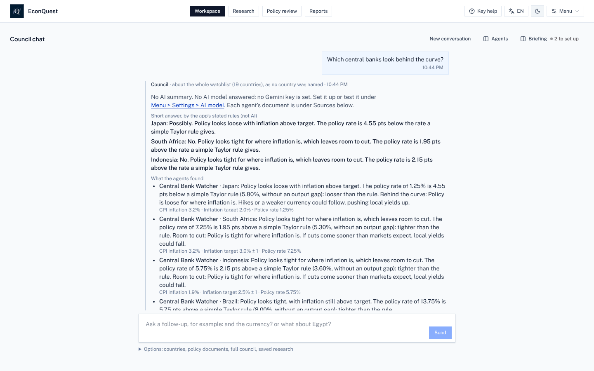
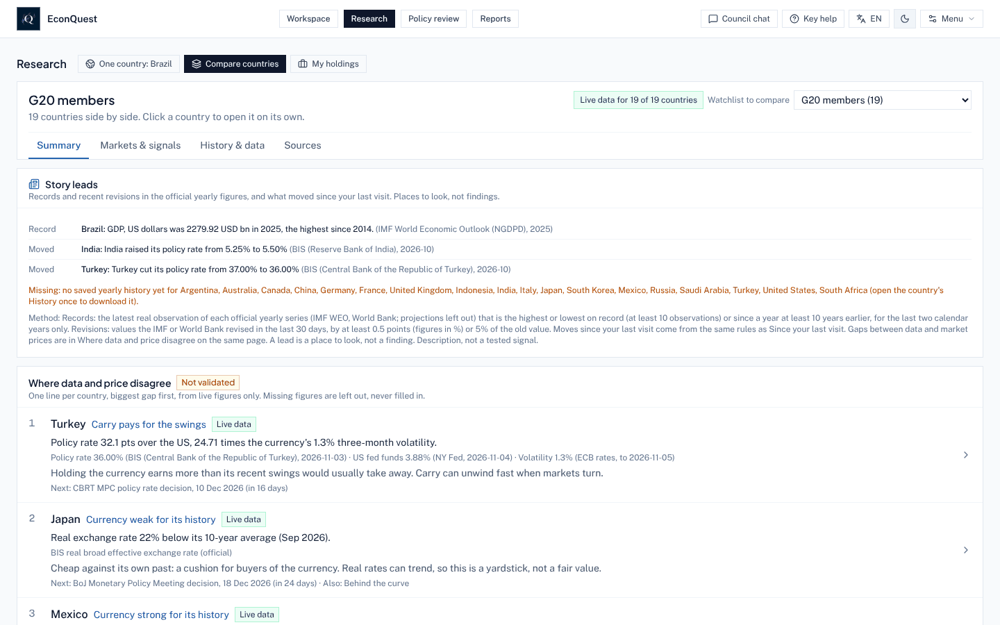
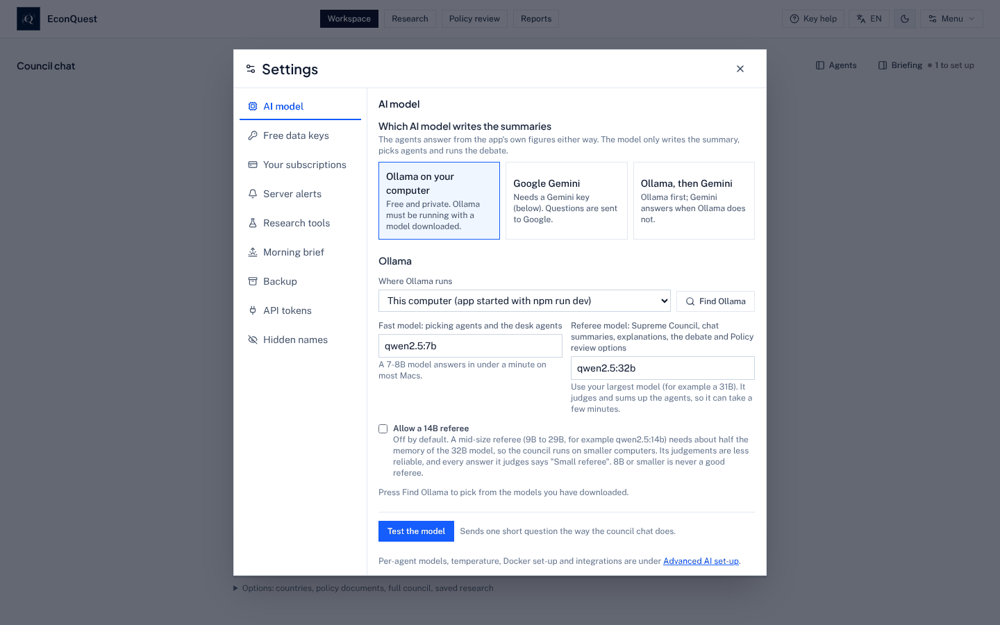
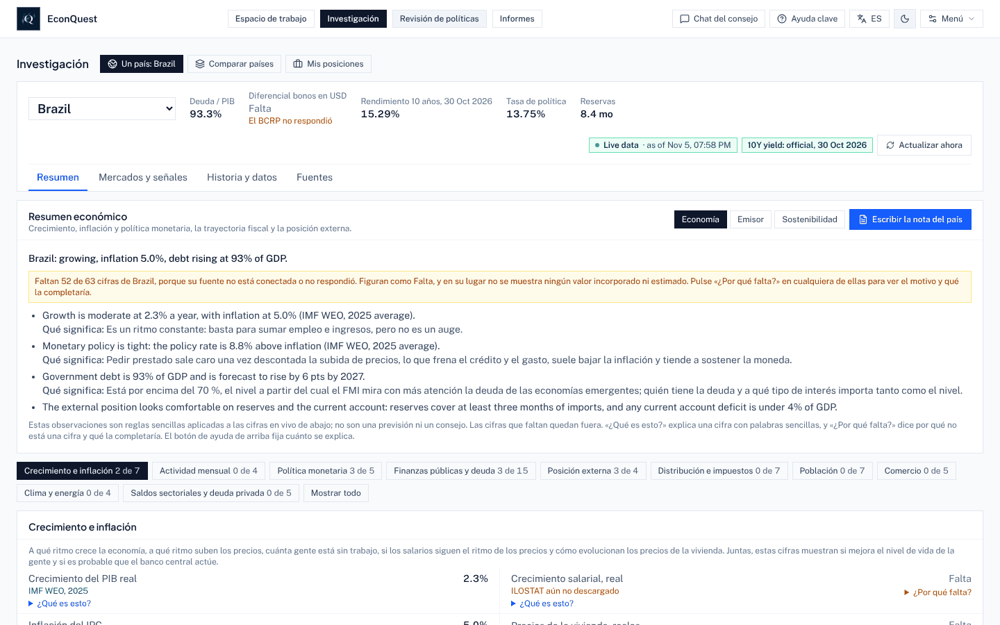

# EconQuest Sovereign Council Terminal

[English](./README.md) · **Español** · [Français](./README.fr.md) · [Português](./README.pt.md)

EconQuest es un terminal de investigación gratuito y de código abierto para entender la economía de los
países, las finanzas de sus gobiernos y los riesgos que los rodean. Reúne cifras de fuentes públicas
gratuitas (el FMI, el Banco Mundial, el Banco de Pagos Internacionales, bancos centrales, institutos de
estadística y otros), muestra cada una con su origen y su fecha, y le permite hacer preguntas a un
consejo de agentes de IA especializados que responden solo con esas cifras.

Funciona en su propio ordenador. No hay un sitio web de EconQuest en el que registrarse ni una cuenta
con nosotros: sus claves, su investigación guardada y las preguntas que hace se quedan con usted. Toda
la aplicación está en **inglés, español, francés y portugués de Brasil**.


*Investigación > Un país, pestaña Resumen (captura en inglés). Cada cifra indica su fuente y su fecha; una
cifra que ninguna fuente ha aportado aparece como «Falta», con el motivo.*

Este es un programa de investigación y enseñanza, no asesoramiento de inversión.

Esta es una traducción del [README en inglés](./README.md), que es la versión de referencia. Los detalles
de cada función están en [Funciones y detalles](./docs/FEATURES.es.md); las notas para desarrolladores
solo están en inglés.

## Contenido

- [Por qué existe](#por-qué-existe)
- [Por qué usar EconQuest](#por-qué-usar-econquest)
- [Gratuito, abierto e independiente](#gratuito-abierto-e-independiente)
- [La regla: solo cifras reales](#la-regla-solo-cifras-reales)
- [Qué puede hacer con él](#qué-puede-hacer-con-él)
- [Guía con capturas de pantalla](#guía-con-capturas-de-pantalla)
- [Inicio rápido](#inicio-rápido)
- [Documentación](#documentación)
- [Licencia](#licencia)

---

## Por qué existe

En palabras del responsable del proyecto:

> "In 2026 we feel and see the economic effects of poor economic policies. I wanted to see if I could
> make a tool that could assist people in learning and understanding economics, finding multiple and
> optimal financial and policy options, and attempting to bring the best tools to the most
> underserved countries."
>
> (En 2026 sentimos y vemos los efectos económicos de las malas políticas económicas. Quería ver si
> podía crear una herramienta que ayudara a las personas a aprender y entender la economía, a encontrar
> opciones financieras y de política múltiples y óptimas, y a intentar llevar las mejores herramientas a
> los países con menos recursos.)

Los terminales económicos profesionales cuestan decenas de miles de dólares al año, lo que los deja
fuera del alcance de la mayoría de estudiantes, periodistas, ministerios de finanzas y bancos centrales
pequeños, y analistas de los países que más necesitan una política económica cuidadosa. EconQuest quiere
ofrecer buena parte de esa misma investigación, con datos oficiales gratuitos y con cada método por
escrito para que cualquiera pueda comprobarlo.

**Para quién es:** analistas de deuda y crédito soberano de mercados emergentes, economistas de bancos
centrales, ministerios de finanzas e instituciones internacionales, inversores macro y de divisas,
equipos de riesgo país, docentes y estudiantes, periodistas y cualquier persona que quiera entender qué
le pasa a una economía y por qué.

---

## Por qué usar EconQuest

- **Cada número se puede rastrear.** Cada cifra indica su fuente y su fecha; un hueco aparece como
  «Falta», nunca como una estimación.
- **Pruebas en público, también las fallidas.** Cada regla de señal y de previsión se escribe antes de
  probarla, y cada resultado queda registrado ([historial](docs/TRACK_RECORD.md), en inglés).
- **La IA explica, nunca aporta cifras.** Las respuestas se comprueban con los números de la propia
  aplicación y llevan su etiqueta. Todas las cifras, gráficos y pruebas funcionan sin ninguna IA.
- **Pensado también para los países de menores ingresos.** Remesas, ayuda, precios de los alimentos,
  desastres y los 59 países de la lista de bajos ingresos del FMI y el Banco Mundial, junto al G20.
- **De la pregunta a la nota de política.** Una revisión de políticas va del problema a las opciones,
  los precedentes, un memorando y una nota de una página para quien no es economista.
- **Suya, en su ordenador.** Sin cuenta, sin pagos, sin seguimiento. Sus claves y su investigación se
  quedan con usted.
- **Cuatro idiomas, cuatro niveles de ayuda.** Inglés, español, francés y portugués de Brasil, con
  ayuda en lenguaje claro.

**Lo que no hace.** No tiene datos de mercado de pago, salvo que usted use su propia cuenta; las
calificaciones crediticias y el consenso de analistas aparecen como «Falta». Es software de
investigación y enseñanza, no asesoramiento de inversión.

---

## Gratuito, abierto e independiente

- **La aplicación es gratuita** en todos los ordenadores y lo seguirá siendo. No hay planes de pago ni
  publicidad.
- **Sin seguimiento.** La aplicación no envía nada sobre usted al proyecto: ni recuentos de uso, ni
  informes de fallos, ni analítica. Qué sale de su computadora, y cuándo, está en
  [docs/PRIVACY.md](./docs/PRIVACY.md) (en inglés).
- **Código abierto.** El código está bajo la licencia Apache 2.0 y la documentación, las notas de método
  y el contenido didáctico bajo CC BY 4.0: cualquiera puede usarlos, modificarlos y compartirlos.
- **Donaciones, solo a través del sitio web del proyecto**, mediante GitHub Sponsors y Open Source
  Collective, cuando el proyecto tenga un anfitrión fiscal. Hasta entonces no acepta donaciones
  ([GOVERNANCE.md](./GOVERNANCE.md)). Los donantes no deciden sobre métodos, resultados ni países.
- **Sede pública:** [github.com/e-conquest/econquest](https://github.com/e-conquest/econquest), con la
  aplicación lista para usar en `ghcr.io/e-conquest/econquest`.

---

## La regla: solo cifras reales

Una cifra aparece solo cuando la ha aportado una fuente en vivo, una serie oficial o un archivo suyo.
Todo lo demás aparece como **Falta**, con el motivo («Necesita configuración», «La fuente no respondió»,
«Aún no hay fuente»). No hay cifras incorporadas, de muestra ni estimadas por IA en ninguna parte de la
aplicación. Si la aplicación no conoce una cifra, lo dice en lugar de adivinarla.

Los datos de pago (por ejemplo precios de CDS, LSEG, EPFR, calificaciones crediticias o consenso de
analistas) solo se usan desde su propia cuenta o su propio archivo, tras un interruptor en Configuración,
y nunca se transmiten en descargas ni copias compartidas. Si usted ya paga Macrobond, Trading Economics
o EODHD, puede conectarlo con su propia clave y elegir las series que quiera; esas cifras se quedan en
su ordenador.

---

## Qué puede hacer con él

- **Hacer una pregunta con palabras sencillas** en el Espacio de trabajo, en el Chat del consejo.
  Agentes especializados responden con las cifras de la aplicación, cada uno con su fuente, y las
  preguntas de «qué pasaría si» reciben una respuesta en ocho partes.
- **Estudiar un país** en Investigación > Un país: un resumen claro, mercados y señales, gráficos de
  muchos años, previsiones con márgenes y herramientas de deuda, inflación, moneda, clima y desastres.
- **Comparar países** uno al lado del otro, empezando por el G20 o por los 15 mayores países de
  ingresos bajos.
- **Poner a prueba una decisión de política** en Revisión de políticas, desde el problema hasta un
  memorando y una nota de una página para quien no es economista, y vea cómo les fue a los países
  después de hacer el mismo tipo de cambio.
- **Escribir un informe** en Markdown o PDF, con cada fuente y fecha.
- **Aprender sobre la marcha** con cuatro niveles de ayuda, un glosario en lenguaje claro y cinco
  ejemplos guiados.
- **Usar las cifras en R, Python, Stata o Excel**, o conectar otro programa a la aplicación.

Cada cifra, gráfico y prueba funciona sin ningún modelo de IA. La lista completa de tareas y
herramientas está en **[Funciones y detalles](docs/FEATURES.es.md#qué-puede-hacer-con-él)**.

---

## Guía con capturas de pantalla

La guía completa, con pasos numerados para cada tarea, está en **[docs/GUIDE.es.md](./docs/GUIDE.es.md)**.
Cubre: el primer inicio, preguntar al consejo (también qué haría un cambio), estudiar un país y sus
herramientas, comparar países, hacer una revisión de
políticas y un informe, elegir un modelo de IA, las herramientas y las comprobaciones de datos, el idioma
y los niveles de ayuda, las herramientas de clima y seguros, el uso en el teléfono y cómo probar los Retos.

| | |
| --- | --- |
|  **Pregunte al consejo.** La respuesta llega primero, cada línea con sus cifras; el panel de agentes muestra qué agentes respondieron y por qué. |  **Lea la historia.** Cada gráfico dice qué mide, de quién es la cifra y cómo leerlo. |
|  **Compare países.** Pistas y discrepancias entre mercados y datos. |  **Revise una política.** Del problema al memorando. |
|  **Elija un modelo de IA.** Modelo rápido para las mesas, modelo grande para el árbitro. |  **Cambie de idioma.** Botón EN / ES / FR / PT en la cabecera. |

Las capturas se tomaron el 24 de noviembre de 2026 (dos de la guía, Retos y Pares, son del 13 de
noviembre) de una compilación local de la rama principal, que
reproducía respuestas de las fuentes grabadas el 5 de noviembre de 2026, solo de las fuentes cuyos
términos permiten transmitir los datos. Por eso muchas cifras aparecen como «Falta»; en un ordenador que
llega a las fuentes se rellenan más. La mayoría están en inglés; la última muestra la aplicación en
español.

---

## Inicio rápido

> **Aún no es público.** La copia pública en github.com/e-conquest/econquest y la aplicación lista
> para usar en `ghcr.io/e-conquest/econquest` todavía no se han publicado, así que los enlaces de
> descarga y la dirección de `git clone` de abajo no funcionan hasta entonces. Esta nota se quitará el
> día en que se publiquen. Mientras tanto, quienes prueban la aplicación la instalan desde el código en
> github.com/smcarus/econquest: los pasos están en [docs/TESTING.md](docs/TESTING.md) (en inglés).

**¿Es nuevo en esto?** [docs/INSTALL.md](docs/INSTALL.md) (en inglés) es una guía paso a paso: instale
Docker Desktop, descargue un archivo y ejecute la aplicación lista para usar. No hay que compilar ni
programar.

**Aplicación lista para usar.** Instale [Docker Desktop](https://www.docker.com/products/docker-desktop/) y
póngalo en marcha. Después abra una terminal y escriba estas líneas.

En un Mac o en Linux, en la aplicación **Terminal**:

```sh
mkdir econquest
cd econquest
curl -fsSLO https://raw.githubusercontent.com/e-conquest/econquest/main/deploy/quick-start/compose.yml
docker compose up -d
```

En Windows, en **PowerShell** (búsquelo en el menú Inicio):

```powershell
mkdir econquest
cd econquest
Invoke-WebRequest -Uri https://raw.githubusercontent.com/e-conquest/econquest/main/deploy/quick-start/compose.yml -OutFile compose.yml
docker compose up -d
```

Después abra **http://localhost:3737** en su navegador. Necesita macOS, Windows 10 u 11, o Linux de
64 bits, 8 GB de memoria (4 GB en modo ligero) y 5 GB de disco libre; todos los tamaños están en
[Funciones y detalles](docs/FEATURES.es.md#requisitos-y-tamaños).

**Portátil modesto** (4 GB de memoria o poco disco): ponga `LIGHT_MODE=on` en un archivo `.env` junto a
`compose.yml` antes de arrancar: en la terminal, `echo LIGHT_MODE=on > .env` en un Mac o en Linux, o
`Set-Content .env LIGHT_MODE=on` en PowerShell de Windows. El modo ligero no ejecuta ningún modelo de IA en su ordenador (el
consejo usa su propia clave de Gemini o queda desactivado), omite los 3,4 GB de archivos de noticias de
GDELT y descarga solo los países de su lista. Desde el código: `scripts/start-mac.sh --light`, o
`scripts\start-windows-light.bat` en Windows.

**Desde el código** (Node.js 20.19 o posterior, o 22.12 o posterior):

```sh
git clone https://github.com/e-conquest/econquest.git
cd econquest
npm install
npm run go           # actualiza, instala, arranca la aplicación y empieza la descarga diaria de datos
```

`npm run go` trae el código más reciente, instala los paquetes, descarga los modelos de IA si usa
Ollama, reconstruye y arranca la aplicación Docker en http://localhost:3737 y la de desarrollo en
http://localhost:3000, y empieza la descarga diaria de datos en segundo plano. En un Mac puede hacer
doble clic en `econquest-mac.command` (Windows: `scripts/start-windows.bat`).

### Primer inicio

Bajo la bienvenida del chat, una tarjeta breve, **¿Es nuevo aquí? Tres pasos**, indica por dónde
empezar (hacer una pregunta, abrir Investigación y, si quiere, añadir un modelo de IA) hasta que pulse
**Entendido**. Después:

1. **Vea qué fuentes responden:** Menú > Herramientas > Conexiones de datos (o `npm run check:data`).
2. **Añada una clave gratuita de FRED** en Menú > Configuración > Claves de datos gratuitos. Rellena los
   rendimientos oficiales a 10 años de varios países.
3. **Elija un modelo de IA** en Menú > Configuración > Modelo de IA ([Modelos de IA](docs/FEATURES.es.md#modelos-de-ia-cuál-usar-tamaños-y-ajustes)).
4. **Elija sus países** con Editar en la tarjeta de la lista de seguimiento.
5. **Elija idioma y nivel de ayuda** con los botones de la cabecera.

Las claves se guardan en `data/local/settings.json` (nunca en git, ni en copias de seguridad, ni en el
registro de auditoría).

---

## Documentación

- [docs/FEATURES.es.md](./docs/FEATURES.es.md): todo lo que hace la aplicación, en detalle, en español
- [docs/GUIDE.es.md](./docs/GUIDE.es.md): guía paso a paso con capturas, en español
- En inglés: [INSTALL.md](./docs/INSTALL.md) (instalación), [USER_MANUAL.md](./docs/USER_MANUAL.md)
  (manual), [GLOSSARY.md](./docs/GLOSSARY.md) (glosario; también dentro de la aplicación en español),
  [METHODOLOGY.md](./docs/METHODOLOGY.md), [HOW_IT_WORKS.md](./docs/HOW_IT_WORKS.md), [METHODS.md](./docs/METHODS.md),
  [TRACK_RECORD.md](./docs/TRACK_RECORD.md), [DATA_SOURCES.md](./docs/DATA_SOURCES.md),
  [DATA_LICENCES.md](./docs/DATA_LICENCES.md), [DATA_API.md](./docs/DATA_API.md), [DEPLOYMENT.md](./docs/DEPLOYMENT.md),
  [POLICY_REVIEW.md](./docs/POLICY_REVIEW.md), [QUESTS.md](./docs/QUESTS.md),
  [ROADMAP.md](./docs/ROADMAP.md), [HOME_SERVER.md](./docs/HOME_SERVER.md),
  [PRIVACY.md](./docs/PRIVACY.md), [TESTING.md](./docs/TESTING.md), [ACCESSIBILITY.md](./docs/ACCESSIBILITY.md), [SECURITY.md](./docs/SECURITY.md), [ARCHITECTURE.md](./docs/ARCHITECTURE.md), [CONTRIBUTING.md](./CONTRIBUTING.md)
- Desarrolladores: [For developers, en Funciones y detalles en inglés](./docs/FEATURES.md#for-developers)

---

## Licencia

Código: [Apache License 2.0](./LICENSE). Documentación, notas de método, registros de validación,
capturas y contenido de los Retos: [CC BY 4.0](./LICENSE-docs.md). Las cifras de fuentes externas
conservan sus propios términos ([docs/DATA_LICENCES.md](./docs/DATA_LICENCES.md)). Las contribuciones se
firman bajo el Developer Certificate of Origin (DCO). Para citar el programa, use
[CITATION.cff](./CITATION.cff).
