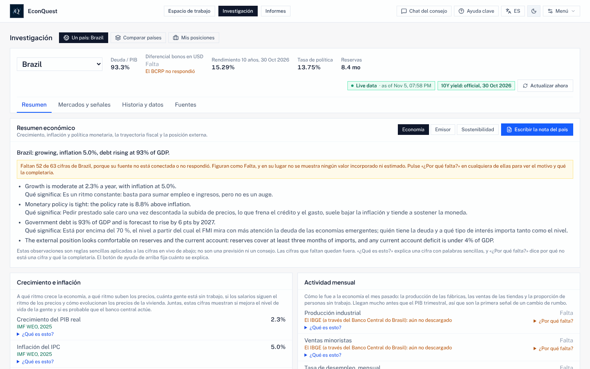

# EconQuest Sovereign Council Terminal

[English](./README.md) · **Español** · [Français](./README.fr.md) · [Português](./README.pt.md)

EconQuest es un terminal de investigación gratuito y de código abierto para entender la economía de los
países, las finanzas de sus gobiernos y los riesgos que los rodean. Reúne cifras de fuentes públicas
gratuitas (el FMI, el Banco Mundial, el Banco de Pagos Internacionales, bancos centrales, institutos de
estadística y otros), muestra cada una con su origen y su fecha, y le permite hacer preguntas a un
consejo de agentes de IA especializados que responden solo con esas cifras.

Funciona en su propio ordenador. No hay un sitio web de EconQuest en el que registrarse ni una cuenta
con nosotros: sus claves, su investigación guardada y las preguntas que hace se quedan con usted. Toda
la aplicación está en **inglés, español, francés y portugués de Brasil**.


*Investigación > Un país, pestaña Resumen (captura en inglés). Cada cifra indica su fuente y su fecha; una
cifra que ninguna fuente ha aportado aparece como «Falta», con el motivo.*

Este es un programa de investigación y enseñanza, no asesoramiento de inversión.

Esta es una traducción del [README en inglés](./README.md), que es la versión de referencia. La sección
para desarrolladores solo está en inglés.

## Contenido

- [Por qué existe](#por-qué-existe)
- [Gratuito, abierto e independiente](#gratuito-abierto-e-independiente)
- [La regla: solo cifras reales](#la-regla-solo-cifras-reales)
- [Qué puede hacer con él](#qué-puede-hacer-con-él)
- [Guía con capturas de pantalla](#guía-con-capturas-de-pantalla)
- [Inicio rápido](#inicio-rápido)
- [Requisitos y tamaños](#requisitos-y-tamaños)
- [Modelos de IA: cuál usar, tamaños y ajustes](#modelos-de-ia-cuál-usar-tamaños-y-ajustes)
- [Idiomas](#idiomas)
- [Retos (Quests): soluciones económicas entre muchos](#retos-quests-soluciones-económicas-entre-muchos)
- [De dónde vienen los datos](#de-dónde-vienen-los-datos)
- [Cómo puede comprobarlo](#cómo-puede-comprobarlo)
- [Hoja de ruta](#hoja-de-ruta)
- [Documentación](#documentación)
- [Licencia](#licencia)

---

## Por qué existe

En palabras del responsable del proyecto:

> "In 2026 we feel and see the economic effects of poor economic policies. I wanted to see if I could
> make a tool that could assist people in learning and understanding economics, finding multiple and
> optimal financial and policy options, and attempting to bring the best tools to the most
> underserved countries."
>
> (En 2026 sentimos y vemos los efectos económicos de las malas políticas económicas. Quería ver si
> podía crear una herramienta que ayudara a las personas a aprender y entender la economía, a encontrar
> opciones financieras y de política múltiples y óptimas, y a intentar llevar las mejores herramientas a
> los países con menos recursos.)

Los terminales económicos profesionales cuestan decenas de miles de dólares al año, lo que los deja
fuera del alcance de la mayoría de estudiantes, periodistas, ministerios de finanzas y bancos centrales
pequeños, y analistas de los países que más necesitan una política económica cuidadosa. EconQuest quiere
ofrecer buena parte de esa misma investigación, con datos oficiales gratuitos y con cada método por
escrito para que cualquiera pueda comprobarlo.

**Para quién es:** analistas de deuda y crédito soberano de mercados emergentes, economistas de bancos
centrales, ministerios de finanzas e instituciones internacionales, inversores macro y de divisas,
equipos de riesgo país, docentes y estudiantes, periodistas y cualquier persona que quiera entender qué
le pasa a una economía y por qué.

## Gratuito, abierto e independiente

- **La aplicación es gratuita** en todos los ordenadores y lo seguirá siendo. No hay planes de pago ni
  publicidad.
- **Código abierto.** El código está bajo la licencia Apache 2.0 y la documentación, las notas de método
  y el contenido didáctico bajo CC BY 4.0: cualquiera puede usarlos, modificarlos y compartirlos.
- **Donaciones, solo a través del sitio web del proyecto**, mediante GitHub Sponsors y Open Source
  Collective, cuando el proyecto tenga un anfitrión fiscal. Hasta entonces no acepta donaciones
  ([GOVERNANCE.md](./GOVERNANCE.md)). Los donantes no deciden sobre métodos, resultados ni países.
- **Sede pública:** [github.com/e-conquest/econquest](https://github.com/e-conquest/econquest), con la
  aplicación lista para usar en `ghcr.io/e-conquest/econquest`.

---

## La regla: solo cifras reales

Una cifra aparece solo cuando la ha aportado una fuente en vivo, una serie oficial o un archivo suyo.
Todo lo demás aparece como **Falta**, con el motivo («Necesita configuración», «La fuente no respondió»,
«Aún no hay fuente»). No hay cifras incorporadas, de muestra ni estimadas por IA en ninguna parte de la
aplicación. Si la aplicación no conoce una cifra, lo dice en lugar de adivinarla.

Los datos de pago (por ejemplo precios de CDS, LSEG, EPFR, calificaciones crediticias o consenso de
analistas) solo se usan desde su propia cuenta o su propio archivo, tras un interruptor en Configuración,
y nunca se transmiten en descargas ni copias compartidas.

---

## Qué puede hacer con él

| Tarea | Dónde | Qué obtiene |
| --- | --- | --- |
| Hacer una pregunta con palabras sencillas | **Espacio de trabajo** (Chat del consejo) | Agentes especializados responden con las cifras de la aplicación, cada uno con su fuente; con un modelo de IA, un agente de síntesis escribe un breve resumen que solo puede citar sus cifras, y un control numérico señala cualquier cifra que no pueda rastrear |
| Estudiar un país | **Investigación > Un país** | Resumen, Mercados y señales, Historia y datos, y Fuentes: gráficos de muchos años, estimaciones del presente y previsiones con rangos, brecha del producto, sostenibilidad de la deuda, suficiencia de reservas, reglas de política, alerta temprana de crisis, curva de rendimientos, factores de la inflación, contabilidad del crecimiento, previsiones del FMI por edición y vistas «a una fecha pasada». Para países de menores ingresos: remesas, ayuda recibida, inclusión financiera, precios de materias primas y términos de intercambio, precios de los alimentos y seguridad alimentaria, y desastres naturales |
| Comparar países | **Investigación > Comparar países** | Su lista de seguimiento lado a lado (los 19 países miembros del G20 al empezar), pistas para investigar y dónde discrepan los precios de mercado y los datos |
| Seguir sus posiciones | **Investigación > Mis posiciones** | Una lista de bonos o posiciones que usted carga, frente a los riesgos y las señales |
| Evaluar una decisión de política | **Informes > Nueva revisión de políticas** | Un expediente paso a paso: plantear el problema, diagnosticar, ordenar opciones, revisar la evidencia y los precedentes, redactar un memorando de recomendación y un resumen de una página para no economistas, y después seguir lo que ocurrió. Compare el diagnóstico con hasta seis países pares, reciba un aviso en la página de inicio cuando una cifra vigilada cruce su umbral, y vea qué cambió al revisar de nuevo la misma política |
| Probar un «¿y si?» fiscal | **Historia y datos**, o desde el Chat del consejo | Cambie el gasto público o los impuestos y vea el efecto probable en el crecimiento y la deuda, con multiplicadores y elasticidades publicados y un rango |
| Escribir un informe | **Informes** | Notas de país y de emisor, evaluaciones de sostenibilidad, revisiones de cartera e informes del consejo, en Markdown o PDF con fuentes y fechas |
| Aprender sobre la marcha | Botones de la cabecera, **Menú > Manual de usuario**, **Menú > Ejemplos resueltos** | Tres niveles de ayuda, un glosario en lenguaje sencillo, cuatro casos resueltos, episodios didácticos y modo examen |
| Usar sus propios datos y pruebas | **Menú > Sus datos**, **Menú > Modelos y validación** | Cargue sus propias series CSV; registre su propia prueba de señal o modelo con las mismas reglas estrictas que las de la aplicación |
| Usar las cifras en R, Python o Stata | [docs/DATA_API.md](./docs/DATA_API.md) (en inglés) | Las mismas series, paneles y tablas que muestran las pantallas, con fuente y fecha en cada valor |
| Conectar un sistema de cartera | **Menú > Configuración > Tokens de API**, [docs/DATA_API.md](./docs/DATA_API.md) (en inglés) | Otro programa lee resúmenes de país y eventos, envía sus posiciones y ejecuta choques y repeticiones de crisis pasadas sobre su cartera, cada uno con un token limitado a lo que usted marque. Los países y valores de la lista de **Nombres ocultos** no aparecen en ninguna parte |

El **Chat del consejo** es el centro de la aplicación. Los agentes son Banco Central, Fiscal y Deuda,
Política y Acontecimientos, Valor Relativo, Divisas, Contagio Global, Calendario, Momento y Finanzas
Conductuales, más un agente de Documentos que lee los documentos de política que usted sube. **Ejecutar
el consejo completo** envía un país a nueve agentes especializados en tres mesas (geopolítica, crédito
soberano y economía en general); debaten, y la aplicación espera su aprobación antes de escribir el
informe final. Un modelo de IA más grande actúa como **árbitro** y juzga si cada respuesta se ciñe a las
cifras.

Por ahora los agentes entienden mejor las preguntas en inglés; la aplicación lo indica junto al cuadro
de preguntas.

**Todas las cifras, gráficos y pruebas funcionan sin ningún modelo de IA.** La IA solo hace falta para el
resumen del chat, los debates y las explicaciones en lenguaje sencillo, y cada respuesta que escribe se
marca como escrita por IA.

---

## Guía con capturas de pantalla

La guía completa, con pasos numerados para cada tarea, está en **[docs/GUIDE.es.md](./docs/GUIDE.es.md)**.
Cubre: el primer inicio, preguntar al consejo, estudiar un país, comparar países, hacer una revisión de
políticas y un informe, elegir un modelo de IA, las herramientas y las comprobaciones de datos, el idioma
y los niveles de ayuda, el uso en el teléfono y cómo probar los Retos.

| | |
| --- | --- |
|  **Pregunte al consejo.** El panel de agentes muestra qué agentes respondieron y por qué. |  **Lea la historia.** Cada gráfico dice qué mide, de quién es la cifra y cómo leerlo. |
|  **Compare países.** Pistas y discrepancias entre mercados y datos. |  **Revise una política.** Del problema al memorando. |
|  **Elija un modelo de IA.** Modelo rápido para las mesas, modelo grande para el árbitro. |  **Cambie de idioma.** Botón EN / ES / FR / PT en la cabecera. |

Las capturas se tomaron el 13 de noviembre de 2026 de una compilación local de la rama principal, que
reproducía respuestas de las fuentes grabadas el 5 de noviembre de 2026, solo de las fuentes cuyos
términos permiten transmitir los datos. Por eso muchas cifras aparecen como «Falta»; en un ordenador que
llega a las fuentes se rellenan más. La mayoría están en inglés; la última muestra la aplicación en
español.

---

## Inicio rápido

**¿Es nuevo en esto?** [docs/INSTALL.md](docs/INSTALL.md) (en inglés) es una guía paso a paso: instale
Docker Desktop, descargue un archivo y ejecute la aplicación lista para usar. No hay que compilar ni
programar.

**Aplicación lista para usar** (con Docker Desktop en marcha):

```sh
mkdir econquest && cd econquest
curl -fsSLO https://raw.githubusercontent.com/e-conquest/econquest/main/deploy/quick-start/compose.yml
docker compose up -d          # después abra http://localhost:3737
```

**Portátil modesto** (4 GB de memoria o poco disco): ponga `LIGHT_MODE=on` en un archivo `.env` junto a
`compose.yml` antes de arrancar. El modo ligero no ejecuta ningún modelo de IA en su ordenador (el
consejo usa su propia clave de Gemini o queda desactivado), omite los 3,4 GB de archivos de noticias de
GDELT y descarga solo los países de su lista. Desde el código: `scripts/start-mac.sh --light`, o
`scripts\start-windows-light.bat` en Windows.

**Desde el código** (Node.js 20.19 o posterior, o 22.12 o posterior):

```sh
git clone https://github.com/e-conquest/econquest.git
cd econquest
npm install
npm run go           # actualiza, instala, arranca la aplicación y empieza la descarga diaria de datos
```

`npm run go` trae el código más reciente, instala los paquetes, descarga los modelos de IA si usa
Ollama, reconstruye y arranca la aplicación Docker en http://localhost:3737 y la de desarrollo en
http://localhost:3000, y empieza la descarga diaria de datos en segundo plano. En un Mac puede hacer
doble clic en `econquest-mac.command` (Windows: `scripts/start-windows.bat`).

### Primer inicio

1. **Vea qué fuentes responden:** Menú > Herramientas > Conexiones de datos (o `npm run check:data`).
2. **Añada una clave gratuita de FRED** en Menú > Configuración > Claves de datos gratuitos. Rellena los
   rendimientos oficiales a 10 años de varios países.
3. **Elija un modelo de IA** en Menú > Configuración > Modelo de IA (más abajo).
4. **Elija sus países** con Editar en la tarjeta de la lista de seguimiento.
5. **Elija idioma y nivel de ayuda** con los botones de la cabecera.

Las claves se guardan en `data/local/settings.json` (nunca en git, ni en copias de seguridad, ni en el
registro de auditoría).

---

## Requisitos y tamaños

| Parte | Mínimo | Recomendado |
| --- | --- | --- |
| Sistema operativo | macOS (las tres versiones más recientes), Windows 10 u 11 (64 bits, WSL 2 para Docker Desktop) o Linux de 64 bits | Lo mismo; Apple Silicon, Intel y AMD funcionan |
| Memoria | 8 GB (4 GB en modo ligero, un objetivo aún no medido) | 16 GB; 32 GB para ejecutar el árbitro grande en el mismo ordenador |
| Disco libre | 5 GB | 10 GB, más espacio para los modelos de IA |
| Internet | Cualquier conexión | Una sin un límite mensual de datos pequeño |
| Node.js (solo desde el código) | 20.19 o posterior, o 22.12 o posterior | 22 |

### Tamaños de descarga

Cada cifra indica cómo se obtuvo. «Medido» significa medido en la fecha indicada; «estimación» indica
el método. Las mediciones del 13 de noviembre de 2026 son de la rama principal hasta la solicitud #510.

| Qué | Tamaño | Cómo se obtuvo |
| --- | --- | --- |
| Código fuente (`git clone`) | 70 MB (29 MB de archivos y 41 MB de historial) | Medido, clon nuevo, 13 de noviembre de 2026 |
| Aplicación lista para usar (imagen Docker) | Unos 170 MB de descarga; 798 MB descomprimida | Medido: imagen construida con el Dockerfile del repositorio el 13 de noviembre de 2026 (798 MB descomprimida, 170 MB comprimida con gzip). La descarga del registro se comprime igual, así que el tamaño será parecido |
| Paquetes instalados, desde el código (`npm install`) | 465 MB | Medido, 13 de noviembre de 2026 |
| Aplicación web compilada | 6,7 MB en total; 415 KB comprimidos al arrancar | Medido con `npm run size:check`, 13 de noviembre de 2026 |
| Cada idioma adicional | Unos 0,7 MB (unos 220 KB comprimidos), solo si se elige | Medido en la compilación, 13 de noviembre de 2026 |
| Primera descarga completa de datos | Unos 3,6 a 3,8 GB, sobre todo archivos de noticias de GDELT | Estimación: GDELT unos 3,4 GB por 8 semanas (según los tamaños publicados por GDELT), ediciones pasadas del FMI unos 100 MB (medido), el resto como la descarga diaria |
| Primera descarga en modo ligero | Objetivo: bastante menos de 1 GB | Aún no medido; pendiente de una prueba en el Mac del desarrollador antes de la publicación |
| Descarga diaria de datos | Aproximadamente 150 a 200 MB (4,5 a 6 GB al mes) | Estimación a partir de respuestas grabadas y tamaños de archivo. La descarga diaria ya registra lo que baja; la cifra medida tras una semana (`npm run go -- status` en el Mac del desarrollador) sustituirá esta estimación |
| Modelos de IA con Ollama (opcional) | qwen2.5:7b 4,7 GB; qwen2.5:14b 9 GB; qwen2.5:32b 20 GB | Tamaños publicados por Ollama |
| Historia larga de GDELT (opcional) | Unos 25 GB desde 2016 (35 GB desde 1979); unos 5 MB se guardan en disco | Tamaños publicados por GDELT |

### Espacio ocupado en funcionamiento

| Configuración | Disco aproximado | Composición |
| --- | --- | --- |
| Modo ligero, sin IA local | Objetivo 2 GB | Aún no medido |
| Aplicación lista para usar, sin IA local | Alrededor de 1 GB, crece unos 40 MB al año | Imagen 0,8 GB (medido) más la carpeta `data/`, unos 150 MB tras los primeros días (medido en el Mac del desarrollador el 9 de noviembre de 2026, 22 países) |
| Con un árbitro de 14B | Alrededor de 15 GB | Lo anterior más qwen2.5:7b y qwen2.5:14b |
| Con toda la IA local | Alrededor de 26 GB | Lo anterior más qwen2.5:7b y qwen2.5:32b |
| Desde el código en lugar de la imagen | Sume unos 0,5 GB | Código e historial 70 MB, paquetes 465 MB, compilación 7 MB (medido) |

Docker Desktop necesita además unos GB (consulte docker.com). Para ver el tamaño real en su ordenador,
ejecute `du -sh data data/*` en la carpeta de EconQuest o abra Menú > Datos sin conexión.

---

## Modelos de IA: cuál usar, tamaños y ajustes

La IA escribe el resumen del consejo, dirige el debate, elige los agentes para una pregunta y explica las
cifras. Nunca aporta una cifra: cada número viene de una fuente, una serie oficial o su archivo. Elija el
proveedor en Menú > Configuración > Modelo de IA.

| Proveedor | Coste | Privacidad | Notas |
| --- | --- | --- | --- |
| **Sin IA** | Gratis | Solo salen las peticiones de cifras públicas | Todo funciona; los agentes responden sin resumen escrito |
| **Ollama** en su ordenador | Gratis | Todo se queda en su ordenador | Necesita la [aplicación Ollama](https://ollama.com/download) y memoria suficiente |
| **Google Gemini** | Gratis hasta los límites diarios de Google; después se factura a su propia clave | Las preguntas y sus cifras van a Google | Necesita una clave de API de Gemini; el modelo por defecto es `gemini-3.8-flash`, se cambia con `GEMINI_MODEL` en `.env` |
| **Ollama y luego Gemini** | Como arriba | Como arriba | Primero Ollama; Gemini responde cuando Ollama no lo hace |
| Servidor local compatible con OpenAI (como LM Studio) | Gratis | Se queda en su ordenador | En Configuración avanzada de IA; usted indica la dirección y el modelo |

### Dos papeles: modelo rápido y árbitro

| Papel | Qué hace | Por defecto | Regla |
| --- | --- | --- | --- |
| **Modelo rápido** | Elige los agentes y escribe las respuestas de las mesas | `qwen2.5:7b` (`OLLAMA_QUICK_MODEL`) | Un modelo de 7 a 8B responde en menos de un minuto en la mayoría de los Mac |
| **Árbitro** | Paso final del consejo completo, resúmenes y explicaciones del chat, debate de agentes, paso de Opciones de la revisión de políticas y textos de apertura de los debates de Retos | `qwen2.5:32b` (`OLLAMA_DEEP_MODEL`) | 30B o más cuenta como árbitro completo. Un modelo de 8B o menos nunca se usa como árbitro. Un árbitro de 14B solo se permite si activa **Permitir un árbitro de 14B** (desactivado por defecto), y cada respuesta que juzga indica «Árbitro pequeño» |

### Qué configuración para qué ordenador

| Su ordenador | Configuración recomendada |
| --- | --- |
| Portátil de 4 GB | Modo ligero con una clave de Google Gemini, o sin IA |
| 8 GB | Google Gemini, o sin IA. Un modelo local deja muy poca memoria para la aplicación, Docker y el navegador |
| 16 GB | Ollama `qwen2.5:7b` para las mesas, con «Ollama y luego Gemini» para que Gemini haga de árbitro; o active un árbitro `qwen2.5:14b`, marcado como «Árbitro pequeño» (necesita la mitad de memoria que el de 32B) |
| 32 GB o más, o una tarjeta gráfica de 24 GB | Todo local: `qwen2.5:7b` y `qwen2.5:32b` |

Descargue los modelos una vez con `ollama pull qwen2.5:7b` y `ollama pull qwen2.5:32b` (o con
`npm run go`). En un ordenador sin memoria suficiente o sin chip gráfico, el modelo grande puede tardar
10 minutos o más por informe completo; use Gemini como árbitro o Ollama en una máquina mayor.

### Ajustes que usa la aplicación

Valores actuales del código; los marcados «modificable» están en Menú > Configuración > Modelo de IA >
Configuración avanzada de IA.

| Ajuste | Valor | Por qué |
| --- | --- | --- |
| Temperatura, resumen y explicaciones del chat | 0, con semilla 42 | Las mismas cifras dan la misma respuesta, exactamente con el mismo modelo Ollama y la misma máquina |
| Temperatura, pasos de la revisión de políticas | 0 | Repetir da un resultado lo más parecido posible |
| Temperatura, textos de apertura de debates de Retos | 0, con semilla 42, en el árbitro | Se escriben una vez y se registran con sus ajustes |
| Temperatura, otros pasos (mesas del consejo completo) | 0,2 (modificable, de 0 a 1,5) | Algo de variedad entre mesas |
| Ventana de contexto (`num_ctx` de Ollama) | 8.192 tokens (modificable, de 1.024 a 65.536) | Suficiente para la pregunta, las cifras y las instrucciones |
| Longitud máxima en pasos largos (`num_predict` de Ollama) | 2.048 tokens; 4.096 para modelos de razonamiento | Detiene un modelo que sigue escribiendo relleno |
| Espera por llamada | 16 segundos por paso de mesa y 25 por paso del consejo completo (modificable, de 5 a 180); al menos 120 segundos en pasos del árbitro | Una dirección caída falla rápido; el árbitro tiene tiempo |
| Modelo cargado (`keep_alive` de Ollama) | 30 minutos en pasos largos | La siguiente pregunta no vuelve a cargar un modelo de 20 GB |
| Formato | JSON comprobado con un esquema; nivel de razonamiento de Gemini bajo | La aplicación lee cada campo y comprueba cada cifra con su fuente |

En `.env`: `DEFAULT_AI_PROVIDER` (`ollama` o `gemini`), `OLLAMA_BASE_URL`, `OLLAMA_QUICK_MODEL`,
`OLLAMA_DEEP_MODEL`, `GEMINI_API_KEY`, `GEMINI_MODEL`, `LIGHT_MODE`.

---

## Idiomas

| Idioma | Estado | Tratamiento |
| --- | --- | --- |
| Inglés | Completo; idioma de origen | |
| Español | Toda la aplicación | *Usted* |
| Francés | Toda la aplicación | *Vous* |
| Portugués de Brasil | Toda la aplicación | *Você* |
| Árabe, suajili | Previstos, sin empezar | |

Todas las pantallas, menús, textos de ayuda, entradas del glosario y ejemplos resueltos están traducidos;
el resumen de política de una página se imprime en los cuatro idiomas. Cambie con el botón **EN / ES /
FR / PT** de la cabecera; la elección se guarda en su navegador. Un idioma solo se descarga cuando se
elige.

Algunas cosas quedan como se escribieron, y la aplicación lo indica: las cifras, los nombres de fuentes y
de series aparecen como los da la fuente; los agentes del consejo leen las preguntas y escriben sus
documentos en inglés; las notas de método citan artículos en inglés; algunas frases que las reglas de la
aplicación escriben sobre un país siguen en inglés. Ninguna traducción ha sido revisada todavía por un
hablante nativo; se agradece la ayuda ([CONTRIBUTING.md](./CONTRIBUTING.md)).

Este README y la guía están en los cuatro idiomas. Los demás documentos están en inglés.

---

## Retos (Quests): soluciones económicas entre muchos

Los Retos convierten preguntas económicas abiertas en un juego público con puntuación en el que
cualquiera puede participar, para que muchas personas trabajen sobre los problemas de un país, pongan a
prueba sus razonamientos con los datos y construyan un historial de quién prevé bien. **Los Retos están
construidos pero desactivados.** Menú > Retos aparece en gris («Aún no disponible») hasta que se marque
cada punto de la lista de [docs/QUESTS.md](./docs/QUESTS.md) y el proyecto sea público. Para probarlos
en su ordenador, añada `QUESTS_ENABLED=on` a `.env` y reinicie.


**Qué es un Reto.** Un archivo en `quests/` con una pregunta y una regla escrita sobre cómo se resuelve
con las propias fuentes de la aplicación. Hay cuatro tipos:

| Tipo | Ejemplo | Cómo termina |
| --- | --- | --- |
| **Previsión** | «¿Estará el tipo oficial de Turquía más bajo el 30 de junio de 2027 que al cierre de las entradas?» | Se resuelve con la fuente según su regla; cada entrada recibe puntuación |
| **Debate** | «¿Qué reconstruiría con más seguridad las reservas de divisas de Egipto?» | Nunca se puntúa. Se defiende una postura con las cifras de la aplicación; Claim Check compara cada cifra citada con la de la aplicación; al cierre, un mapa de evidencia muestra los argumentos junto a lo que dijeron las cifras |
| **Replicación** | «Reproduzca la estimación de reacción fiscal de Bohn para Brasil» | Cada entrada da la cifra que produjo un script público propio; la reproduce si está dentro de la tolerancia. Una entrada cuidadosa que encuentra un error en la aplicación resuelve el Reto |
| **Señal** | «¿Vuelve en seis semanas un posicionamiento muy concentrado en futuros?» | Se propone una prueba prerregistrada; cada una se ejecuta una sola vez tras el cierre, cuenta en la corrección de Holm junto con todas las demás y recibe una insignia como las de la aplicación |

**Cómo funciona el juego.**

- **En privado o en público.** Guarde una respuesta en privado en su ordenador, practique con datos
  pasados (puntuación inmediata, no se guarda) o participe en público con una solicitud de cambios que
  la aplicación le prepara. Quien esté en un país que GitHub bloquea puede participar por correo a
  través de un responsable.
- **Puntuación frente a una tasa base.** Las previsiones se puntúan con el índice de Brier frente a la
  frecuencia con que el hecho ocurrió en el pasado, y las previsiones numéricas frente a «nada cambia»,
  de modo que la suerte y la copia sirven de poco.
- **Clasificación.** Habilidad con un rango del 90 %, calibración, nitidez, historial frente a la
  multitud, puntos fuertes por área y región, rachas, temporadas por año natural y una tabla histórica.
  Solo se clasifica a alguien tras 12 previsiones resueltas y con una cuenta de GitHub de al menos 90
  días; nadie se clasifica por el número de Retos en que participa. Debates, replicaciones y pruebas se
  listan en la página de cada participante, sin clasificar.
- **Nada se puede cambiar después.** Los Retos aprobados llevan huella digital; los resultados se
  escriben en un registro encadenado por hash que falla si se altera una línea; las disputas se deciden
  en público.
- **Abierto a quien no tiene la aplicación.** Una página pública estática (`npm run quests:board`)
  muestra las tablas, los resultados y la multitud frente a la tasa base, y cada año se puede depositar
  un conjunto de datos abierto con DOI.
- **Reglas que lo mantienen sólido.** Ninguna cifra escrita en un archivo de Reto; los Retos de
  previsión solo se resuelven con fuentes cuyos términos permiten compartir con atribución; las
  preguntas sobre conflictos, disturbios o víctimas solo se plantean como Debates; sin apuestas ni
  premios. Los Retos no son un mercado de apuestas.
- **En el aula.** Los docentes pueden usar Retos con un código de clase y una tabla de clase privada; se
  prevé un piloto de un trimestre con dos profesores.

Hay catorce Retos en borrador en `quests/drafts/`; ninguno está aprobado todavía. Las reglas completas,
los pasos del responsable y la lista de lanzamiento están en [docs/QUESTS.md](./docs/QUESTS.md) (en
inglés).

---

## De dónde vienen los datos

Todas son gratuitas. Algunas necesitan una clave gratuita, que se añade en Menú > Configuración.

| Área | Fuentes |
| --- | --- |
| Crecimiento, deuda, presupuestos, comercio | Banco Mundial (indicadores y estadísticas de deuda), FMI (Perspectivas de la economía mundial y ediciones pasadas, reservas, balanza de pagos, composición de reservas, gasto público por función), OCDE (indicadores adelantados, precios, PIB trimestral, vía DBnomics), precios al consumo mensuales del FMI, Eurostat, UN Comtrade y WITS |
| Tipos de interés y bonos | BPI (tipos oficiales, títulos de deuda, tipos de cambio reales), FRED (rendimientos oficiales a 10 años; clave gratuita), Fed de Nueva York, Tesoro de EE. UU. (tenedores extranjeros, subastas), Tesoro de Brasil, banco central de Perú (diferenciales EMBIG), y rendimientos a 10 años de la OCDE y tipos de cambio H.10 de la Reserva Federal, mensuales desde 1990 vía FRED, para repetir crisis pasadas |
| Divisas y materias primas | Tipos de cambio al contado (open.er-api.com), tipos de referencia del BCE, precios de materias primas del Banco Mundial, precios del petróleo de la EIA (clave gratuita) |
| Encuestas y expectativas | Encuestas de empresas y consumidores de la UE (Comisión Europea, vía Eurostat; sustituto gratuito de los PMI de pago, marcado como tal), encuesta de previsores profesionales del BCE, encuesta Focus de Brasil, índice de presión de la cadena de suministro de la Fed de Nueva York |
| Bancos centrales y calendario | Banco Central do Brasil, Banco de México (token gratuito), fechas oficiales de decisiones, fechas de publicación del IPC y del PIB de los institutos de estadística |
| Instituciones y apertura | Indicadores de gobernanza del Banco Mundial (WGI), índice de apertura de la cuenta de capital de Chinn e Ito (se descarga en su ordenador como máximo una vez al mes, se cita a Chinn e Ito 2006 y nunca se reenvía) |
| Política, conflicto y transporte marítimo | Noticias de GDELT, datos de conflicto de UCDP y ACLED (ACLED se descarga a mano), listas de sanciones de la OFAC y la ONU, índice de riesgo geopolítico, IMF PortWatch |
| Mercados y posicionamiento | Mercados de predicción Kalshi y Polymarket, informe Commitments of Traders de la CFTC |
| Países de menores ingresos | Banco Mundial (remesas y su costo de envío, cuentas de Global Findex, ayuda recibida según la publica de nuevo a partir de la OCDE, seguridad alimentaria, peso de las materias primas en el comercio y términos de intercambio); dos archivos que usted guarda: precios al consumidor de FAOSTAT para la inflación de alimentos, y desastres naturales de EM-DAT, descargados con su propia cuenta gratuita de EM-DAT (sus condiciones no permiten que la aplicación los incluya) |

La lista completa está en [docs/DATA_SOURCES.md](./docs/DATA_SOURCES.md) y lo que permite cada fuente en
[docs/DATA_LICENCES.md](./docs/DATA_LICENCES.md) (en inglés).

---

## Cómo puede comprobarlo

- **Cada cifra lleva su fuente y su fecha**, y Menú > Estado de los datos muestra si cada fuente sigue
  llegando y si alguna cifra se ha revisado desde que se mostró.
- **Las señales y los modelos se prueban antes de confiar en ellos.** Cada prueba se escribe y se firma
  *antes* de ejecutarla (prerregistro), usa solo datos disponibles en su momento, cuenta los costes de
  negociación y se comprueba con remuestreo. Los resultados se corrigen por suerte entre todas las
  pruebas (corrección de Holm). Una prueba fallida queda registrada como fallida y nunca se reajusta.
- **Insignias**: Validada, Provisional, En revisión, Retirada o Revisión pendiente. La mayoría de las
  señales no han superado su prueba, y la aplicación lo dice.
- **Un registro de auditoría** guarda qué se preguntó, qué cifras se usaron y quién aprobó un informe.

El método completo está en [docs/METHODOLOGY.md](./docs/METHODOLOGY.md) (en inglés).

---

## Hoja de ruta

Situación al 13 de noviembre de 2026 (detalle en [docs/ROADMAP.md](./docs/ROADMAP.md), en inglés):

**Hecho**

1. **Citas, mantenimiento y comentarios**: «Citar» en cada gráfico, tabla y respuesta, una revisión de
   tamaño, un control mensual de las fuentes y el contraste de revisiones de políticas pasadas con lo
   que ocurrió.
2. **Las cifras que necesita un terminal completo**: desigualdad, ingresos tributarios y aranceles,
   deuda de países de bajos ingresos, población, comercio y estructura de la deuda, clima, salarios y
   precios de la vivienda, balances sectoriales, actividad mensual, y cifras de la zona del euro y del
   Reino Unido tal como se publicaron por primera vez (los ingresos por estado son un segundo paso que
   espera un control de cobertura).
3. **Herramientas de análisis y de política**: alerta temprana de crisis, sostenibilidad externa,
   curva de rendimientos, factores de la inflación, contabilidad del crecimiento, una calculadora de
   reestructuración, finanzas conductuales y una revisión de políticas más completa con precedentes,
   reglas fiscales, viabilidad política, un gráfico de compensaciones y un resumen de una página.
4. **Datos para países de menores ingresos** (adelantados el 13 de noviembre): remesas, inclusión
   financiera, precios de materias primas y términos de intercambio, ayuda recibida, precios de los
   alimentos y desastres naturales.
5. **Herramientas para la revisión de políticas** (adelantadas el 13 de noviembre): comparación con
   pares, avisos en la página de inicio y comparación de una revisión con la anterior.
6. **Conexión con otros sistemas** (13 de noviembre): tokens de API, eventos y webhooks, vigilancias de
   indicadores, resúmenes de país, posiciones enviadas desde fuera, nombres ocultos, escenarios y
   repeticiones de crisis, un registro de auditoría sellado, una guía de despliegue e inicio de sesión
   con OpenID Connect.
7. **Idiomas y enseñanza**: toda la aplicación en portugués y cuatro ejemplos resueltos.

**Siguiente**

- **La publicación** en e-conquest/econquest. El modo ligero y la revisión de seguridad están hechos;
  faltan un primer arranque en un ordenador con Windows, una medición del modo ligero y una nueva
  exportación pública.
- **El punto de control 1**, unas cuatro semanas después de la publicación, es la única revisión antes
  de planificar más trabajo. El uso real decide lo que viene después; no se añaden funciones nuevas
  antes.

**En espera**

- **Retos en el aula**: el plan está completo (13 cambios pequeños y luego un piloto de un trimestre
  con dos profesores); la construcción empieza cuando el responsable del proyecto lo indique.
- **Árabe y suajili**: previstos, en pausa por decisión del responsable del proyecto.
- **La aplicación para el teléfono**: en pausa hasta después de la publicación.
- **Ideas aparcadas** para el punto de control 1: datos de mercados y financiación (regímenes
  cambiarios, balances de los bancos centrales, tensiones de financiación en dólares) y enseñanza y
  difusión (un informe de país sin conexión, un laboratorio macro con modelos de manual y más ejemplos
  resueltos).

---

## Documentación

- [docs/GUIDE.es.md](./docs/GUIDE.es.md): guía paso a paso con capturas, en español
- En inglés: [INSTALL.md](./docs/INSTALL.md) (instalación), [USER_MANUAL.md](./docs/USER_MANUAL.md)
  (manual), [GLOSSARY.md](./docs/GLOSSARY.md) (glosario; también dentro de la aplicación en español),
  [METHODOLOGY.md](./docs/METHODOLOGY.md), [HOW_IT_WORKS.md](./docs/HOW_IT_WORKS.md), [METHODS.md](./docs/METHODS.md),
  [TRACK_RECORD.md](./docs/TRACK_RECORD.md), [DATA_SOURCES.md](./docs/DATA_SOURCES.md),
  [DATA_LICENCES.md](./docs/DATA_LICENCES.md), [DATA_API.md](./docs/DATA_API.md), [DEPLOYMENT.md](./docs/DEPLOYMENT.md),
  [POLICY_REVIEW.md](./docs/POLICY_REVIEW.md), [QUESTS.md](./docs/QUESTS.md),
  [ROADMAP.md](./docs/ROADMAP.md), [HOME_SERVER.md](./docs/HOME_SERVER.md),
  [SECURITY.md](./docs/SECURITY.md), [CONTRIBUTING.md](./CONTRIBUTING.md)
- Desarrolladores: [sección For developers del README en inglés](./README.md#for-developers)

---

## Licencia

Código: [Apache License 2.0](./LICENSE). Documentación, notas de método, registros de validación,
capturas y contenido de los Retos: [CC BY 4.0](./LICENSE-docs.md). Las cifras de fuentes externas
conservan sus propios términos ([docs/DATA_LICENCES.md](./docs/DATA_LICENCES.md)). Las contribuciones se
firman bajo el Developer Certificate of Origin (DCO). Para citar el programa, use
[CITATION.cff](./CITATION.cff).
