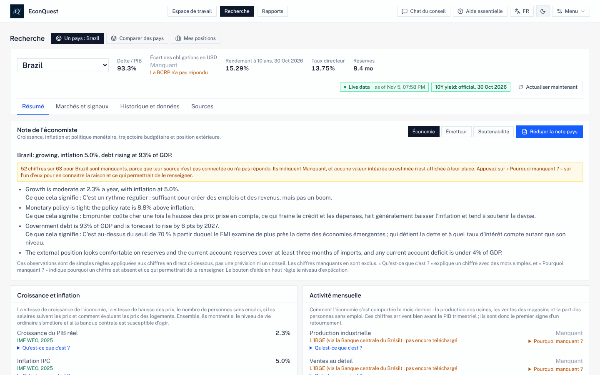

# EconQuest Sovereign Council Terminal

[English](./README.md) · [Español](./README.es.md) · **Français** · [Português](./README.pt.md)

EconQuest est un terminal de recherche gratuit et open source pour comprendre l'économie des pays, les
finances de leurs États et les risques qui les entourent. Il rassemble des chiffres de sources publiques
gratuites (le FMI, la Banque mondiale, la Banque des règlements internationaux, les banques centrales,
les instituts statistiques et d'autres), affiche chacun avec sa provenance et sa date, et vous permet de
poser des questions à un conseil d'agents d'IA spécialisés qui ne répondent qu'à partir de ces chiffres.

Il tourne sur votre propre ordinateur. Il n'y a pas de site EconQuest où s'inscrire ni de compte chez
nous : vos clés, vos recherches enregistrées et vos questions restent chez vous. Toute l'application
est en **anglais, espagnol, français et portugais du Brésil**.


*Recherche > Un pays, onglet Résumé (capture en anglais). Chaque chiffre indique sa source et sa date ;
un chiffre qu'aucune source n'a fourni s'affiche « Manquant », avec la raison.*

Ce logiciel sert à la recherche et à l'enseignement ; ce n'est pas un conseil en investissement.

Ceci est une traduction du [README anglais](./README.md), qui fait foi. La partie pour les développeurs
n'existe qu'en anglais.

## Sommaire

- [Pourquoi ce projet](#pourquoi-ce-projet)
- [Gratuit, ouvert et indépendant](#gratuit-ouvert-et-indépendant)
- [La règle : uniquement des chiffres réels](#la-règle--uniquement-des-chiffres-réels)
- [Ce que vous pouvez en faire](#ce-que-vous-pouvez-en-faire)
- [Guide avec captures d'écran](#guide-avec-captures-décran)
- [Démarrage rapide](#démarrage-rapide)
- [Configuration requise et tailles](#configuration-requise-et-tailles)
- [Modèles d'IA : lequel choisir, tailles et réglages](#modèles-dia--lequel-choisir-tailles-et-réglages)
- [Langues](#langues)
- [Quêtes : des solutions économiques à plusieurs](#quêtes--des-solutions-économiques-à-plusieurs)
- [D'où viennent les données](#doù-viennent-les-données)
- [Comment le vérifier](#comment-le-vérifier)
- [Feuille de route](#feuille-de-route)
- [Documentation](#documentation)
- [Licence](#licence)

---

## Pourquoi ce projet

Selon les mots du responsable du projet :

> "In 2026 we feel and see the economic effects of poor economic policies. I wanted to see if I could
> make a tool that could assist people in learning and understanding economics, finding multiple and
> optimal financial and policy options, and attempting to bring the best tools to the most
> underserved countries."
>
> (En 2026, nous ressentons et voyons les effets économiques de mauvaises politiques économiques. Je
> voulais voir si je pouvais créer un outil qui aide les gens à apprendre et à comprendre l'économie, à
> trouver des options financières et politiques multiples et optimales, et à apporter les meilleurs
> outils aux pays les moins bien servis.)

Les terminaux économiques professionnels coûtent des dizaines de milliers de dollars par an, ce qui les
met hors de portée de la plupart des étudiants, des journalistes, des petits ministères des finances et
banques centrales, et des analystes des pays qui ont le plus besoin d'une politique économique réfléchie.
EconQuest veut offrir une grande partie de ces mêmes analyses, à partir de données officielles gratuites,
avec chaque méthode écrite pour que chacun puisse la vérifier.

**Pour qui :** analystes de la dette et du crédit souverains des pays émergents, économistes des banques
centrales, des ministères des finances et des institutions internationales, investisseurs macro et
change, équipes de risque pays, enseignants et étudiants, journalistes, et toute personne qui veut
comprendre ce qui arrive à une économie et pourquoi.

## Gratuit, ouvert et indépendant

- **L'application est gratuite**, sur tous les ordinateurs, et le restera. Pas d'offre payante ni de
  publicité.
- **Open source.** Le code est sous licence Apache 2.0 ; la documentation, les notes de méthode et le
  contenu pédagogique sous CC BY 4.0 : chacun peut les utiliser, les modifier et les partager.
- **Dons, uniquement via le site du projet**, par GitHub Sponsors et Open Source Collective, une fois que
  le projet aura un hôte fiscal. D'ici là, aucun don n'est accepté ([GOVERNANCE.md](./GOVERNANCE.md)).
  Les donateurs n'ont aucun mot à dire sur les méthodes, les résultats ou les pays couverts.
- **Dépôt public :** [github.com/e-conquest/econquest](https://github.com/e-conquest/econquest), avec
  l'application prête à l'emploi sur `ghcr.io/e-conquest/econquest`.

---

## La règle : uniquement des chiffres réels

Un chiffre n'apparaît que s'il vient d'une source en direct, d'une série officielle ou de votre propre
fichier. Tout le reste s'affiche **Manquant**, avec la raison (« À configurer », « La source n'a pas
répondu », « Pas encore de source »). Il n'y a aucun chiffre intégré, d'exemple ou estimé par une IA dans
l'application. Si l'application ne connaît pas un chiffre, elle le dit au lieu de le deviner.

Les données payantes (par exemple les prix de CDS, LSEG, EPFR, les notations ou le consensus des
analystes) ne sont utilisées qu'à partir de votre propre compte ou fichier, derrière un interrupteur dans
les Réglages, et ne sont jamais transmises dans les téléchargements ou les copies partagées.

---

## Ce que vous pouvez en faire

| Tâche | Où | Ce que vous obtenez |
| --- | --- | --- |
| Poser une question en langage courant | **Espace de travail** (Chat du conseil) | Des agents spécialisés répondent à partir des chiffres de l'application, chacun avec sa source ; avec un modèle d'IA, un agent de synthèse rédige une courte note qui ne peut citer que leurs chiffres, et un contrôle signale tout chiffre impossible à retracer |
| Étudier un pays | **Recherche > Un pays** | Résumé, Marchés et signaux, Historique et données, Sources : graphiques sur des années, estimations du présent et prévisions avec intervalles, écart de production, soutenabilité de la dette, adéquation des réserves, règles de politique monétaire, alerte précoce de crise, courbe des taux, moteurs de l'inflation, comptabilité de la croissance, prévisions du FMI par édition, et vues « à une date passée ». Pour les pays à revenu plus faible : envois de fonds, aide reçue, inclusion financière, prix des matières premières et termes de l’échange, prix alimentaires et sécurité alimentaire, et catastrophes naturelles |
| Comparer des pays | **Recherche > Comparer des pays** | Votre liste de suivi côte à côte (les 19 pays membres du G20 au départ), des pistes d'articles et les écarts entre prix de marché et données |
| Suivre vos positions | **Recherche > Mes positions** | Une liste d'obligations ou de positions que vous chargez, face aux risques et aux signaux |
| Évaluer un choix de politique | **Rapports > Nouvelle revue de politique** | Un dossier pas à pas : poser le problème, diagnostiquer, classer les options, examiner les preuves et les précédents, rédiger une note de recommandation et une synthèse d'une page pour les non-économistes, puis suivre ce qui s'est passé. Comparez le diagnostic avec jusqu'à six pays pairs, recevez une alerte sur la page d'accueil quand un chiffre suivi franchit son seuil, et voyez ce qui a changé quand vous reprenez la même politique |
| Tester une hypothèse budgétaire | **Historique et données**, ou depuis le Chat du conseil | Modifiez les dépenses publiques ou les impôts et voyez l'effet probable sur la croissance et la dette, avec des multiplicateurs et élasticités publiés et un intervalle |
| Rédiger un rapport | **Rapports** | Notes pays et émetteur, évaluations de soutenabilité, revues de portefeuille et synthèses du conseil, en Markdown ou PDF avec sources et dates |
| Apprendre en chemin | Boutons de l'en-tête, **Menu > Manuel d'utilisation**, **Menu > Exemples guidés** | Trois niveaux d'aide, un glossaire en langage clair, quatre cas guidés, des séquences pédagogiques et un mode examen |
| Utiliser vos propres données et tests | **Menu > Vos données**, **Menu > Modèles et validation** | Chargez vos propres séries CSV ; enregistrez votre propre test de signal ou de modèle selon les mêmes règles strictes que ceux de l'application |
| Utiliser les chiffres dans R, Python ou Stata | [docs/DATA_API.md](./docs/DATA_API.md) (en anglais) | Les mêmes séries, panels et tableaux qu'à l'écran, avec source et date pour chaque valeur |
| Connecter un système de portefeuille | **Menu > Réglages > Jetons d’API**, [docs/DATA_API.md](./docs/DATA_API.md) (en anglais) | Un autre programme lit des instantanés de pays et des événements, envoie ses positions et lance des chocs et des rejeux de crises passées sur son portefeuille, chacun avec un jeton limité à ce que vous cochez. Les pays et titres de la liste **Noms masqués** n’apparaissent nulle part |

Le **Chat du conseil** est le cœur de l'application. Les agents sont Banque centrale, Budget et dette,
Politique et événements, Valeur relative, Change, Contagion mondiale, Calendrier, Timing et Finance
comportementale, plus un agent Documents qui lit les textes de politique que vous chargez. **Lancer le
conseil complet** envoie un pays à neuf agents spécialisés sur trois bureaux (géopolitique, crédit
souverain et économie générale) ; ils débattent, et l'application attend votre accord avant de rédiger
le rapport final. Un modèle d'IA plus grand sert d'**arbitre** et juge si chaque réponse s'en tient aux
chiffres.

Pour l'instant, les agents comprennent mieux les questions posées en anglais ; l'application le signale
près de la zone de saisie.

**Chaque chiffre, graphique et test fonctionne sans aucun modèle d'IA.** L'IA ne sert qu'à la synthèse du
chat, aux débats et aux explications en langage clair, et chaque réponse qu'elle rédige est signalée
comme écrite par une IA.

---

## Guide avec captures d'écran

Le guide complet, avec des étapes numérotées pour chaque tâche, se trouve dans
**[docs/GUIDE.fr.md](./docs/GUIDE.fr.md)**. Il couvre : le premier démarrage, interroger le conseil,
étudier un pays, comparer des pays, mener une revue de politique et rédiger un rapport, choisir un modèle
d'IA, les outils et la vérification des données, la langue et les niveaux d'aide, l'usage sur téléphone,
et l'essai des Quêtes.

| | |
| --- | --- |
|  **Interrogez le conseil.** Le panneau des agents montre qui a répondu et pourquoi. |  **Lisez l'historique.** Chaque graphique dit ce qu'il mesure, à qui est le chiffre et comment le lire. |
|  **Comparez des pays.** Pistes et écarts entre marchés et données. |  **Examinez une politique.** Du problème à la note. |
|  **Choisissez un modèle d'IA.** Modèle rapide pour les bureaux, grand modèle pour l'arbitre. |  **Changez de langue.** Bouton EN / ES / FR / PT dans l'en-tête. |

Les captures ont été prises le 13 novembre 2026 sur une version locale de la branche principale, qui
rejouait des réponses enregistrées le 5 novembre 2026, uniquement des sources dont les conditions
permettent de transmettre les données. C'est pourquoi beaucoup de chiffres s'affichent « Manquant » ; sur
un ordinateur qui atteint les sources, davantage se remplissent. La plupart sont en anglais ; la dernière
montre l'application en français.

---

## Démarrage rapide

**Vous débutez ?** [docs/INSTALL.md](docs/INSTALL.md) (en anglais) est un guide pas à pas : installez
Docker Desktop, téléchargez un fichier et lancez l'application prête à l'emploi. Rien à compiler ni à
programmer.

**Application prête à l'emploi** (Docker Desktop lancé) :

```sh
mkdir econquest && cd econquest
curl -fsSLO https://raw.githubusercontent.com/e-conquest/econquest/main/deploy/quick-start/compose.yml
docker compose up -d          # puis ouvrez http://localhost:3737
```

**Ordinateur portable modeste** (4 Go de mémoire ou peu de disque) : mettez `LIGHT_MODE=on` dans un
fichier `.env` à côté de `compose.yml` avant de démarrer. Le mode léger ne fait tourner aucun modèle
d'IA sur votre ordinateur (le conseil utilise votre propre clé Gemini, ou reste éteint), laisse de côté
les 3,4 Go de fichiers d'actualité GDELT et ne télécharge que les pays de votre liste. Depuis le code :
`scripts/start-mac.sh --light`, ou `scripts\start-windows-light.bat` sous Windows.

**Depuis le code** (Node.js 20.19 ou plus récent, ou 22.12 ou plus récent) :

```sh
git clone https://github.com/e-conquest/econquest.git
cd econquest
npm install
npm run go           # met à jour, installe, démarre l'application et lance le téléchargement quotidien
```

`npm run go` récupère le code le plus récent, installe les paquets, télécharge les modèles d'IA si vous
utilisez Ollama, reconstruit et démarre l'application Docker sur http://localhost:3737 et celle de
développement sur http://localhost:3000, et lance le téléchargement quotidien des données en arrière-plan.
Sur Mac, vous pouvez double-cliquer sur `econquest-mac.command` (Windows : `scripts/start-windows.bat`).

### Premier démarrage

1. **Voyez quelles sources répondent :** Menu > Outils > Connexions de données (ou `npm run check:data`).
2. **Ajoutez une clé FRED gratuite** dans Menu > Réglages > Clés de données gratuites. Elle fournit les
   rendements officiels à 10 ans de plusieurs pays.
3. **Choisissez un modèle d'IA** dans Menu > Réglages > Modèle d'IA (ci-dessous).
4. **Choisissez vos pays** avec Modifier sur la carte de la liste de suivi.
5. **Choisissez la langue et le niveau d'aide** avec les boutons de l'en-tête.

Les clés sont enregistrées dans `data/local/settings.json` (jamais dans git, ni dans les sauvegardes, ni
dans le journal d'audit).

---

## Configuration requise et tailles

| Élément | Minimum | Recommandé |
| --- | --- | --- |
| Système | macOS (les trois versions les plus récentes), Windows 10 ou 11 (64 bits, WSL 2 pour Docker Desktop) ou Linux 64 bits | Idem ; Apple Silicon, Intel et AMD fonctionnent |
| Mémoire | 8 Go (4 Go en mode léger, un objectif pas encore mesuré) | 16 Go ; 32 Go pour faire tourner le grand arbitre sur le même ordinateur |
| Disque libre | 5 Go | 10 Go, plus la place des modèles d'IA |
| Internet | N'importe quelle connexion | Une connexion sans petit plafond mensuel |
| Node.js (seulement depuis le code) | 20.19 ou plus, ou 22.12 ou plus | 22 |

### Tailles de téléchargement

Chaque chiffre dit comment il a été obtenu. « Mesuré » signifie mesuré à la date indiquée ; « estimation »
donne la méthode. Les mesures du 13 novembre 2026 portent sur la branche principale jusqu'à la demande
#510.

| Quoi | Taille | Comment le chiffre a été obtenu |
| --- | --- | --- |
| Code source (`git clone`) | 70 Mo (29 Mo de fichiers et 41 Mo d'historique) | Mesuré, clone neuf, 13 novembre 2026 |
| Application prête à l'emploi (image Docker) | Environ 170 Mo à télécharger ; 798 Mo une fois décompressée | Mesuré : image construite avec le Dockerfile du dépôt le 13 novembre 2026 (798 Mo décompressée, 170 Mo compressée avec gzip). Le téléchargement depuis le registre est compressé de la même façon, la taille sera donc proche |
| Paquets installés, depuis le code (`npm install`) | 465 Mo | Mesuré, 13 novembre 2026 |
| Application web compilée | 6,7 Mo au total ; 415 Ko compressés au démarrage | Mesuré avec `npm run size:check`, 13 novembre 2026 |
| Chaque langue supplémentaire | Environ 0,7 Mo (environ 220 Ko compressés), seulement si elle est choisie | Mesuré sur la version compilée, 13 novembre 2026 |
| Premier téléchargement complet des données | Environ 3,6 à 3,8 Go, surtout des fichiers d'actualité GDELT | Estimation : GDELT environ 3,4 Go pour 8 semaines (d'après les tailles publiées par GDELT), anciennes éditions du FMI environ 100 Mo (mesuré), le reste comme le téléchargement quotidien |
| Premier téléchargement en mode léger | Objectif : bien moins de 1 Go | Pas encore mesuré ; attendu d'un essai sur le Mac du développeur avant la publication |
| Téléchargement quotidien | Environ 150 à 200 Mo (4,5 à 6 Go par mois) | Estimation à partir de réponses enregistrées et de tailles de fichiers. Le téléchargement quotidien enregistre désormais ce qu'il récupère ; le chiffre mesuré après une semaine (`npm run go -- status` sur le Mac du développeur) remplacera cette estimation |
| Modèles d'IA via Ollama (facultatif) | qwen2.5:7b 4,7 Go ; qwen2.5:14b 9 Go ; qwen2.5:32b 20 Go | Tailles publiées par Ollama |
| Historique long GDELT (facultatif) | Environ 25 Go depuis 2016 (35 Go depuis 1979) ; environ 5 Mo conservés sur disque | Tailles publiées par GDELT |

### Espace occupé en fonctionnement

| Configuration | Disque environ | Composition |
| --- | --- | --- |
| Mode léger, sans IA locale | Objectif 2 Go | Pas encore mesuré |
| Application prête à l'emploi, sans IA locale | Environ 1 Go, plus environ 40 Mo par an | Image 0,8 Go (mesuré) plus le dossier `data/`, environ 150 Mo après les premiers jours (mesuré sur le Mac du développeur le 9 novembre 2026, 22 pays) |
| Avec un arbitre 14B | Environ 15 Go | Ce qui précède plus qwen2.5:7b et qwen2.5:14b |
| Avec toute l'IA en local | Environ 26 Go | Ce qui précède plus qwen2.5:7b et qwen2.5:32b |
| Depuis le code au lieu de l'image | Ajoutez environ 0,5 Go | Code et historique 70 Mo, paquets 465 Mo, version compilée 7 Mo (mesuré) |

Docker Desktop demande en plus quelques Go (voir docker.com). Pour connaître la taille réelle sur votre
ordinateur, lancez `du -sh data data/*` dans le dossier EconQuest ou ouvrez Menu > Données hors ligne.

---

## Modèles d'IA : lequel choisir, tailles et réglages

L'IA rédige la synthèse du conseil, anime le débat, choisit les agents pour une question et explique les
chiffres. Elle ne fournit jamais un chiffre : chaque nombre vient d'une source, d'une série officielle ou
de votre fichier. Choisissez le fournisseur dans Menu > Réglages > Modèle d'IA.

| Fournisseur | Coût | Confidentialité | Remarques |
| --- | --- | --- | --- |
| **Sans IA** | Gratuit | Seules les demandes de chiffres publics sortent | Tout fonctionne ; les agents répondent sans synthèse rédigée |
| **Ollama** sur votre ordinateur | Gratuit | Tout reste sur votre ordinateur | Nécessite l'[application Ollama](https://ollama.com/download) et assez de mémoire |
| **Google Gemini** | Gratuit dans les limites quotidiennes de Google, puis facturé sur votre propre clé | Les questions et leurs chiffres partent chez Google | Nécessite une clé d'API Gemini ; le modèle par défaut est `gemini-3.8-flash`, modifiable avec `GEMINI_MODEL` dans `.env` |
| **Ollama, puis Gemini** | Comme ci-dessus | Comme ci-dessus | Ollama d'abord ; Gemini répond quand Ollama ne répond pas |
| Serveur local compatible OpenAI (comme LM Studio) | Gratuit | Reste sur votre ordinateur | Dans Configuration avancée de l'IA ; vous indiquez l'adresse et le modèle |

### Deux rôles : modèle rapide et arbitre

| Rôle | Ce qu'il fait | Par défaut | Règle |
| --- | --- | --- | --- |
| **Modèle rapide** | Choisit les agents et rédige les réponses des bureaux | `qwen2.5:7b` (`OLLAMA_QUICK_MODEL`) | Un modèle de 7 à 8B répond en moins d'une minute sur la plupart des Mac |
| **Arbitre** | Étape finale du conseil complet, synthèses et explications du chat, débat des agents, étape Options de la revue de politique et textes d'ouverture des débats de Quêtes | `qwen2.5:32b` (`OLLAMA_DEEP_MODEL`) | 30B ou plus compte comme arbitre complet. Un modèle de 8B ou moins n'est jamais utilisé comme arbitre. Un arbitre 14B n'est permis que si vous activez **Autoriser un arbitre de 14B** (désactivé par défaut), et chaque réponse qu'il juge porte la mention « Arbitre réduit » |

### Quelle configuration pour quel ordinateur

| Votre ordinateur | Configuration recommandée |
| --- | --- |
| Portable de 4 Go | Mode léger avec une clé Google Gemini, ou sans IA |
| 8 Go | Google Gemini, ou sans IA. Un modèle local laisse trop peu de mémoire à l'application, à Docker et au navigateur |
| 16 Go | Ollama `qwen2.5:7b` pour les bureaux, avec « Ollama, puis Gemini » pour que Gemini arbitre ; ou activez un arbitre `qwen2.5:14b`, signalé « Arbitre réduit » (il demande environ moitié moins de mémoire que le 32B) |
| 32 Go ou plus, ou une carte graphique de 24 Go | Tout en local : `qwen2.5:7b` et `qwen2.5:32b` |

Téléchargez les modèles une fois avec `ollama pull qwen2.5:7b` et `ollama pull qwen2.5:32b` (ou via
`npm run go`). Sur un ordinateur sans assez de mémoire ni puce graphique, le grand modèle peut prendre
10 minutes ou plus par rapport complet ; utilisez Gemini comme arbitre, ou Ollama sur une machine plus
puissante.

### Réglages utilisés par l'application

Valeurs actuelles du code ; celles marquées « modifiable » se trouvent dans Menu > Réglages > Modèle
d'IA > Configuration avancée de l'IA.

| Réglage | Valeur | Pourquoi |
| --- | --- | --- |
| Température, synthèse et explications du chat | 0, avec la graine 42 | Les mêmes chiffres donnent la même réponse, exactement avec le même modèle Ollama sur la même machine |
| Température, étapes de la revue de politique | 0 | Une reprise donne un résultat aussi proche que possible |
| Température, textes d'ouverture des débats de Quêtes | 0, avec la graine 42, sur l'arbitre | Rédigés une fois et enregistrés avec leurs réglages |
| Température, autres étapes (bureaux du conseil complet) | 0,2 (modifiable, de 0 à 1,5) | Un peu de variété entre bureaux |
| Fenêtre de contexte (`num_ctx` d'Ollama) | 8 192 jetons (modifiable, de 1 024 à 65 536) | Assez pour la question, les chiffres et les consignes |
| Longueur maximale sur les étapes longues (`num_predict` d'Ollama) | 2 048 jetons ; 4 096 pour les modèles de raisonnement | Arrête un modèle qui continue d'écrire du remplissage |
| Attente par appel | 16 secondes par étape de bureau et 25 par étape du conseil complet (modifiable, de 5 à 180) ; au moins 120 secondes pour les étapes de l'arbitre | Une adresse injoignable échoue vite ; l'arbitre a le temps |
| Modèle gardé en mémoire (`keep_alive` d'Ollama) | 30 minutes sur les étapes longues | La question suivante ne recharge pas un modèle de 20 Go |
| Format | JSON vérifié par un schéma ; niveau de réflexion de Gemini bas | L'application lit chaque champ et vérifie chaque chiffre avec sa source |

Dans `.env` : `DEFAULT_AI_PROVIDER` (`ollama` ou `gemini`), `OLLAMA_BASE_URL`, `OLLAMA_QUICK_MODEL`,
`OLLAMA_DEEP_MODEL`, `GEMINI_API_KEY`, `GEMINI_MODEL`, `LIGHT_MODE`.

---

## Langues

| Langue | État | Forme d'adresse |
| --- | --- | --- |
| Anglais | Complet ; langue source | |
| Espagnol | Toute l'application | *Usted* |
| Français | Toute l'application | *Vous* |
| Portugais du Brésil | Toute l'application | *Você* |
| Arabe, swahili | Prévus, pas commencés | |

Chaque écran, menu, texte d'aide, entrée du glossaire et exemple guidé est traduit ; la synthèse de
politique d'une page s'imprime dans les quatre langues. Changez avec le bouton **EN / ES / FR / PT** de
l'en-tête ; le choix est gardé dans votre navigateur. Une langue n'est téléchargée que lorsqu'elle est
choisie.

Certaines choses restent telles qu'écrites, et l'application le signale : les chiffres, les noms de
sources et de séries s'affichent comme la source les donne ; les agents du conseil lisent les questions
et rédigent leurs documents en anglais ; les notes de méthode citent des articles en anglais ; certaines
phrases que les règles de l'application écrivent sur un pays sont encore en anglais. Aucune traduction
n'a encore été relue par un locuteur natif ; toute aide est la bienvenue ([CONTRIBUTING.md](./CONTRIBUTING.md)).

Ce README et le guide existent dans les quatre langues. Les autres documents sont en anglais.

---

## Quêtes : des solutions économiques à plusieurs

Les Quêtes transforment des questions économiques ouvertes en un jeu public avec score auquel chacun peut
participer, pour que beaucoup de personnes travaillent sur les problèmes d'un pays, confrontent leurs
raisonnements aux données et constituent un historique de qui prévoit bien. **Les Quêtes sont construites
mais désactivées.** Menu > Quêtes est grisé (« Pas encore disponible ») jusqu'à ce que chaque point de la
liste de [docs/QUESTS.md](./docs/QUESTS.md) soit coché et que le projet soit public. Pour les essayer sur
votre ordinateur, ajoutez `QUESTS_ENABLED=on` à `.env` et redémarrez.


**Ce qu'est une Quête.** Un fichier dans `quests/` avec une question et une règle écrite qui dit comment
elle se règle à partir des sources de l'application. Il en existe quatre types :

| Type | Exemple | Comment elle se termine |
| --- | --- | --- |
| **Prévision** | « Le taux directeur de la Turquie sera-t-il plus bas le 30 juin 2027 qu'à la clôture des participations ? » | Réglée par la source selon sa règle ; chaque participation reçoit un score |
| **Débat** | « Qu'est-ce qui reconstituerait le plus sûrement les réserves de change de l'Égypte ? » | Jamais notée. On défend une position avec les chiffres de l'application ; Claim Check compare chaque chiffre cité à celui de l'application ; après la clôture, une carte des preuves montre les arguments à côté de ce que disaient les chiffres |
| **Réplication** | « Reproduisez l'estimation de réaction budgétaire de Bohn pour le Brésil » | Chaque participation donne le chiffre produit par un script public personnel ; elle reproduit le chiffre de l'application si elle est dans la tolérance. Une participation soignée qui trouve une erreur dans l'application résout la Quête |
| **Signal** | « Un positionnement très concentré sur les contrats à terme se résorbe-t-il en six semaines ? » | On propose un test préenregistré ; chacun est exécuté une seule fois après la clôture, compté dans la correction de Holm avec tous les autres et reçoit un badge comme ceux de l'application |

**Comment fonctionne le jeu.**

- **En privé ou en public.** Enregistrez une réponse en privé sur votre ordinateur, entraînez-vous sur des
  données passées (score immédiat, rien n'est gardé) ou participez publiquement par une demande de
  modification que l'application prépare pour vous. Les personnes dans un pays que GitHub bloque peuvent
  participer par e-mail via un responsable.
- **Score face à un taux de base.** Les prévisions sont notées avec le score de Brier face à la fréquence
  passée de l'événement, et les prévisions chiffrées face à « rien ne change » : la chance et la copie
  rapportent peu.
- **Classement.** Compétence avec un intervalle à 90 %, calibration, netteté, bilan face à la foule,
  points forts par domaine et région, séries, saisons par année civile et tableau historique. Une personne
  n'est classée qu'après 12 prévisions réglées et avec un compte GitHub d'au moins 90 jours ; personne
  n'est classé sur le nombre de Quêtes jouées. Débats, réplications et tests sont listés sur la page de
  chaque participant, sans classement.
- **Rien ne peut être modifié après coup.** Les Quêtes approuvées portent une empreinte ; les résultats
  sont écrits dans un registre chaîné par hachage qui échoue si une ligne est modifiée ; les contestations
  sont tranchées en public.
- **Ouvert à qui n'a pas l'application.** Une page publique statique (`npm run quests:board`) affiche les
  tableaux, les résultats et la foule face au taux de base, et un jeu de données ouvert annuel peut être
  déposé avec un DOI.
- **Des règles qui le gardent sain.** Aucun chiffre écrit dans un fichier de Quête ; les Quêtes de
  prévision ne se règlent que sur des sources dont les conditions permettent le partage avec attribution ;
  les questions sur les conflits, les troubles ou les victimes ne se posent qu'en Débats ; ni mises ni
  prix. Les Quêtes ne sont pas un marché de paris.
- **En classe.** Les enseignants peuvent utiliser les Quêtes avec un code de classe et un tableau de
  classe privé ; un pilote d'un semestre avec deux professeurs est prévu.

Quatorze Quêtes en brouillon se trouvent dans `quests/drafts/` ; aucune n'est encore approuvée. Les règles
complètes, les étapes du responsable et la liste de lancement sont dans [docs/QUESTS.md](./docs/QUESTS.md)
(en anglais).

---

## D'où viennent les données

Toutes sont gratuites. Quelques-unes demandent une clé gratuite, à ajouter dans Menu > Réglages.

| Domaine | Sources |
| --- | --- |
| Croissance, dette, budgets, commerce | Banque mondiale (indicateurs et statistiques de dette), FMI (Perspectives de l'économie mondiale et éditions passées, réserves, balance des paiements, composition des réserves, dépenses publiques par fonction), OCDE (indicateurs avancés, prix, PIB trimestriel, via DBnomics), prix à la consommation mensuels du FMI, Eurostat, UN Comtrade et WITS |
| Taux et obligations | BRI (taux directeurs, titres de dette, taux de change réels), FRED (rendements officiels à 10 ans ; clé gratuite), Fed de New York, Trésor américain (détenteurs étrangers, adjudications), Trésor brésilien, banque centrale du Pérou (écarts EMBIG), et rendements à 10 ans de l’OCDE et taux de change H.10 de la Réserve fédérale, mensuels depuis 1990 via FRED, pour rejouer les crises passées |
| Change et matières premières | Taux de change au comptant (open.er-api.com), taux de référence de la BCE, prix des matières premières de la Banque mondiale, prix du pétrole de l'EIA (clé gratuite) |
| Enquêtes et anticipations | Enquêtes auprès des entreprises et des consommateurs de l'UE (Commission européenne, via Eurostat ; substitut gratuit des PMI payants, signalé comme tel), enquête de la BCE auprès des prévisionnistes professionnels, enquête Focus du Brésil, indice de tension des chaînes d'approvisionnement de la Fed de New York |
| Banques centrales et calendrier | Banco Central do Brasil, Banco de México (jeton gratuit), dates officielles des décisions, dates de publication de l'IPC et du PIB des instituts statistiques |
| Institutions et ouverture | Indicateurs de gouvernance de la Banque mondiale (WGI), indice d’ouverture du compte de capital de Chinn et Ito (téléchargé sur votre ordinateur au plus une fois par mois, cité comme Chinn et Ito 2006 et jamais retransmis) |
| Politique, conflits et transport maritime | Actualités GDELT, données de conflit UCDP et ACLED (ACLED se télécharge à la main), listes de sanctions de l'OFAC et de l'ONU, indice de risque géopolitique, IMF PortWatch |
| Marchés et positionnement | Marchés de prédiction Kalshi et Polymarket, rapport Commitments of Traders de la CFTC |
| Pays à revenu plus faible | Banque mondiale (envois de fonds et leur coût d'envoi, comptes Global Findex, aide reçue telle que republiée à partir de l'OCDE, sécurité alimentaire, part des matières premières dans les échanges et termes de l’échange) ; deux fichiers que vous enregistrez vous-même : les prix à la consommation de FAOSTAT pour l'inflation alimentaire, et les catastrophes naturelles d'EM-DAT, téléchargées avec votre propre compte EM-DAT gratuit (ses conditions ne permettent pas à l'application de les fournir) |

La liste complète est dans [docs/DATA_SOURCES.md](./docs/DATA_SOURCES.md) et ce que permet chaque source
dans [docs/DATA_LICENCES.md](./docs/DATA_LICENCES.md) (en anglais).

---

## Comment le vérifier

- **Chaque chiffre porte sa source et sa date**, et Menu > État des données montre si chaque source
  arrive toujours et si un chiffre a été révisé depuis son premier affichage.
- **Les signaux et les modèles sont testés avant qu'on s'y fie.** Chaque test est écrit et doté d'une
  empreinte *avant* d'être lancé (préenregistrement), n'utilise que des données disponibles à l'époque,
  compte les coûts de transaction et est vérifié par rééchantillonnage. Les résultats sont corrigés de la
  chance sur l'ensemble des tests (correction de Holm). Un test échoué est enregistré comme tel et n'est
  jamais réajusté.
- **Badges** : Validé, Provisoire, En cours d'examen, Retiré ou Revue due. La plupart des signaux n'ont
  pas réussi leur test, et l'application le dit.
- **Un journal d'audit** garde ce qui a été demandé, quels chiffres ont servi et qui a validé un rapport.

La méthode complète est dans [docs/METHODOLOGY.md](./docs/METHODOLOGY.md) (en anglais).

---

## Feuille de route

Où en est le projet au 13 novembre 2026 (détail dans [docs/ROADMAP.md](./docs/ROADMAP.md), en anglais) :

**Fait**

1. **Citations, maintenance et retours** : « Citer » sur chaque graphique, tableau et réponse, une revue
   de taille, un contrôle mensuel des sources et la confrontation des revues de politique passées avec
   ce qui s’est produit.
2. **Les chiffres dont un terminal complet a besoin** : inégalités, recettes fiscales et droits de
   douane, dette des pays à faible revenu, population, commerce et structure de la dette, climat,
   salaires et prix des logements, soldes sectoriels, activité mensuelle, et chiffres de la zone euro et
   du Royaume-Uni tels que publiés la première fois (les recettes par État sont une seconde étape qui
   attend un contrôle de couverture).
3. **Outils d’analyse et de politique** : alerte précoce de crise, soutenabilité extérieure, courbe des
   taux, moteurs de l’inflation, comptabilité de la croissance, un calculateur de restructuration, la
   finance comportementale et une revue de politique plus complète avec précédents, règles
   budgétaires, faisabilité politique, un graphique d’arbitrages et une note d’une page.
4. **Des données pour les pays à revenu plus faible** (avancées le 13 novembre) : envois de fonds,
   inclusion financière, prix des matières premières et termes de l’échange, aide reçue, prix
   alimentaires et catastrophes naturelles.
5. **Outils pour la revue de politique** (avancés le 13 novembre) : comparaison avec des pairs, alertes
   sur la page d’accueil et comparaison d’une revue avec la précédente.
6. **Connexion avec d’autres systèmes** (13 novembre) : jetons d’API, événements et webhooks,
   surveillances d’indicateurs, instantanés de pays, positions envoyées de l’extérieur, noms masqués,
   scénarios et rejeux de crises, un journal d’audit scellé, un guide de déploiement et la connexion
   par OpenID Connect.
7. **Langues et enseignement** : toute l’application en portugais et quatre exemples guidés.

**Ensuite**

- **La publication** sur e-conquest/econquest. Le mode léger et la revue de sécurité sont faits ; il
  reste un premier démarrage sur un ordinateur Windows, une mesure du mode léger et un nouvel export
  public.
- **Le point d’étape 1**, environ quatre semaines après la publication, est la seule revue avant de
  planifier d’autres travaux. L’usage réel décide de la suite ; aucune nouvelle fonction n’est ajoutée
  avant.

**En attente**

- **Les Quêtes en classe** : le plan est complet (13 petites modifications, puis un pilote d’un semestre
  avec deux professeurs) ; la construction commence quand le responsable du projet le décide.
- **Arabe et swahili** : prévus, mis en pause par le responsable du projet.
- **L’application mobile** : en pause jusqu’après la publication.
- **Idées en attente** pour le point d’étape 1 : données de marchés et de financement (régimes de change,
  bilans des banques centrales, tensions sur le financement en dollars) et enseignement et partage (un
  rapport pays hors ligne, un laboratoire macro avec des modèles de manuel, d’autres exemples guidés).

---

## Documentation

- [docs/GUIDE.fr.md](./docs/GUIDE.fr.md) : guide pas à pas avec captures, en français
- En anglais : [INSTALL.md](./docs/INSTALL.md) (installation), [USER_MANUAL.md](./docs/USER_MANUAL.md)
  (manuel), [GLOSSARY.md](./docs/GLOSSARY.md) (glossaire ; aussi dans l'application en français),
  [METHODOLOGY.md](./docs/METHODOLOGY.md), [HOW_IT_WORKS.md](./docs/HOW_IT_WORKS.md), [METHODS.md](./docs/METHODS.md),
  [TRACK_RECORD.md](./docs/TRACK_RECORD.md), [DATA_SOURCES.md](./docs/DATA_SOURCES.md),
  [DATA_LICENCES.md](./docs/DATA_LICENCES.md), [DATA_API.md](./docs/DATA_API.md), [DEPLOYMENT.md](./docs/DEPLOYMENT.md),
  [POLICY_REVIEW.md](./docs/POLICY_REVIEW.md), [QUESTS.md](./docs/QUESTS.md),
  [ROADMAP.md](./docs/ROADMAP.md), [HOME_SERVER.md](./docs/HOME_SERVER.md),
  [SECURITY.md](./docs/SECURITY.md), [CONTRIBUTING.md](./CONTRIBUTING.md)
- Développeurs : [partie For developers du README anglais](./README.md#for-developers)

---

## Licence

Code : [Apache License 2.0](./LICENSE). Documentation, notes de méthode, registres de validation, captures
d'écran et contenu des Quêtes : [CC BY 4.0](./LICENSE-docs.md). Les chiffres des sources externes gardent
leurs propres conditions ([docs/DATA_LICENCES.md](./docs/DATA_LICENCES.md)). Les contributions sont signées
selon le Developer Certificate of Origin (DCO). Pour citer le logiciel, utilisez
[CITATION.cff](./CITATION.cff).
