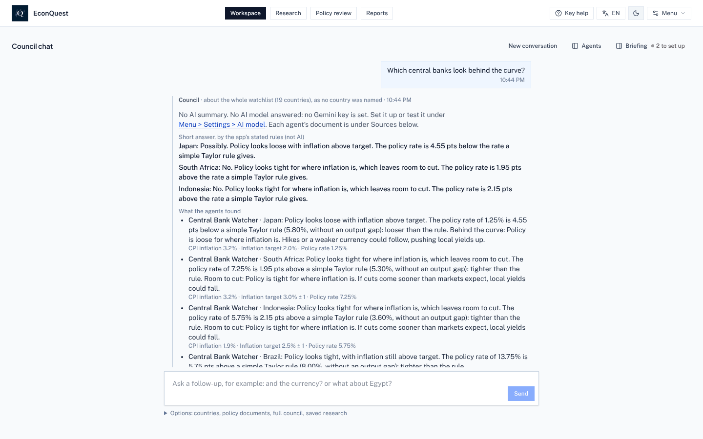
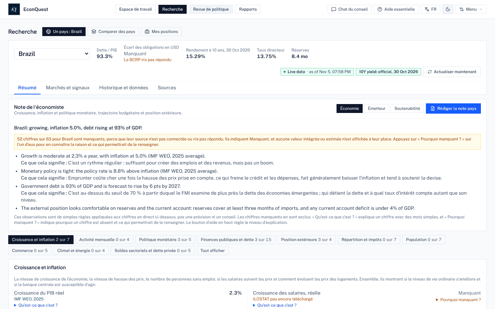

# EconQuest Sovereign Council Terminal

[English](./README.md) · [Español](./README.es.md) · **Français** · [Português](./README.pt.md)

EconQuest est un terminal de recherche gratuit et open source pour comprendre l'économie des pays, les
finances de leurs États et les risques qui les entourent. Il rassemble des chiffres de sources publiques
gratuites (le FMI, la Banque mondiale, la Banque des règlements internationaux, les banques centrales,
les instituts statistiques et d'autres), affiche chacun avec sa provenance et sa date, et vous permet de
poser des questions à un conseil d'agents d'IA spécialisés qui ne répondent qu'à partir de ces chiffres.

Il tourne sur votre propre ordinateur. Il n'y a pas de site EconQuest où s'inscrire ni de compte chez
nous : vos clés, vos recherches enregistrées et vos questions restent chez vous. Toute l'application
est en **anglais, espagnol, français et portugais du Brésil**.


*Recherche > Un pays, onglet Résumé (capture en anglais). Chaque chiffre indique sa source et sa date ;
un chiffre qu'aucune source n'a fourni s'affiche « Manquant », avec la raison.*

Ce logiciel sert à la recherche et à l'enseignement ; ce n'est pas un conseil en investissement.

Ceci est une traduction du [README anglais](./README.md), qui fait foi. Le détail de
chaque fonction est dans [Fonctions et détails](./docs/FEATURES.fr.md) ; les notes pour les développeurs
n'existent qu'en anglais.

## Sommaire

- [Pourquoi ce projet](#pourquoi-ce-projet)
- [Pourquoi utiliser EconQuest](#pourquoi-utiliser-econquest)
- [Gratuit, ouvert et indépendant](#gratuit-ouvert-et-indépendant)
- [La règle : uniquement des chiffres réels](#la-règle--uniquement-des-chiffres-réels)
- [Ce que vous pouvez en faire](#ce-que-vous-pouvez-en-faire)
- [Guide avec captures d'écran](#guide-avec-captures-décran)
- [Démarrage rapide](#démarrage-rapide)
- [Documentation](#documentation)
- [Licence](#licence)

---

## Pourquoi ce projet

Selon les mots du responsable du projet :

> "In 2026 we feel and see the economic effects of poor economic policies. I wanted to see if I could
> make a tool that could assist people in learning and understanding economics, finding multiple and
> optimal financial and policy options, and attempting to bring the best tools to the most
> underserved countries."
>
> (En 2026, nous ressentons et voyons les effets économiques de mauvaises politiques économiques. Je
> voulais voir si je pouvais créer un outil qui aide les gens à apprendre et à comprendre l'économie, à
> trouver des options financières et politiques multiples et optimales, et à apporter les meilleurs
> outils aux pays les moins bien servis.)

Les terminaux économiques professionnels coûtent des dizaines de milliers de dollars par an, ce qui les
met hors de portée de la plupart des étudiants, des journalistes, des petits ministères des finances et
banques centrales, et des analystes des pays qui ont le plus besoin d'une politique économique réfléchie.
EconQuest veut offrir une grande partie de ces mêmes analyses, à partir de données officielles gratuites,
avec chaque méthode écrite pour que chacun puisse la vérifier.

**Pour qui :** analystes de la dette et du crédit souverains des pays émergents, économistes des banques
centrales, des ministères des finances et des institutions internationales, investisseurs macro et
change, équipes de risque pays, enseignants et étudiants, journalistes, et toute personne qui veut
comprendre ce qui arrive à une économie et pourquoi.

---

## Pourquoi utiliser EconQuest

- **Chaque nombre peut être retracé.** Chaque chiffre indique sa source et sa date ; un manque
  s'affiche comme « Manquant », jamais comme une estimation.
- **Des tests publics, échecs compris.** Chaque règle de signal et de prévision est écrite avant
  d'être testée, et chaque résultat reste consigné ([historique](docs/TRACK_RECORD.md), en anglais).
- **L'IA explique, elle ne fournit jamais de chiffres.** Les réponses sont vérifiées par rapport aux
  chiffres de l'application et étiquetées. Chaque chiffre, graphique et test fonctionne sans IA.
- **Conçue aussi pour les pays à faible revenu.** Envois de fonds, aide, prix alimentaires,
  catastrophes et les 59 pays de la liste des pays à faible revenu du FMI et de la Banque mondiale, à
  côté du G20.
- **De la question à la note de politique.** Une revue de politique va du problème aux options, aux
  précédents, à une note et à un résumé d'une page pour les non-économistes.
- **À vous, sur votre ordinateur.** Pas de compte, pas de frais, pas de suivi. Vos clés et vos
  recherches restent chez vous.
- **Quatre langues, quatre niveaux d'aide.** Anglais, espagnol, français et portugais du Brésil, avec
  une aide en langage clair.

**Ce qu'elle ne fait pas.** Elle n'a pas de données de marché payantes, sauf si vous utilisez votre
propre compte ; les notations de crédit et le consensus des analystes s'affichent comme « Manquant ».
C'est un logiciel de recherche et d'enseignement, pas un conseil en investissement.

---

## Gratuit, ouvert et indépendant

- **L'application est gratuite**, sur tous les ordinateurs, et le restera. Pas d'offre payante ni de
  publicité.
- **Aucun suivi.** L'application n'envoie rien sur vous au projet : ni comptage d'usage, ni rapport
  de plantage, ni outil d'analyse. Ce qui quitte votre ordinateur, et quand, est listé dans
  [docs/PRIVACY.md](./docs/PRIVACY.md) (en anglais).
- **Open source.** Le code est sous licence Apache 2.0 ; la documentation, les notes de méthode et le
  contenu pédagogique sous CC BY 4.0 : chacun peut les utiliser, les modifier et les partager.
- **Dons, uniquement via le site du projet**, par GitHub Sponsors et Open Source Collective, une fois que
  le projet aura un hôte fiscal. D'ici là, aucun don n'est accepté ([GOVERNANCE.md](./GOVERNANCE.md)).
  Les donateurs n'ont aucun mot à dire sur les méthodes, les résultats ou les pays couverts.
- **Dépôt public :** [github.com/e-conquest/econquest](https://github.com/e-conquest/econquest), avec
  l'application prête à l'emploi sur `ghcr.io/e-conquest/econquest`.

---

## La règle : uniquement des chiffres réels

Un chiffre n'apparaît que s'il vient d'une source en direct, d'une série officielle ou de votre propre
fichier. Tout le reste s'affiche **Manquant**, avec la raison (« À configurer », « La source n'a pas
répondu », « Pas encore de source »). Il n'y a aucun chiffre intégré, d'exemple ou estimé par une IA dans
l'application. Si l'application ne connaît pas un chiffre, elle le dit au lieu de le deviner.

Les données payantes (par exemple les prix de CDS, LSEG, EPFR, les notations ou le consensus des
analystes) ne sont utilisées qu'à partir de votre propre compte ou fichier, derrière un interrupteur dans
les Réglages, et ne sont jamais transmises dans les téléchargements ou les copies partagées.

---

## Ce que vous pouvez en faire

- **Poser une question en langage courant** dans l'Espace de travail, dans le Chat du conseil. Des
  agents spécialisés répondent à partir des chiffres de l'application, chacun avec sa source, et les
  questions « et si » reçoivent une réponse en huit parties.
- **Étudier un pays** dans Recherche > Un pays : un résumé clair, les marchés et les signaux, des
  graphiques sur de longues années, des prévisions avec leurs marges et des outils pour la dette,
  l'inflation, la monnaie, la météo et les catastrophes.
- **Comparer des pays** côte à côte, en commençant par le G20 ou par les 15 plus grands pays à faible
  revenu.
- **Tester un choix de politique** dans Revue de politique, du problème à une note et à un résumé
  d'une page pour les non-économistes, et voyez comment les pays ont évolué après le même type de
  changement.
- **Rédiger un rapport** en Markdown ou en PDF, avec chaque source et chaque date.
- **Apprendre en chemin** avec quatre niveaux d'aide, un glossaire en langage clair et cinq exemples
  guidés.
- **Utiliser les chiffres dans R, Python, Stata ou Excel**, ou y connecter un autre programme.

Chaque chiffre, graphique et test fonctionne sans aucun modèle d'IA. La liste complète des tâches et
des outils est dans **[Fonctions et détails](docs/FEATURES.fr.md#ce-que-vous-pouvez-en-faire)**.

---

## Guide avec captures d'écran

Le guide complet, avec des étapes numérotées pour chaque tâche, se trouve dans
**[docs/GUIDE.fr.md](./docs/GUIDE.fr.md)**. Il couvre : le premier démarrage, interroger le conseil
(y compris ce que ferait un changement), étudier un pays et ses outils, comparer des pays, mener une revue de politique et rédiger un rapport, choisir un modèle
d'IA, les outils et la vérification des données, la langue et les niveaux d'aide, les outils météo et assurance,
l'usage sur téléphone et l'essai des Quêtes.

| | |
| --- | --- |
|  **Interrogez le conseil.** La réponse vient d'abord, chaque ligne avec ses chiffres ; le panneau des agents montre qui a répondu et pourquoi. |  **Lisez l'historique.** Chaque graphique dit ce qu'il mesure, à qui est le chiffre et comment le lire. |
|  **Comparez des pays.** Pistes et écarts entre marchés et données. |  **Examinez une politique.** Du problème à la note. |
|  **Choisissez un modèle d'IA.** Modèle rapide pour les bureaux, grand modèle pour l'arbitre. |  **Changez de langue.** Bouton EN / ES / FR / PT dans l'en-tête. |

Les captures ont été prises le 24 novembre 2026 (deux du guide, Quêtes et Pairs, datent du 13 novembre)
sur une version locale de la branche principale, qui
rejouait des réponses enregistrées le 5 novembre 2026, uniquement des sources dont les conditions
permettent de transmettre les données. C'est pourquoi beaucoup de chiffres s'affichent « Manquant » ; sur
un ordinateur qui atteint les sources, davantage se remplissent. La plupart sont en anglais ; la dernière
montre l'application en français.

---

## Démarrage rapide

> **Pas encore public.** La copie publique sur github.com/e-conquest/econquest et l'application prête
> à l'emploi sur `ghcr.io/e-conquest/econquest` ne sont pas encore publiées : les liens de
> téléchargement et l'adresse `git clone` ci-dessous ne fonctionnent pas avant cela. Cette note sera
> retirée le jour de leur publication. D'ici là, les testeurs installent l'application à partir du code
> sur github.com/smcarus/econquest : les étapes sont dans [docs/TESTING.md](docs/TESTING.md) (en anglais).

**Vous débutez ?** [docs/INSTALL.md](docs/INSTALL.md) (en anglais) est un guide pas à pas : installez
Docker Desktop, téléchargez un fichier et lancez l'application prête à l'emploi. Rien à compiler ni à
programmer.

**Application prête à l'emploi.** Installez [Docker Desktop](https://www.docker.com/products/docker-desktop/)
et lancez-le. Ouvrez ensuite un terminal et tapez ces lignes.

Sur un Mac ou sous Linux, dans l'application **Terminal** :

```sh
mkdir econquest
cd econquest
curl -fsSLO https://raw.githubusercontent.com/e-conquest/econquest/main/deploy/quick-start/compose.yml
docker compose up -d
```

Sous Windows, dans **PowerShell** (cherchez-le dans le menu Démarrer) :

```powershell
mkdir econquest
cd econquest
Invoke-WebRequest -Uri https://raw.githubusercontent.com/e-conquest/econquest/main/deploy/quick-start/compose.yml -OutFile compose.yml
docker compose up -d
```

Ouvrez ensuite **http://localhost:3737** dans votre navigateur. Il vous faut macOS, Windows 10 ou 11, ou
Linux 64 bits, 8 Go de mémoire (4 Go en mode léger) et 5 Go d'espace disque libre ; toutes les tailles
sont dans [Fonctions et détails](docs/FEATURES.fr.md#configuration-requise-et-tailles).

**Ordinateur portable modeste** (4 Go de mémoire ou peu de disque) : mettez `LIGHT_MODE=on` dans un
fichier `.env` à côté de `compose.yml` avant de démarrer : dans le terminal, `echo LIGHT_MODE=on > .env` sur un Mac ou sous
Linux, ou `Set-Content .env LIGHT_MODE=on` dans PowerShell sous Windows. Le mode léger ne fait tourner aucun modèle
d'IA sur votre ordinateur (le conseil utilise votre propre clé Gemini, ou reste éteint), laisse de côté
les 3,4 Go de fichiers d'actualité GDELT et ne télécharge que les pays de votre liste. Depuis le code :
`scripts/start-mac.sh --light`, ou `scripts\start-windows-light.bat` sous Windows.

**Depuis le code** (Node.js 20.19 ou plus récent, ou 22.12 ou plus récent) :

```sh
git clone https://github.com/e-conquest/econquest.git
cd econquest
npm install
npm run go           # met à jour, installe, démarre l'application et lance le téléchargement quotidien
```

`npm run go` récupère le code le plus récent, installe les paquets, télécharge les modèles d'IA si vous
utilisez Ollama, reconstruit et démarre l'application Docker sur http://localhost:3737 et celle de
développement sur http://localhost:3000, et lance le téléchargement quotidien des données en arrière-plan.
Sur Mac, vous pouvez double-cliquer sur `econquest-mac.command` (Windows : `scripts/start-windows.bat`).

### Premier démarrage

Sous l'accueil du chat, une courte carte, **Nouveau ici ? Trois étapes**, indique par où commencer
(poser une question, ouvrir Recherche et, si vous le souhaitez, ajouter un modèle d'IA) jusqu'à ce que
vous appuyiez sur **Compris**. Ensuite :

1. **Voyez quelles sources répondent :** Menu > Outils > Connexions de données (ou `npm run check:data`).
2. **Ajoutez une clé FRED gratuite** dans Menu > Réglages > Clés de données gratuites. Elle fournit les
   rendements officiels à 10 ans de plusieurs pays.
3. **Choisissez un modèle d'IA** dans Menu > Réglages > Modèle d'IA ([Modèles d'IA](docs/FEATURES.fr.md#modèles-dia--lequel-choisir-tailles-et-réglages)).
4. **Choisissez vos pays** avec Modifier sur la carte de la liste de suivi.
5. **Choisissez la langue et le niveau d'aide** avec les boutons de l'en-tête.

Les clés sont enregistrées dans `data/local/settings.json` (jamais dans git, ni dans les sauvegardes, ni
dans le journal d'audit).

---

## Documentation

- [docs/FEATURES.fr.md](./docs/FEATURES.fr.md) : tout ce que fait l'application, en détail, en français
- [docs/GUIDE.fr.md](./docs/GUIDE.fr.md) : guide pas à pas avec captures, en français
- En anglais : [INSTALL.md](./docs/INSTALL.md) (installation), [USER_MANUAL.md](./docs/USER_MANUAL.md)
  (manuel), [GLOSSARY.md](./docs/GLOSSARY.md) (glossaire ; aussi dans l'application en français),
  [METHODOLOGY.md](./docs/METHODOLOGY.md), [HOW_IT_WORKS.md](./docs/HOW_IT_WORKS.md), [METHODS.md](./docs/METHODS.md),
  [TRACK_RECORD.md](./docs/TRACK_RECORD.md), [DATA_SOURCES.md](./docs/DATA_SOURCES.md),
  [DATA_LICENCES.md](./docs/DATA_LICENCES.md), [DATA_API.md](./docs/DATA_API.md), [DEPLOYMENT.md](./docs/DEPLOYMENT.md),
  [POLICY_REVIEW.md](./docs/POLICY_REVIEW.md), [QUESTS.md](./docs/QUESTS.md),
  [ROADMAP.md](./docs/ROADMAP.md), [HOME_SERVER.md](./docs/HOME_SERVER.md),
  [PRIVACY.md](./docs/PRIVACY.md), [TESTING.md](./docs/TESTING.md), [ACCESSIBILITY.md](./docs/ACCESSIBILITY.md), [SECURITY.md](./docs/SECURITY.md), [ARCHITECTURE.md](./docs/ARCHITECTURE.md), [CONTRIBUTING.md](./CONTRIBUTING.md)
- Développeurs : [For developers, dans Fonctions et détails en anglais](./docs/FEATURES.md#for-developers)

---

## Licence

Code : [Apache License 2.0](./LICENSE). Documentation, notes de méthode, registres de validation, captures
d'écran et contenu des Quêtes : [CC BY 4.0](./LICENSE-docs.md). Les chiffres des sources externes gardent
leurs propres conditions ([docs/DATA_LICENCES.md](./docs/DATA_LICENCES.md)). Les contributions sont signées
selon le Developer Certificate of Origin (DCO). Pour citer le logiciel, utilisez
[CITATION.cff](./CITATION.cff).
