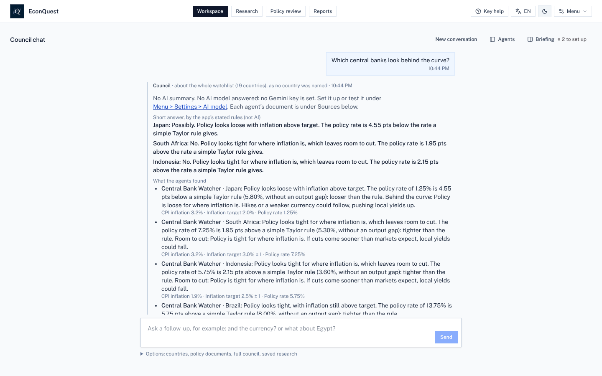
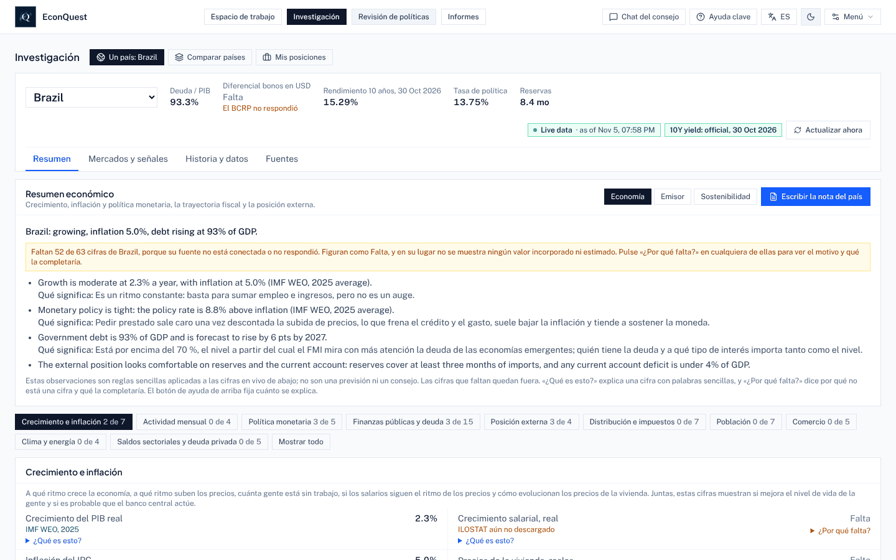

# EconQuest Sovereign Council Terminal

**English** · [Español](./README.es.md) · [Français](./README.fr.md) · [Português](./README.pt.md)

EconQuest is a free, open-source research terminal for understanding countries' economies, their
governments' finances and the risks around them. It gathers figures from free public sources (the
IMF, the World Bank, the Bank for International Settlements, central banks, statistics offices and
others), shows each one with where it came from and when, and lets you put questions to a council of
specialist AI agents that answer only from those figures.

It runs on your own computer. There is no EconQuest website to sign up to and no account with us:
your keys, your saved research and the questions you ask stay with you. The whole app is in
**English, Spanish, French and Brazilian Portuguese**.


*Research > One country, Summary. Each figure names its source and date; a figure no source supplied
reads Missing, with the reason.*

This is research and teaching software, not investment advice.

## Contents

- [Why it exists](#why-it-exists)
- [Why use EconQuest](#why-use-econquest)
- [Free, open and independent](#free-open-and-independent)
- [The one rule: only real figures](#the-one-rule-only-real-figures)
- [What you can do with it](#what-you-can-do-with-it)
- [Walk-through with screenshots](#walk-through-with-screenshots)
- [Quick start](#quick-start)
- [Documentation](#documentation)
- [Licence](#licence)

---

## Why it exists

In the maintainer's words:

> "In 2026 we feel and see the economic effects of poor economic policies. I wanted to see if I could
> make a tool that could assist people in learning and understanding economics, finding multiple and
> optimal financial and policy options, and attempting to bring the best tools to the most
> underserved countries."

Professional economic terminals cost tens of thousands of dollars a year, which puts them out of reach
of most students, journalists, smaller finance ministries and central banks, and analysts in the
countries that most need careful economic policy. EconQuest aims to offer much of the same research,
built on free official data, with every method written down so anyone can check it.

**Who it is for:** analysts of emerging-market government debt and credit, economists at central
banks, finance ministries and international institutions, macro and currency investors, country-risk
teams, teachers and students, journalists, and anyone who wants to understand what is happening to an
economy and why.

---

## Why use EconQuest

- **Every number can be traced.** Each figure names its source and date; a gap reads Missing, never
  an estimate.
- **Tested in public, failures included.** Each signal and forecast rule is written down before it is
  tested, and every result stays on record ([track record](docs/TRACK_RECORD.md)).
- **AI explains, it never supplies figures.** Answers are checked against the app's own numbers and
  labelled. Every figure, chart and test works with no AI at all.
- **Built for lower-income countries too.** Remittances, aid, food prices, disasters and the 59
  countries on the IMF and World Bank low-income list sit beside the G20.
- **From question to policy brief.** A policy review runs from the problem to options, precedents, a
  memo and a one-page brief for non-economists.
- **Yours, on your computer.** No account, no fees, no tracking. Your keys and research stay with you.
- **Four languages, four help levels.** English, Spanish, French and Brazilian Portuguese, with
  plain-language help.

**What it does not do.** It has no paid market data unless you bring your own account; credit ratings
and analyst consensus read Missing. It is research and teaching software, not investment advice.

---

## Free, open and independent

- **The app is free**, on every computer, and will stay free. There are no paid tiers and no adverts.
- **No tracking.** The app sends nothing about you to the project: no usage counts, no crash reports,
  no analytics. What leaves your computer, and when, is listed in [docs/PRIVACY.md](./docs/PRIVACY.md).
- **Open source.** The code is under the Apache License 2.0 and the documentation, methods notes and
  learning content are under CC BY 4.0, so anyone may use, change and share them (see [Licence](#licence)).
- **Donations, only through the project website.** Once the project has a fiscal host, gifts will be
  taken only through the website, by GitHub Sponsors and Open Source Collective. Until then it takes no
  donations ([GOVERNANCE.md](./GOVERNANCE.md)). Donors and sponsors have no say over methods, results or
  which countries are covered.
- **Public home.** The public copy of the project will live at
  [github.com/e-conquest/econquest](https://github.com/e-conquest/econquest), with the ready-made app at
  `ghcr.io/e-conquest/econquest`.

---

## The one rule: only real figures

A number appears only when a live feed, an official series or your own file supplied it. Anything
else reads **Missing**, with the reason ("Needs setup", "Feed did not answer", "No source yet"). There
are no built-in, sample or AI-estimated figures anywhere in the app. If the app does not know a
figure, it says so rather than guess.

Paid data (for example credit default swap prices, LSEG, EPFR, credit ratings or analyst consensus) is
used only from your own account or your own file, behind a switch in Settings, and is never passed on
in downloads or shared copies. If you already pay for Macrobond, Trading Economics or EODHD, you can
connect it with your own key and pick the series you want; those figures stay on your computer.

---

## What you can do with it

- **Ask a question in plain words** on Workspace, in Council chat. Specialist agents answer from the
  app's figures, each naming its source, and "what if" questions get an answer in eight parts.
- **Study one country** in Research > One country: a plain summary, markets and signals, charts going
  back years, forecasts with ranges, and tools for debt, inflation, the currency, weather and disasters.
- **Compare countries** side by side, starting with the G20 or the 15 largest lower-income countries.
- **Test a policy choice** in Policy review, from the problem to a memo and a one-page brief for
  non-economists, and see how countries went after making the same kind of change.
- **Write a report** as Markdown or PDF, with every source and date.
- **Learn as you go** with four help levels, a plain-language glossary and five worked examples.
- **Use the figures in R, Python, Stata or Excel**, or connect another program to the app.

Every figure, chart and test works without any AI model. The full list of tasks and tools is in
**[Features and details](docs/FEATURES.md#what-you-can-do-with-it)**.

---

## Walk-through with screenshots

The full walk-through, with numbered steps for each task, is in **[docs/GUIDE.md](./docs/GUIDE.md)**
(also in [Spanish](./docs/GUIDE.es.md), [French](./docs/GUIDE.fr.md) and [Portuguese](./docs/GUIDE.pt.md)).
It covers: the first start, asking the council (including what-if questions), studying a country
and its tools, comparing countries, writing a
policy review and a report, choosing an AI model, the tools and data checks, language and help levels,
the weather and insurance tools, using it on a phone, and trying Quests.

| | |
| --- | --- |
|  **Ask the council.** Type a question or pick an example; the answer comes first, each line with its figures, and the Agents panel shows which agents answered and why. |  **Read the history.** Every chart says what it measures, whose figure it is and how to read it. |
|  **Compare countries.** Story leads and where markets and the data disagree. |  **Review a policy.** Frame a problem and work it through to a memo. |
|  **Choose an AI model.** Fast model for the desks, large model for the referee. |  **Switch language.** The EN / ES / FR / PT button in the header. |

The screenshots were taken on 24 November 2026 (two in the guide, Quests and Peers, are from
13 November) from a local build of the main branch, replaying feed
replies recorded on 5 November 2026 from the sources whose terms allow passing data on. That is why
many figures read Missing in them; on a computer that reaches the feeds, more fill in.

---

## Quick start

> **Not public yet.** The public copy at github.com/e-conquest/econquest and the ready-made app at
> `ghcr.io/e-conquest/econquest` have not been published yet, so the download links and the
> `git clone` address below do not work until they are. This note comes out on the day they go live.
> Until then, testers install from the code at github.com/smcarus/econquest:
> [docs/TESTING.md](docs/TESTING.md) has the steps.

**New to this?** [docs/INSTALL.md](docs/INSTALL.md) is a plain-language, step-by-step guide: install
Docker Desktop, download one file, and run the ready-made app. No building and no programming needed.

**Ready-made app.** Install [Docker Desktop](https://www.docker.com/products/docker-desktop/) and start
it. Then open a terminal and type these lines.

On a Mac or Linux, in the **Terminal** app:

```sh
mkdir econquest
cd econquest
curl -fsSLO https://raw.githubusercontent.com/e-conquest/econquest/main/deploy/quick-start/compose.yml
docker compose up -d
```

On Windows, in **PowerShell** (search for it in the Start menu):

```powershell
mkdir econquest
cd econquest
Invoke-WebRequest -Uri https://raw.githubusercontent.com/e-conquest/econquest/main/deploy/quick-start/compose.yml -OutFile compose.yml
docker compose up -d
```

Then open **http://localhost:3737** in your browser. You need macOS, Windows 10 or 11, or 64-bit Linux,
8 GB of memory (4 GB in light mode) and 5 GB of free disk; all the sizes are in
[Features and details](docs/FEATURES.md#system-requirements-and-sizes).

**Modest laptop** (4 GB of memory or little disk): put `LIGHT_MODE=on` in a `.env` file next to
`compose.yml` before starting: in the terminal, `echo LIGHT_MODE=on > .env` on a Mac or Linux, or
`Set-Content .env LIGHT_MODE=on` in Windows PowerShell. Light mode runs no AI model on your computer (the council uses your own
Gemini key, or stays off), leaves out the 3.4 GB of GDELT news files, and downloads only your
watchlist countries ([INSTALL.md, On a modest laptop](docs/INSTALL.md#on-a-modest-laptop)). From the
code: `scripts/start-mac.sh --light`, or `scripts\start-windows-light.bat` on Windows.

**From the code** (Node.js 20.19 or later, or 22.12 or later):

```sh
git clone https://github.com/e-conquest/econquest.git
cd econquest
npm install
npm run go           # update, install, start the app and begin the daily data download
```

`npm run go` pulls the latest code, installs packages, downloads the AI models if you use Ollama,
rebuilds and starts the Docker app on http://localhost:3737 and the development app on
http://localhost:3000, and begins the daily data download in the background. On a Mac you can
double-click `econquest-mac.command` instead (Windows: `scripts/start-windows.bat`).

To run it on an always-on Linux box or NAS, see [docs/HOME_SERVER.md](docs/HOME_SERVER.md); on a
Kubernetes cluster, the Helm chart in `deploy/helm/econquest/` ([docs/KUBERNETES.md](docs/KUBERNETES.md)).

### First run

A new install shows dashes until the first download finishes. Under the chat welcome, a short
**New here? Three steps** card says where to start (ask a question, open Research, and optionally add
an AI model) until you press **Got it**. The **Briefing** panel on Workspace lists what is left to set
up:

1. **See which sources answer.** Menu > Tools > Data connections (or `npm run check:data`) lists every
   source as connected (with a figure it returned), needs setup, off, or why it failed.
2. **Add a free FRED key** in Menu > Settings > Free data keys (⌘, or Ctrl+,). It fills official
   10-year yields for several countries.
3. **Choose an AI model** in Menu > Settings > AI model ([AI models](docs/FEATURES.md#ai-models-which-to-use-sizes-and-settings)).
4. **Pick your countries** with Edit on the watchlist card.
5. **Pick your language and help level** with the buttons in the header.

Keys saved in Settings go to `data/local/settings.json` (never in git, never in backups or the audit
log) and take effect without a restart.

---

## Documentation

| Document | What it covers |
| --- | --- |
| [docs/FEATURES.md](./docs/FEATURES.md) | Everything the app does, in detail: every task and tool, sizes and requirements, AI models and their settings, languages, Quests, data sources, how to check it, the commands, the roadmap and the notes for developers (also [ES](./docs/FEATURES.es.md), [FR](./docs/FEATURES.fr.md), [PT](./docs/FEATURES.pt.md)) |
| [docs/GUIDE.md](./docs/GUIDE.md) | Walk-through with screenshots, task by task (also [ES](./docs/GUIDE.es.md), [FR](./docs/GUIDE.fr.md), [PT](./docs/GUIDE.pt.md)) |
| [docs/INSTALL.md](./docs/INSTALL.md) | Step-by-step install for people new to this, with requirements and sizes |
| [docs/USER_MANUAL.md](./docs/USER_MANUAL.md) | Every page and panel in detail |
| [docs/GLOSSARY.md](./docs/GLOSSARY.md) | Every economic, market and testing term in plain words |
| [docs/HOW_IT_WORKS.md](./docs/HOW_IT_WORKS.md) | How the app works, in plain words: where the figures come from, what the AI does and does not do, how a rule is tested, and one result read step by step |
| [docs/METHODOLOGY.md](./docs/METHODOLOGY.md) | How data is sourced, how the council is checked, and how models and signals are tested and graded |
| [docs/METHODS.md](./docs/METHODS.md) | A methods note per model and signal, with its pre-registered backtests and recorded verdicts |
| [docs/TRACK_RECORD.md](./docs/TRACK_RECORD.md) | Every pre-registered test on record, passed or failed, with the Holm correction |
| [docs/DATA_SOURCES.md](./docs/DATA_SOURCES.md) | Every source, what it fills, how to set it up |
| [docs/DATA_LICENCES.md](./docs/DATA_LICENCES.md) | What each source's terms allow |
| [docs/DATA_API.md](./docs/DATA_API.md), [docs/openapi.json](./docs/openapi.json) | Reading the app's figures from R, Python and Stata, and connecting an outside system (tokens, events, webhooks, snapshots, holdings, hidden names, scenarios) |
| [docs/RESEARCH_TOOLS.md](./docs/RESEARCH_TOOLS.md) | Council chat calling a research-tools server you run (MCP): settings, what is sent, the audit log |
| [docs/DEPLOYMENT.md](./docs/DEPLOYMENT.md) | Running it as a service for another system: reverse proxy and TLS, service tokens, health checks, the daily-download deadline |
| [docs/POLICY_REVIEW.md](./docs/POLICY_REVIEW.md) | The policy review steps |
| [docs/QUESTS.md](./docs/QUESTS.md) | Quests, their rules and the checklist before they are turned on |
| [docs/ROADMAP.md](./docs/ROADMAP.md) | What is planned next, in order |
| [docs/MAINTENANCE.md](./docs/MAINTENANCE.md) | The upkeep routine and what happens when a source ends |
| [docs/RISK_AND_COMPLIANCE.md](./docs/RISK_AND_COMPLIANCE.md) | Audit log, model register, report sign-off |
| [docs/BACKUP_AND_RESTORE.md](./docs/BACKUP_AND_RESTORE.md) | Backups and moving to another computer |
| [docs/HOME_SERVER.md](./docs/HOME_SERVER.md), [docs/KUBERNETES.md](./docs/KUBERNETES.md) | Running it for a household, team or class |
| [docs/PRIVACY.md](./docs/PRIVACY.md) | What stays on your computer, what leaves it, and when |
| [docs/TESTING.md](./docs/TESTING.md) | For testers before the public release: installing from the code in light mode, what to try, and how to report a problem |
| [docs/ACCESSIBILITY.md](./docs/ACCESSIBILITY.md) | How EconQuest works with a keyboard, a screen reader and reduce motion, what is checked (WCAG 2.2 AA), known gaps |
| [docs/SECURITY.md](./docs/SECURITY.md), [docs/SECURITY_REVIEW.md](./docs/SECURITY_REVIEW.md) | Accounts, sign-in (including OpenID Connect), sessions, the audit seal, and the security review |
| [docs/ARCHITECTURE.md](./docs/ARCHITECTURE.md) | How the code fits together: how a figure travels from a source to the screen and the council, and where to start for common changes |
| [docs/DESIGN_SYSTEM.md](./docs/DESIGN_SYSTEM.md) | UI rules for contributors |
| [docs/FEATURES.md, For developers](./docs/FEATURES.md#for-developers) | Development commands, the stack, tests on real replies, and connecting an outside system |
| [CONTRIBUTING.md](./CONTRIBUTING.md) | How to contribute, the research rules, and signing off commits |

---

## Licence

Code: [Apache License 2.0](./LICENSE). Documentation, methods notes, validation records, screenshots
and Quest content: [CC BY 4.0](./LICENSE-docs.md). Figures fetched from outside sources keep their own
terms ([docs/DATA_LICENCES.md](./docs/DATA_LICENCES.md)); the bundled UCDP datasets are CC BY 4.0
([NOTICE](./NOTICE)). Contributions are signed off under the Developer Certificate of Origin (DCO).

Contributions are welcome: see [CONTRIBUTING.md](./CONTRIBUTING.md), the
[code of conduct](./CODE_OF_CONDUCT.md), [GOVERNANCE.md](./GOVERNANCE.md) and, for security problems,
[SECURITY.md](./SECURITY.md). To cite the software, use [CITATION.cff](./CITATION.cff).
