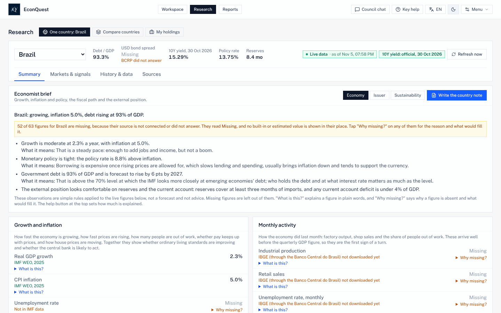
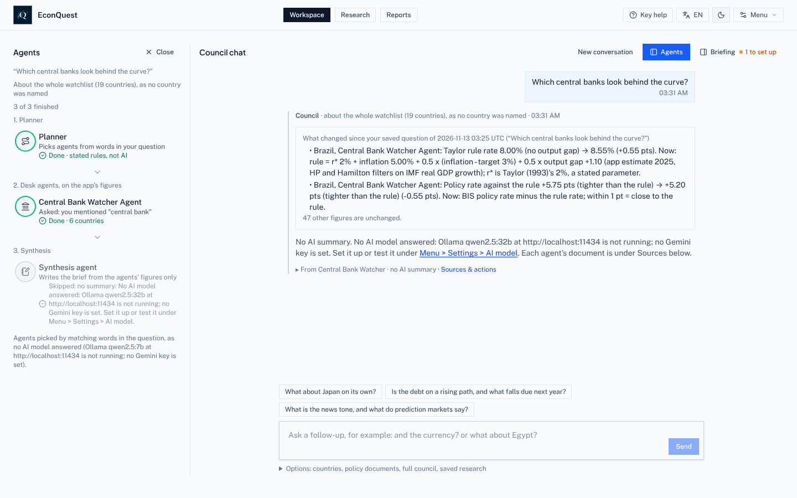
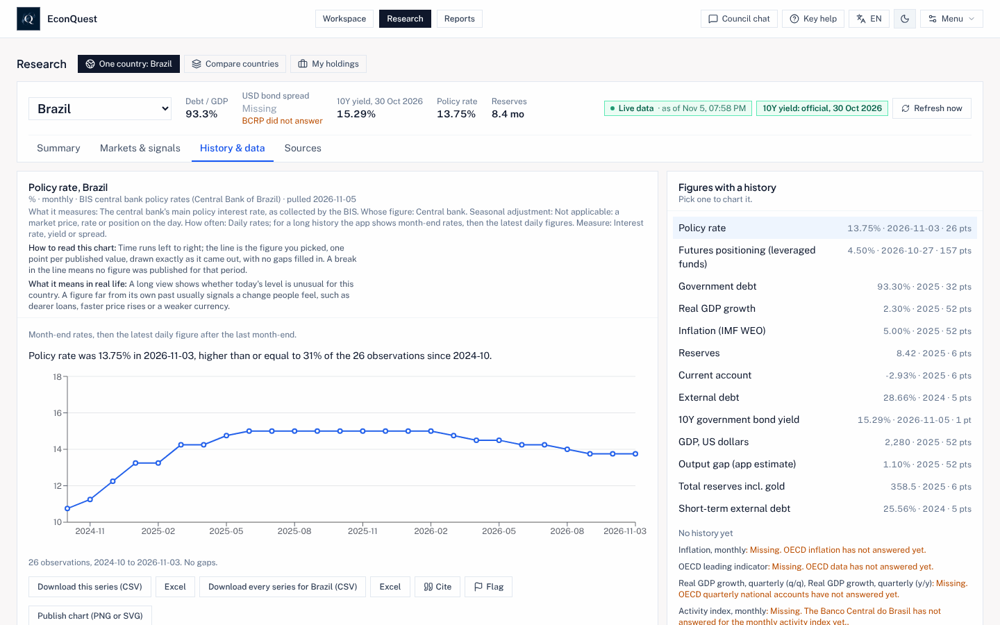
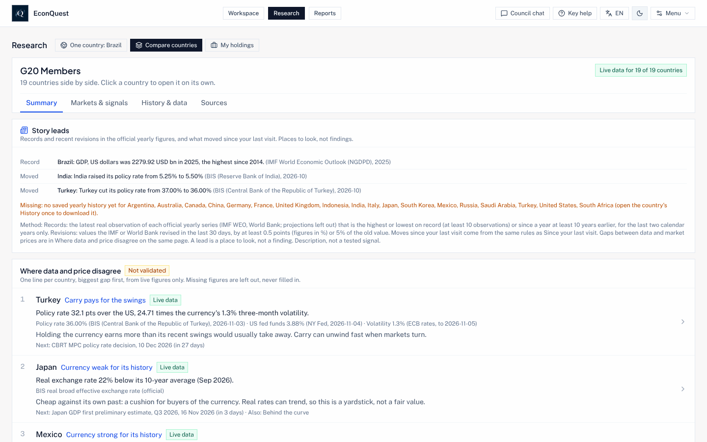
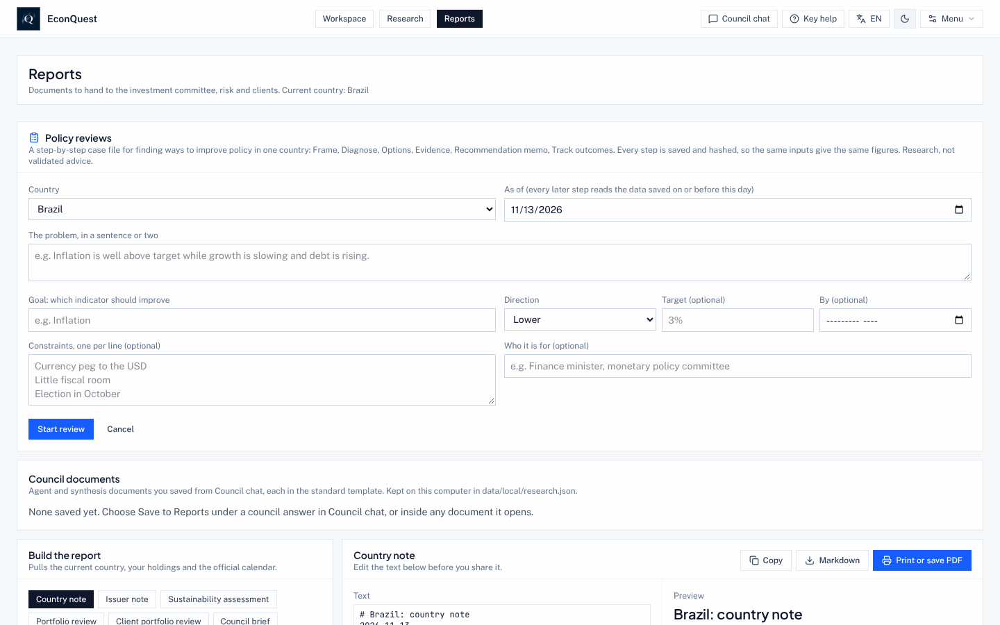
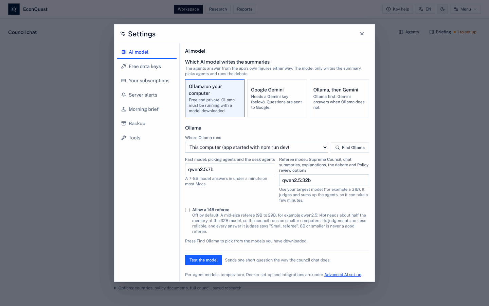
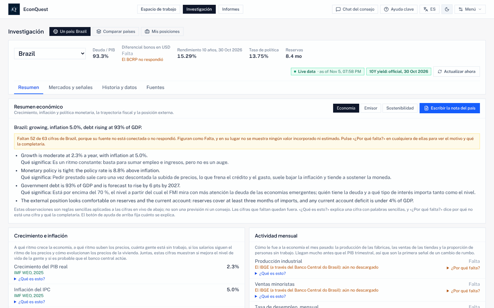
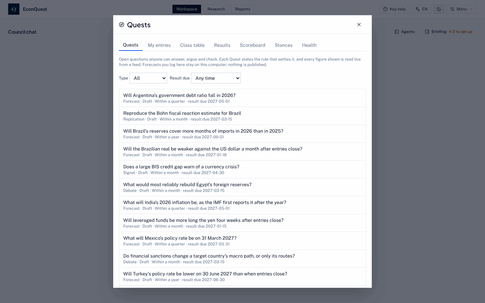

# EconQuest Sovereign Council Terminal

**English** · [Español](./README.es.md) · [Français](./README.fr.md) · [Português](./README.pt.md)

EconQuest is a free, open-source research terminal for understanding countries' economies, their
governments' finances and the risks around them. It gathers figures from free public sources (the
IMF, the World Bank, the Bank for International Settlements, central banks, statistics offices and
others), shows each one with where it came from and when, and lets you put questions to a council of
specialist AI agents that answer only from those figures.

It runs on your own computer. There is no EconQuest website to sign up to and no account with us:
your keys, your saved research and the questions you ask stay with you. The whole app is in
**English, Spanish, French and Brazilian Portuguese**.



*Research > One country, Summary. Each figure names its source and date; a figure no source supplied
reads Missing, with the reason.*

This is research and teaching software, not investment advice.

## Contents

- [Why it exists](#why-it-exists)
- [Free, open and independent](#free-open-and-independent)
- [The one rule: only real figures](#the-one-rule-only-real-figures)
- [What you can do with it](#what-you-can-do-with-it)
- [Walk-through with screenshots](#walk-through-with-screenshots)
- [Quick start](#quick-start)
- [System requirements and sizes](#system-requirements-and-sizes)
- [AI models: which to use, sizes and settings](#ai-models-which-to-use-sizes-and-settings)
- [Languages](#languages)
- [Quests: crowdsourcing answers to economic questions](#quests-crowdsourcing-answers-to-economic-questions)
- [Where the data comes from](#where-the-data-comes-from)
- [How you can check it](#how-you-can-check-it)
- [Commands](#commands)
- [Roadmap](#roadmap)
- [Documentation](#documentation)
- [For developers](#for-developers)
- [Licence](#licence)

---

## Why it exists

In the maintainer's words:

> "In 2026 we feel and see the economic effects of poor economic policies. I wanted to see if I could
> make a tool that could assist people in learning and understanding economics, finding multiple and
> optimal financial and policy options, and attempting to bring the best tools to the most
> underserved countries."

Professional economic terminals cost tens of thousands of dollars a year, which puts them out of reach
of most students, journalists, smaller finance ministries and central banks, and analysts in the
countries that most need careful economic policy. EconQuest aims to offer much of the same research,
built on free official data, with every method written down so anyone can check it.

**Who it is for:** analysts of emerging-market government debt and credit, economists at central
banks, finance ministries and international institutions, macro and currency investors, country-risk
teams, teachers and students, journalists, and anyone who wants to understand what is happening to an
economy and why.

## Free, open and independent

- **The app is free**, on every computer, and will stay free. There are no paid tiers and no adverts.
- **Open source.** The code is under the Apache License 2.0 and the documentation, methods notes and
  learning content are under CC BY 4.0, so anyone may use, change and share them (see [Licence](#licence)).
- **Donations, only through the project website.** Once the project has a fiscal host, gifts will be
  taken only through the website, by GitHub Sponsors and Open Source Collective. Until then it takes no
  donations ([GOVERNANCE.md](./GOVERNANCE.md)). Donors and sponsors have no say over methods, results or
  which countries are covered.
- **Public home.** The public copy of the project will live at
  [github.com/e-conquest/econquest](https://github.com/e-conquest/econquest), with the ready-made app at
  `ghcr.io/e-conquest/econquest`.

---

## The one rule: only real figures

A number appears only when a live feed, an official series or your own file supplied it. Anything
else reads **Missing**, with the reason ("Needs setup", "Feed did not answer", "No source yet"). There
are no built-in, sample or AI-estimated figures anywhere in the app. If the app does not know a
figure, it says so rather than guess.

Paid data (for example credit default swap prices, LSEG, EPFR, credit ratings or analyst consensus) is
used only from your own account or your own file, behind a switch in Settings, and is never passed on
in downloads or shared copies.

---

## What you can do with it

| Task | Where | What you get |
| --- | --- | --- |
| Ask a question in plain words | **Workspace** (Council chat) | Specialist agents answer from the app's figures, each naming its source; with an AI model, a summary agent writes a short brief that may quote only their figures, and a number check flags any figure it cannot trace |
| Study one country | **Research > One country** | Summary, Markets & signals, History & data and Sources: charts going back years, nowcasts and forecasts with ranges, output gap, debt sustainability, reserve adequacy, policy rules, crisis early-warning, yield curve, inflation drivers, growth accounting, IMF forecasts by edition, and "as of" views of what was known on a past day. For lower-income countries: remittances, aid received, financial inclusion, commodity prices and terms of trade, food prices and food security, and natural disasters |
| Compare countries | **Research > Compare countries** | Your watchlist side by side (the 19 G20 member countries to start with), story leads and where market prices and the data disagree |
| Follow your holdings | **Research > My holdings** | A list of bonds or positions you load, against the risks and signals |
| Test a policy choice | **Reports > New policy review** | A step-by-step case file: frame the problem, diagnose, rank options, check the evidence and precedents, write a recommendation memo and a one-page brief for non-economists, then track what happened. Compare the diagnosis with up to six peer countries, get a warning on the start page when a watched figure crosses its trigger, and see what changed when you review the same policy again |
| Try a fiscal what-if | **History & data**, or from Council chat | Change government spending or taxes and see the likely effect on growth and debt, using published multipliers and budget elasticities, with a range |
| Write a report | **Reports** | Country notes, issuer notes, debt sustainability assessments, portfolio and client reviews and council briefs, as Markdown or PDF with sources and dates |
| Learn as you go | Header buttons, **Menu > User manual**, **Menu > Worked examples** | Three help levels, a plain-language glossary, four worked case studies, teaching episodes and exam mode |
| Bring your own data and tests | **Menu > Your data**, **Menu > Models & validation** | Load your own CSV series; register your own signal or model test under the same strict rules as the app's own |
| Use the figures in R, Python or Stata | [docs/DATA_API.md](./docs/DATA_API.md) | The same series, panels and tables the screens show, with source and date on every value |

**Council chat** is the heart of the app. The agents are Central Bank, Fiscal & Debt, Politics &
Events, Relative Value, FX (currencies), Global Spillover, Calendar, Timing and Behavioural Finance,
plus a Document agent that reads policy papers you upload. **Run the full council** sends one country
to nine specialist agents on three desks (geopolitics, sovereign credit and the wider economy); they
debate, and the app stops for your approval before writing the final report. A larger AI model acts as
the **referee**, judging whether each answer sticks to the figures ([AI models](#ai-models-which-to-use-sizes-and-settings)).

**Every figure, chart and test works without any AI model.** The AI is needed only for the chat
summary, debates and plain-language explanations, and each answer it writes is labelled as AI-written.

---

## Walk-through with screenshots

The full walk-through, with numbered steps for each task, is in **[docs/GUIDE.md](./docs/GUIDE.md)**
(also in [Spanish](./docs/GUIDE.es.md), [French](./docs/GUIDE.fr.md) and [Portuguese](./docs/GUIDE.pt.md)).
It covers: the first start, asking the council, studying a country, comparing countries, writing a
policy review and a report, choosing an AI model, the tools and data checks, language and help levels,
using it on a phone, and trying Quests.

| | |
| --- | --- |
|  **Ask the council.** Type a question or pick an example; the Agents panel shows which agents answered and why. |  **Read the history.** Every chart says what it measures, whose figure it is and how to read it. |
|  **Compare countries.** Story leads and where markets and the data disagree. |  **Review a policy.** Frame a problem and work it through to a memo. |
|  **Choose an AI model.** Fast model for the desks, large model for the referee. |  **Switch language.** The EN / ES / FR / PT button in the header. |

The screenshots were taken on 13 November 2026 from a local build of the main branch, replaying feed
replies recorded on 5 November 2026 from the sources whose terms allow passing data on. That is why
many figures read Missing in them; on a computer that reaches the feeds, more fill in.

---

## Quick start

**New to this?** [docs/INSTALL.md](docs/INSTALL.md) is a plain-language, step-by-step guide: install
Docker Desktop, download one file, and run the ready-made app. No building and no programming needed.

**Ready-made app** (Docker Desktop running):

```sh
mkdir econquest && cd econquest
curl -fsSLO https://raw.githubusercontent.com/e-conquest/econquest/main/deploy/quick-start/compose.yml
docker compose up -d          # then open http://localhost:3737
```

**Modest laptop** (4 GB of memory or little disk): put `LIGHT_MODE=on` in a `.env` file next to
`compose.yml` before starting. Light mode runs no AI model on your computer (the council uses your own
Gemini key, or stays off), leaves out the 3.4 GB of GDELT news files, and downloads only your
watchlist countries ([INSTALL.md, On a modest laptop](docs/INSTALL.md#on-a-modest-laptop)). From the
code: `scripts/start-mac.sh --light`, or `scripts\start-windows-light.bat` on Windows.

**From the code** (Node.js 20.19 or later, or 22.12 or later):

```sh
git clone https://github.com/e-conquest/econquest.git
cd econquest
npm install
npm run go           # update, install, start the app and begin the daily data download
```

`npm run go` pulls the latest code, installs packages, downloads the AI models if you use Ollama,
rebuilds and starts the Docker app on http://localhost:3737 and the development app on
http://localhost:3000, and begins the daily data download in the background. On a Mac you can
double-click `econquest-mac.command` instead (Windows: `scripts/start-windows.bat`).

To run it on an always-on Linux box or NAS, see [docs/HOME_SERVER.md](docs/HOME_SERVER.md); on a
Kubernetes cluster, the Helm chart in `deploy/helm/econquest/` ([docs/KUBERNETES.md](docs/KUBERNETES.md)).

### First run

A new install shows dashes until the first download finishes. The **Briefing** panel on Workspace
lists what is left to set up:

1. **See which sources answer.** Menu > Tools > Data connections (or `npm run check:data`) lists every
   source as connected (with a figure it returned), needs setup, off, or why it failed.
2. **Add a free FRED key** in Menu > Settings > Free data keys (⌘, or Ctrl+,). It fills official
   10-year yields for several countries.
3. **Choose an AI model** in Menu > Settings > AI model ([AI models](#ai-models-which-to-use-sizes-and-settings)).
4. **Pick your countries** with Edit on the watchlist card.
5. **Pick your language and help level** with the buttons in the header.

Keys saved in Settings go to `data/local/settings.json` (never in git, never in backups or the audit
log) and take effect without a restart.

---

## System requirements and sizes

| Part | Minimum | Recommended |
| --- | --- | --- |
| Operating system | macOS (three newest versions), Windows 10 or 11 (64-bit, WSL 2 for Docker Desktop), or 64-bit Linux | The same; Apple Silicon and Intel or AMD all work |
| Memory | 8 GB (4 GB in light mode, a target not yet measured) | 16 GB; 32 GB to run the large AI referee on the same computer |
| Free disk | 5 GB | 10 GB, plus room for AI models (below) |
| Internet | Any connection | One without a small monthly data cap |
| Node.js (only to run from the code) | 20.19 or later, or 22.12 or later | 22 |

### Download sizes

Each figure says how it was found. "Measured" means measured on the date given; "estimate" gives its
method. Measurements from 13 November 2026 are of the main branch through pull request #510.

| What | Size | How the figure was found |
| --- | --- | --- |
| Source code (`git clone`) | 70 MB (29 MB of files and 41 MB of history) | Measured, fresh clone, 13 November 2026 |
| Ready-made app (Docker image) | About 170 MB to download; 798 MB once unpacked | Measured: image built from the repository's Dockerfile on 13 November 2026 (798 MB unpacked, 170 MB compressed with gzip). The download from the registry is compressed the same way, so expect a similar size |
| Installed packages, from the code (`npm install`) | 465 MB | Measured, 13 November 2026 |
| Built web app (`npm run build`) | 6.7 MB in all; 415 KB compressed at start-up | Measured with `npm run size:check`, 13 November 2026 (limits 465 KB and 7.5 MB) |
| Each extra language (Spanish, French, Portuguese) | About 0.7 MB (about 220 KB compressed), downloaded only when picked | Measured from the build, 13 November 2026 |
| First full data download | About 3.6 to 3.8 GB, mostly GDELT news files | Estimate: GDELT about 3.4 GB for 8 weeks (from GDELT's own file sizes), past IMF forecast editions about 100 MB (measured), the rest as in the daily run |
| First data download in light mode | Target: well under 1 GB | Not yet measured; owed from a light-mode run on the developer's Mac before the public release |
| Daily data download | Roughly 150 to 200 MB (about 4.5 to 6 GB a month) | Estimate from recorded replies and file sizes ([INSTALL.md](docs/INSTALL.md#how-much-data-it-downloads)). The daily run now records what it downloads; the measured figure from a week of runs (`npm run go -- status` on the developer's Mac) will replace this estimate |
| AI models through Ollama (optional) | qwen2.5:7b 4.7 GB; qwen2.5:14b 9 GB; qwen2.5:32b 20 GB | Model sizes published by Ollama |
| GDELT long history (optional, `npm run gdelt:daily`) | About 25 GB from 2016 (35 GB from 1979); about 5 MB kept on disk | GDELT's published file sizes; `-- --estimate` gives the exact figure |

### Space used once running

| Set-up | About how much disk | Made up of |
| --- | --- | --- |
| Light mode, no local AI | Target 2 GB | Not yet measured, as above |
| Ready-made app, no local AI | About 1 GB, growing about 40 MB a year | App image 0.8 GB (measured) plus the `data/` folder, about 150 MB after the first few days (measured on the developer's Mac, 9 November 2026, 22 countries) |
| Ready-made app with a 14B referee | About 15 GB | The above plus qwen2.5:7b and qwen2.5:14b (4.7 + 9 GB) |
| Ready-made app with the full local AI | About 26 GB | The above plus qwen2.5:7b and qwen2.5:32b (4.7 + 20 GB) |
| From the code instead of the image | Add about 0.5 GB | Source and history 70 MB, packages 465 MB, build 7 MB (measured) |

Docker Desktop itself needs a few GB more (check docker.com). Every past IMF forecast edition since
2007 would add roughly 300 MB (estimate: about 38 editions at an average of 7 MB). To see the real
size on your own computer, run `du -sh data data/*` in the EconQuest folder, or open Menu > Offline
data. [docs/INSTALL.md](docs/INSTALL.md#what-you-need) has the folder-by-folder tables.

---

## AI models: which to use, sizes and settings

The AI writes the council summary, runs the debate, picks agents for a question and explains figures.
It never supplies a figure: every number comes from a feed, an official series or your file. Choose a
provider in Menu > Settings > AI model.

| Provider | Cost | Privacy | Notes |
| --- | --- | --- | --- |
| **No AI** | Free | Nothing leaves your computer except requests for public figures | Every figure, chart and test works; agents answer from the figures without a written summary |
| **Ollama** on your computer | Free | Everything stays on your computer | Needs the [Ollama app](https://ollama.com/download) and enough memory (below) |
| **Google Gemini** | Free up to Google's daily limits, then billed to your own key | Questions and the figures they use go to Google | Needs a Gemini API key; the default model is `gemini-3.8-flash`, changed with `GEMINI_MODEL` in `.env` |
| **Ollama, then Gemini** | As above | As above | Ollama first; Gemini answers when Ollama does not |
| Local OpenAI-compatible server (such as LM Studio) | Free | Stays on your computer | Under Advanced AI set-up; you set the address and model name |

### Two roles: fast model and referee

| Role | What it does | Default | Rule |
| --- | --- | --- | --- |
| **Fast model** | Picks agents and writes the desk agents' answers | `qwen2.5:7b` (`OLLAMA_QUICK_MODEL`) | A 7 to 8B model answers in under a minute on most Macs |
| **Referee** | The full council's final step, Council chat summaries and explanations, the agent debate, the Policy review Options step and Quest debate briefs | `qwen2.5:32b` (`OLLAMA_DEEP_MODEL`) | 30B or larger counts as a full referee. A model of 8B or less is never used as a referee: it is flagged in Settings and under each answer. A 14B referee is allowed only if you turn on **Allow a 14B referee** (off by default), and every answer it judges says "Small referee" |

### Which set-up for which computer

| Your computer | Recommended set-up |
| --- | --- |
| 4 GB laptop | Light mode with a Google Gemini key, or no AI |
| 8 GB | Google Gemini, or no AI. A local model leaves too little memory for the app, Docker and a browser |
| 16 GB | Ollama `qwen2.5:7b` for the desks, with "Ollama, then Gemini" so Gemini does the refereeing; or opt in to a `qwen2.5:14b` referee, labelled "Small referee" (it needs about half the memory of the 32B model) |
| 32 GB or more, or a graphics card with 24 GB | Everything local: `qwen2.5:7b` and `qwen2.5:32b` |

Download the models once with `ollama pull qwen2.5:7b` and `ollama pull qwen2.5:32b` (or `npm run go`
does it). On a computer without enough memory or a graphics chip the large model can take 10 minutes
or more per full council report; use Gemini for the referee, or run Ollama on a bigger machine
([HOME_SERVER.md](docs/HOME_SERVER.md)).

### Settings the app uses

These are the values in the code today; the ones marked "changeable" are under Menu > Settings > AI
model > Advanced AI set-up.

| Setting | Value | Why |
| --- | --- | --- |
| Temperature, Council chat summary and explanations | 0, with seed 42 | The same figures give the same answer, exactly on the same Ollama model and machine |
| Temperature, Policy review steps | 0 | A rerun reads as close as the model allows |
| Temperature, Quest debate briefs | 0, with seed 42, on the referee | Written once and recorded with its settings |
| Temperature, other steps (full council desks) | 0.2 (changeable, 0 to 1.5) | A little variety between desk answers |
| Context window (Ollama `num_ctx`) | 8,192 tokens (changeable, 1,024 to 65,536) | Enough for a question, the figures and the instructions |
| Answer length cap on long steps (Ollama `num_predict`) | 2,048 tokens; 4,096 for reasoning models | Stops a model that keeps writing padding |
| Wait per model call | 16 seconds for a desk step and 25 for a full-council step by default (changeable, 5 to 180); at least 120 seconds for referee steps | A dead address fails fast; the referee gets time to think |
| Model kept loaded (Ollama `keep_alive`) | 30 minutes on long steps | The next question does not reload a 20 GB model |
| Answer format | JSON checked against a schema; Gemini thinking level low | The app reads each field and checks every figure against its source |

In `.env` (see [deploy/quick-start/env.example](deploy/quick-start/env.example)):
`DEFAULT_AI_PROVIDER` (`ollama` or `gemini`), `OLLAMA_BASE_URL`, `OLLAMA_QUICK_MODEL`,
`OLLAMA_DEEP_MODEL`, `GEMINI_API_KEY`, `GEMINI_MODEL`, `LIGHT_MODE`.

---

## Languages

| Language | Status | Form of address |
| --- | --- | --- |
| English | Complete; the source language | |
| Spanish (español) | Whole app | Formal *usted* |
| French (français) | Whole app | Formal *vous* |
| Brazilian Portuguese (português) | Whole app | *Você* |
| Arabic, Swahili | Planned, not started | |

Every screen, menu, help text, glossary entry and worked example is translated; the one-page policy
brief prints in all four languages. Switch with the **EN / ES / FR / PT** button in the header; the
choice is kept in your browser. A language downloads only when picked, so it never slows the app for
anyone else.

Some things stay as they are written and say so: figures, source names and series names show as the
source gave them; the council agents read questions in English and write their documents in English;
method notes cite papers in English; some text the app's rules write about a country (such as the
brief's headline sentences) is still in English. None of the translations has yet been checked by a
native speaker; help with that is welcome ([CONTRIBUTING.md](./CONTRIBUTING.md)).

This README and the walk-through guide are in all four languages. The other documents are in English.

---

## Quests: crowdsourcing answers to economic questions

Quests turn open economic questions into a public, scored game anyone can join, so that many people
can work on a country's problems, test each other's reasoning against the data, and build a record of
who forecasts well. **Quests are built but switched off.** Menu > Quests is greyed out ("Not yet
available") until every item on the checklist in [docs/QUESTS.md](./docs/QUESTS.md) is ticked and the
project has gone public. To try them on your own computer, add `QUESTS_ENABLED=on` to `.env` and
restart.



**What a Quest is.** One file in `quests/`, with a question and a stated rule for how it is settled
from the app's own feeds. There are four kinds:

| Kind | Example | How it ends |
| --- | --- | --- |
| **Forecast** | "Will Turkey's policy rate be lower on 30 June 2027 than when entries close?" | Settled from the feed by its rule; each entry is scored |
| **Debate** | "What would most reliably rebuild Egypt's foreign reserves?" | Never scored. People argue a position with the app's figures; Claim Check compares every figure they state with the app's; after close an evidence map shows the arguments beside what the figures showed |
| **Replication** | "Reproduce the Bohn fiscal reaction estimate for Brazil" | Each entry gives the figure a person's own public script produced; it reproduces the app's figure if within the stated tolerance. A careful entry that finds a mistake in the app solves the Quest |
| **Signal** | "Does crowded futures positioning come back within six weeks?" | People propose a pre-registered test; each is run once after close, counted in the Holm correction with every other test on record, and badged like the app's own |

**How the game works.**

- **Play in private or in public.** Log an answer privately on your own computer, practise on past
  data (scored at once, not saved), or enter publicly by a pull request the app prepares for you.
  People in countries GitHub blocks can enter by email through a maintainer.
- **Scores against a base rate.** Forecasts are scored with the Brier score against how often the
  thing happened in the past, and number forecasts against "nothing changes", so luck and copying
  gain little.
- **Scoreboard.** Skill with a 90% range, calibration, sharpness, record against the crowd, strengths
  by field and region, streaks, seasons by calendar year and an all-time table. A person is ranked
  only after 12 settled forecasts and with a GitHub account at least 90 days old; nobody is ranked on
  how many Quests they enter. Debates, replications and tests are listed on contributor pages, never
  ranked.
- **Nothing can be changed afterwards.** Approved Quests are fingerprinted; results are written to a
  hash-chained record that fails its check if any line is altered; disputes are decided in public.
- **Open for people without the app.** A static public board (`npm run quests:board`) shows the
  tables, results and the crowd against the base rate, and a yearly open dataset can be deposited
  for a DOI.
- **Rules that keep it sound.** No figures written into a Quest file; Forecast Quests settle only on
  sources whose terms allow sharing with credit; questions on conflict, unrest or casualties run only
  as Debates; no stakes and no prizes. Quests are not a betting market.
- **In the classroom.** Teachers can run Quests with a class code and a private class table; a
  one-term pilot with two professors is planned ([docs/ROADMAP.md](./docs/ROADMAP.md)).

Fourteen draft Quests are in `quests/drafts/`; none is approved yet. The full rules, the maintainer's
steps and the launch checklist are in [docs/QUESTS.md](./docs/QUESTS.md) and
[quests/README.md](./quests/README.md).

---

## Where the data comes from

All of these are free. A few need a free key, which you add in Menu > Settings.

| Area | Sources |
| --- | --- |
| Growth, debt, budgets, trade | World Bank (indicators and debt statistics), IMF (World Economic Outlook, past editions, reserves, balance of payments, reserve currency shares, government spending by purpose), OECD (leading indicators, prices, quarterly GDP, read through DBnomics), IMF monthly consumer prices, Eurostat (inflation, industrial production, government spending), UN Comtrade and WITS (trade partners) |
| Interest rates and bonds | BIS (central bank policy rates, debt securities, real exchange rates), FRED (official 10-year yields; free key), New York Fed rates, US Treasury (foreign holders, auctions), Brazil Treasury, Peru's central bank (EMBIG spreads) |
| Currencies and commodities | Spot exchange rates (open.er-api.com), ECB reference rates, World Bank commodity prices (Pink Sheet), US EIA oil prices (free key) |
| Surveys and expectations | EU business and consumer surveys (European Commission, via Eurostat; a free stand-in for paid PMIs, labelled as such), ECB Survey of Professional Forecasters, Brazil's Focus survey, NY Fed supply chain pressure index |
| Central banks and calendar | Banco Central do Brasil, Banco de México (free token), official central bank decision dates, CPI and GDP release dates from statistics offices' own calendars |
| Politics, conflict and shipping | GDELT news events, UCDP and ACLED conflict data (ACLED files are downloaded by hand), OFAC and UN sanctions lists, the Geopolitical Risk index, IMF PortWatch (ships through chokepoints and port calls) |
| Markets and positioning | Kalshi and Polymarket prediction markets, CFTC Commitments of Traders |
| Lower-income countries | World Bank (remittances and the cost of sending them, Global Findex accounts, aid received as republished from the OECD, food security, commodity trade shares and terms of trade); two files you save yourself: FAOSTAT consumer prices for food price inflation, and EM-DAT natural disasters, downloaded with your own free EM-DAT account (its terms do not allow the app to ship it) |

The full list, with what each source fills and how often it is fetched, is in
[docs/DATA_SOURCES.md](./docs/DATA_SOURCES.md). What each source's terms allow (showing figures to
others, commercial use, credit) is in [docs/DATA_LICENCES.md](./docs/DATA_LICENCES.md).

**How data is kept.** The daily download fetches every free feed once a day in the background, so
opening a page never waits on the internet (log: `data/local/logs/daily.log`). If a source fails, the
last good figure is kept with "kept from the <date> pull" on its label. Every pull is archived by day
in `data/archive/`, so the data as it stood on a past date is never lost. Menu > Settings > Backup
saves your holdings, watchlists and settings, without the keys, as one file.

---

## How you can check it

- **Every figure carries its source and date**, and Menu > Data health shows whether each source is
  still arriving and whether any figure has been revised since it was first shown.
- **Signals and models are tested before they are trusted.** Each test is written down and
  fingerprinted *before* it is run (pre-registration), uses only data that was available at the time,
  counts trading costs, and is checked with resampling. Because many tests are run, the results are
  corrected for luck across all of them (the Holm correction). A test that fails is recorded as failed
  and never re-tuned until it passes.
- **Badges** show where each signal stands: Validated, Provisional, Under review, Withdrawn or Review
  due. Most signals have not passed; the app says so.
- **The track record** keeps every pre-registered test, passed or failed, and a forward record of
  live predictions ([docs/TRACK_RECORD.md](./docs/TRACK_RECORD.md), [docs/METHODS.md](./docs/METHODS.md)).
- **An audit log** records what was asked, which figures were used and who signed off a report.

The full method is in [docs/METHODOLOGY.md](./docs/METHODOLOGY.md).

---

## Commands

| Command | What it does |
| --- | --- |
| `npm run go` | Update and start everything |
| `npm run go -- status` | Show what is running and what the last daily download did, with its size |
| `npm run go -- daily` | Run the daily data download now |
| `npm run go -- --test` | Start, then run the type check and tests |
| `npm run go -- --validate` | Start, then re-run the signal tests and write the report |
| `npm run go -- stop` | Stop the app |
| `npm run dev` | Only the development app, on http://localhost:3000 |
| `npm run check:data` | Live check of every source from this computer |

---

## Roadmap

Planned work, in order (details and status in [docs/ROADMAP.md](./docs/ROADMAP.md)):

1. **Citations, upkeep and feedback** (done): "Cite this" on every chart, table and answer, a size
   review, a monthly source check, and checks of past policy reviews against what happened.
2. **The figures a full terminal needs** (done; revenue by level of government has a second step that waits on the data): inequality, tax revenue and tariffs, low-income
   country debt, people, trade and debt structure, climate, wages and house prices, sector balances,
   monthly activity, and euro area and UK figures as first published.
3. **The public release** at e-conquest/econquest, after a security and Windows check, with a light
   mode for modest laptops (light mode done; release checks under way).
4. **Analysis and policy tools** (done; the crisis early-warning test waits on a data licence): crisis early-warning, external sustainability, the yield
   curve, inflation drivers, growth accounting, a restructuring calculator, behavioural finance, and a
   fuller policy review with precedents, fiscal rules, political feasibility, a trade-off chart and a
   one-page brief.
5. **More languages and teaching**: Portuguese and worked examples (done); Arabic and Swahili
   (planned); Quests in the classroom with a one-term pilot.
6. **A phone app** (paused): a free standalone app that uses your own keys.

Two groups of ideas were brought forward from the parked list on 13 November 2026 and are done: data
for lower-income countries (remittances, financial inclusion, commodity prices and terms of trade,
aid received, food prices and natural disasters) and policy review tools (peer comparison, watch
alerts on the start page, and comparing a review with the earlier one).

---

## Documentation

| Document | What it covers |
| --- | --- |
| [docs/GUIDE.md](./docs/GUIDE.md) | Walk-through with screenshots, task by task (also [ES](./docs/GUIDE.es.md), [FR](./docs/GUIDE.fr.md), [PT](./docs/GUIDE.pt.md)) |
| [docs/INSTALL.md](./docs/INSTALL.md) | Step-by-step install for people new to this, with requirements and sizes |
| [docs/USER_MANUAL.md](./docs/USER_MANUAL.md) | Every page and panel in detail |
| [docs/GLOSSARY.md](./docs/GLOSSARY.md) | Every economic, market and testing term in plain words |
| [docs/METHODOLOGY.md](./docs/METHODOLOGY.md) | How data is sourced, how the council is checked, and how models and signals are tested and graded |
| [docs/METHODS.md](./docs/METHODS.md) | A methods note per model and signal, with its pre-registered backtests and recorded verdicts |
| [docs/TRACK_RECORD.md](./docs/TRACK_RECORD.md) | Every pre-registered test on record, passed or failed, with the Holm correction |
| [docs/DATA_SOURCES.md](./docs/DATA_SOURCES.md) | Every source, what it fills, how to set it up |
| [docs/DATA_LICENCES.md](./docs/DATA_LICENCES.md) | What each source's terms allow |
| [docs/DATA_API.md](./docs/DATA_API.md) | Reading the app's figures from R, Python and Stata |
| [docs/POLICY_REVIEW.md](./docs/POLICY_REVIEW.md) | The policy review steps |
| [docs/QUESTS.md](./docs/QUESTS.md) | Quests, their rules and the checklist before they are turned on |
| [docs/ROADMAP.md](./docs/ROADMAP.md) | What is planned next, in order |
| [docs/MAINTENANCE.md](./docs/MAINTENANCE.md) | The upkeep routine and what happens when a source ends |
| [docs/RISK_AND_COMPLIANCE.md](./docs/RISK_AND_COMPLIANCE.md) | Audit log, model register, report sign-off |
| [docs/BACKUP_AND_RESTORE.md](./docs/BACKUP_AND_RESTORE.md) | Backups and moving to another computer |
| [docs/HOME_SERVER.md](./docs/HOME_SERVER.md), [docs/KUBERNETES.md](./docs/KUBERNETES.md) | Running it for a household, team or class |
| [docs/SECURITY.md](./docs/SECURITY.md), [docs/SECURITY_REVIEW.md](./docs/SECURITY_REVIEW.md) | Accounts, sign-in, sessions, and the security review |
| [docs/DESIGN_SYSTEM.md](./docs/DESIGN_SYSTEM.md) | UI rules for contributors |
| [CONTRIBUTING.md](./CONTRIBUTING.md) | How to contribute, the research rules, and signing off commits |

---

## For developers

```bash
npm run lint         # TypeScript
npm test             # unit and server tests (Node's built-in runner, network replaced by fixtures)
npm run build        # production bundle
npm run size:check   # fails if the start-up download or the whole app grows past its limit
npm run test:smoke   # opens every page of the built app in Chromium with all feeds down
npm run check:data   # live check of every source from this computer
npm run check:imf    # prints the IMF series codes the app matches
npm run record:feeds # records every free feed's real reply for the tests (run where the feeds answer), then the shareable subset
npm run preload      # downloads every free feed for every country, for fast offline use
```

**Stack.** Node.js and Express on the server (`server.ts`, `src/server/`), React 19 and Vite on the
page, TypeScript throughout. AI calls go through `src/server/ai.ts` to Ollama, Google Gemini or an
OpenAI-compatible local server.

**Layout.** `src/utils/` (one module per source or calculation, each with a test in `tests/`),
`src/components/` (React pages and panels), `src/data/` (navigation, official calendar, country list),
`src/i18n/` (English message files, with Spanish in `es/`, French in `fr/` and Portuguese in `pt/`),
`quests/` (Quest files), `docs/validation/` (pre-registered tests and verdicts). Each panel sits inside
a crash guard (`PanelBoundary`), so one failing panel never blanks the app.

**Continuous integration.** Every pull request runs the type check and tests on GitHub
(`.github/workflows/ci.yml`); changes to code also run the build, size check and browser tests, and
changes to packaging also build the app image. The smoke test needs Playwright's Chromium once:
`npx playwright install chromium`. `tests/server.test.ts` and the smoke test start the real server
with `tests/helpers/offline-fetch.mjs` in place of the network.

**Size limits.** Every screen added since the start loads only when it is opened, and each language
downloads only when picked. The start-up download must stay under 465 KB compressed and the whole app
under 7.5 MB; `npm run size:check` enforces both.

**Tests on real replies.** `npm run record:feeds`, run on a computer that reaches the feeds, saves
what every free feed really sends (gzipped, keys taken out of every URL, own paid data and AI switched
off) in `tests/fixtures/recorded/`, with what the app made of it. `tests/recorded.test.ts` replays those
replies through the real server with the clock set back to the recording, and fails, naming the
source, if a source connected then no longer is or a figure filled then is now Missing. The same run
builds `tests/fixtures/recorded-public/`: only the replies from sources whose terms allow passing data
on. That folder ships in the public repository, so `tests/recordedPublic.test.ts` gives outside
contributors the same check without a key. Council prompts have their own recorded replay
(`npm run council:record`, `tests/councilRecorded.test.ts`).

**Screenshots.** The images in `docs/images/` come from a build that replays
`tests/fixtures/recorded-public/` (start the server with
`NODE_OPTIONS="--import ./tests/helpers/replay-fetch.mjs" REPLAY_DIR=tests/fixtures/recorded-public`),
so they show only figures whose sources allow passing them on.

### Integration API

Other apps can read council output from `/api/v1/integration/*` (desks, bundle, publish, an SSE
stream, deliveries, and `openapi.json`). It answers `404 NO_COUNCIL_RUN` until you have run the full
council on that country, and never sends built-in figures. Set `SMCR_INTEGRATION_API_KEY` and
`SMCR_WEBHOOK_HMAC_SECRET` in `.env` to fix the key and signing secret. The same key lets a script
read the [data API](docs/DATA_API.md) addresses, and only those, on a copy with sign-in on.

An outside portfolio system can name countries by ISO alpha-2 or alpha-3 (every answer carries
both) and positions by ISIN, LEI, CIK or ticker plus its own entity ID, which comes back unchanged.
See "Connecting an outside portfolio system" in [docs/DATA_API.md](docs/DATA_API.md) and the
address list in [docs/openapi.json](docs/openapi.json). It signs in with a named, revocable API token made
in Menu > Settings > API tokens, limited to the scopes it needs (`read:data`, `read:council`,
`read:events`, `write:holdings`, `write:exclusions`, `run:scenarios`); every use is in the audit
log. `SMCR_INTEGRATION_API_KEY` still works as a legacy key with the three read scopes. Any call may carry an
`X-Correlation-Id` header, which is sent back and written into the audit log entries it makes. Events (signal and badge changes,
revisions, stale or failed feeds, sanctions list changes, releases due tomorrow, council runs and
the daily download) can be read after an id, streamed live, or sent to webhooks signed with HMAC-SHA256
and retried with backoff; see "Events and webhooks" in [docs/DATA_API.md](docs/DATA_API.md). An outside
system can also set its own indicator watches (none is built in); a crossing after the daily download
sends a `threshold_crossed` event. `GET /api/v1/countries/<code>/snapshot` returns every saved figure
for a country, with source, date, badge and shareable flag, without a council run. It includes capital account openness from the Chinn-Ito index (Chinn and Ito 2006), cited and not passed on in sharing mode. With `write:holdings` it
can send its positions (`PUT` or `POST /api/v1/holdings`), which appear in Holdings marked with the token's name. Names on
the hidden-names list (Menu > Settings > Hidden names, or `/api/v1/exclusions`) never appear anywhere; only a
count shows, and the app keeps fingerprints, not names. With `run:scenarios` it can run a shock (emerging-market
currencies, US rates, per-country fiscal shocks) or replay a past crisis (1997, 1998, 2001, 2008, 2013, 2020, 2022) on a
portfolio it sends (`POST /api/v1/scenarios`); results are per position, labelled hypothetical, with Missing moves explained.
The audit log can be sealed (`AUDIT_SEAL_KEY`: an HMAC on every entry) and copied entry by entry to an S3-compatible
bucket with object lock (`AUDIT_BUCKET_URL`); see "Audit seal and locked copies" in [docs/SECURITY.md](docs/SECURITY.md).
Running it as a service for another system (reverse proxy and TLS, `ALLOWED_HOSTS`, service tokens with
`npm run tokens`, `/healthz` and `/readyz`, and `DAILY_DOWNLOAD_DEADLINE`) is covered in [docs/DEPLOYMENT.md](docs/DEPLOYMENT.md).

### Network

`npm run dev` listens on 127.0.0.1, so only this computer can open the app. Docker publishes on
127.0.0.1 too. Set `HOST="0.0.0.0"` in `.env` only if you want other machines on your network to
reach it; Settings can still be changed only from this computer unless `SETTINGS_ALLOW_REMOTE` is
"true".

The server answers only to localhost names (localhost, 127.0.0.1, [::1]), so a website cannot reach
it by pointing its own domain at this computer, and it refuses changes sent from pages on other
sites. If you open it to your network, list the names it may be reached by in `ALLOWED_HOSTS`. The
connector test and webhook buttons work only from this computer and cannot be pointed at the app
itself or at cloud metadata addresses.

---

## Licence

Code: [Apache License 2.0](./LICENSE). Documentation, methods notes, validation records, screenshots
and Quest content: [CC BY 4.0](./LICENSE-docs.md). Figures fetched from outside sources keep their own
terms ([docs/DATA_LICENCES.md](./docs/DATA_LICENCES.md)); the bundled UCDP datasets are CC BY 4.0
([NOTICE](./NOTICE)). Contributions are signed off under the Developer Certificate of Origin (DCO).

Contributions are welcome: see [CONTRIBUTING.md](./CONTRIBUTING.md), the
[code of conduct](./CODE_OF_CONDUCT.md), [GOVERNANCE.md](./GOVERNANCE.md) and, for security problems,
[SECURITY.md](./SECURITY.md). To cite the software, use [CITATION.cff](./CITATION.cff).
