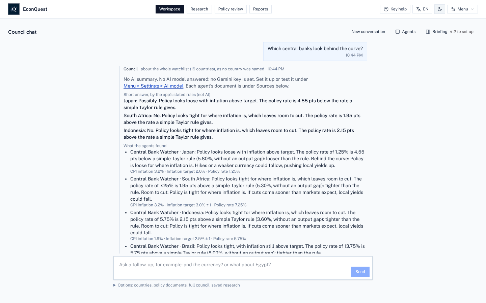
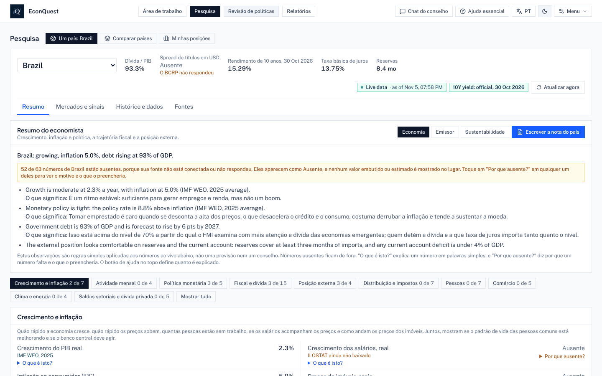

# EconQuest Sovereign Council Terminal

[English](./README.md) · [Español](./README.es.md) · [Français](./README.fr.md) · **Português**

O EconQuest é um terminal de pesquisa gratuito e de código aberto para entender a economia dos países,
as finanças dos seus governos e os riscos ao redor deles. Ele reúne números de fontes públicas gratuitas
(o FMI, o Banco Mundial, o Banco de Compensações Internacionais, bancos centrais, institutos de
estatística e outros), mostra cada um com sua origem e data, e permite que você faça perguntas a um
conselho de agentes de IA especializados que respondem apenas com esses números.

Ele roda no seu próprio computador. Não existe um site do EconQuest para se cadastrar nem uma conta com a
gente: suas chaves, sua pesquisa salva e as perguntas que você faz ficam com você. O app inteiro está em
**inglês, espanhol, francês e português do Brasil**.


*Pesquisa > Um país, aba Resumo (captura em inglês). Cada número mostra sua fonte e data; um número que
nenhuma fonte forneceu aparece como "Ausente", com o motivo.*

Este é um software de pesquisa e ensino, não uma recomendação de investimento.

Esta é uma tradução do [README em inglês](./README.md), que é a versão de referência. Os detalhes de
cada recurso estão em [Recursos e detalhes](./docs/FEATURES.pt.md); as notas para desenvolvedores
existem só em inglês.

## Conteúdo

- [Por que existe](#por-que-existe)
- [Gratuito, aberto e independente](#gratuito-aberto-e-independente)
- [A regra: só números reais](#a-regra-só-números-reais)
- [O que você pode fazer com ele](#o-que-você-pode-fazer-com-ele)
- [Guia com capturas de tela](#guia-com-capturas-de-tela)
- [Início rápido](#início-rápido)
- [Documentação](#documentação)
- [Licença](#licença)

---

## Por que existe

Nas palavras do responsável pelo projeto:

> "In 2026 we feel and see the economic effects of poor economic policies. I wanted to see if I could
> make a tool that could assist people in learning and understanding economics, finding multiple and
> optimal financial and policy options, and attempting to bring the best tools to the most
> underserved countries."
>
> (Em 2026 sentimos e vemos os efeitos econômicos de políticas econômicas ruins. Eu queria ver se
> conseguia criar uma ferramenta que ajudasse as pessoas a aprender e entender economia, a encontrar
> opções financeiras e de política múltiplas e ótimas, e a tentar levar as melhores ferramentas aos
> países menos atendidos.)

Terminais econômicos profissionais custam dezenas de milhares de dólares por ano, o que os deixa fora do
alcance da maioria dos estudantes, jornalistas, ministérios da fazenda e bancos centrais menores, e dos
analistas dos países que mais precisam de uma política econômica cuidadosa. O EconQuest quer oferecer boa
parte dessa mesma pesquisa, com dados oficiais gratuitos e com cada método por escrito para que qualquer
pessoa possa conferir.

**Para quem é:** analistas de dívida e crédito soberano de mercados emergentes, economistas de bancos
centrais, ministérios da fazenda e instituições internacionais, investidores macro e de câmbio, equipes
de risco-país, professores e estudantes, jornalistas e qualquer pessoa que queira entender o que está
acontecendo com uma economia e por quê.

---

## Gratuito, aberto e independente

- **O app é gratuito**, em todos os computadores, e vai continuar assim. Não há planos pagos nem
  anúncios.
- **Sem rastreamento.** O app não envia nada sobre você ao projeto: nem contagem de uso, nem
  relatórios de falha, nem análise de uso. O que sai do seu computador, e quando, está em
  [docs/PRIVACY.md](./docs/PRIVACY.md) (em inglês).
- **Código aberto.** O código está sob a licença Apache 2.0, e a documentação, as notas de método e o
  conteúdo didático sob CC BY 4.0: qualquer pessoa pode usar, alterar e compartilhar.
- **Doações, só pelo site do projeto**, via GitHub Sponsors e Open Source Collective, quando o projeto
  tiver um anfitrião fiscal. Até lá, não aceita doações ([GOVERNANCE.md](./GOVERNANCE.md)). Doadores não
  opinam sobre métodos, resultados ou países cobertos.
- **Casa pública:** [github.com/e-conquest/econquest](https://github.com/e-conquest/econquest), com o
  app pronto para usar em `ghcr.io/e-conquest/econquest`.

---

## A regra: só números reais

Um número só aparece quando veio de uma fonte ao vivo, de uma série oficial ou de um arquivo seu. Todo o
resto aparece como **Ausente**, com o motivo ("Precisa de configuração", "A fonte não respondeu", "Ainda
sem fonte"). Não há números embutidos, de exemplo ou estimados por IA em nenhuma parte do app. Se o app
não conhece um número, ele diz isso em vez de chutar.

Dados pagos (por exemplo preços de CDS, LSEG, EPFR, ratings de crédito ou consenso de analistas) só são
usados a partir da sua própria conta ou arquivo, atrás de uma chave nas Configurações, e nunca são
repassados em downloads ou cópias compartilhadas.

---

## O que você pode fazer com ele

- **Fazer uma pergunta com palavras simples** na Área de trabalho, no Chat do conselho. Agentes
  especializados respondem com os números do app, cada um com sua fonte, e perguntas do tipo "e se"
  recebem uma resposta em oito partes.
- **Estudar um país** em Pesquisa > Um país: um resumo claro, mercados e sinais, gráficos de muitos
  anos, previsões com margens e ferramentas de dívida, inflação, moeda, clima e desastres.
- **Comparar países** lado a lado, começando pelo G20 ou pelos 15 maiores países de baixa renda.
- **Testar uma decisão de política** em Revisão de políticas, do problema a um memorando e a um resumo
  de uma página para quem não é economista.
- **Escrever um relatório** em Markdown ou PDF, com cada fonte e data.
- **Aprender no caminho** com quatro níveis de ajuda, um glossário em linguagem simples e cinco
  exemplos guiados.
- **Usar os números em R, Python, Stata ou Excel**, ou conectar outro programa ao app.

Cada número, gráfico e teste funciona sem nenhum modelo de IA. A lista completa de tarefas e
ferramentas está em **[Recursos e detalhes](docs/FEATURES.pt.md#o-que-você-pode-fazer-com-ele)**.

---

## Guia com capturas de tela

O guia completo, com passos numerados para cada tarefa, está em **[docs/GUIDE.pt.md](./docs/GUIDE.pt.md)**.
Ele cobre: o primeiro início, perguntar ao conselho (inclusive o que uma mudança faria), estudar um
país e suas ferramentas, comparar países, fazer uma revisão
de política e um relatório, escolher um modelo de IA, as ferramentas e a checagem dos dados, idioma e
níveis de ajuda, as ferramentas de clima e seguros, uso no celular e como experimentar as Quests.

| | |
| --- | --- |
|  **Pergunte ao conselho.** A resposta vem primeiro, cada linha com seus números; o painel de agentes mostra quem respondeu e por quê. |  **Leia o histórico.** Cada gráfico diz o que mede, de quem é o número e como ler. |
|  **Compare países.** Pautas e onde mercados e dados discordam. |  **Revise uma política.** Do problema ao memorando. |
|  **Escolha um modelo de IA.** Modelo rápido para as mesas, modelo grande para o árbitro. |  **Troque o idioma.** Botão EN / ES / FR / PT no cabeçalho. |

As capturas foram feitas em 24 de novembro de 2026 (duas do guia, Quests e Pares, são de 13 de
novembro) a partir de uma compilação local do branch principal,
reproduzindo respostas gravadas em 5 de novembro de 2026, apenas das fontes cujos termos permitem repassar
os dados. Por isso muitos números aparecem como "Ausente"; num computador que alcança as fontes, mais
números são preenchidos. A maioria está em inglês; a última mostra o app em português.

---

## Início rápido

> **Ainda não é público.** A cópia pública em github.com/e-conquest/econquest e o app pronto em
> `ghcr.io/e-conquest/econquest` ainda não foram publicados, então os links de download e o endereço
> do `git clone` abaixo só funcionam depois disso. Esta nota sai no dia em que forem publicados.
> Até lá, quem testa o app instala a partir do código em github.com/smcarus/econquest: os passos
> estão em [docs/TESTING.md](docs/TESTING.md) (em inglês).

**É novo nisso?** [docs/INSTALL.md](docs/INSTALL.md) (em inglês) é um guia passo a passo: instale o
Docker Desktop, baixe um arquivo e rode o app pronto. Não é preciso compilar nem programar.

**App pronto para usar.** Instale o [Docker Desktop](https://www.docker.com/products/docker-desktop/) e abra-o.
Depois abra um terminal e digite estas linhas.

Num Mac ou no Linux, no app **Terminal**:

```sh
mkdir econquest
cd econquest
curl -fsSLO https://raw.githubusercontent.com/e-conquest/econquest/main/deploy/quick-start/compose.yml
docker compose up -d
```

No Windows, no **PowerShell** (procure-o no menu Iniciar):

```powershell
mkdir econquest
cd econquest
Invoke-WebRequest -Uri https://raw.githubusercontent.com/e-conquest/econquest/main/deploy/quick-start/compose.yml -OutFile compose.yml
docker compose up -d
```

Depois abra **http://localhost:3737** no navegador. Você precisa de macOS, Windows 10 ou 11, ou Linux de
64 bits, 8 GB de memória (4 GB no modo leve) e 5 GB de disco livre; todos os tamanhos estão em
[Recursos e detalhes](docs/FEATURES.pt.md#requisitos-e-tamanhos).

**Notebook modesto** (4 GB de memória ou pouco disco): coloque `LIGHT_MODE=on` num arquivo `.env` ao lado
do `compose.yml` antes de iniciar: no terminal, `echo LIGHT_MODE=on > .env` num Mac ou no Linux, ou
`Set-Content .env LIGHT_MODE=on` no PowerShell do Windows. O modo leve não roda nenhum modelo de IA no seu computador (o conselho
usa sua própria chave do Gemini, ou fica desligado), deixa de fora os 3,4 GB de arquivos de notícias do
GDELT e baixa apenas os países da sua lista. A partir do código: `scripts/start-mac.sh --light`, ou
`scripts\start-windows-light.bat` no Windows.

**A partir do código** (Node.js 20.19 ou mais recente, ou 22.12 ou mais recente):

```sh
git clone https://github.com/e-conquest/econquest.git
cd econquest
npm install
npm run go           # atualiza, instala, inicia o app e começa o download diário de dados
```

`npm run go` busca o código mais recente, instala os pacotes, baixa os modelos de IA se você usa o Ollama,
reconstrói e inicia o app Docker em http://localhost:3737 e o de desenvolvimento em http://localhost:3000,
e começa o download diário de dados em segundo plano. No Mac você pode dar dois cliques em
`econquest-mac.command` (Windows: `scripts/start-windows.bat`).

### Primeiro início

Abaixo da mensagem de boas-vindas do chat, um cartão curto, **É novo aqui? Três passos**, mostra por
onde começar (fazer uma pergunta, abrir Pesquisa e, se quiser, adicionar um modelo de IA) até você
clicar em **Entendi**. Depois:

1. **Veja quais fontes respondem:** Menu > Ferramentas > Conexões de dados (ou `npm run check:data`).
2. **Adicione uma chave gratuita do FRED** em Menu > Configurações > Chaves de dados gratuitos. Ela
   preenche os rendimentos oficiais de 10 anos de vários países.
3. **Escolha um modelo de IA** em Menu > Configurações > Modelo de IA ([Modelos de IA](docs/FEATURES.pt.md#modelos-de-ia-qual-usar-tamanhos-e-ajustes)).
4. **Escolha seus países** com Editar no cartão da lista de acompanhamento.
5. **Escolha idioma e nível de ajuda** com os botões do cabeçalho.

As chaves ficam em `data/local/settings.json` (nunca no git, nos backups ou no log de auditoria).

---

## Documentação

- [docs/FEATURES.pt.md](./docs/FEATURES.pt.md): tudo o que o app faz, em detalhe, em português
- [docs/GUIDE.pt.md](./docs/GUIDE.pt.md): guia passo a passo com capturas, em português
- Em inglês: [INSTALL.md](./docs/INSTALL.md) (instalação), [USER_MANUAL.md](./docs/USER_MANUAL.md)
  (manual), [GLOSSARY.md](./docs/GLOSSARY.md) (glossário; também dentro do app em português),
  [METHODOLOGY.md](./docs/METHODOLOGY.md), [HOW_IT_WORKS.md](./docs/HOW_IT_WORKS.md), [METHODS.md](./docs/METHODS.md),
  [TRACK_RECORD.md](./docs/TRACK_RECORD.md), [DATA_SOURCES.md](./docs/DATA_SOURCES.md),
  [DATA_LICENCES.md](./docs/DATA_LICENCES.md), [DATA_API.md](./docs/DATA_API.md), [DEPLOYMENT.md](./docs/DEPLOYMENT.md),
  [POLICY_REVIEW.md](./docs/POLICY_REVIEW.md), [QUESTS.md](./docs/QUESTS.md),
  [ROADMAP.md](./docs/ROADMAP.md), [HOME_SERVER.md](./docs/HOME_SERVER.md),
  [PRIVACY.md](./docs/PRIVACY.md), [TESTING.md](./docs/TESTING.md), [ACCESSIBILITY.md](./docs/ACCESSIBILITY.md), [SECURITY.md](./docs/SECURITY.md), [ARCHITECTURE.md](./docs/ARCHITECTURE.md), [CONTRIBUTING.md](./CONTRIBUTING.md)
- Desenvolvedores: [For developers, em Recursos e detalhes em inglês](./docs/FEATURES.md#for-developers)

---

## Licença

Código: [Apache License 2.0](./LICENSE). Documentação, notas de método, registros de validação, capturas de
tela e conteúdo das Quests: [CC BY 4.0](./LICENSE-docs.md). Os números de fontes externas mantêm seus
próprios termos ([docs/DATA_LICENCES.md](./docs/DATA_LICENCES.md)). As contribuições são assinadas sob o
Developer Certificate of Origin (DCO). Para citar o software, use [CITATION.cff](./CITATION.cff).
