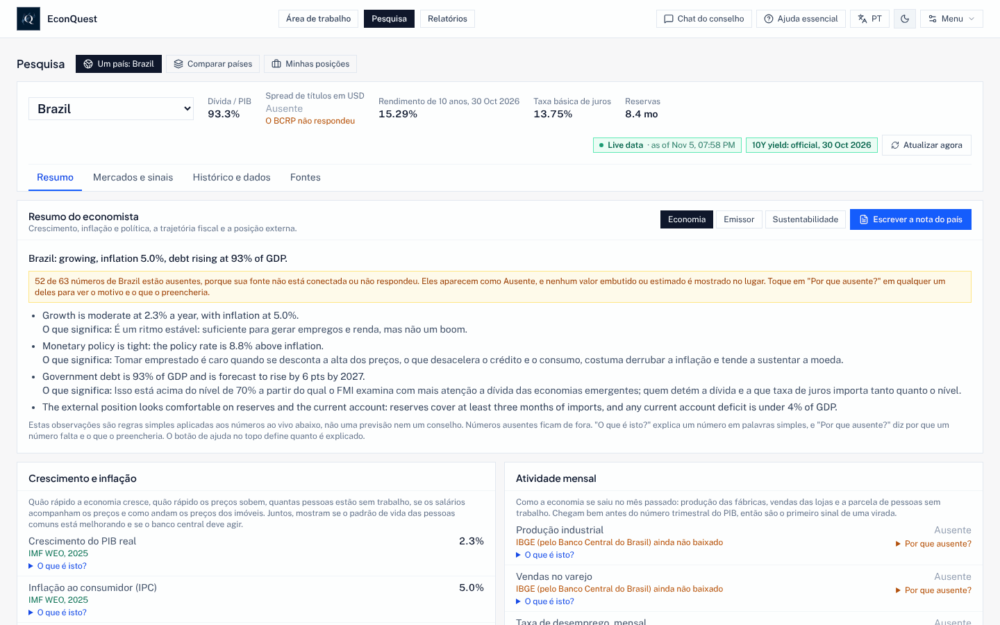

# EconQuest Sovereign Council Terminal

[English](./README.md) · [Español](./README.es.md) · [Français](./README.fr.md) · **Português**

O EconQuest é um terminal de pesquisa gratuito e de código aberto para entender a economia dos países,
as finanças dos seus governos e os riscos ao redor deles. Ele reúne números de fontes públicas gratuitas
(o FMI, o Banco Mundial, o Banco de Compensações Internacionais, bancos centrais, institutos de
estatística e outros), mostra cada um com sua origem e data, e permite que você faça perguntas a um
conselho de agentes de IA especializados que respondem apenas com esses números.

Ele roda no seu próprio computador. Não existe um site do EconQuest para se cadastrar nem uma conta com a
gente: suas chaves, sua pesquisa salva e as perguntas que você faz ficam com você. O app inteiro está em
**inglês, espanhol, francês e português do Brasil**.


*Pesquisa > Um país, aba Resumo (captura em inglês). Cada número mostra sua fonte e data; um número que
nenhuma fonte forneceu aparece como "Ausente", com o motivo.*

Este é um software de pesquisa e ensino, não uma recomendação de investimento.

Esta é uma tradução do [README em inglês](./README.md), que é a versão de referência. A parte para
desenvolvedores existe só em inglês.

## Conteúdo

- [Por que existe](#por-que-existe)
- [Gratuito, aberto e independente](#gratuito-aberto-e-independente)
- [A regra: só números reais](#a-regra-só-números-reais)
- [O que você pode fazer com ele](#o-que-você-pode-fazer-com-ele)
- [Guia com capturas de tela](#guia-com-capturas-de-tela)
- [Início rápido](#início-rápido)
- [Requisitos e tamanhos](#requisitos-e-tamanhos)
- [Modelos de IA: qual usar, tamanhos e ajustes](#modelos-de-ia-qual-usar-tamanhos-e-ajustes)
- [Idiomas](#idiomas)
- [Quests: soluções econômicas construídas por muitos](#quests-soluções-econômicas-construídas-por-muitos)
- [De onde vêm os dados](#de-onde-vêm-os-dados)
- [Como você pode conferir](#como-você-pode-conferir)
- [Roteiro](#roteiro)
- [Documentação](#documentação)
- [Licença](#licença)

---

## Por que existe

Nas palavras do responsável pelo projeto:

> "In 2026 we feel and see the economic effects of poor economic policies. I wanted to see if I could
> make a tool that could assist people in learning and understanding economics, finding multiple and
> optimal financial and policy options, and attempting to bring the best tools to the most
> underserved countries."
>
> (Em 2026 sentimos e vemos os efeitos econômicos de políticas econômicas ruins. Eu queria ver se
> conseguia criar uma ferramenta que ajudasse as pessoas a aprender e entender economia, a encontrar
> opções financeiras e de política múltiplas e ótimas, e a tentar levar as melhores ferramentas aos
> países menos atendidos.)

Terminais econômicos profissionais custam dezenas de milhares de dólares por ano, o que os deixa fora do
alcance da maioria dos estudantes, jornalistas, ministérios da fazenda e bancos centrais menores, e dos
analistas dos países que mais precisam de uma política econômica cuidadosa. O EconQuest quer oferecer boa
parte dessa mesma pesquisa, com dados oficiais gratuitos e com cada método por escrito para que qualquer
pessoa possa conferir.

**Para quem é:** analistas de dívida e crédito soberano de mercados emergentes, economistas de bancos
centrais, ministérios da fazenda e instituições internacionais, investidores macro e de câmbio, equipes
de risco-país, professores e estudantes, jornalistas e qualquer pessoa que queira entender o que está
acontecendo com uma economia e por quê.

## Gratuito, aberto e independente

- **O app é gratuito**, em todos os computadores, e vai continuar assim. Não há planos pagos nem
  anúncios.
- **Código aberto.** O código está sob a licença Apache 2.0, e a documentação, as notas de método e o
  conteúdo didático sob CC BY 4.0: qualquer pessoa pode usar, alterar e compartilhar.
- **Doações, só pelo site do projeto**, via GitHub Sponsors e Open Source Collective, quando o projeto
  tiver um anfitrião fiscal. Até lá, não aceita doações ([GOVERNANCE.md](./GOVERNANCE.md)). Doadores não
  opinam sobre métodos, resultados ou países cobertos.
- **Casa pública:** [github.com/e-conquest/econquest](https://github.com/e-conquest/econquest), com o
  app pronto para usar em `ghcr.io/e-conquest/econquest`.

---

## A regra: só números reais

Um número só aparece quando veio de uma fonte ao vivo, de uma série oficial ou de um arquivo seu. Todo o
resto aparece como **Ausente**, com o motivo ("Precisa de configuração", "A fonte não respondeu", "Ainda
sem fonte"). Não há números embutidos, de exemplo ou estimados por IA em nenhuma parte do app. Se o app
não conhece um número, ele diz isso em vez de chutar.

Dados pagos (por exemplo preços de CDS, LSEG, EPFR, ratings de crédito ou consenso de analistas) só são
usados a partir da sua própria conta ou arquivo, atrás de uma chave nas Configurações, e nunca são
repassados em downloads ou cópias compartilhadas.

---

## O que você pode fazer com ele

| Tarefa | Onde | O que você recebe |
| --- | --- | --- |
| Fazer uma pergunta com palavras simples | **Área de trabalho** (Chat do conselho) | Agentes especializados respondem com os números do app, cada um com sua fonte; com um modelo de IA, um agente de síntese escreve um breve resumo que só pode citar esses números, e uma checagem aponta qualquer número que não consiga rastrear |
| Estudar um país | **Pesquisa > Um país** | Resumo, Mercados e sinais, Histórico e dados, e Fontes: gráficos de muitos anos, estimativas do presente e previsões com faixas, hiato do produto, sustentabilidade da dívida, adequação das reservas, regras de política monetária, alerta antecipado de crise, curva de juros, fatores da inflação, contabilidade do crescimento, previsões do FMI por edição e visões "em um dia passado". Para países de renda mais baixa: remessas, ajuda recebida, inclusão financeira, preços de commodities e termos de troca, preços dos alimentos e segurança alimentar, e desastres naturais |
| Comparar países | **Pesquisa > Comparar países** | Sua lista de acompanhamento lado a lado (os 19 países membros do G20 no início), pautas e onde os preços de mercado e os dados discordam |
| Acompanhar suas posições | **Pesquisa > Minhas posições** | Uma lista de títulos ou posições que você carrega, diante dos riscos e sinais |
| Avaliar uma escolha de política | **Relatórios > Nova revisão de política** | Um dossiê passo a passo: definir o problema, diagnosticar, ordenar opções, checar evidências e precedentes, escrever um memorando de recomendação e um resumo de uma página para quem não é economista, e depois acompanhar o que aconteceu. Compare o diagnóstico com até seis países pares, receba um aviso na página inicial quando um número acompanhado cruzar seu gatilho, e veja o que mudou ao revisar de novo a mesma política |
| Testar um "e se" fiscal | **Histórico e dados**, ou a partir do Chat do conselho | Mude os gastos do governo ou os impostos e veja o efeito provável no crescimento e na dívida, com multiplicadores e elasticidades publicados e uma faixa |
| Escrever um relatório | **Relatórios** | Notas de país e de emissor, avaliações de sustentabilidade, revisões de carteira e resumos do conselho, em Markdown ou PDF com fontes e datas |
| Aprender pelo caminho | Botões do cabeçalho, **Menu > Manual do usuário**, **Menu > Exemplos resolvidos** | Três níveis de ajuda, um glossário em linguagem simples, quatro casos resolvidos, episódios didáticos e modo prova |
| Usar seus próprios dados e testes | **Menu > Seus dados**, **Menu > Modelos e validação** | Carregue suas próprias séries em CSV; registre seu próprio teste de sinal ou modelo com as mesmas regras rígidas dos testes do app |
| Usar os números em R, Python ou Stata | [docs/DATA_API.md](./docs/DATA_API.md) (em inglês) | As mesmas séries, painéis e tabelas das telas, com fonte e data em cada valor |

O **Chat do conselho** é o coração do app. Os agentes são Banco Central, Fiscal e Dívida, Política e
Eventos, Valor Relativo, Câmbio, Contágio Global, Calendário, Timing e Finanças Comportamentais, mais um
agente de Documentos que lê os documentos de política que você envia. **Executar o conselho completo**
manda um país para nove agentes especializados em três mesas (geopolítica, crédito soberano e economia em
geral); eles debatem, e o app espera a sua aprovação antes de escrever o relatório final. Um modelo de IA
maior atua como **árbitro** e julga se cada resposta se atém aos números.

Por enquanto os agentes entendem melhor perguntas em inglês; o app avisa isso junto à caixa de perguntas.

**Todos os números, gráficos e testes funcionam sem nenhum modelo de IA.** A IA só é necessária para o
resumo do chat, os debates e as explicações em linguagem simples, e cada resposta que ela escreve é
marcada como escrita por IA.

---

## Guia com capturas de tela

O guia completo, com passos numerados para cada tarefa, está em **[docs/GUIDE.pt.md](./docs/GUIDE.pt.md)**.
Ele cobre: o primeiro início, perguntar ao conselho, estudar um país, comparar países, fazer uma revisão
de política e um relatório, escolher um modelo de IA, as ferramentas e a checagem dos dados, idioma e
níveis de ajuda, uso no celular e como experimentar as Quests.

| | |
| --- | --- |
|  **Pergunte ao conselho.** O painel de agentes mostra quem respondeu e por quê. |  **Leia o histórico.** Cada gráfico diz o que mede, de quem é o número e como ler. |
|  **Compare países.** Pautas e onde mercados e dados discordam. |  **Revise uma política.** Do problema ao memorando. |
|  **Escolha um modelo de IA.** Modelo rápido para as mesas, modelo grande para o árbitro. |  **Troque o idioma.** Botão EN / ES / FR / PT no cabeçalho. |

As capturas foram feitas em 13 de novembro de 2026 a partir de uma compilação local do branch principal,
reproduzindo respostas gravadas em 5 de novembro de 2026, apenas das fontes cujos termos permitem repassar
os dados. Por isso muitos números aparecem como "Ausente"; num computador que alcança as fontes, mais
números são preenchidos. A maioria está em inglês; a última mostra o app em português.

---

## Início rápido

**É novo nisso?** [docs/INSTALL.md](docs/INSTALL.md) (em inglês) é um guia passo a passo: instale o
Docker Desktop, baixe um arquivo e rode o app pronto. Não é preciso compilar nem programar.

**App pronto para usar** (com o Docker Desktop rodando):

```sh
mkdir econquest && cd econquest
curl -fsSLO https://raw.githubusercontent.com/e-conquest/econquest/main/deploy/quick-start/compose.yml
docker compose up -d          # depois abra http://localhost:3737
```

**Notebook modesto** (4 GB de memória ou pouco disco): coloque `LIGHT_MODE=on` num arquivo `.env` ao lado
do `compose.yml` antes de iniciar. O modo leve não roda nenhum modelo de IA no seu computador (o conselho
usa sua própria chave do Gemini, ou fica desligado), deixa de fora os 3,4 GB de arquivos de notícias do
GDELT e baixa apenas os países da sua lista. A partir do código: `scripts/start-mac.sh --light`, ou
`scripts\start-windows-light.bat` no Windows.

**A partir do código** (Node.js 20.19 ou mais recente, ou 22.12 ou mais recente):

```sh
git clone https://github.com/e-conquest/econquest.git
cd econquest
npm install
npm run go           # atualiza, instala, inicia o app e começa o download diário de dados
```

`npm run go` busca o código mais recente, instala os pacotes, baixa os modelos de IA se você usa o Ollama,
reconstrói e inicia o app Docker em http://localhost:3737 e o de desenvolvimento em http://localhost:3000,
e começa o download diário de dados em segundo plano. No Mac você pode dar dois cliques em
`econquest-mac.command` (Windows: `scripts/start-windows.bat`).

### Primeiro início

1. **Veja quais fontes respondem:** Menu > Ferramentas > Conexões de dados (ou `npm run check:data`).
2. **Adicione uma chave gratuita do FRED** em Menu > Configurações > Chaves de dados gratuitos. Ela
   preenche os rendimentos oficiais de 10 anos de vários países.
3. **Escolha um modelo de IA** em Menu > Configurações > Modelo de IA (abaixo).
4. **Escolha seus países** com Editar no cartão da lista de acompanhamento.
5. **Escolha idioma e nível de ajuda** com os botões do cabeçalho.

As chaves ficam em `data/local/settings.json` (nunca no git, nos backups ou no log de auditoria).

---

## Requisitos e tamanhos

| Item | Mínimo | Recomendado |
| --- | --- | --- |
| Sistema operacional | macOS (as três versões mais recentes), Windows 10 ou 11 (64 bits, WSL 2 para o Docker Desktop) ou Linux 64 bits | O mesmo; Apple Silicon, Intel e AMD funcionam |
| Memória | 8 GB (4 GB no modo leve, uma meta ainda não medida) | 16 GB; 32 GB para rodar o árbitro grande no mesmo computador |
| Disco livre | 5 GB | 10 GB, mais espaço para os modelos de IA |
| Internet | Qualquer conexão | Uma sem limite mensal de dados pequeno |
| Node.js (só a partir do código) | 20.19 ou mais, ou 22.12 ou mais | 22 |

### Tamanhos de download

Cada número diz como foi obtido. "Medido" quer dizer medido na data indicada; "estimativa" traz o
método. As medições de 13 de novembro de 2026 são do branch principal até o pull request #510.

| O quê | Tamanho | Como o número foi obtido |
| --- | --- | --- |
| Código-fonte (`git clone`) | 70 MB (29 MB de arquivos e 41 MB de histórico) | Medido, clone novo, 13 de novembro de 2026 |
| App pronto (imagem Docker) | Cerca de 170 MB para baixar; 798 MB descompactada | Medido: imagem construída com o Dockerfile do repositório em 13 de novembro de 2026 (798 MB descompactada, 170 MB compactada com gzip). O download do registro é compactado da mesma forma, então o tamanho será parecido |
| Pacotes instalados, a partir do código (`npm install`) | 465 MB | Medido, 13 de novembro de 2026 |
| App web compilado | 6,7 MB no total; 415 KB compactados na inicialização | Medido com `npm run size:check`, 13 de novembro de 2026 |
| Cada idioma adicional | Cerca de 0,7 MB (cerca de 220 KB compactados), só quando escolhido | Medido na compilação, 13 de novembro de 2026 |
| Primeiro download completo de dados | Cerca de 3,6 a 3,8 GB, quase tudo arquivos de notícias do GDELT | Estimativa: GDELT cerca de 3,4 GB para 8 semanas (pelos tamanhos publicados pelo GDELT), edições antigas do FMI cerca de 100 MB (medido), o resto como no download diário |
| Primeiro download no modo leve | Meta: bem menos de 1 GB | Ainda não medido; pendente de um teste no Mac do desenvolvedor antes do lançamento |
| Download diário de dados | Cerca de 150 a 200 MB (4,5 a 6 GB por mês) | Estimativa a partir de respostas gravadas e tamanhos de arquivo. O download diário agora registra quanto baixa; o número medido após uma semana (`npm run go -- status` no Mac do desenvolvedor) vai substituir esta estimativa |
| Modelos de IA via Ollama (opcional) | qwen2.5:7b 4,7 GB; qwen2.5:14b 9 GB; qwen2.5:32b 20 GB | Tamanhos publicados pelo Ollama |
| Histórico longo do GDELT (opcional) | Cerca de 25 GB desde 2016 (35 GB desde 1979); cerca de 5 MB ficam no disco | Tamanhos publicados pelo GDELT |

### Espaço ocupado em uso

| Configuração | Disco aproximado | Composição |
| --- | --- | --- |
| Modo leve, sem IA local | Meta de 2 GB | Ainda não medido |
| App pronto, sem IA local | Cerca de 1 GB, crescendo uns 40 MB por ano | Imagem 0,8 GB (medido) mais a pasta `data/`, cerca de 150 MB após os primeiros dias (medido no Mac do desenvolvedor em 9 de novembro de 2026, 22 países) |
| Com um árbitro de 14B | Cerca de 15 GB | O anterior mais qwen2.5:7b e qwen2.5:14b |
| Com toda a IA local | Cerca de 26 GB | O anterior mais qwen2.5:7b e qwen2.5:32b |
| A partir do código em vez da imagem | Some cerca de 0,5 GB | Código e histórico 70 MB, pacotes 465 MB, compilação 7 MB (medido) |

O Docker Desktop precisa de mais alguns GB (veja docker.com). Para ver o tamanho real no seu computador,
rode `du -sh data data/*` na pasta do EconQuest ou abra Menu > Dados offline.

---

## Modelos de IA: qual usar, tamanhos e ajustes

A IA escreve o resumo do conselho, conduz o debate, escolhe os agentes para uma pergunta e explica os
números. Ela nunca fornece um número: cada número vem de uma fonte, de uma série oficial ou do seu
arquivo. Escolha o provedor em Menu > Configurações > Modelo de IA.

| Provedor | Custo | Privacidade | Observações |
| --- | --- | --- | --- |
| **Sem IA** | Grátis | Só saem os pedidos de números públicos | Tudo funciona; os agentes respondem sem resumo escrito |
| **Ollama** no seu computador | Grátis | Tudo fica no seu computador | Precisa do [app Ollama](https://ollama.com/download) e de memória suficiente |
| **Google Gemini** | Grátis até os limites diários do Google; depois é cobrado na sua própria chave | As perguntas e seus números vão para o Google | Precisa de uma chave de API do Gemini; o modelo padrão é `gemini-3.8-flash`, alterado com `GEMINI_MODEL` no `.env` |
| **Ollama, depois Gemini** | Como acima | Como acima | Ollama primeiro; o Gemini responde quando o Ollama não responde |
| Servidor local compatível com OpenAI (como o LM Studio) | Grátis | Fica no seu computador | Em Configuração avançada de IA; você informa o endereço e o modelo |

### Dois papéis: modelo rápido e árbitro

| Papel | O que faz | Padrão | Regra |
| --- | --- | --- | --- |
| **Modelo rápido** | Escolhe os agentes e escreve as respostas das mesas | `qwen2.5:7b` (`OLLAMA_QUICK_MODEL`) | Um modelo de 7 a 8B responde em menos de um minuto na maioria dos Macs |
| **Árbitro** | Etapa final do conselho completo, resumos e explicações do chat, debate dos agentes, etapa de Opções da revisão de política e textos de abertura dos debates das Quests | `qwen2.5:32b` (`OLLAMA_DEEP_MODEL`) | 30B ou mais conta como árbitro completo. Um modelo de 8B ou menos nunca é usado como árbitro. Um árbitro de 14B só é permitido se você ligar **Permitir um árbitro de 14B** (desligado por padrão), e toda resposta que ele julga diz "Árbitro pequeno" |

### Qual configuração para qual computador

| Seu computador | Configuração recomendada |
| --- | --- |
| Notebook de 4 GB | Modo leve com uma chave do Google Gemini, ou sem IA |
| 8 GB | Google Gemini, ou sem IA. Um modelo local deixa pouca memória para o app, o Docker e o navegador |
| 16 GB | Ollama `qwen2.5:7b` para as mesas, com "Ollama, depois Gemini" para o Gemini ser o árbitro; ou ligue um árbitro `qwen2.5:14b`, marcado "Árbitro pequeno" (precisa de cerca de metade da memória do 32B) |
| 32 GB ou mais, ou uma placa de vídeo de 24 GB | Tudo local: `qwen2.5:7b` e `qwen2.5:32b` |

Baixe os modelos uma vez com `ollama pull qwen2.5:7b` e `ollama pull qwen2.5:32b` (ou pelo `npm run go`).
Num computador sem memória suficiente ou sem chip gráfico, o modelo grande pode levar 10 minutos ou mais
por relatório completo; use o Gemini como árbitro ou rode o Ollama numa máquina maior.

### Ajustes que o app usa

Valores atuais do código; os marcados "alterável" ficam em Menu > Configurações > Modelo de IA >
Configuração avançada de IA.

| Ajuste | Valor | Por quê |
| --- | --- | --- |
| Temperatura, resumo e explicações do chat | 0, com semente 42 | Os mesmos números dão a mesma resposta, exatamente com o mesmo modelo Ollama na mesma máquina |
| Temperatura, etapas da revisão de política | 0 | Repetir dá um resultado o mais próximo possível |
| Temperatura, textos de abertura dos debates das Quests | 0, com semente 42, no árbitro | Escritos uma vez e registrados com seus ajustes |
| Temperatura, outras etapas (mesas do conselho completo) | 0,2 (alterável, de 0 a 1,5) | Um pouco de variedade entre as mesas |
| Janela de contexto (`num_ctx` do Ollama) | 8.192 tokens (alterável, de 1.024 a 65.536) | Suficiente para a pergunta, os números e as instruções |
| Tamanho máximo nas etapas longas (`num_predict` do Ollama) | 2.048 tokens; 4.096 para modelos de raciocínio | Interrompe um modelo que continua escrevendo enchimento |
| Espera por chamada | 16 segundos por etapa de mesa e 25 por etapa do conselho completo (alterável, de 5 a 180); pelo menos 120 segundos nas etapas do árbitro | Um endereço fora do ar falha rápido; o árbitro tem tempo |
| Modelo mantido carregado (`keep_alive` do Ollama) | 30 minutos nas etapas longas | A próxima pergunta não recarrega um modelo de 20 GB |
| Formato | JSON conferido por um esquema; nível de raciocínio do Gemini baixo | O app lê cada campo e confere cada número com sua fonte |

No `.env`: `DEFAULT_AI_PROVIDER` (`ollama` ou `gemini`), `OLLAMA_BASE_URL`, `OLLAMA_QUICK_MODEL`,
`OLLAMA_DEEP_MODEL`, `GEMINI_API_KEY`, `GEMINI_MODEL`, `LIGHT_MODE`.

---

## Idiomas

| Idioma | Situação | Tratamento |
| --- | --- | --- |
| Inglês | Completo; idioma de origem | |
| Espanhol | App inteiro | *Usted* |
| Francês | App inteiro | *Vous* |
| Português do Brasil | App inteiro | *Você* |
| Árabe, suaíli | Planejados, não iniciados | |

Todas as telas, menus, textos de ajuda, verbetes do glossário e exemplos resolvidos estão traduzidos; o
resumo de política de uma página sai nos quatro idiomas. Troque com o botão **EN / ES / FR / PT** do
cabeçalho; a escolha fica salva no seu navegador. Um idioma só é baixado quando escolhido.

Algumas coisas ficam como foram escritas, e o app avisa: números, nomes de fontes e de séries aparecem
como a fonte os entrega; os agentes do conselho leem as perguntas e escrevem seus documentos em inglês;
as notas de método citam artigos em inglês; algumas frases que as regras do app escrevem sobre um país
ainda estão em inglês. Nenhuma tradução foi revisada ainda por um falante nativo; ajuda é bem-vinda
([CONTRIBUTING.md](./CONTRIBUTING.md)).

Este README e o guia estão nos quatro idiomas. Os outros documentos estão em inglês.

---

## Quests: soluções econômicas construídas por muitos

As Quests transformam perguntas econômicas abertas num jogo público com pontuação do qual qualquer pessoa
pode participar, para que muita gente trabalhe nos problemas de um país, teste os raciocínios uns dos
outros contra os dados e construa um histórico de quem prevê bem. **As Quests estão construídas, mas
desligadas.** Menu > Quests aparece em cinza ("Ainda não disponível") até que cada item da lista em
[docs/QUESTS.md](./docs/QUESTS.md) seja marcado e o projeto se torne público. Para experimentar no seu
computador, adicione `QUESTS_ENABLED=on` ao `.env` e reinicie.


**O que é uma Quest.** Um arquivo em `quests/` com uma pergunta e uma regra escrita de como ela é
resolvida a partir das próprias fontes do app. Há quatro tipos:

| Tipo | Exemplo | Como termina |
| --- | --- | --- |
| **Previsão** | "A taxa básica da Turquia estará mais baixa em 30 de junho de 2027 do que no fechamento das participações?" | Resolvida pela fonte conforme sua regra; cada participação recebe pontuação |
| **Debate** | "O que reconstruiria com mais segurança as reservas internacionais do Egito?" | Nunca pontuado. Defende-se uma posição com os números do app; o Claim Check compara cada número citado com o do app; depois do fechamento, um mapa de evidências mostra os argumentos ao lado do que os números mostraram |
| **Replicação** | "Reproduza a estimativa de reação fiscal de Bohn para o Brasil" | Cada participação traz o número que um script público próprio produziu; reproduz o número do app se estiver dentro da tolerância. Uma participação cuidadosa que encontra um erro no app resolve a Quest |
| **Sinal** | "Um posicionamento muito concentrado em futuros se desfaz em seis semanas?" | Propõe-se um teste pré-registrado; cada um roda uma única vez após o fechamento, entra na correção de Holm com todos os outros e recebe um selo como os do app |

**Como o jogo funciona.**

- **No privado ou em público.** Registre uma resposta no privado no seu computador, pratique com dados
  passados (pontuação na hora, nada é salvo) ou participe em público com um pull request que o app
  prepara para você. Quem está num país bloqueado pelo GitHub pode participar por e-mail, por meio de um
  responsável.
- **Pontuação contra uma taxa de base.** As previsões são pontuadas com o escore de Brier contra a
  frequência com que o fato aconteceu no passado, e as previsões numéricas contra "nada muda", de modo
  que sorte e cópia rendem pouco.
- **Placar.** Habilidade com faixa de 90%, calibração, nitidez, desempenho contra a multidão, pontos
  fortes por área e região, sequências, temporadas por ano civil e uma tabela de todos os tempos. Uma
  pessoa só entra no ranking depois de 12 previsões resolvidas e com uma conta no GitHub de pelo menos 90
  dias; ninguém é ranqueado pelo número de Quests de que participa. Debates, replicações e testes
  aparecem na página de cada participante, sem ranking.
- **Nada pode ser alterado depois.** As Quests aprovadas têm impressão digital; os resultados vão para um
  registro encadeado por hash que falha se qualquer linha for alterada; as contestações são decididas em
  público.
- **Aberto a quem não tem o app.** Uma página pública estática (`npm run quests:board`) mostra as
  tabelas, os resultados e a multidão contra a taxa de base, e um conjunto de dados aberto anual pode ser
  depositado com DOI.
- **Regras que mantêm tudo sólido.** Nenhum número escrito num arquivo de Quest; as Quests de previsão só
  se resolvem em fontes cujos termos permitem compartilhar com crédito; perguntas sobre conflitos,
  distúrbios ou vítimas só entram como Debates; sem apostas e sem prêmios. As Quests não são um mercado de
  apostas.
- **Na sala de aula.** Professores podem usar as Quests com um código de turma e uma tabela de turma
  privada; está planejado um piloto de um semestre com dois professores.

Há catorze Quests em rascunho em `quests/drafts/`; nenhuma foi aprovada ainda. As regras completas, os
passos do responsável e a lista de lançamento estão em [docs/QUESTS.md](./docs/QUESTS.md) (em inglês).

---

## De onde vêm os dados

Todas são gratuitas. Algumas precisam de uma chave gratuita, adicionada em Menu > Configurações.

| Área | Fontes |
| --- | --- |
| Crescimento, dívida, orçamentos, comércio | Banco Mundial (indicadores e estatísticas de dívida), FMI (Panorama Econômico Mundial e edições passadas, reservas, balanço de pagamentos, composição das reservas, gasto público por função), OCDE (indicadores antecedentes, preços, PIB trimestral, via DBnomics), preços ao consumidor mensais do FMI, Eurostat, UN Comtrade e WITS |
| Juros e títulos | BIS (taxas básicas, títulos de dívida, taxas de câmbio reais), FRED (rendimentos oficiais de 10 anos; chave gratuita), Fed de Nova York, Tesouro dos EUA (detentores estrangeiros, leilões), Tesouro Nacional do Brasil, banco central do Peru (spreads EMBIG) |
| Câmbio e commodities | Câmbio à vista (open.er-api.com), taxas de referência do BCE, preços de commodities do Banco Mundial, preços do petróleo da EIA (chave gratuita) |
| Pesquisas e expectativas | Pesquisas com empresas e consumidores da UE (Comissão Europeia, via Eurostat; substituto gratuito dos PMIs pagos, identificado como tal), pesquisa de previsores profissionais do BCE, boletim Focus do Brasil, índice de pressão das cadeias de suprimentos do Fed de Nova York |
| Bancos centrais e calendário | Banco Central do Brasil, Banco de México (token gratuito), datas oficiais das decisões, datas de divulgação de inflação e PIB dos institutos de estatística |
| Política, conflitos e transporte marítimo | Notícias do GDELT, dados de conflito do UCDP e do ACLED (o ACLED é baixado à mão), listas de sanções da OFAC e da ONU, índice de risco geopolítico, IMF PortWatch |
| Mercados e posicionamento | Mercados de previsão Kalshi e Polymarket, relatório Commitments of Traders da CFTC |
| Países de renda mais baixa | Banco Mundial (remessas e o custo de enviá-las, contas do Global Findex, ajuda recebida como republicada a partir da OCDE, segurança alimentar, peso das commodities no comércio e termos de troca); dois arquivos que você mesmo salva: preços ao consumidor da FAOSTAT para a inflação de alimentos, e desastres naturais do EM-DAT, baixados com sua própria conta gratuita do EM-DAT (os termos não permitem que o app os inclua) |

A lista completa está em [docs/DATA_SOURCES.md](./docs/DATA_SOURCES.md) e o que cada fonte permite em
[docs/DATA_LICENCES.md](./docs/DATA_LICENCES.md) (em inglês).

---

## Como você pode conferir

- **Cada número traz sua fonte e data**, e Menu > Saúde dos dados mostra se cada fonte continua chegando
  e se algum número foi revisado desde que apareceu.
- **Sinais e modelos são testados antes de serem usados.** Cada teste é escrito e recebe uma impressão
  digital *antes* de rodar (pré-registro), usa só dados disponíveis na época, conta os custos de
  negociação e é conferido com reamostragem. Os resultados são corrigidos pela sorte entre todos os testes
  (correção de Holm). Um teste que falha fica registrado como falho e nunca é reajustado.
- **Selos**: Validado, Provisório, Em revisão, Retirado ou Revisão pendente. A maioria dos sinais não
  passou no teste, e o app diz isso.
- **Um log de auditoria** guarda o que foi perguntado, quais números foram usados e quem aprovou um
  relatório.

O método completo está em [docs/METHODOLOGY.md](./docs/METHODOLOGY.md) (em inglês).

---

## Roteiro

Na ordem (detalhes em [docs/ROADMAP.md](./docs/ROADMAP.md), em inglês):

1. **Citações, manutenção e retorno dos usuários** (feito).
2. **Os números de que um terminal completo precisa** (feito; a receita por nível de governo tem uma
   segunda etapa que espera dados).
3. **O lançamento público** em e-conquest/econquest, após uma revisão de segurança e de Windows, com um
   modo leve para notebooks modestos (modo leve feito; revisões em andamento).
4. **Ferramentas de análise e de política** (feito; o teste de alerta antecipado de crise espera uma
   licença de dados).
5. **Mais idiomas e ensino**: português e exemplos resolvidos (feito); árabe e suaíli (planejados);
   Quests na sala de aula com um piloto de um semestre.
6. **Um app para celular** (pausado).

Em 13 de novembro de 2026, dois grupos de ideias foram adiantados da lista de espera e estão feitos:
dados para países de renda mais baixa (remessas, inclusão financeira, preços de commodities e termos de
troca, ajuda recebida, preços dos alimentos e desastres naturais) e ferramentas para a revisão de
política (comparação com pares, avisos na página inicial e comparação de uma revisão com a anterior).

---

## Documentação

- [docs/GUIDE.pt.md](./docs/GUIDE.pt.md): guia passo a passo com capturas, em português
- Em inglês: [INSTALL.md](./docs/INSTALL.md) (instalação), [USER_MANUAL.md](./docs/USER_MANUAL.md)
  (manual), [GLOSSARY.md](./docs/GLOSSARY.md) (glossário; também dentro do app em português),
  [METHODOLOGY.md](./docs/METHODOLOGY.md), [METHODS.md](./docs/METHODS.md),
  [TRACK_RECORD.md](./docs/TRACK_RECORD.md), [DATA_SOURCES.md](./docs/DATA_SOURCES.md),
  [DATA_LICENCES.md](./docs/DATA_LICENCES.md), [DATA_API.md](./docs/DATA_API.md),
  [POLICY_REVIEW.md](./docs/POLICY_REVIEW.md), [QUESTS.md](./docs/QUESTS.md),
  [ROADMAP.md](./docs/ROADMAP.md), [HOME_SERVER.md](./docs/HOME_SERVER.md),
  [SECURITY.md](./docs/SECURITY.md), [CONTRIBUTING.md](./CONTRIBUTING.md)
- Desenvolvedores: [parte For developers do README em inglês](./README.md#for-developers)

---

## Licença

Código: [Apache License 2.0](./LICENSE). Documentação, notas de método, registros de validação, capturas de
tela e conteúdo das Quests: [CC BY 4.0](./LICENSE-docs.md). Os números de fontes externas mantêm seus
próprios termos ([docs/DATA_LICENCES.md](./docs/DATA_LICENCES.md)). As contribuições são assinadas sob o
Developer Certificate of Origin (DCO). Para citar o software, use [CITATION.cff](./CITATION.cff).
