# Guía paso a paso

[English](./GUIDE.md) · **Español** · [Français](./GUIDE.fr.md) · [Português](./GUIDE.pt.md)

Esta guía muestra cómo usar EconQuest, tarea por tarea, con una captura para cada paso. Supone que la
aplicación ya está instalada y abierta en su navegador (consulte [INSTALL.md](./INSTALL.md), en inglés).
Para cada página y panel en detalle, vea el [manual de usuario](./USER_MANUAL.md) (en inglés); para
cualquier término, el glosario dentro de la aplicación (Menú > Manual de usuario).

Sobre las capturas: se tomaron el 24 de noviembre de 2026 (dos, Retos y Pares, son del 13 de noviembre)
de una compilación local de la rama principal,
que reproducía respuestas grabadas el 5 de noviembre de 2026 de las fuentes cuyos términos permiten
transmitir los datos, sin ningún modelo de IA configurado. Por eso muchas cifras aparecen como **Falta**
y el consejo no escribe un resumen en ellas. En su ordenador, con las fuentes accesibles y un modelo de
IA elegido, se rellenan más cifras y el consejo escribe su resumen. Las capturas están en inglés salvo
la de la sección 10; los nombres de los botones se dan aquí tal como aparecen con la aplicación en
español.

## Contenido

1. [La pantalla de un vistazo](#1-la-pantalla-de-un-vistazo)
2. [Primer inicio: qué configurar](#2-primer-inicio-qué-configurar)
3. [Hacer una pregunta al consejo](#3-hacer-una-pregunta-al-consejo)
4. [Estudiar un país](#4-estudiar-un-país)
5. [Mirar atrás en el tiempo](#5-mirar-atrás-en-el-tiempo)
6. [Comparar países](#6-comparar-países)
7. [Revisar una política y escribir un informe](#7-revisar-una-política-y-escribir-un-informe)
8. [Elegir un modelo de IA](#8-elegir-un-modelo-de-ia)
9. [Herramientas, comprobación de datos y el menú](#9-herramientas-comprobación-de-datos-y-el-menú)
10. [Cambiar el idioma y el nivel de ayuda](#10-cambiar-el-idioma-y-el-nivel-de-ayuda)
11. [Usarla en el teléfono](#11-usarla-en-el-teléfono)
12. [Probar los Retos](#12-probar-los-retos)

---

## 1. La pantalla de un vistazo

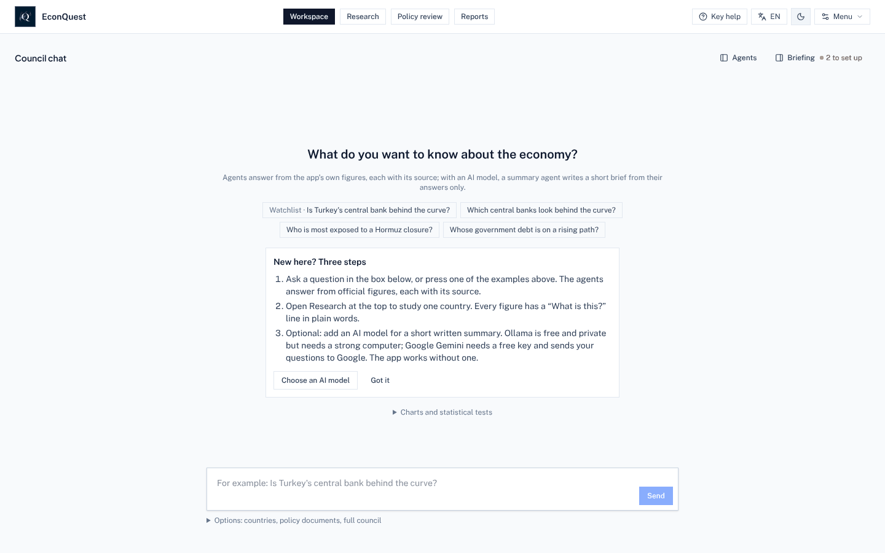

- **Cabecera, en el centro:** las cuatro páginas. **Espacio de trabajo** (Chat del consejo),
  **Investigación** (países y posiciones), **Revisión de políticas** (expedientes paso a paso) e
  **Informes** (notas, informes breves y material docente).
- **Cabecera, a la derecha:** **Chat del consejo** (abre el chat junto a Investigación o Informes), el
  botón del **nivel de ayuda** (aquí *Ayuda clave*), el botón de **idioma** (*ES*), el cambio claro y
  oscuro (hasta que lo pulse, la app sigue el ajuste de su computadora), y **Menú**.
- **Espacio de trabajo, arriba a la derecha:** **Agentes** muestra qué agentes trabajaron en la última
  respuesta; **Resumen** abre sus ajustes, la lista de seguimiento, qué se movió y lo que viene. «1 por
  configurar» cuenta los pasos de configuración pendientes.
- **¿Es nuevo aquí? Tres pasos** (solo en el primer inicio): haga una pregunta, abra Investigación para
  estudiar un país y, si lo desea, añada un modelo de IA. **Elegir un modelo de IA** abre la
  configuración; **Entendido** oculta la tarjeta para siempre en este navegador. Mientras ningún modelo
  de IA funcione, la configuración no muestra ninguno elegido y el Menú dice *IA: sin configurar*: la
  aplicación funciona sin él.

## 2. Primer inicio: qué configurar

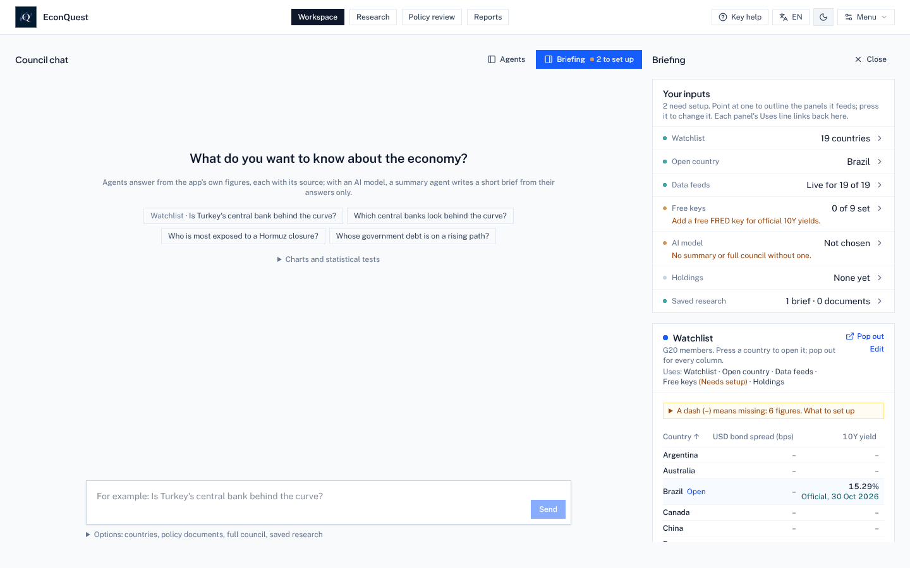

1. En **Espacio de trabajo**, pulse **Resumen**.
2. Lea la lista de ajustes. Cada línea dice qué usa la aplicación: la lista de seguimiento (19 países
   del G20 al empezar), el país abierto, cuántas fuentes respondieron, cuántas claves gratuitas hay, el
   modelo de IA, sus posiciones y su investigación guardada. Pulse una línea para cambiarla.
3. Añada primero la clave gratuita de **FRED** (Menú > Configuración > Claves de datos gratuitos).
   Rellena los rendimientos oficiales de los bonos a 10 años de varios países.
4. Pulse **Editar** en la tarjeta de la lista de seguimiento para añadir o quitar países. Para seguir
   economías más pobres, elija la lista **Países de ingreso bajo**: los 15 mayores por región, de India
   y Nigeria a Ghana y Bolivia. Los 59 países de la lista de deuda de bajos ingresos del FMI y del
   Banco Mundial (Malawi, Sierra Leona, Haití, Ruanda, Nepal, Camboya, los pequeños estados insulares
   y otros) también están en todas las listas de países; la descarga diaria guarda uno en cuanto está
   en una lista de seguimiento y, si no, sus cifras se piden al abrirlo. Un país que no está en la
   lista de la aplicación se puede añadir con **Añadir un país** (en **Investigación > Un país**, o en
   el editor de la lista), que muestra todos los países con su nombre en el idioma de la página;
   desde la siguiente descarga diaria se guarda como los demás, con historia, vistas "a una fecha" y
   alertas (hasta 25 países añadidos; los demás se nombran en **Menú > Datos sin conexión** con el
   motivo).
5. Elija un modelo de IA si quiere resúmenes escritos ([sección 8](#8-elegir-un-modelo-de-ia)). Todo lo
   demás funciona sin él.

Una instalación nueva muestra guiones hasta que termina la primera descarga de datos, que puede tardar
unos minutos.

## 3. Hacer una pregunta al consejo

1. En **Espacio de trabajo**, escriba una pregunta en el cuadro inferior o pulse una pregunta de
   ejemplo. Por ahora los agentes entienden mejor las preguntas en inglés, por ejemplo «Which central
   banks look behind the curve?».
2. Pulse **Enviar**. La respuesta aparece primero. Pulse **Agentes** (arriba a la derecha) para abrir el
   panel que muestra el trabajo:
   - El **Planificador** elige los agentes que cubren su pregunta (con reglas escritas si no hay modelo
     de IA).
   - Los **agentes de mesa** responden con las cifras de la aplicación. Aquí el agente de Banco Central
     cubrió 6 países.
   - El **agente de síntesis** escribe un breve resumen que solo puede citar las cifras de los agentes.
     Sin modelo de IA se omite y dice por qué, como en la captura.

   Cuando a todos los agentes se les preguntó por el mismo motivo, el panel lo dice una sola vez.
3. **Sin modelo de IA**, arriba aparece una **Respuesta breve, según las reglas declaradas de la
   aplicación (no IA)**. A una pregunta sobre si un banco central va por detrás de la curva responde
   *No*, *Posiblemente* o *No claramente* para cada país, según la postura que el agente de Banco
   Central atribuye a la política y la distancia a una regla de Taylor sencilla. Las demás preguntas
   reciben en una línea la postura y la trayectoria de la deuda de cada país. Debajo, **Lo que
   encontraron los agentes** da las líneas de cada agente con sus cifras.
4. La lista de **Falta** bajo la respuesta es corta: se quitan las repeticiones, las cifras que solo son
   más antiguas de lo habitual tienen su propio título (*Más antiguas de lo habitual: léalas con su
   fecha*), y lo que ninguna fuente que lee la aplicación publica para el país se agrupa en una línea.
   El recuento muestra solo lo que se podría completar. Si ya hizo la misma pregunta, **Qué cambió** es
   una línea cuando nada se movió, y se pliega con su recuento cuando algo cambió.
5. Abra **Fuentes y acciones** bajo la respuesta para ver el documento de cada agente, con la fuente y la
   fecha de cada cifra, y guardarlo en Informes.
6. Haga una pregunta de seguimiento en el mismo cuadro o pulse una de las sugeridas bajo la respuesta.
   Si no nombra ningún país, la pregunta cubre toda su lista de seguimiento.
7. **Opciones**, bajo el cuadro, permite elegir países, adjuntar un documento de política para el agente
   de Documentos o **ejecutar el consejo completo**: nueve agentes en tres mesas debaten sobre un país, y
   la aplicación pide su aprobación antes del informe final.

**Preguntar qué haría un cambio.** El Chat del consejo también responde preguntas del tipo «¿y si...?».

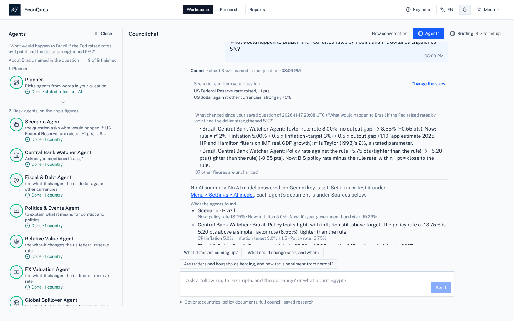

1. Formule el cambio con sus palabras y con su tamaño: «What would happen to Brazil if the Fed raised
   rates by 1 point and the dollar strengthened 5%?». Puede nombrar el tipo de un banco central o de la
   Fed, el costo de endeudamiento del gobierno, el dólar, la moneda, los precios del petróleo, de los
   alimentos o de las materias primas, la tensión financiera, la presión en las cadenas de suministro,
   el crecimiento o la inflación.
2. **Escenario leído de su pregunta** muestra cada cambio que la aplicación entendió, con su tamaño. Si
   usted no dio un tamaño, se lo pide; nunca elige uno por usted.
3. El **Scenario Agent** (agente de escenarios) pone las cifras de hoy junto a las cifras después del
   cambio, para un máximo de cuatro países, y añade lo que ocurrió en episodios pasados del mismo tipo y
   lo que hallaron estudios publicados (cada estudio con su página y su DOI; la cifra de un estudio es
   un promedio de muchos países). Las partes sin cifras dicen **Falta** con el motivo. Para Bolivia,
   Croacia, Irak, Nepal, Pakistán o Turquía, un cambio en el petróleo, los alimentos o la tasa de
   política monetaria recibe también cifras del **modelo del Banco Mundial**, si los modelos de país
   del Banco Mundial están activados (vea la sección 5).
4. Con un modelo de IA configurado, la respuesta llega en ocho partes, de *Dónde estamos hoy* a *Qué
   cambiaría la respuesta*, cada una marcada con el tipo de evidencia en que se apoya: *Datos*, *Cálculo
   de la app*, *Pasado*, *Estudio publicado* o *Interpretación*.
5. Pulse **Cambiar los tamaños**, cambie un tamaño o quite un cambio, y pulse **Volver a preguntar con
   estos cambios**. La nueva respuesta llega como seguimiento, para comparar las dos. Una trayectoria de
   deuda tiene **Guardar para el gráfico de disyuntivas**, que la lleva al gráfico de Sostenibilidad de la
   deuda.

Si usted tiene su propio servidor de herramientas de investigación y lo configura (Menú > Configuración >
Herramientas de investigación), una **mesa cuantitativa** responde también preguntas sobre backtests,
previsiones, volatilidad, nowcasts, precios de opciones, caídas máximas o ratios de Sharpe, con el enlace
de cada cifra, la fecha de sus datos y la etiqueta del servidor (resultado hipotético sobre datos
pasados, no una recomendación). Está apagada hasta que usted la configura
([RESEARCH_TOOLS.md](./RESEARCH_TOOLS.md), en inglés).

## 4. Estudiar un país

Abra **Investigación**. El selector de país está arriba a la izquierda; la franja de al lado muestra
deuda, diferencial de los bonos, rendimiento a 10 años, tipo oficial y reservas, y las etiquetas verdes
indican lo recientes que son los datos. **Actualizar ahora** vuelve a traer las cifras de ese país.

### Resumen

1. **Resumen** se abre primero. El **resumen económico** da los puntos principales en lenguaje sencillo,
   cada uno con «Qué significa» para la vida diaria. *Economía*, *Emisor* y *Sostenibilidad* cambian el
   enfoque.
2. El recuadro amarillo dice cuántas cifras faltan y por qué. Pulse **¿Por qué falta?** junto a cualquiera
   para ver el motivo y qué la rellenaría.
3. **¿Qué es esto?** bajo una cifra la explica. **Explicar** pregunta al consejo qué significa para este
   país.
4. Las cifras se muestran por grupos: elija un grupo en la fila de botones, o **Mostrar todo**.
   **Fuentes** y **Mis posiciones** funcionan igual.
5. **Escribir la nota del país** convierte la página en un borrador de informe.

### Mercados y señales

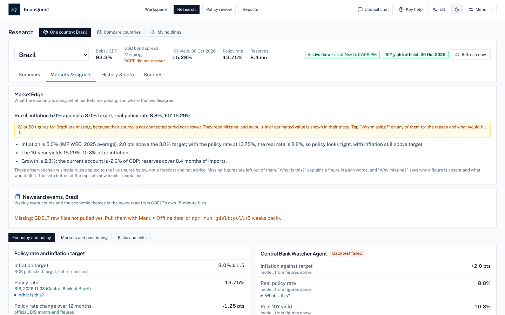

1. Pulse **Mercados y señales**. **MarketEdge** compara lo que hace la economía con lo que descuentan
   los mercados, y dónde discrepan.
2. Cada agente y señal lleva una insignia: *Validada*, *Provisional*, *No validada*, etc. La insignia
   dice hasta dónde ha llegado su prueba. La mayoría de las señales no han superado aún una prueba, y la
   insignia lo dice.
3. Las probabilidades de los mercados de predicción (Kalshi, Polymarket), los diferenciales de los bonos
   y las divisas aparecen aquí cuando sus fuentes responden.
4. La página tiene tres partes: **Economía y política**, **Mercados y posicionamiento** y **Riesgos y
   vínculos**.

### Historia y datos

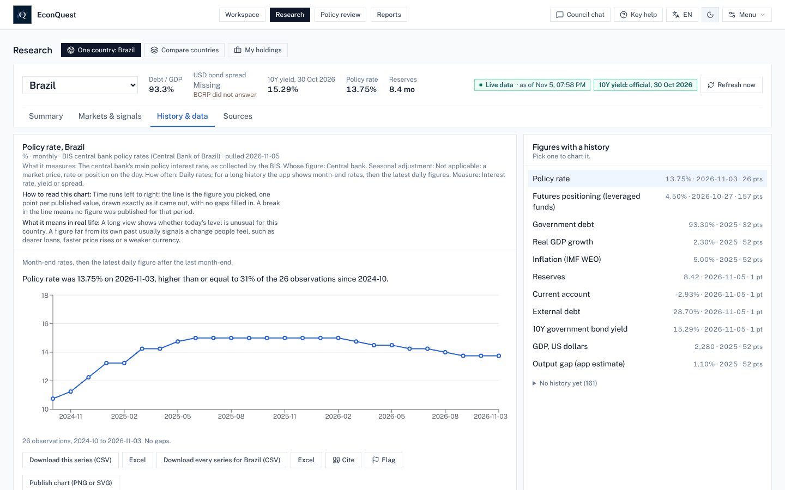

1. Pulse **Historia y datos**. Elija una cifra en **Cifras con historia**, a la derecha, para dibujarla.
2. Encima de cada gráfico: qué mide, de quién es la cifra, con qué frecuencia se publica, cómo leer el
   gráfico y qué significa en la vida real.
3. Debajo: **Descargar esta serie** (CSV o Excel), **Descargar todas las series** del país, **Citar**
   (texto, BibTeX o RIS), **Señalar** (avisar de un problema) y **Publicar el gráfico** (PNG o SVG).
4. Debajo del gráfico, **Herramientas para <país>** enumera todas las herramientas de análisis en ocho
   grupos: Deuda y presupuesto, Tipos y precios, Sector externo y moneda, Crecimiento y previsiones,
   Personas y desarrollo, Riesgos y shocks, Mirar atrás, y Aprender y convertir. Pulse una y se abre
   debajo del gráfico. Para cambiar, elija otra en la lista **Herramienta**, o pulse **Todas las
   herramientas** para volver al menú. Las cifras que aún no tienen historia se agrupan en una línea
   (**Todavía sin historia**) en la lista de la derecha.

   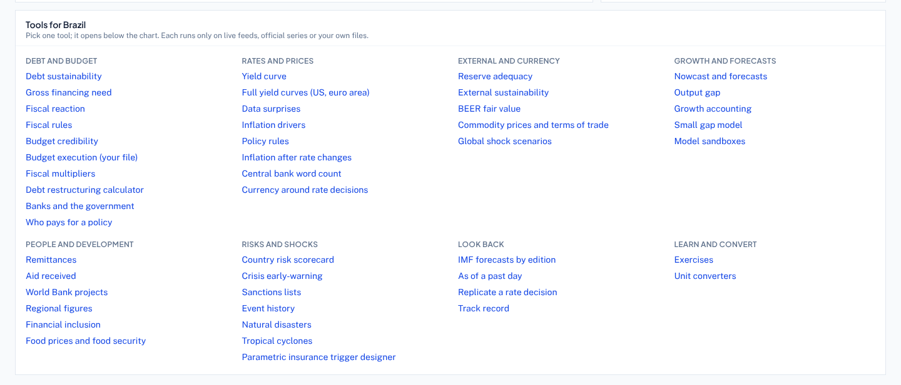

   Entre ellas: estimaciones del presente y previsiones con bandas del 50, 70 y 90 %, brecha del
   producto, sostenibilidad de la deuda, necesidad bruta de financiación, suficiencia de reservas,
   sostenibilidad externa, alerta temprana de crisis, curva de rendimientos, factores de la inflación,
   contabilidad del crecimiento, reglas de política, «¿y si?» fiscales y un pequeño modelo de brecha que
   usted rellena.
5. Herramientas para países de menores ingresos, en Personas y desarrollo y en Riesgos y shocks:
   **Remesas** (junto a exportaciones, inversión y
   ayuda, y el costo de enviar 200 US$ frente a la meta del 3 % de la ONU), **Inclusión financiera**
   (quién tiene una cuenta, por sexo e ingreso), **Precios de materias primas y términos de
   intercambio** (qué significan los últimos movimientos de los precios mundiales para el país, en % del
   PIB), **Ayuda recibida**, **Precios de los alimentos y seguridad alimentaria** y **Desastres
   naturales**. La inflación de alimentos y los desastres se leen de archivos que usted guarda en
   `data/local/fao-cpi/` y `data/local/emdat/`; hasta entonces esas partes dicen Faltante e indican
   dónde obtener el archivo ([INSTALL.md](./INSTALL.md#files-you-save-yourself), en inglés). Bajo
   Desastres naturales, **Modelo de pérdidas** separa el daño de cada año en cuántos eventos dañinos
   hay en un año y qué tan grande es cada uno, y simula 20.000 años para dar la pérdida anual promedio
   y la pérdida superada 1 año de cada 10, 50 y 100, también en % del PIB.
6. **Cifras con historia** también muestra cómo funcionan en la práctica la moneda y la financiación en
   dólares: el **régimen cambiario** (cómo se maneja la moneda de hecho, mes a mes, según el libro de
   Ilzetzki, Reinhart y Rogoff que usted guarda en `data/local/irr/`), los **activos del banco
   central** (su balance en % del PIB, del BIS) y la **tensión de financiación en dólares** (préstamos
   y bonos en dólares de los no bancos del país, del BIS, y las líneas de swap en dólares de la Reserva
   Federal, de la Fed de Nueva York).
7. La misma lista muestra el **clima**: temperatura y lluvia mensuales en la capital desde 1981 (NASA
   POWER) y en promedio sobre todo el país desde 1901 (portal climático del Banco Mundial), cada mes
   frente a su promedio de 1991-2020. Los precios mundiales del arroz, el trigo, el maíz y la soja
   llegan hasta 1960, para poner una sequía junto a un alza de precios.
8. **Seguro paramétrico** le permite esbozar una cobertura que paga según una cifra medida (lluvia,
   temperatura o un precio de alimentos) y no según una pérdida evaluada:
   1. Elija el índice, la temporada, si paga cuando el índice es bajo o alto, el disparador donde
      empieza el pago, la salida donde se paga la cobertura completa y el monto cubierto. El panel abre
      con un diseño tomado del registro (disparador superado cerca de 1 año de cada 5, salida cerca de
      1 de cada 20).
   2. El análisis de siniestralidad repite el diseño en cada temporada pasada: los años en que pagó y
      el pago anual promedio (el costo de siniestralidad).
   3. **Precio justo** suma un recargo que usted elige (un % del pago esperado, o k desviaciones
      estándar del pago anual) y da el precio en % de la cobertura al año.
   4. **¿Qué tan raro es?** dice con qué frecuencia se superan el disparador y la salida, según el
      registro y según una curva de valores extremos ajustada, con un rango del 90%.
   5. **Riesgo de base** compara la cobertura con la otra serie de clima (capital frente a todo el
      país): en cuántos años malos pagó y en cuántos no.
9. **Ciclones tropicales** lista los huracanes, tifones y ciclones que pasaron a menos de 50, 100 o
   200 km del país desde 1980, según las trayectorias IBTrACS de NOAA. No se descarga nada hasta que
   usted pulsa **Descargar trayectorias de tormentas de NOAA**; también puede guardar un archivo
   IBTrACS en `data/local/ibtracs/`.
10. Herramientas para quien gestiona o evalúa un presupuesto, en **Deuda y presupuesto** y **Personas y
    desarrollo**:
    - **Credibilidad del presupuesto**: cuánto del presupuesto aprobado al inicio de cada año gastó de
      verdad el gobierno, con la banda PEFA de cada año (A dentro del 5 % del presupuesto, B dentro del
      10 %, C dentro del 15 %, D más lejos) y una nota calculada por la aplicación (no la puntuación
      oficial de PEFA).
    - **Ejecución del presupuesto (su archivo)**: pulse **Descargar la plantilla**, rellene su
      presupuesto aprobado y el gasto mensual por ministerio o programa, indique en qué mes empieza el
      año fiscal, la unidad y la fuente, y cargue el archivo. Cada línea muestra su gasto frente a la
      parte del año transcurrida; las líneas más de 10 puntos por detrás o por delante se marcan, y los
      meses sin cifra se enumeran, nunca se rellenan. El archivo se queda en su ordenador.
    - **Proyectos del Banco Mundial**: los proyectos en curso en el país, de mayor a menor, con el monto
      comprometido, la parte del plazo previsto ya transcurrida y, para los créditos y donaciones de la
      AIF, la parte desembolsada. Un proyecto que desembolsa despacio para su edad se marca como motivo
      para mirar de cerca.
    - **Cifras regionales**: la producción por persona en cada región, la distancia a la cifra nacional
      y si las regiones se acercaron en diez años; para los países de la UE y la AELC, el PIB por persona
      y el desempleo por región; y el Índice de Desarrollo Humano por región si usted guarda el archivo
      de Global Data Lab en `data/local/gdl/`.
11. Herramientas para economistas y operadores, en **Tipos y precios** y **Crecimiento y previsiones**:
    - **Curvas de rendimiento completas (EE. UU., zona del euro)**: cada plazo de las curvas del Tesoro
      de EE. UU. y de la zona del euro cada día, una curva ajustada, el nivel, la pendiente y la
      curvatura con sus movimientos en un día y en un mes, y el carry y el roll-down a tres meses de
      cada plazo.
    - **Sorpresas en los datos**: cada publicación frente a lo que se esperaba justo antes (la encuesta
      Focus de Brasil, la encuesta de previsores del BCE, el mercado de IPC de Kalshi para Estados
      Unidos o el nowcast del PIB de la propia aplicación), y el **Índice de sorpresas de inflación**,
      que resume las sorpresas recientes de inflación (también una tarjeta en Hoy para Brasil, la zona
      del euro y Estados Unidos). Una descripción, no una señal.
    - **Nowcast y previsiones** añade **Rangos según errores pasados**: un rango del 70 % y del 90 % en
      cada paso probado, según cuánto falló la previsión para este país en su prueba. Con menos de 8
      casos pasados dice **Falta**.
12. La **Ficha de riesgo país** pone lado a lado la gobernanza, los conflictos armados, el malestar
    social, el riesgo geopolítico, la apertura de la cuenta de capital (el índice de Chinn e Ito, citado
    como Chinn e Ito 2006) y la economía, cada dato con su fuente y su año. No da una puntuación global.
    El 13 de noviembre de 2026 se fijó de antemano una prueba de si una gobernanza débil precede a un
    impago, y la superó en su primera ejecución (23 de noviembre de 2026). Tal como se registró la
    prueba, superarla no convierte las lecturas en una puntuación, así que el cuadro sigue diciendo No
    validada.

13. Más herramientas en Historial y datos: **Cómo se propagan los choques entre economías** (un VAR
    global pequeño: elija dónde empieza la sorpresa, crecimiento o inflación, y su tamaño; la
    respuesta de cada economía durante cinco años con una banda del 90 % y la ponderación comercial
    que la explica), el **Modelo de brechas estimado** dentro del modelo de brechas pequeño (solo se
    muestra si superó su prueba registrada de antemano), **Documentos oficiales** (informes del Banco
    Mundial y discursos de banqueros centrales del BPI sobre el país, cada uno enlazado a la página
    del editor) y el **Laboratorio macro** para la enseñanza (demanda y oferta agregadas, y una
    trayectoria de deuda, con controles que empiezan en cero). **Descargar informe sin conexión**
    guarda un archivo HTML de una página con las cifras del país que se abre sin la aplicación.

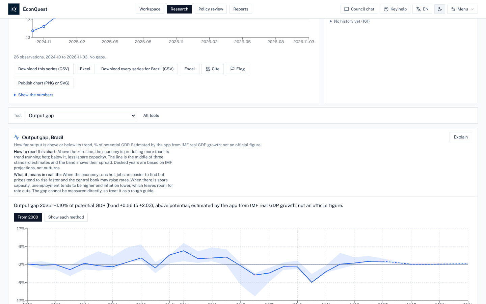

Ejemplo: la **brecha del producto** muestra cuánto funciona la economía por encima o por debajo de su
capacidad normal. La línea es el centro de tres estimaciones estándar, la banda su dispersión, y los
años discontinuos se basan en proyecciones del FMI.

### Fuentes

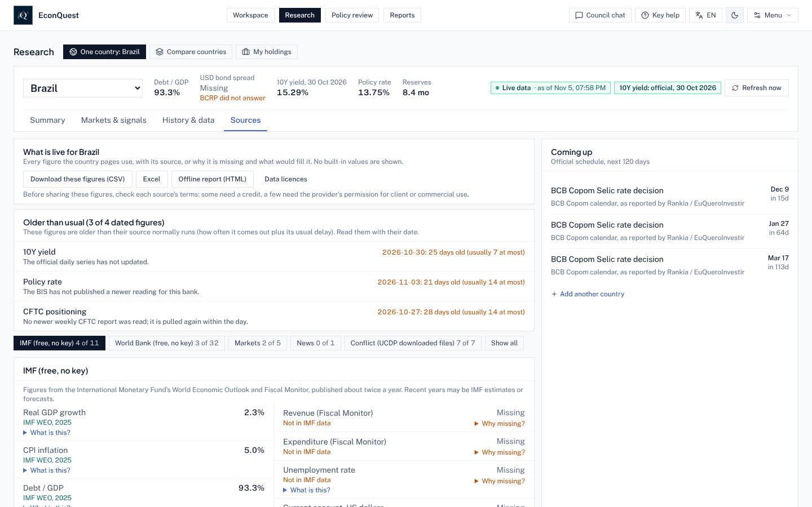

1. Pulse **Fuentes**. Enumera cada cifra de las páginas del país con su fuente, o por qué falta, sin
   nada incorporado.
2. **Más antiguas de lo habitual** señala las cifras cuya fuente va con retraso.
3. **Próximamente** enumera las fechas oficiales (decisiones de bancos centrales, publicaciones de datos)
   de los próximos 120 días.
4. Puede descargar la lista completa en CSV o Excel; **Licencias de datos** dice qué permite compartir
   cada fuente.

## 5. Mirar atrás en el tiempo

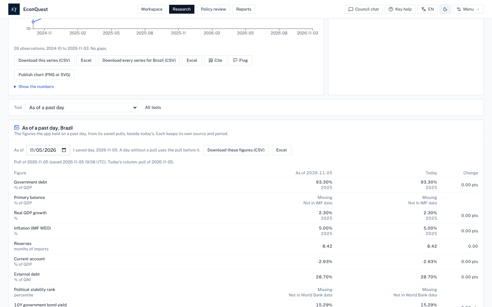

1. En **Historia y datos**, abra **A una fecha pasada** desde el menú de herramientas (en Mirar atrás).
2. Elija una fecha. La tabla muestra cada cifra tal como la tenía la aplicación ese día, junto a la de
   hoy y el cambio. Cada descarga diaria se archiva, así que no se pierde nada.
3. **Previsiones del FMI por edición** (otra herramienta de Mirar atrás) muestra cómo cambió la visión
   del FMI sobre el país de una edición a otra, cuando las ediciones pasadas están guardadas. Bajo su
   tabla, **Rango según errores pasados del FMI** pone un rango del 70 % y del 90 % alrededor de las
   proyecciones de la última edición, según cuánto fallaron las ediciones pasadas para este país.
   **Previsiones oficiales lado a lado** pone juntas las previsiones de crecimiento e inflación del
   FMI, del Banco Mundial (Global Economic Prospects) y de la OCDE (Economic Outlook) para este año y
   los dos siguientes, con la distancia entre ellas; para Estados Unidos añade la encuesta de
   pronosticadores profesionales de la Reserva Federal de Filadelfia desde un archivo que usted guarda.
   Son previsiones oficiales, no un consenso de mercado de pago.
4. Para Bolivia, Croacia, Irak, Nepal, Pakistán y Turquía, **Modelo de país del Banco Mundial** viene
   después en la misma herramienta, una vez activado el servicio opcional de modelos
   ([guía de instalación](./INSTALL.md#add-the-world-bank-country-models-optional), en inglés).
   Muestra las cifras guardadas en el modelo público del Banco Mundial para el país: crecimiento,
   inflación, saldo presupuestario, deuda, cuenta corriente y tasa de política monetaria. Estas
   copias públicas son versiones didácticas con datos antiguos, así que léalas como la trayectoria
   del modelo, no como una previsión. Debajo, **Pruebe un choque en el modelo**: elija el precio
   mundial del petróleo, los precios mundiales de alimentos, las compras del gobierno o (solo
   Pakistán, Turquía e Irak) la tasa de política monetaria, indique un tamaño y pulse **Calcular**.
   La tabla muestra cuánto aleja el choque cada cifra de la trayectoria propia del modelo, año por
   año desde el año en que empieza el choque.

## 6. Comparar países

1. En **Investigación**, pulse **Comparar países**. Su lista de seguimiento aparece lado a lado, con las
   mismas cuatro pestañas que un país.
2. **Pistas para investigar** señala récords, grandes movimientos y revisiones en las cifras oficiales.
3. **Donde los datos y el precio no coinciden** ordena los países en los que mercados y datos apuntan en
   direcciones distintas, con las cifras que lo sustentan.
4. MarketEdge, la exposición a escenarios y el balance de la Fed son partes separadas; **Donde los datos y
   el precio no coinciden** muestra cuatro países hasta que pulsa **Mostrar todo**.
5. Pulse el nombre de un país para abrirlo por separado.

En los países de ingreso bajo, algunas cifras vienen de fuentes más lentas y lo dicen en su etiqueta.
Donde no hay tipo de cambio diario de un banco central o del BCE (por ejemplo el naira, el chelín
keniano o el cedi), el gráfico histórico muestra el tipo medio mensual del FMI por dólar
estadounidense. Donde el BPI no publica el tipo oficial de un país (por ejemplo Egipto, Nigeria, Kenia
o Pakistán), la lista de seguimiento y la página del país muestran la cifra mensual del FMI, marcada
"FMI, mensual" con su mes; aparece como Missing si tiene más de cuatro meses. La previsión inmediata y la previsión de inflación
y la previsión del tipo oficial (Historia y datos) usan las mismas cifras mensuales del FMI para estos
países e indican que son del FMI; un tipo oficial de más de cuatro meses no da previsión. Las metas de inflación y
las fechas de decisión de los bancos centrales solo aparecen donde la página del propio banco las
indica, así que muchos de estos países no muestran ninguna fecha.

**Mis posiciones**, la tercera vista, hace lo mismo con una lista de bonos o posiciones que usted carga
desde un archivo CSV.

## 7. Revisar una política y escribir un informe

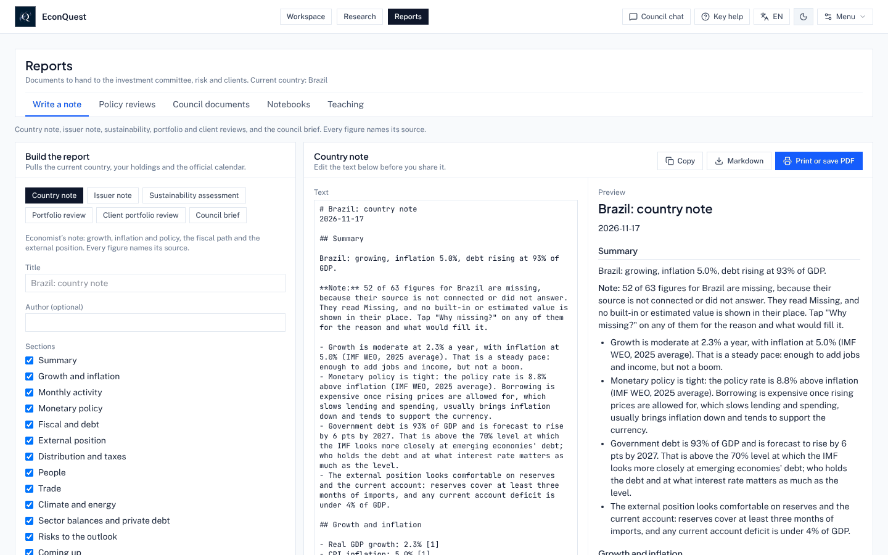

**Informes** tiene cuatro pestañas, cada una por separado: **Escribir una nota** (el generador de
informes), **Documentos del consejo** (los documentos guardados desde el Chat del consejo), **Cuadernos**
y **Docencia**. Las revisiones de políticas tienen su propia página, **Revisión de políticas**, en la
cabecera.

Para escribir un informe:

1. En **Escribir una nota**, elija un tipo: Nota de país, Nota de emisor, Evaluación de sostenibilidad, Revisión de cartera,
   Revisión de la cartera del cliente o Informe del consejo.
2. Marque las secciones que quiera. El borrador se actualiza y la vista previa muestra el resultado.
3. Edite el texto y después **Copiar**, descargue el **archivo Markdown** o **Imprimir o guardar en PDF**.
   Cada cifra lleva su fuente y su fecha.

Para revisar una política:

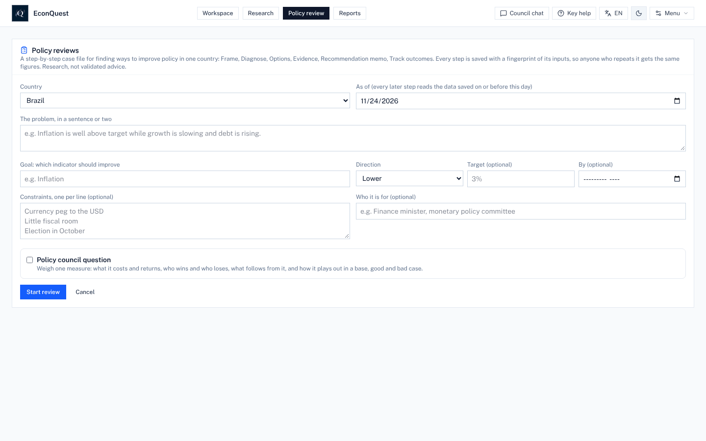

1. Pulse **Revisión de políticas** en la cabecera y después **Nueva revisión de políticas**. **Iniciar
   una revisión de política** bajo una respuesta del Chat del consejo, y los enlaces de revisión de
   políticas en Herramientas, abren la misma página.
2. Elija el país y la fecha de referencia (cada paso posterior lee los datos tal como estaban ese día).
3. Describa el problema en una o dos frases, por ejemplo «La inflación está muy por encima del objetivo
   mientras el crecimiento se frena y la deuda sube».
4. Elija el indicador que debe mejorar, la dirección y, si quiere, una meta y una fecha. Escriba las
   restricciones una por línea (un tipo de cambio fijo, poco margen fiscal, unas elecciones) y para quién
   es la revisión.
5. Pulse **Empezar la revisión**. Siguen los pasos: planteamiento, diagnóstico, opciones (ordenadas por el
   modelo árbitro), evidencia y precedentes (los años-país pasados más parecidos y lo que ocurrió después),
   una comprobación conductual, reglas fiscales y viabilidad política, el memorando de recomendación, un
   **resumen de una página** en PDF para no economistas, y el seguimiento de resultados, que compara la
   revisión con lo ocurrido a los 12 y 24 meses. Cada paso se guarda con su huella digital.
   En precedentes, **Qué pasó después** elige un cambio que hizo el país (un gran giro presupuestario,
   una devaluación, un nuevo régimen cambiario o regla fiscal, o uno que usted añade con su fuente) y
   compara el país con un «gemelo»: una mezcla de otros países que se movieron como él en los diez años
   anteriores y no hicieron ese cambio. Dice cuánto se separaron tres años después, qué tan raro es eso
   entre países que no hicieron ningún cambio, y puede mostrar todos los países que hicieron el mismo tipo
   de cambio. Un resultado puede guardarse para el resumen de una página. Está marcado como sin validar
   hasta que pase su prueba registrada de antemano.

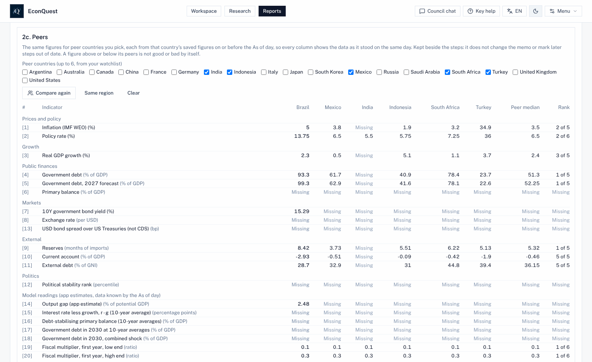

6. Después del diagnóstico, **Pares** pone las cifras del diagnóstico junto a hasta seis países de su
   lista de seguimiento (o pulse **Misma región**, luego **Comparar**), cada una tal como estaba guardada
   en la fecha de la revisión o antes, con la mediana de los pares y el puesto de este país.
7. En el memorando, dé a una cifra vigilada un umbral que la aplicación pueda leer, como «por encima de
   8», «por debajo de 3», «meta 4», «sube» o «baja». **Seguimiento de revisiones de políticas**, bajo
   las alertas de seguimiento en el Briefing del espacio de trabajo, muestra cada una como cruzada o no
   cruzada frente a las últimas cifras guardadas; **Abrir revisión** vuelve a la revisión.
8. En la fecha de revisión, **Revisar de nuevo** inicia una revisión nueva con el mismo planteamiento y
   los datos de hoy. La nueva revisión abre **Qué cambió desde la revisión anterior**: el planteamiento,
   la opción que recomendó cada memorando, cada cifra entonces y ahora, y si el indicador objetivo se
   movió en la dirección buscada.
9. Para sopesar una medida (un cambio de impuesto, una reforma de un subsidio, un programa de gasto),
   marque **Pregunta para el consejo de políticas** en el planteamiento y elija **Una medida**. Bajo la
   revisión, complete **Costos y beneficios** (las cifras de cada año con su fuente, con tasas de descuento
   oficiales o las suyas: la aplicación da el valor presente y el año en que se recupera), **Quién gana y
   quién pierde**, **Lo que sigue** (efectos de segundo orden, cada uno basado en una cifra, una fuente o
   un supuesto) y **Lo que podría salir distinto** (de dos a cinco casos, con probabilidades si quiere).
   El paso de opciones ordena entonces alternativas frente a la medida. Elija en cambio **Qué significa
   un evento para un mercado** para sopesar un evento para la moneda o los bonos del Estado: **Copiar las
   lecturas de mercado** toma las cifras de la propia aplicación tal como estaban en la fecha de
   referencia, y sus casos son el cambio de valor para un tenedor. El resumen de una página termina con
   estas partes, y a los 12 y 24 meses los casos de una revisión sobre la moneda se comparan con lo que
   hizo el tipo de cambio.

10. En el memorando, **Para las personas** da un resumen sencillo para la ciudadanía: qué cambia, el
    costo por persona, quién gana y quién paga, las regiones más rezagadas y lo que vieron después tres
    países en una situación parecida. Se escribe con frases fijas rellenadas con las cifras, no con IA,
    y se añade al resumen de una página.

Para escribir un documento de trabajo que pueda comprobar más tarde:

1. En el Chat del consejo, pida un gráfico («chart Brazil's policy rate since 2015»). Bajo el gráfico del
   agente de gráficos, pulse **Fijar en un cuaderno** y elija un cuaderno. La aplicación guarda la fecha
   hasta la que llegan las cifras y una huella de las cifras (un código corto que cambia si cambia
   cualquier cifra).
2. Abra **Informes > Cuadernos**. **Paquete de documento de trabajo (.zip)** descarga un solo zip: un
   borrador en Markdown con sus notas, una carpeta por cada cifra fijada con sus datos y los scripts de
   Python, R y Stata, un archivo de cita y la lista de la huella de cada archivo.
3. Más tarde, pulse **Comprobar que se mantiene** en una cifra fijada. Responde *Igual*, *Revisada* (con
   los valores antiguos y nuevos) o *La fuente ya no responde*. `npm run notebook:check` comprueba todas
   las cifras fijadas a la vez.

## 8. Elegir un modelo de IA

1. Abra **Menú > Configuración > Modelo de IA** (o pulse ⌘, en un Mac, Ctrl+, en otros ordenadores).
2. Elija un proveedor:
   - **Ollama en su ordenador**: gratis y privado; Ollama debe estar en marcha con los modelos
     descargados.
   - **Google Gemini**: necesita su propia clave de Gemini; las preguntas se envían a Google.
   - **Ollama y luego Gemini**: primero Ollama; Gemini responde cuando Ollama no lo hace.
3. Para Ollama, indique **dónde se ejecuta** y pulse **Buscar Ollama** para elegir entre sus modelos.
4. Ajuste el **modelo rápido** (elección de agentes y respuestas de las mesas; `qwen2.5:7b` por defecto) y
   el **modelo árbitro** (resúmenes, explicaciones, debate y opciones de política; `qwen2.5:32b` por
   defecto). Use su modelo más grande como árbitro.
5. Deje **Permitir un árbitro de 14B** desactivado salvo que su ordenador no pueda con el de 32B. Si lo
   activa, cada respuesta que juzgue un árbitro de 14B indica «Árbitro pequeño». Un modelo de 8B o menos
   nunca es un buen árbitro.
6. Pulse **Probar el modelo**. Envía una pregunta breve igual que el Chat del consejo.

Qué modelo conviene a cada ordenador y los ajustes que usa la aplicación están en Funciones y detalles:
[Modelos de IA](./FEATURES.es.md#modelos-de-ia-cuál-usar-tamaños-y-ajustes).

## 9. Herramientas, comprobación de datos y el menú

El **Menú** reúne todo lo que no es una página, en tres grupos después de **Herramientas**:
*Configurar*, *Revisar los datos* y *Aprender*. Lo primero que conviene conocer:

- **Herramientas**: todas las herramientas agrupadas por lo que quiere hacer, y **Conexiones de datos**.
- **Datos sin conexión**: descargue los datos de todos los países para usarlos sin internet y vea cuánto
  ocupan.
- **Configuración > Herramientas de investigación**: la dirección y la clave de un servidor de
  herramientas de investigación propio, para la mesa cuantitativa del Chat del consejo. Apagado hasta que
  ambas están puestas; **Probar la conexión** enumera las herramientas que la clave puede ver, y cada
  llamada queda en el registro de auditoría, nunca la clave.
- **Estado de los datos**: qué fuentes llegan, cuáles fallan y qué cifras se revisaron. Mientras una
  fuente no responde, algunas cifras muestran la última respuesta buena con sus propias fechas en vez
  de Falta; la pestaña **Sources** (en inglés) indica qué fuentes muestran cifras guardadas y cuándo se
  vuelve a consultar cada una. La pestaña **Calendar** tiene la tarjeta **Días de publicación**
  (también en Hoy): las publicaciones oficiales de IPC y de actividad mensual desde ayer hasta dentro de
  una semana, y «New today» cuando llega el nuevo mes (un día de publicación la aplicación vuelve a
  consultar esa fuente más o menos cada hora). Su pestaña **Daily download** (en inglés) sigue la
  descarga diaria mientras corre: cada parte, qué falló y por qué, el segundo intento al final de la
  descarga y los intentos posteriores pasadas dos horas, las fuentes que necesitan una clave o un
  archivo, y qué descargar a mano.
- **Modelos y validación**: el registro de modelos, los resultados de las pruebas, el **Historial de
  aciertos** (39 pruebas registradas el 23 de noviembre de 2026: 11 superadas, 25 no superadas y 3 con
  pocos casos; cada una con su p y si sigue en pie al contar el número de pruebas, y una tabla mes a
  mes de las previsiones anotadas antes de que saliera la cifra y calificadas después) y **Sus
  pruebas**.
- **Sus datos**: cargue sus propias series desde un archivo CSV.
- **Buscar datos**: una búsqueda en los catálogos gratuitos (DBnomics, el FMI, el Banco Mundial y
  Eurostat), cada resultado con su proveedor y un enlace.
- **Configuración > Sus suscripciones > Su suscripción de datos**: si usted ya paga Macrobond, Trading
  Economics o EODHD, actívela, escriba su propia clave y asigne las series que quiera (el código del
  servicio, el país, qué es). Aparecen en Historial y datos con la etiqueta «Su suscripción» y nunca salen de
  su ordenador: las descargas, las copias de seguridad y las copias compartidas dicen «Retenido».
  Desactivada por defecto.
- **Configuración > Sus suscripciones > Precios de su bróker**: precios en vivo de los contratos que
  usted indique, de su propia cuenta de Interactive Brokers, a través del IBKR Client Portal Gateway
  que usted ejecuta e inicia sesión en su equipo. Desactivado por defecto; solo en pantalla y nunca
  se guarda.
- **Modo examen**: desactiva todos los pasos de IA para un examen.
- **Ejemplos resueltos**: cinco casos de una pregunta a un memorando.
- **Qué significa para usted**: su propia tasa de inflación según cómo reparte su gasto entre los
  grupos oficiales de precios, frente a la tasa general, y lo que un cambio de tipos hace a la cuota de
  su préstamo. Lo que usted introduce se queda solo en su navegador.
- **Acerca de y licencias de datos**: la versión, una nota breve sobre privacidad
  ([PRIVACY.md](PRIVACY.md), en inglés) y si hay una versión más reciente, con los pasos para actualizar.
  Cuando la hay, el Menú muestra **Nueva versión** junto a Acerca de.
- **Informar de un problema**: abre una nueva incidencia en GitHub con la versión de la app ya escrita.
  Usted la lee y la envía. Si una pantalla no se puede dibujar, su nota también tiene **Copiar los
  detalles** e **Informar de este problema**. Hasta que se publique la copia pública, las incidencias
  van a github.com/smcarus/econquest; para enviar una se necesita una cuenta gratuita de GitHub.
- **Atajos de teclado**: pulse **?** para ver la lista. **/** va al cuadro de pregunta del consejo,
  **Cmd+K** (Ctrl+K en Windows) busca en las herramientas, **Cmd+,** abre la configuración y **Esc**
  cierra una ventana. / y ? no hacen nada mientras escribe en un cuadro.
- **Retos**: en gris, «Aún no disponible», hasta que los active en **Configuración > Retos y clases**
  ([sección 12](#12-probar-los-retos)).
- **Cuenta**: cree aquí la primera cuenta de administrador cuando comparta la aplicación o dirija una
  clase; a partir de entonces todos inician sesión.

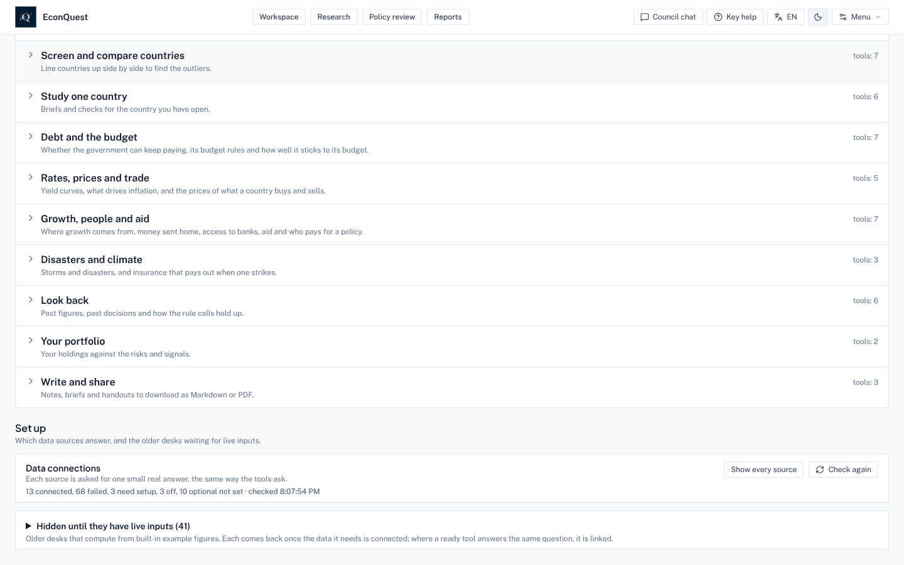

Para comprobar qué fuentes responden:

1. Abra **Menú > Herramientas**.
2. Baje hasta **Conexiones de datos** y pulse **Mostrar todas las fuentes**, o **Comprobar de nuevo** para
   consultar todas las fuentes ahora. Cada fuente aparece como conectada (con una cifra que devolvió),
   pendiente de configurar, desactivada, o con el motivo del fallo.
3. La misma comprobación se hace en un terminal con `npm run check:data`.

### Dejar que otro programa use EconQuest

Si usa una herramienta de cartera u otro programa que deba leer las cifras de EconQuest, puede darle
acceso sin compartir su contraseña.

1. Abra **Menú > Configuración > Tokens de API**.
2. Dé un nombre al token (por ejemplo «Consola de cartera») y marque solo lo que puede hacer: leer
   cifras y series, leer las sesiones del consejo, hacer preguntas al chat del Consejo, recibir eventos
   y fijar vigilancias, enviar posiciones, fijar nombres ocultos o ejecutar escenarios sobre una cartera.
3. Pulse **Crear token** y cópielo enseguida: solo se muestra una vez, y la aplicación guarda solo una huella
   de él. Cada uso queda en el registro de auditoría; **Revocar** lo detiene al instante.
4. Las posiciones que envíe el otro programa aparecen en **Investigación > Mis posiciones** marcadas
   «Enviada por» y el nombre del token.
5. Un token que puede hacer preguntas al chat del Consejo recibe la misma respuesta que usted
   obtendría en el chat para la misma pregunta: los mismos agentes, cifras y comprobaciones. Cada
   pregunta usa su modelo de IA y cuenta para el mismo límite de solicitudes de IA que sus propias
   preguntas. Los nombres ocultos nunca aparecen en sus respuestas, y solo se usan cifras cuyas fuentes
   permiten compartirlas. Cada pregunta queda en el registro de auditoría con el nombre del token.

Para que un país o un valor no aparezca en ninguna pantalla, respuesta o evento, añádalo en **Menú >
Configuración > Nombres ocultos** (por código ISO del país, ticker o su propio identificador). Las
pantallas mostrarán solo cuántos elementos están ocultos, y la aplicación guarda una huella de cada
nombre, no el nombre.

En un servidor compartido por varias personas, un administrador puede dejar que inicien sesión con una
cuenta que ya tengan en Google, Microsoft, Okta, Keycloak u otro proveedor OpenID Connect; la página de
inicio de sesión muestra entonces **Iniciar sesión con** y el nombre del proveedor
([SECURITY.md](./SECURITY.md), en inglés). Lo que necesita un programador para conectarse está en
[DATA_API.md](./DATA_API.md) y [DEPLOYMENT.md](./DEPLOYMENT.md) (en inglés).

## 10. Cambiar el idioma y el nivel de ayuda

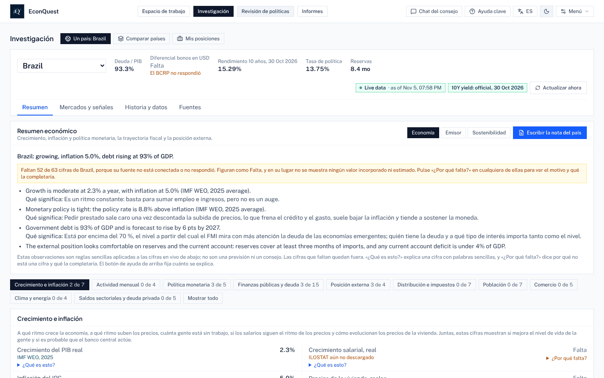

1. Pulse el botón de **idioma** de la cabecera. Cada pulsación pasa al siguiente: English, Español,
   Français, Português. La elección se guarda en este navegador.
2. Pulse el botón de **ayuda** de al lado. Abre los cuatro niveles, cada uno con una línea sobre lo que
   explica; pulse uno para elegirlo:
   - **Ayuda clave** (por defecto): cómo leer cada gráfico, qué significa en la vida real y *¿Qué es
     esto?* en las cifras principales;
   - **Ayuda completa**: *¿Qué es esto?* en cada cifra y término, y por qué falta cada cifra ausente;
   - **Ayuda desactivada**: solo cifras, fuentes y observaciones, sin rangos de previsión;
   - **Experto**: cifras, fuentes y rangos de previsión, sin explicaciones en lenguaje sencillo.

Las cifras y los nombres de fuentes y series quedan como los escribe la fuente. Algunas frases que la
aplicación escribe sobre un país siguen en inglés, como muestra la captura; el Chat del consejo y el consejo
responden en el idioma que usted elija; sus agentes siguen entendiendo mejor las preguntas en inglés.

**Teclado, lector de pantalla y reducir movimiento.** Cada página se puede usar solo con el
teclado: Tab pasa de un control al siguiente, y el que tiene el foco muestra un recuadro. Con el
ajuste «reducir movimiento» del ordenador activado, se detienen los indicadores giratorios y las
transiciones. Qué se ha comprobado, y qué se sabe que aún no funciona, está en
[ACCESSIBILITY.md](./ACCESSIBILITY.md) (en inglés).

## 11. Usarla en el teléfono

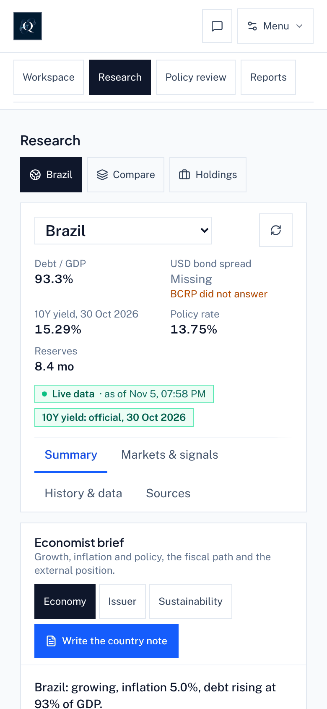

La aplicación funciona con ancho de teléfono en el navegador. Los paneles se apilan en una columna y la
cabecera conserva los botones de las páginas, con botones de icono para el Chat del consejo, la ayuda,
el idioma, claro y oscuro, y el Menú. Para abrirla desde un teléfono en la misma red de casa, el
ordenador que ejecuta EconQuest debe permitirlo (`HOST="0.0.0.0"` y `ALLOWED_HOSTS` en `.env`; vea
[HOME_SERVER.md](./HOME_SERVER.md), y active antes el inicio de sesión).

## 12. Probar los Retos

Los Retos son preguntas abiertas sobre economías que usted responde y comprueba con cifras reales,
por ejemplo «¿Estará más baja la tasa de política monetaria de Brasil el 31 de marzo?». Están
desactivados para todos hasta que se complete la lista de lanzamiento de [QUESTS.md](./QUESTS.md),
pero puede activarlos en su propia copia cuando quiera:

1. Abra **Menú > Configuración > Retos y clases** y elija *Activado* para los retos. El cambio es
   inmediato, sin reiniciar. (La forma anterior sigue funcionando: añada `QUESTS_ENABLED=on` al
   archivo `.env` de su carpeta de EconQuest y reinicie.) Solo el ordenador donde se ejecuta la
   aplicación, o un administrador cuando el inicio de sesión está activado, puede cambiarlo.

   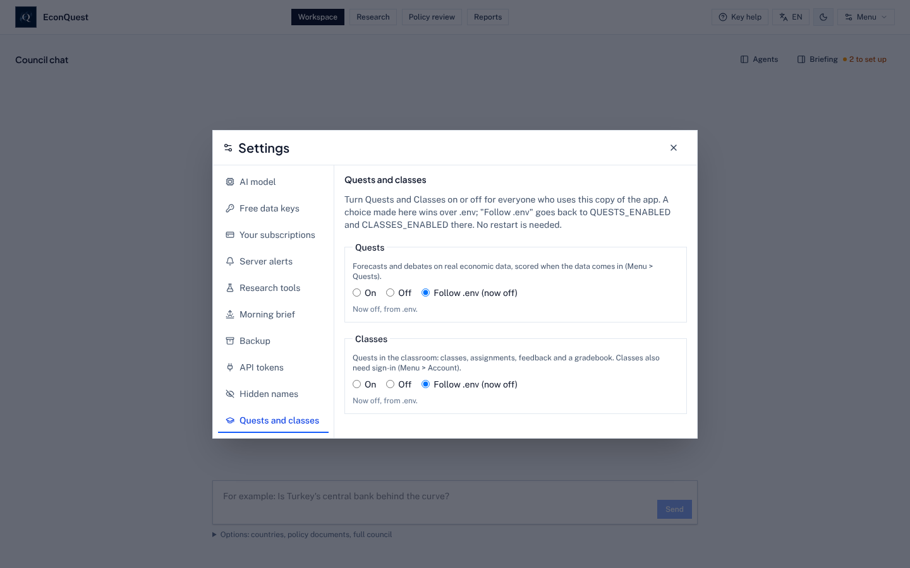

2. Abra **Menú > Retos**. La ventana está en español, inglés, francés y portugués, como el resto de
   la aplicación. Cada fila muestra la pregunta, su tipo (Pronóstico, Debate, Replicación o Señal), su
   nivel (inicial, intermedio o avanzado) y cuándo se espera su resultado. Filtre por tipo, nivel,
   fecha o paquete.
3. ¿Es nuevo en esto? Elija el **Paquete de inicio** en *Paquete*: 25 problemas agrupados por tema,
   desde un tutorial breve sobre el petróleo Brent hasta inflación, deuda, monedas, empleo, comercio y
   países de menores ingresos. Las filas marcadas *Practique ya* se pueden probar al momento con cifras
   pasadas.
4. Abra un Reto para leer su regla en palabras, la última cifra de cada serie con la que se resolverá
   (o «Falta» con el motivo) y lo que no puede decirle.
5. Responda de una de tres maneras:
   - **Practicar con el pasado** le da un periodo pasado de la misma duración con la respuesta oculta
     y le puntúa al momento. No se guarda nada.
   - **Registrar en privado** guarda su pronóstico solo en este ordenador, sellado con una huella para
     que no se pueda cambiar después. **Mis respuestas** lo muestra, con su puntuación cuando llegue el
     resultado.
   - **Participar en público** prepara una respuesta para el repositorio público. Necesita una cuenta
     gratuita de GitHub y contará cuando los Retos sean públicos.
6. Las **Repeticiones** son preguntas sobre el pasado en paquetes de cuatro semanas. Pulse *Intentar*,
   responda y vea al momento lo que pasó y cómo le fue frente a la suposición más simple.
7. **Resultados** muestra cada resultado registrado y comprueba que el registro no se ha cambiado. La
   misma vista está junto al historial de resultados en **Menú > Modelos y validación**.
   **Clasificación**, **Posturas** y **Estado** muestran las estadísticas de los participantes, las
   preguntas opcionales de postura económica y si el sistema de Retos funciona.

Los Retos también le llegan a usted: la página de un país y cada respuesta del chat del Consejo
muestran hasta tres *Retos sobre este país*, y un enlace abre ese Reto.

**Reproducir un estudio publicado.** El Reto de replicación *Reproduzca la estimación de reacción fiscal de
Bohn para Brasil* le pide rehacer, con su propio programa, la estimación de la aplicación sobre cómo
responde el presupuesto de Brasil a su deuda (Bohn, 1998). La página
del Reto enlaza la descarga de datos, una guía en cuatro idiomas y programas de inicio para R, Python
y Stata en `quests/replications/bohn/`. Los programas solo cargan los datos; el cálculo le toca a usted.

**Dirigir una clase.** Un profesor puede usar los Retos con una clase en un solo ordenador que los
estudiantes abren en su navegador. Las clases necesitan cuentas, para que cada persona tenga su propia
función:

1. En el ordenador donde se ejecuta la aplicación, abra **Menú > Cuenta** y cree la primera cuenta de
   administrador. La contraseña debe tener al menos 12 caracteres (una frase corta es lo más fácil de
   recordar) y no puede contener el nombre de usuario. A partir de entonces todos inician sesión.
2. En **Menú > Configuración > Retos y clases**, elija *Activado* para las clases.
3. En **Menú > Retos > Clases**, dé a la clase un nombre, una zona horaria y las fechas del curso y
   pulse *Crear la clase*. La tarjeta de la clase muestra un código para unirse; pegue una lista de
   apodos en *Crear cuentas de estudiante* para crear todas sus cuentas de una vez.

`npm run class:setup` hace los pasos 1 y 2 con una sola orden y abre la aplicación a la red del
centro. El curso completo, desde asignar Retos con hora de entrega hasta los comentarios, la tabla de
la clase y el libro de calificaciones, está en la [guía para docentes](./TEACHING.es.md). La página
Funciones y detalles explica [cómo funciona el juego](./FEATURES.es.md#retos-quests-soluciones-económicas-entre-muchos).
