# Guía paso a paso

[English](./GUIDE.md) · **Español** · [Français](./GUIDE.fr.md) · [Português](./GUIDE.pt.md)

Esta guía muestra cómo usar EconQuest, tarea por tarea, con una captura para cada paso. Supone que la
aplicación ya está instalada y abierta en su navegador (consulte [INSTALL.md](./INSTALL.md), en inglés).
Para cada página y panel en detalle, vea el [manual de usuario](./USER_MANUAL.md) (en inglés); para
cualquier término, el glosario dentro de la aplicación (Menú > Manual de usuario).

Sobre las capturas: se tomaron el 13 de noviembre de 2026 de una compilación local de la rama principal,
que reproducía respuestas grabadas el 5 de noviembre de 2026 de las fuentes cuyos términos permiten
transmitir los datos, sin ningún modelo de IA configurado. Por eso muchas cifras aparecen como **Falta**
y el consejo no escribe un resumen en ellas. En su ordenador, con las fuentes accesibles y un modelo de
IA elegido, se rellenan más cifras y el consejo escribe su resumen. Las capturas están en inglés salvo
la de la sección 10; los nombres de los botones se dan aquí tal como aparecen con la aplicación en
español.

## Contenido

1. [La pantalla de un vistazo](#1-la-pantalla-de-un-vistazo)
2. [Primer inicio: qué configurar](#2-primer-inicio-qué-configurar)
3. [Hacer una pregunta al consejo](#3-hacer-una-pregunta-al-consejo)
4. [Estudiar un país](#4-estudiar-un-país)
5. [Mirar atrás en el tiempo](#5-mirar-atrás-en-el-tiempo)
6. [Comparar países](#6-comparar-países)
7. [Revisar una política y escribir un informe](#7-revisar-una-política-y-escribir-un-informe)
8. [Elegir un modelo de IA](#8-elegir-un-modelo-de-ia)
9. [Herramientas, comprobación de datos y el menú](#9-herramientas-comprobación-de-datos-y-el-menú)
10. [Cambiar el idioma y el nivel de ayuda](#10-cambiar-el-idioma-y-el-nivel-de-ayuda)
11. [Usarla en el teléfono](#11-usarla-en-el-teléfono)
12. [Probar los Retos](#12-probar-los-retos)

---

## 1. La pantalla de un vistazo

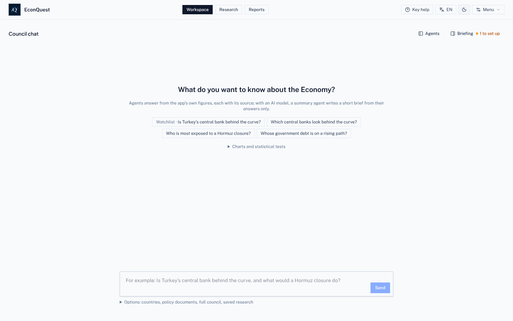

- **Cabecera, en el centro:** las tres páginas. **Espacio de trabajo** (Chat del consejo),
  **Investigación** (países y posiciones) e **Informes**.
- **Cabecera, a la derecha:** **Chat del consejo** (abre el chat junto a Investigación o Informes), el
  botón del **nivel de ayuda** (aquí *Ayuda clave*), el botón de **idioma** (*ES*), el cambio claro y
  oscuro, y **Menú**.
- **Espacio de trabajo, arriba a la derecha:** **Agentes** muestra qué agentes trabajaron en la última
  respuesta; **Resumen** abre sus ajustes, la lista de seguimiento, qué se movió y lo que viene. «1 por
  configurar» cuenta los pasos de configuración pendientes.

## 2. Primer inicio: qué configurar

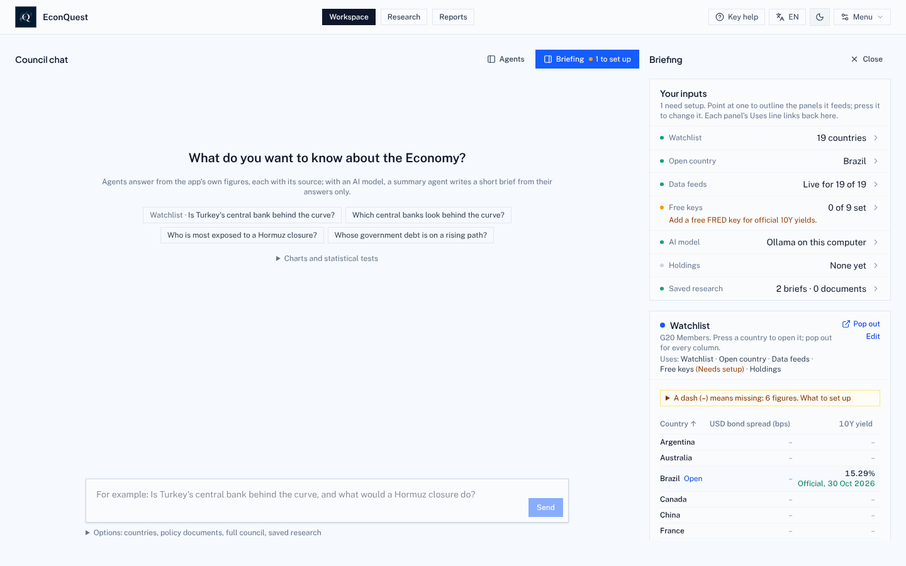

1. En **Espacio de trabajo**, pulse **Resumen**.
2. Lea la lista de ajustes. Cada línea dice qué usa la aplicación: la lista de seguimiento (19 países
   del G20 al empezar), el país abierto, cuántas fuentes respondieron, cuántas claves gratuitas hay, el
   modelo de IA, sus posiciones y su investigación guardada. Pulse una línea para cambiarla.
3. Añada primero la clave gratuita de **FRED** (Menú > Configuración > Claves de datos gratuitos).
   Rellena los rendimientos oficiales de los bonos a 10 años de varios países.
4. Pulse **Editar** en la tarjeta de la lista de seguimiento para añadir o quitar países.
5. Elija un modelo de IA si quiere resúmenes escritos ([sección 8](#8-elegir-un-modelo-de-ia)). Todo lo
   demás funciona sin él.

Una instalación nueva muestra guiones hasta que termina la primera descarga de datos, que puede tardar
unos minutos.

## 3. Hacer una pregunta al consejo

1. En **Espacio de trabajo**, escriba una pregunta en el cuadro inferior o pulse una pregunta de
   ejemplo. Por ahora los agentes entienden mejor las preguntas en inglés, por ejemplo «Which central
   banks look behind the curve?».
2. Pulse **Enviar**. El panel **Agentes** de la izquierda muestra el trabajo:
   - El **Planificador** elige los agentes que cubren su pregunta (con reglas escritas si no hay modelo
     de IA).
   - Los **agentes de mesa** responden con las cifras de la aplicación. Aquí el agente de Banco Central
     cubrió 6 países.
   - El **agente de síntesis** escribe un breve resumen que solo puede citar las cifras de los agentes.
     Sin modelo de IA se omite y dice por qué, como en la captura.
3. Abra **Fuentes y acciones** bajo la respuesta para ver el documento de cada agente, con la fuente y la
   fecha de cada cifra, y guardarlo en Informes.
4. Haga una pregunta de seguimiento en el mismo cuadro o pulse una de las sugeridas. Si no nombra ningún
   país, la pregunta cubre toda su lista de seguimiento.
5. **Opciones**, bajo el cuadro, permite elegir países, adjuntar un documento de política para el agente
   de Documentos o **ejecutar el consejo completo**: nueve agentes en tres mesas debaten sobre un país, y
   la aplicación pide su aprobación antes del informe final.

## 4. Estudiar un país

Abra **Investigación**. El selector de país está arriba a la izquierda; la franja de al lado muestra
deuda, diferencial de los bonos, rendimiento a 10 años, tipo oficial y reservas, y las etiquetas verdes
indican lo recientes que son los datos. **Actualizar ahora** vuelve a traer las cifras de ese país.

### Resumen

1. **Resumen** se abre primero. El **resumen económico** da los puntos principales en lenguaje sencillo,
   cada uno con «Qué significa» para la vida diaria. *Economía*, *Emisor* y *Sostenibilidad* cambian el
   enfoque.
2. El recuadro amarillo dice cuántas cifras faltan y por qué. Pulse **¿Por qué falta?** junto a cualquiera
   para ver el motivo y qué la rellenaría.
3. **¿Qué es esto?** bajo una cifra la explica. **Explicar** pregunta al consejo qué significa para este
   país.
4. **Escribir la nota del país** convierte la página en un borrador de informe.

### Mercados y señales

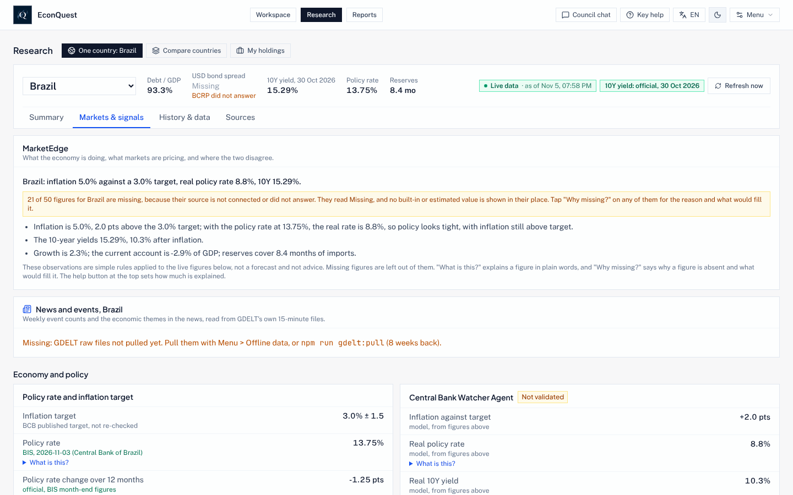

1. Pulse **Mercados y señales**. **MarketEdge** compara lo que hace la economía con lo que descuentan
   los mercados, y dónde discrepan.
2. Cada agente y señal lleva una insignia: *Validada*, *Provisional*, *No validada*, etc. La insignia
   dice hasta dónde ha llegado su prueba. La mayoría de las señales no han superado aún una prueba, y la
   insignia lo dice.
3. Las probabilidades de los mercados de predicción (Kalshi, Polymarket), los diferenciales de los bonos
   y las divisas aparecen aquí cuando sus fuentes responden.

### Historia y datos

1. Pulse **Historia y datos**. Elija una cifra en **Cifras con historia**, a la derecha, para dibujarla.
2. Encima de cada gráfico: qué mide, de quién es la cifra, con qué frecuencia se publica, cómo leer el
   gráfico y qué significa en la vida real.
3. Debajo: **Descargar esta serie** (CSV o Excel), **Descargar todas las series** del país, **Citar**
   (texto, BibTeX o RIS), **Señalar** (avisar de un problema) y **Publicar el gráfico** (PNG o SVG).
4. Más abajo están los paneles de análisis: estimaciones del presente y previsiones con bandas del 50, 70
   y 90 %, brecha del producto, sostenibilidad de la deuda, necesidad bruta de financiación, suficiencia
   de reservas, sostenibilidad externa, alerta temprana de crisis, curva de rendimientos, factores de la
   inflación, contabilidad del crecimiento, reglas de política, «¿y si?» fiscales y un pequeño modelo de
   brecha que usted rellena.
5. Siguen paneles para países de menores ingresos: **Remesas** (junto a exportaciones, inversión y
   ayuda, y el costo de enviar 200 US$ frente a la meta del 3 % de la ONU), **Inclusión financiera**
   (quién tiene una cuenta, por sexo e ingreso), **Precios de materias primas y términos de
   intercambio** (qué significan los últimos movimientos de los precios mundiales para el país, en % del
   PIB), **Ayuda recibida**, **Precios de los alimentos y seguridad alimentaria** y **Desastres
   naturales**. La inflación de alimentos y los desastres se leen de archivos que usted guarda en
   `data/local/fao-cpi/` y `data/local/emdat/`; hasta entonces esas partes dicen Faltante e indican
   dónde obtener el archivo ([INSTALL.md](./INSTALL.md#files-you-save-yourself), en inglés).
6. La **Ficha de riesgo país** pone lado a lado la gobernanza, los conflictos armados, el malestar
   social, el riesgo geopolítico, la apertura de la cuenta de capital (el índice de Chinn e Ito, citado
   como Chinn e Ito 2006) y la economía, cada dato con su fuente y su año. No da una puntuación global.
   El 13 de noviembre de 2026 se fijó de antemano una prueba de si una gobernanza débil precede a un
   impago; mientras no se ejecute, la insignia del panel dice No validada.

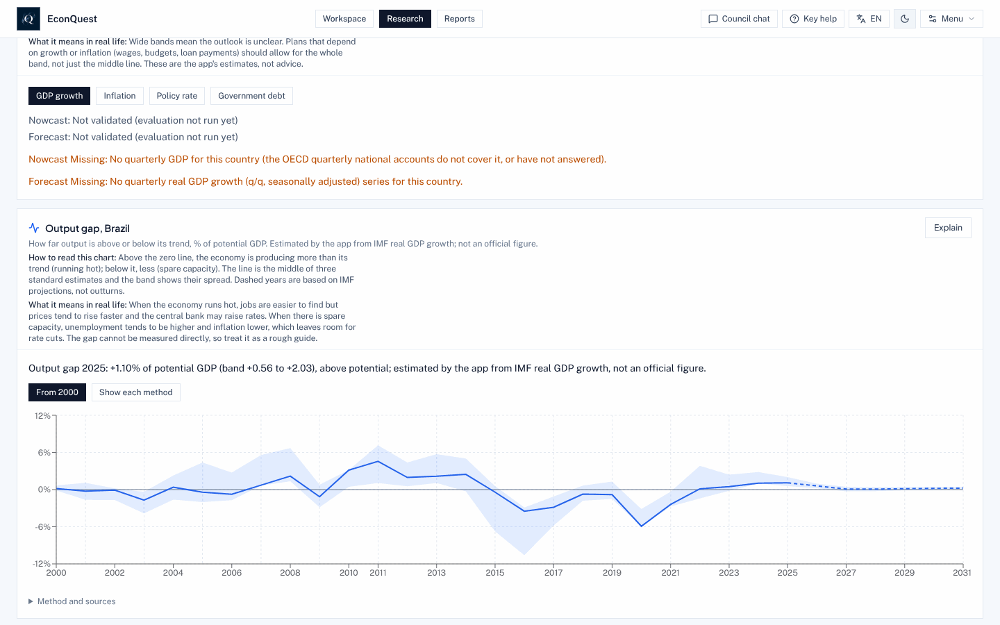

Ejemplo: la **brecha del producto** muestra cuánto funciona la economía por encima o por debajo de su
capacidad normal. La línea es el centro de tres estimaciones estándar, la banda su dispersión, y los
años discontinuos se basan en proyecciones del FMI.

### Fuentes

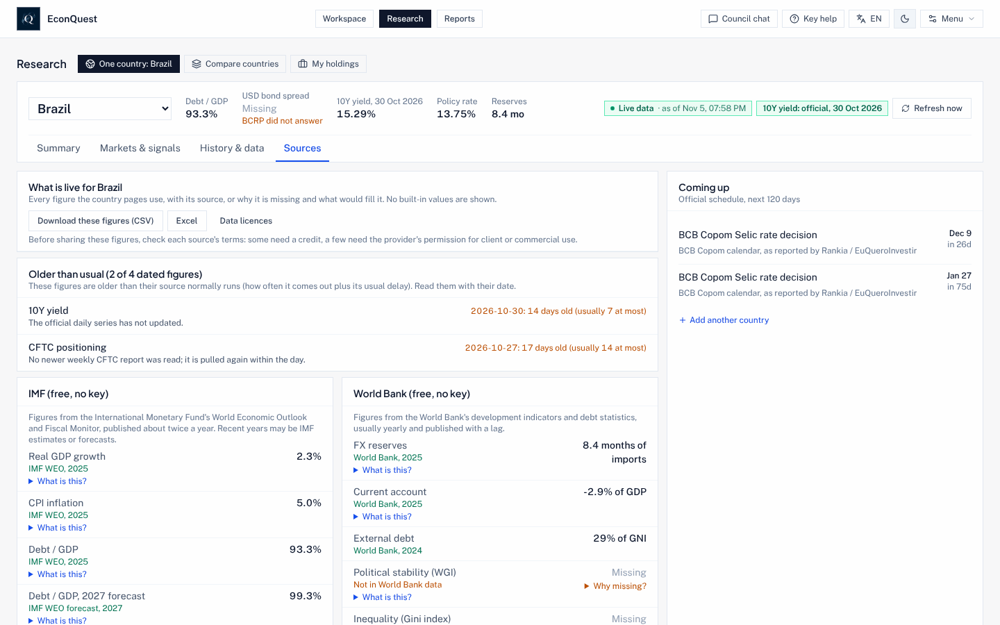

1. Pulse **Fuentes**. Enumera cada cifra de las páginas del país con su fuente, o por qué falta, sin
   nada incorporado.
2. **Más antiguas de lo habitual** señala las cifras cuya fuente va con retraso.
3. **Próximamente** enumera las fechas oficiales (decisiones de bancos centrales, publicaciones de datos)
   de los próximos 120 días.
4. Puede descargar la lista completa en CSV o Excel; **Licencias de datos** dice qué permite compartir
   cada fuente.

## 5. Mirar atrás en el tiempo

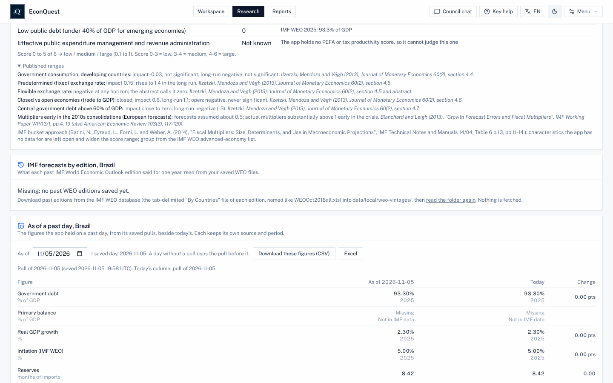

1. En **Historia y datos**, baje hasta **A una fecha pasada**.
2. Elija una fecha. La tabla muestra cada cifra tal como la tenía la aplicación ese día, junto a la de
   hoy y el cambio. Cada descarga diaria se archiva, así que no se pierde nada.
3. **Previsiones del FMI por edición** (justo encima) muestra cómo cambió la visión del FMI sobre el país
   de una edición a otra, cuando las ediciones pasadas están guardadas.

## 6. Comparar países

1. En **Investigación**, pulse **Comparar países**. Su lista de seguimiento aparece lado a lado, con las
   mismas cuatro pestañas que un país.
2. **Pistas para investigar** señala récords, grandes movimientos y revisiones en las cifras oficiales.
3. **Donde los datos y el precio no coinciden** ordena los países en los que mercados y datos apuntan en
   direcciones distintas, con las cifras que lo sustentan.
4. Pulse el nombre de un país para abrirlo por separado.

**Mis posiciones**, la tercera vista, hace lo mismo con una lista de bonos o posiciones que usted carga
desde un archivo CSV.

## 7. Revisar una política y escribir un informe

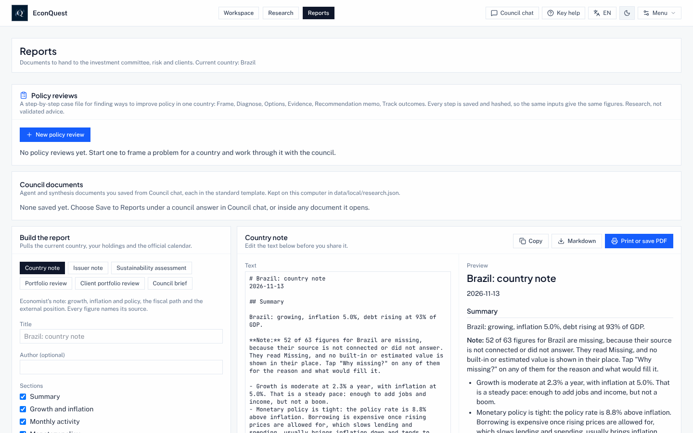

**Informes** reúne las revisiones de políticas, los documentos guardados desde el Chat del consejo y el
generador de informes.

Para escribir un informe:

1. Elija un tipo: Nota de país, Nota de emisor, Evaluación de sostenibilidad, Revisión de cartera,
   Revisión de la cartera del cliente o Informe del consejo.
2. Marque las secciones que quiera. El borrador se actualiza y la vista previa muestra el resultado.
3. Edite el texto y después **Copiar**, descargue el **archivo Markdown** o **Imprimir o guardar en PDF**.
   Cada cifra lleva su fuente y su fecha.

Para revisar una política:

1. Pulse **Nueva revisión de políticas**.
2. Elija el país y la fecha de referencia (cada paso posterior lee los datos tal como estaban ese día).
3. Describa el problema en una o dos frases, por ejemplo «La inflación está muy por encima del objetivo
   mientras el crecimiento se frena y la deuda sube».
4. Elija el indicador que debe mejorar, la dirección y, si quiere, una meta y una fecha. Escriba las
   restricciones una por línea (un tipo de cambio fijo, poco margen fiscal, unas elecciones) y para quién
   es la revisión.
5. Pulse **Empezar la revisión**. Siguen los pasos: planteamiento, diagnóstico, opciones (ordenadas por el
   modelo árbitro), evidencia y precedentes (los años-país pasados más parecidos y lo que ocurrió después),
   una comprobación conductual, reglas fiscales y viabilidad política, el memorando de recomendación, un
   **resumen de una página** en PDF para no economistas, y el seguimiento de resultados, que compara la
   revisión con lo ocurrido a los 12 y 24 meses. Cada paso se guarda con su huella digital.

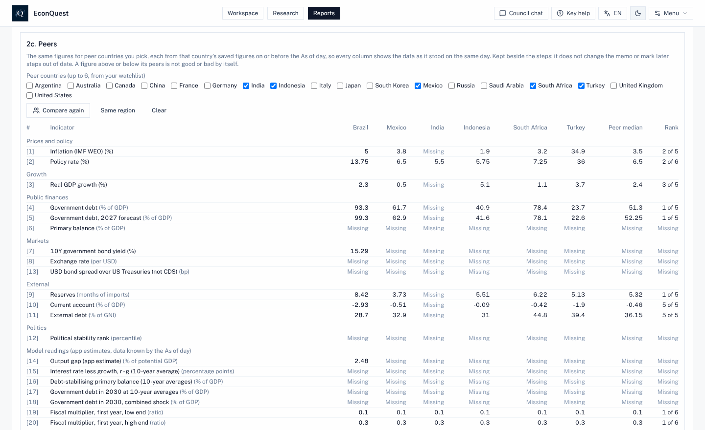

6. Después del diagnóstico, **Pares** pone las cifras del diagnóstico junto a hasta seis países de su
   lista de seguimiento (o pulse **Misma región**, luego **Comparar**), cada una tal como estaba guardada
   en la fecha de la revisión o antes, con la mediana de los pares y el puesto de este país.
7. En el memorando, dé a una cifra vigilada un umbral que la aplicación pueda leer, como «por encima de
   8», «por debajo de 3», «meta 4», «sube» o «baja». **Seguimiento de revisiones de políticas**, bajo
   las alertas de seguimiento en el Briefing del espacio de trabajo, muestra cada una como cruzada o no
   cruzada frente a las últimas cifras guardadas; **Abrir revisión** vuelve a la revisión.
8. En la fecha de revisión, **Revisar de nuevo** inicia una revisión nueva con el mismo planteamiento y
   los datos de hoy. La nueva revisión abre **Qué cambió desde la revisión anterior**: el planteamiento,
   la opción que recomendó cada memorando, cada cifra entonces y ahora, y si el indicador objetivo se
   movió en la dirección buscada.

## 8. Elegir un modelo de IA

1. Abra **Menú > Configuración > Modelo de IA** (o pulse ⌘, en un Mac, Ctrl+, en otros ordenadores).
2. Elija un proveedor:
   - **Ollama en su ordenador**: gratis y privado; Ollama debe estar en marcha con los modelos
     descargados.
   - **Google Gemini**: necesita su propia clave de Gemini; las preguntas se envían a Google.
   - **Ollama y luego Gemini**: primero Ollama; Gemini responde cuando Ollama no lo hace.
3. Para Ollama, indique **dónde se ejecuta** y pulse **Buscar Ollama** para elegir entre sus modelos.
4. Ajuste el **modelo rápido** (elección de agentes y respuestas de las mesas; `qwen2.5:7b` por defecto) y
   el **modelo árbitro** (resúmenes, explicaciones, debate y opciones de política; `qwen2.5:32b` por
   defecto). Use su modelo más grande como árbitro.
5. Deje **Permitir un árbitro de 14B** desactivado salvo que su ordenador no pueda con el de 32B. Si lo
   activa, cada respuesta que juzgue un árbitro de 14B indica «Árbitro pequeño». Un modelo de 8B o menos
   nunca es un buen árbitro.
6. Pulse **Probar el modelo**. Envía una pregunta breve igual que el Chat del consejo.

Qué modelo conviene a cada ordenador y los ajustes que usa la aplicación están en el README:
[Modelos de IA](../README.es.md#modelos-de-ia-cuál-usar-tamaños-y-ajustes).

## 9. Herramientas, comprobación de datos y el menú

El **Menú** reúne todo lo que no es una página. Lo primero que conviene conocer:

- **Herramientas**: todas las herramientas agrupadas por lo que quiere hacer, y **Conexiones de datos**.
- **Datos sin conexión**: descargue los datos de todos los países para usarlos sin internet y vea cuánto
  ocupan.
- **Estado de los datos**: qué fuentes llegan, cuáles fallan y qué cifras se revisaron.
- **Modelos y validación**: el registro de modelos, los resultados de las pruebas y **Sus pruebas**.
- **Sus datos**: cargue sus propias series desde un archivo CSV.
- **Modo examen**: desactiva todos los pasos de IA para un examen.
- **Ejemplos resueltos**: cuatro casos de una pregunta a un memorando.
- **Retos**: en gris, «Aún no disponible» ([sección 12](#12-probar-los-retos)).

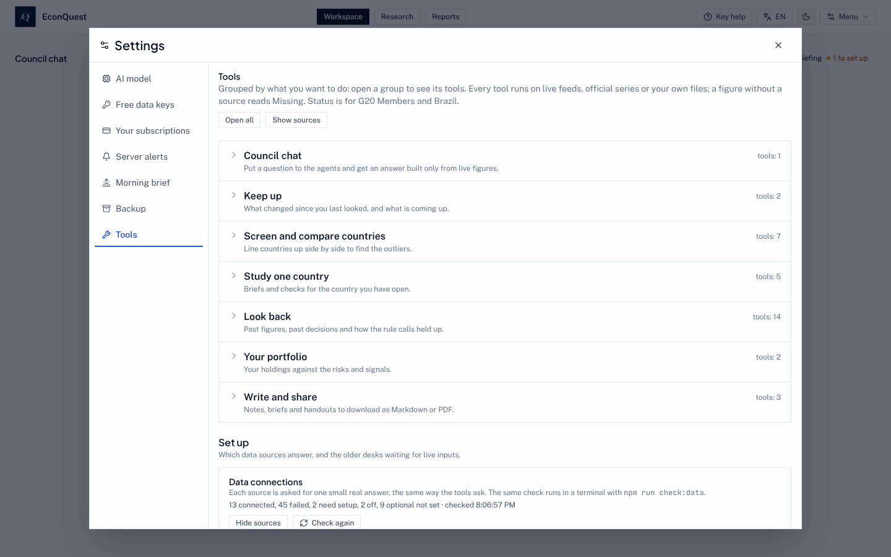

Para comprobar qué fuentes responden:

1. Abra **Menú > Herramientas**.
2. Baje hasta **Conexiones de datos** y pulse **Mostrar fuentes**, o **Comprobar de nuevo** para
   consultar todas las fuentes ahora. Cada fuente aparece como conectada (con una cifra que devolvió),
   pendiente de configurar, desactivada, o con el motivo del fallo.
3. La misma comprobación se hace en un terminal con `npm run check:data`.

### Dejar que otro programa use EconQuest

Si usa una herramienta de cartera u otro programa que deba leer las cifras de EconQuest, puede darle
acceso sin compartir su contraseña.

1. Abra **Menú > Configuración > Tokens de API**.
2. Dé un nombre al token (por ejemplo «Consola de cartera») y marque solo lo que puede hacer: leer
   cifras y series, leer las sesiones del consejo, recibir eventos y fijar vigilancias, enviar
   posiciones, fijar nombres ocultos o ejecutar escenarios sobre una cartera.
3. Pulse **Crear token** y cópielo enseguida: solo se muestra una vez, y la aplicación guarda solo una huella
   de él. Cada uso queda en el registro de auditoría; **Revocar** lo detiene al instante.
4. Las posiciones que envíe el otro programa aparecen en **Investigación > Mis posiciones** marcadas
   «Enviada por» y el nombre del token.

Para que un país o un valor no aparezca en ninguna pantalla, respuesta o evento, añádalo en **Menú >
Configuración > Nombres ocultos** (por código ISO del país, ticker o su propio identificador). Las
pantallas mostrarán solo cuántos elementos están ocultos, y la aplicación guarda una huella de cada
nombre, no el nombre.

En un servidor compartido por varias personas, un administrador puede dejar que inicien sesión con una
cuenta que ya tengan en Google, Microsoft, Okta, Keycloak u otro proveedor OpenID Connect; la página de
inicio de sesión muestra entonces **Iniciar sesión con** y el nombre del proveedor
([SECURITY.md](./SECURITY.md), en inglés). Lo que necesita un programador para conectarse está en
[DATA_API.md](./DATA_API.md) y [DEPLOYMENT.md](./DEPLOYMENT.md) (en inglés).

## 10. Cambiar el idioma y el nivel de ayuda

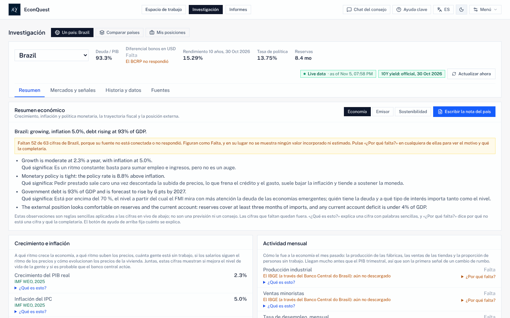

1. Pulse el botón de **idioma** de la cabecera. Cada pulsación pasa al siguiente: English, Español,
   Français, Português. La elección se guarda en este navegador.
2. Pulse el botón de **ayuda** de al lado para pasar entre:
   - **Ayuda clave** (por defecto): cómo leer cada gráfico, qué significa en la vida real y *¿Qué es
     esto?* en las cifras principales;
   - **Ayuda completa**: *¿Qué es esto?* en cada cifra y término, y por qué falta cada cifra ausente;
   - **Ayuda desactivada**: solo cifras, fuentes y observaciones, sin rangos de previsión;
   - **Experto**: cifras, fuentes y rangos de previsión, sin explicaciones en lenguaje sencillo.

Las cifras y los nombres de fuentes y series quedan como los escribe la fuente. Algunas frases que la
aplicación escribe sobre un país siguen en inglés, como muestra la captura; los agentes del consejo
trabajan en inglés.

## 11. Usarla en el teléfono

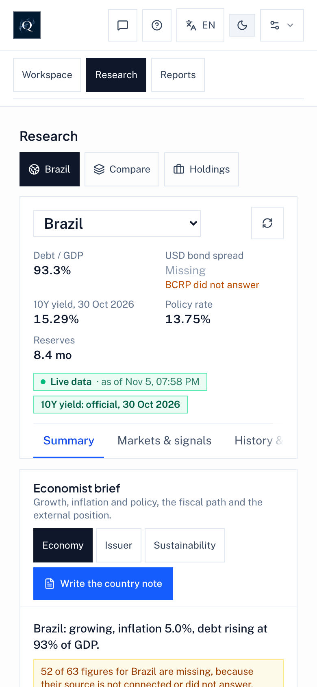

La aplicación funciona con ancho de teléfono en el navegador. Los paneles se apilan en una columna y la
cabecera conserva los botones de las páginas, con botones de icono para el Chat del consejo, la ayuda,
el idioma, claro y oscuro, y el Menú. Para abrirla desde un teléfono en la misma red de casa, el
ordenador que ejecuta EconQuest debe permitirlo (`HOST="0.0.0.0"` y `ALLOWED_HOSTS` en `.env`; vea
[HOME_SERVER.md](./HOME_SERVER.md), y active antes el inicio de sesión).

## 12. Probar los Retos

Los Retos están desactivados para todos hasta que se complete la lista de lanzamiento de
[QUESTS.md](./QUESTS.md). Para probarlos en su ordenador:

1. Añada `QUESTS_ENABLED=on` al archivo `.env` de su carpeta de EconQuest y reinicie la aplicación.
2. Abra **Menú > Retos**. La ventana de Retos está en inglés por ahora. La lista muestra la pregunta de
   cada Reto, su tipo (Forecast, Debate, Replication o Signal), si es un borrador y cuándo se espera su
   resultado. Filtre por tipo o por fecha.
3. Abra un Reto para ver su regla, las cifras en vivo con las que se resolverá y sus límites conocidos.
4. **Log privately** guarda su respuesta solo en este ordenador; **Practice** responde a preguntas
   pasadas y le puntúa al momento; **My entries** muestra lo que guardó y cómo puntuó.
5. **Results**, **Scoreboard**, **Stances** y **Health** muestran los Retos resueltos, las estadísticas
   de los participantes, las preguntas opcionales de postura económica y si el sistema funciona.

Cuando los Retos sean públicos, **Enter publicly** le preparará una solicitud de cambios al repositorio
público. El README explica [cómo funciona el juego](../README.es.md#retos-quests-soluciones-económicas-entre-muchos).
