# Guide pas à pas

[English](./GUIDE.md) · [Español](./GUIDE.es.md) · **Français** · [Português](./GUIDE.pt.md)

Ce guide montre comment utiliser EconQuest, tâche par tâche, avec une capture pour chaque étape. Il
suppose que l'application est installée et ouverte dans votre navigateur (voir [INSTALL.md](./INSTALL.md),
en anglais). Pour chaque page et panneau en détail, voir le [manuel d'utilisation](./USER_MANUAL.md) (en
anglais) ; pour tout terme inconnu, le glossaire dans l'application (Menu > Manuel d'utilisation).

À propos des captures : elles ont été prises le 13 novembre 2026 sur une version locale de la branche
principale, qui rejouait des réponses enregistrées le 5 novembre 2026 depuis les sources dont les
conditions permettent de transmettre les données, sans modèle d'IA configuré. C'est pourquoi beaucoup de
chiffres s'affichent **Manquant** et le conseil n'y rédige pas de synthèse. Sur votre ordinateur, avec les
sources accessibles et un modèle d'IA choisi, davantage de chiffres se remplissent et le conseil rédige sa
synthèse. Les captures sont en anglais sauf celle de la section 10 ; les noms des boutons sont donnés ici
tels qu'ils apparaissent avec l'application en français.

## Sommaire

1. [L'écran en un coup d'œil](#1-lécran-en-un-coup-dœil)
2. [Premier démarrage : que configurer](#2-premier-démarrage--que-configurer)
3. [Poser une question au conseil](#3-poser-une-question-au-conseil)
4. [Étudier un pays](#4-étudier-un-pays)
5. [Remonter dans le temps](#5-remonter-dans-le-temps)
6. [Comparer des pays](#6-comparer-des-pays)
7. [Examiner une politique et rédiger un rapport](#7-examiner-une-politique-et-rédiger-un-rapport)
8. [Choisir un modèle d'IA](#8-choisir-un-modèle-dia)
9. [Outils, vérification des données et menu](#9-outils-vérification-des-données-et-menu)
10. [Changer la langue et le niveau d'aide](#10-changer-la-langue-et-le-niveau-daide)
11. [L'utiliser sur un téléphone](#11-lutiliser-sur-un-téléphone)
12. [Essayer les Quêtes](#12-essayer-les-quêtes)

---

## 1. L'écran en un coup d'œil

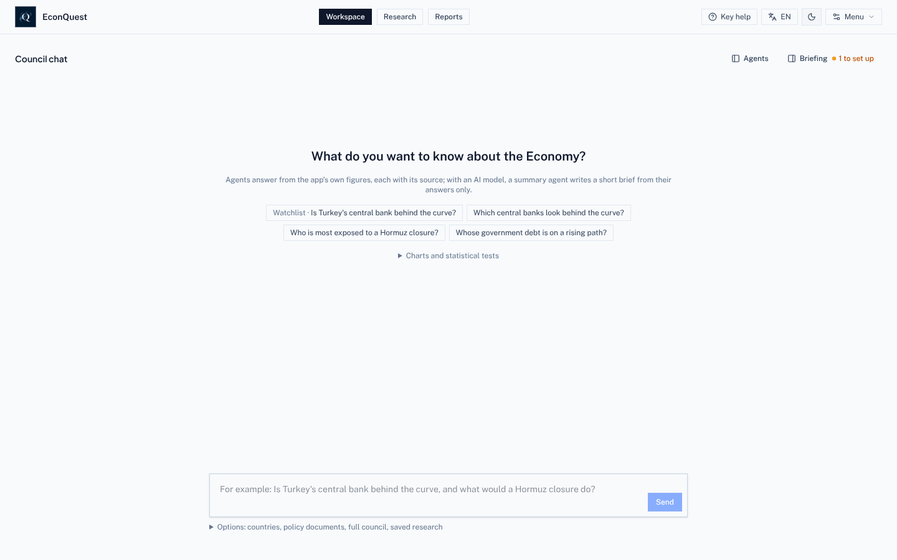

- **En-tête, au centre :** les trois pages. **Espace de travail** (Chat du conseil), **Recherche** (pays
  et positions) et **Rapports**.
- **En-tête, à droite :** **Chat du conseil** (ouvre le chat à côté de Recherche ou Rapports), le bouton
  du **niveau d'aide** (ici *Aide essentielle*), le bouton de **langue** (*FR*), le passage clair et
  sombre, et **Menu**.
- **Espace de travail, en haut à droite :** **Agents** montre quels agents ont travaillé sur la dernière
  réponse ; **Point du jour** ouvre vos données de départ, la liste de suivi, ce qui a bougé et ce qui
  arrive. « 1 à configurer » compte les étapes de configuration restantes.

## 2. Premier démarrage : que configurer

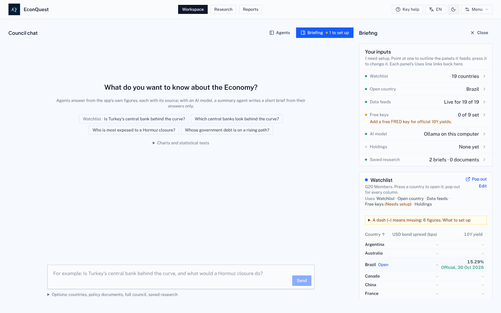

1. Dans **Espace de travail**, appuyez sur **Point du jour**.
2. Lisez vos données de départ. Chaque ligne dit ce que l'application utilise : la liste de suivi (19 pays
   du G20 au départ), le pays ouvert, le nombre de sources qui ont répondu, le nombre de clés gratuites,
   le modèle d'IA, vos positions et vos recherches enregistrées. Appuyez sur une ligne pour la modifier.
3. Ajoutez d'abord la clé gratuite **FRED** (Menu > Réglages > Clés de données gratuites). Elle fournit
   les rendements officiels des obligations d'État à 10 ans de plusieurs pays.
4. Appuyez sur **Modifier** sur la carte de la liste de suivi pour ajouter ou retirer des pays.
5. Choisissez un modèle d'IA si vous voulez des synthèses rédigées ([section 8](#8-choisir-un-modèle-dia)).
   Tout le reste fonctionne sans.

Une installation neuve affiche des tirets jusqu'à la fin du premier téléchargement, ce qui peut prendre
quelques minutes.

## 3. Poser une question au conseil

1. Dans **Espace de travail**, tapez une question dans la zone du bas ou appuyez sur une question
   d'exemple. Pour l'instant, les agents comprennent mieux les questions en anglais, par exemple « Which
   central banks look behind the curve? ».
2. Appuyez sur **Envoyer**. Le panneau **Agents** à gauche montre le travail :
   - le **planificateur** choisit les agents qui couvrent votre question (par des règles écrites si aucun
     modèle d'IA n'est configuré) ;
   - les **agents de bureau** répondent à partir des chiffres de l'application. Ici, l'agent Banque
     centrale a couvert 6 pays ;
   - l'**agent de synthèse** rédige une courte note qui ne peut citer que les chiffres des agents. Sans
     modèle d'IA, il est sauté et dit pourquoi, comme sur la capture.
3. Ouvrez **Sources et actions** sous la réponse pour voir le document de chaque agent, avec la source et
   la date de chaque chiffre, et l'enregistrer dans Rapports.
4. Posez une question de suivi dans la même zone, ou appuyez sur une suggestion. Si vous ne nommez aucun
   pays, la question couvre toute votre liste de suivi.
5. **Options**, sous la zone, permet de choisir des pays, de joindre un document de politique pour l'agent
   Documents ou de **lancer le conseil complet** : neuf agents sur trois bureaux débattent d'un pays, et
   l'application demande votre accord avant le rapport final.

## 4. Étudier un pays

Ouvrez **Recherche**. Le choix du pays est en haut à gauche ; la bande à côté affiche la dette, l'écart de
taux des obligations, le rendement à 10 ans, le taux directeur et les réserves, et les étiquettes vertes
indiquent la fraîcheur des données. **Actualiser maintenant** récupère de nouveau les chiffres du pays.

### Résumé

1. **Résumé** s'ouvre en premier. La **note de l'économiste** donne les points principaux en langage
   clair, chacun avec « Ce que cela signifie » au quotidien. *Économie*, *Émetteur* et *Soutenabilité*
   changent l'angle.
2. L'encadré jaune dit combien de chiffres manquent et pourquoi. Appuyez sur **Pourquoi manquant ?** à côté
   de l'un d'eux pour la raison et ce qui le fournirait.
3. **Qu'est-ce que c'est ?** sous un chiffre l'explique. **Expliquer** demande au conseil ce qu'il signifie
   pour ce pays.
4. **Rédiger la note pays** transforme la page en brouillon de rapport.

### Marchés et signaux

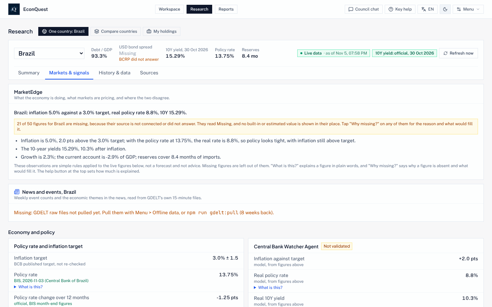

1. Appuyez sur **Marchés et signaux**. **MarketEdge** compare ce que fait l'économie avec ce que les
   marchés anticipent, et là où les deux divergent.
2. Chaque agent et signal porte un badge : *Validé*, *Provisoire*, *Non validé*, etc. Le badge dit où en
   est son test. La plupart des signaux n'ont pas encore réussi de test, et le badge le dit.
3. Les probabilités des marchés de prédiction (Kalshi, Polymarket), les écarts de taux et les changes
   apparaissent ici quand leurs sources répondent.

### Historique et données

1. Appuyez sur **Historique et données**. Choisissez un chiffre dans **Chiffres avec un historique**, à
   droite, pour le tracer.
2. Au-dessus de chaque graphique : ce qu'il mesure, à qui est le chiffre, à quelle fréquence il paraît,
   comment lire le graphique et ce que cela signifie dans la vie réelle.
3. En dessous : **Télécharger cette série** (CSV ou Excel), **Télécharger toutes les séries** du pays,
   **Citer** (texte, BibTeX ou RIS), **Signaler** (un problème) et **Publier le graphique** (PNG ou SVG).
4. Plus bas, les panneaux d'analyse : estimations du présent et prévisions avec intervalles à 50, 70 et
   90 %, écart de production, soutenabilité de la dette, besoin brut de financement, adéquation des
   réserves, soutenabilité extérieure, alerte précoce de crise, courbe des taux, moteurs de l'inflation,
   comptabilité de la croissance, règles de politique monétaire, hypothèses budgétaires et un petit
   modèle d'écart que vous remplissez vous-même.
5. Suivent des panneaux pour les pays à revenu plus faible : **Envois de fonds** (à côté des
   exportations, des investissements et de l'aide, et le coût d'envoi de 200 $ US face à l'objectif de
   3 % de l'ONU), **Inclusion financière** (qui a un compte, par sexe et par revenu), **Prix des matières
   premières et termes de l’échange** (ce que les derniers mouvements des prix mondiaux signifient pour
   le pays, en % du PIB), **Aide reçue**, **Prix alimentaires et sécurité alimentaire** et
   **Catastrophes naturelles**. L'inflation alimentaire et les catastrophes sont lues dans des fichiers
   que vous enregistrez vous-même dans `data/local/fao-cpi/` et `data/local/emdat/` ; d'ici là, ces
   parties affichent Manquant et disent où obtenir le fichier
   ([INSTALL.md](./INSTALL.md#files-you-save-yourself), en anglais).
6. La **Fiche de risque pays** met côte à côte la gouvernance, les conflits armés, les troubles, le
   risque géopolitique, l’ouverture du compte de capital (l’indice de Chinn et Ito, cité comme Chinn et
   Ito 2006) et l’économie, chaque donnée avec sa source et son année. Elle ne donne pas de note
   globale. Un test pour savoir si une gouvernance faible précède un défaut a été fixé à l’avance le
   13 novembre 2026 ; tant qu’il n’est pas exécuté, le badge du panneau indique Non validé.

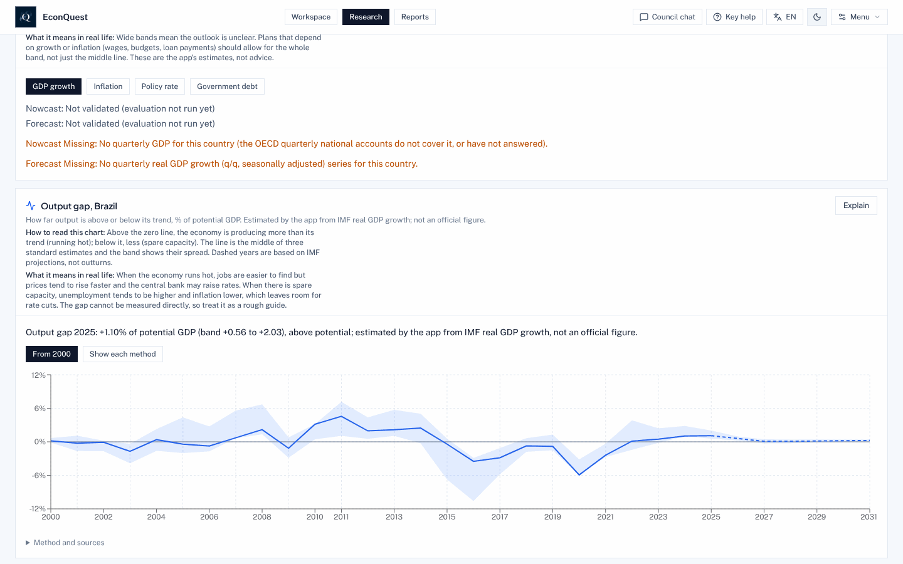

Exemple : l'**écart de production** montre de combien l'économie tourne au-dessus ou en dessous de sa
capacité normale. La ligne est le milieu de trois estimations standard, la bande leur dispersion, et les
années en pointillés reposent sur des projections du FMI.

### Sources

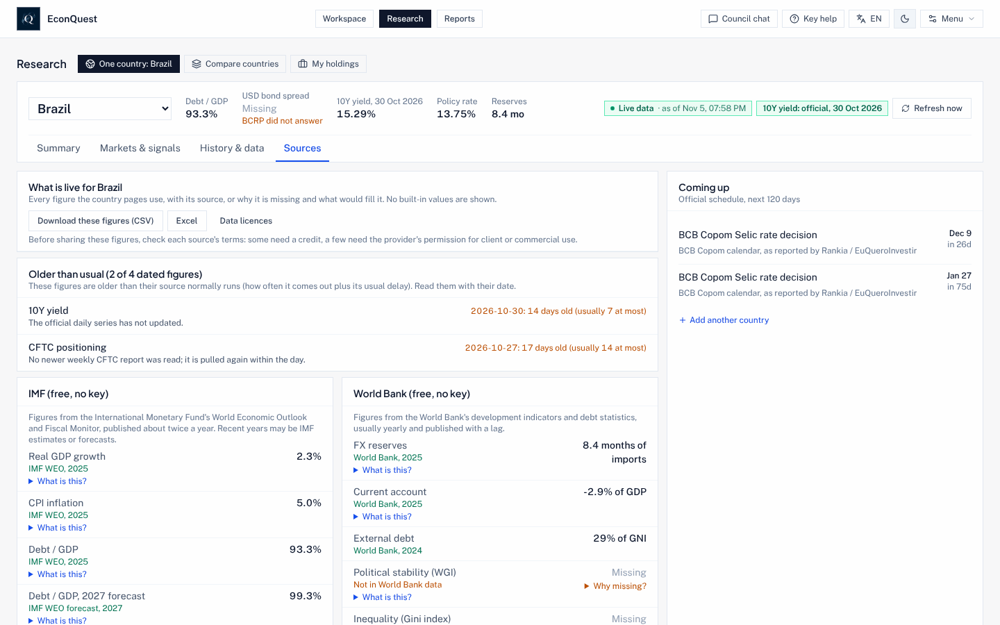

1. Appuyez sur **Sources**. L'onglet liste chaque chiffre des pages du pays avec sa source, ou la raison
   de son absence, sans rien d'intégré.
2. **Plus anciens que d'habitude** signale les chiffres dont la source est en retard.
3. **À venir** liste les dates officielles (décisions de banques centrales, publications de données) des
   120 prochains jours.
4. Vous pouvez télécharger toute la liste en CSV ou Excel ; **Licences des données** dit ce que chaque
   source permet de partager.

## 5. Remonter dans le temps

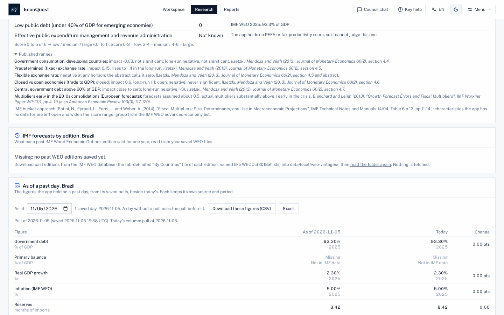

1. Dans **Historique et données**, descendez jusqu'à **À une date passée**.
2. Choisissez une date. Le tableau montre chaque chiffre tel que l'application l'avait ce jour-là, à côté
   du chiffre actuel et de l'écart. Chaque téléchargement quotidien est archivé : rien ne se perd.
3. **Prévisions du FMI par édition** (juste au-dessus) montre comment la vue du FMI sur le pays a changé
   d'une édition à l'autre, une fois les éditions passées enregistrées.

## 6. Comparer des pays

1. Dans **Recherche**, appuyez sur **Comparer des pays**. Votre liste de suivi s'affiche côte à côte, avec
   les mêmes quatre onglets qu'un pays.
2. **Pistes d'articles** signale les records, les grands mouvements et les révisions des chiffres
   officiels.
3. **Là où données et prix divergent** classe les pays où marchés et données vont dans des directions
   différentes, avec les chiffres à l'appui.
4. Appuyez sur le nom d'un pays pour l'ouvrir seul.

**Mes positions**, la troisième vue, fait de même pour une liste d'obligations ou de positions que vous
chargez depuis un fichier CSV.

## 7. Examiner une politique et rédiger un rapport

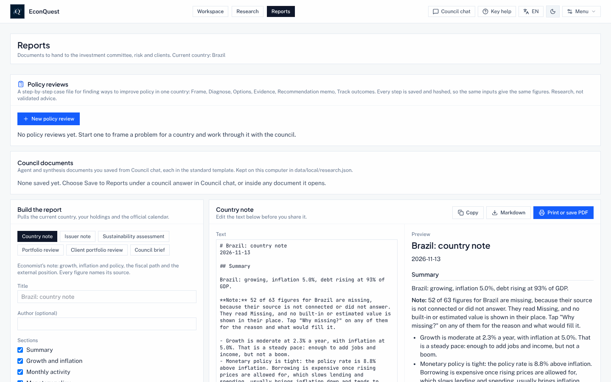

**Rapports** rassemble les revues de politique, les documents enregistrés depuis le Chat du conseil et le
générateur de rapports.

Pour rédiger un rapport :

1. Choisissez un type : Note pays, Note émetteur, Évaluation de la soutenabilité, Revue de portefeuille,
   Revue du portefeuille client ou Synthèse du conseil.
2. Cochez les sections voulues. Le brouillon se met à jour et l'aperçu montre le résultat.
3. Modifiez le texte, puis **Copier**, téléchargez en **Markdown** ou **Imprimer ou enregistrer en PDF**.
   Chaque chiffre garde sa source et sa date.

Pour examiner une politique :

1. Appuyez sur **Nouvelle revue de politique**.
2. Choisissez le pays et la date de référence (chaque étape suivante lit les données telles qu'elles
   étaient ce jour-là).
3. Décrivez le problème en une ou deux phrases, par exemple « L'inflation est bien au-dessus de la cible
   alors que la croissance ralentit et que la dette augmente ».
4. Choisissez l'indicateur à améliorer, le sens et, si vous le souhaitez, une cible et une date. Indiquez
   les contraintes, une par ligne (un change fixe, peu de marge budgétaire, une élection), et à qui
   s'adresse la revue.
5. Appuyez sur **Commencer la revue**. Les étapes suivent : cadrage, diagnostic, options (classées par le
   modèle arbitre), preuves et précédents (les années-pays passées les plus proches et ce qui a suivi), un
   contrôle comportemental, règles budgétaires et faisabilité politique, la note de recommandation, une
   **synthèse d'une page** en PDF pour les non-économistes, et le suivi des résultats, qui compare la revue
   à ce qui s'est passé à 12 et 24 mois. Chaque étape est enregistrée avec son empreinte.

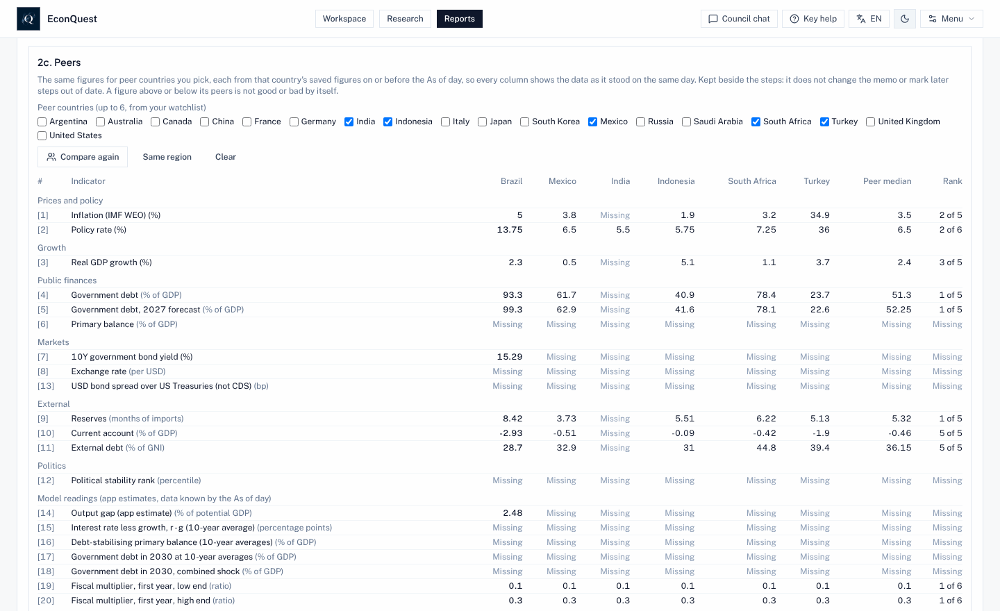

6. Après le diagnostic, **Pairs** place les chiffres du diagnostic à côté de jusqu'à six pays de votre
   liste de suivi (ou appuyez sur **Même région**, puis **Comparer**), chacun tel qu'enregistré à la
   date de la revue ou avant, avec la médiane des pairs et le rang de ce pays.
7. Dans la note, donnez à un chiffre suivi un seuil que l'application sait lire, comme « au-dessus de
   8 », « en dessous de 3 », « cible 4 », « monte » ou « baisse ». **Suivi des revues de politique**,
   sous les alertes de suivi dans le Briefing de l'espace de travail, indique alors pour chacun s'il est
   franchi ou non face aux derniers chiffres enregistrés ; **Ouvrir la revue** ramène à la revue.
8. À la date prévue, **Revoir** lance une nouvelle revue avec le même cadrage sur les données du jour.
   La nouvelle revue ouvre **Ce qui a changé depuis la revue précédente** : le cadrage, l'option
   recommandée par chaque note, chaque chiffre alors et maintenant, et si l'indicateur visé a évolué
   dans le bon sens.

## 8. Choisir un modèle d'IA

1. Ouvrez **Menu > Réglages > Modèle d'IA** (ou ⌘, sur Mac, Ctrl+, ailleurs).
2. Choisissez un fournisseur :
   - **Ollama sur votre ordinateur** : gratuit et privé ; Ollama doit tourner avec les modèles
     téléchargés ;
   - **Google Gemini** : demande votre propre clé Gemini ; les questions sont envoyées à Google ;
   - **Ollama, puis Gemini** : Ollama d'abord, Gemini quand Ollama ne répond pas.
3. Pour Ollama, indiquez **où tourne Ollama** et appuyez sur **Trouver Ollama** pour choisir parmi vos
   modèles.
4. Réglez le **modèle rapide** (choix des agents et réponses des bureaux ; `qwen2.5:7b` par défaut) et le
   **modèle arbitre** (synthèses, explications, débat et options de politique ; `qwen2.5:32b` par
   défaut). Utilisez votre plus grand modèle comme arbitre.
5. Laissez **Autoriser un arbitre de 14B** désactivé, sauf si votre ordinateur ne peut pas faire tourner le
   32B. Activé, chaque réponse jugée par un arbitre 14B porte la mention « Arbitre réduit ». Un modèle de
   8B ou moins n'est jamais un bon arbitre.
6. Appuyez sur **Tester le modèle**. Il envoie une courte question comme le fait le Chat du conseil.

Quel modèle pour quel ordinateur, et les réglages utilisés par l'application, sont dans le README :
[Modèles d'IA](../README.fr.md#modèles-dia--lequel-choisir-tailles-et-réglages).

## 9. Outils, vérification des données et menu

Le **Menu** rassemble tout ce qui n'est pas une page. À connaître d'abord :

- **Outils** : tous les outils regroupés selon ce que vous voulez faire, et **Connexions de données**.
- **Données hors ligne** : téléchargez les données de tous les pays pour un usage sans internet et voyez
  la place qu'elles prennent.
- **État des données** : quelles sources arrivent, lesquelles échouent et quels chiffres ont été révisés.
- **Modèles et validation** : le registre des modèles, les résultats des tests et **Vos tests**.
- **Vos données** : chargez vos propres séries depuis un fichier CSV.
- **Mode examen** : désactive toutes les étapes d'IA pour un examen.
- **Exemples guidés** : quatre cas, d'une question à une note.
- **Quêtes** : grisé, « Pas encore disponible » ([section 12](#12-essayer-les-quêtes)).

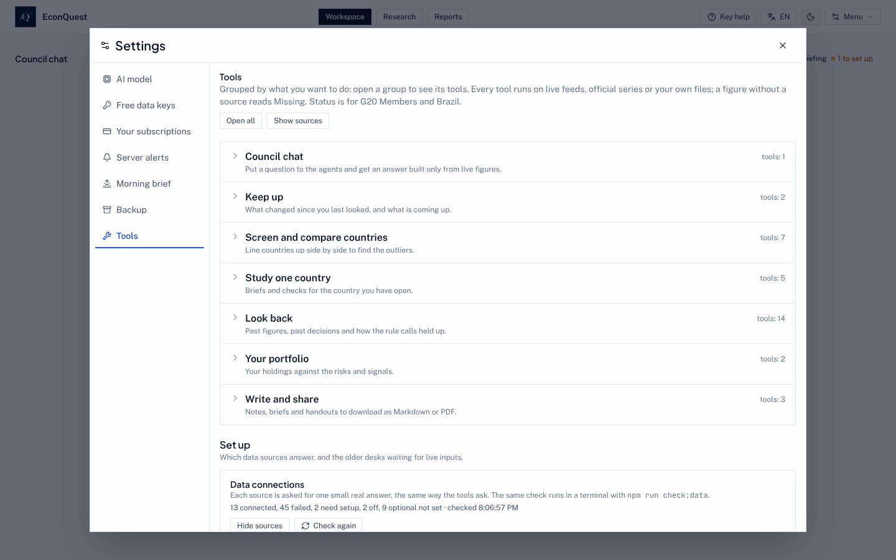

Pour vérifier quelles sources répondent :

1. Ouvrez **Menu > Outils**.
2. Descendez jusqu'à **Connexions de données** et appuyez sur **Afficher les sources**, ou **Vérifier de
   nouveau** pour interroger toutes les sources maintenant. Chaque source s'affiche connectée (avec un
   chiffre renvoyé), à configurer, éteinte, ou avec la raison de l'échec.
3. La même vérification se lance dans un terminal avec `npm run check:data`.

### Laisser un autre programme utiliser EconQuest

Si vous utilisez un outil de portefeuille ou un autre programme qui doit lire les chiffres
d’EconQuest, vous pouvez lui donner accès sans partager votre mot de passe.

1. Ouvrez **Menu > Réglages > Jetons d’API**.
2. Donnez un nom au jeton (par exemple « Console de portefeuille ») et cochez seulement ce qu’il peut
   faire : lire les chiffres et les séries, lire les séances du conseil, recevoir les événements et
   définir des surveillances, envoyer des positions, définir les noms masqués ou lancer des scénarios
   sur un portefeuille.
3. Appuyez sur **Créer le jeton** et copiez-le tout de suite : il n’est affiché qu’une fois, et l’application n’en garde
   qu’une empreinte. Chaque usage est inscrit au journal d’audit ; **Révoquer** l’arrête aussitôt.
4. Les positions envoyées par l’autre programme apparaissent dans **Recherche > Mes positions**, marquées
   « Envoyée par » suivi du nom du jeton.

Pour qu’un pays ou un titre n’apparaisse sur aucun écran, dans aucune réponse ni aucun événement,
ajoutez-le dans **Menu > Réglages > Noms masqués** (par code ISO du pays, ticker ou votre propre
identifiant). Les écrans n’indiquent alors que le nombre d’éléments masqués, et l’application garde une
empreinte de chaque nom, pas le nom lui-même.

Sur un serveur partagé par plusieurs personnes, un administrateur peut les laisser se connecter avec un
compte qu’elles ont déjà chez Google, Microsoft, Okta, Keycloak ou un autre fournisseur OpenID Connect ;
la page de connexion affiche alors **Se connecter avec** et le nom du fournisseur
([SECURITY.md](./SECURITY.md), en anglais). Ce dont un programmeur a besoin pour se connecter se trouve
dans [DATA_API.md](./DATA_API.md) et [DEPLOYMENT.md](./DEPLOYMENT.md) (en anglais).

## 10. Changer la langue et le niveau d'aide

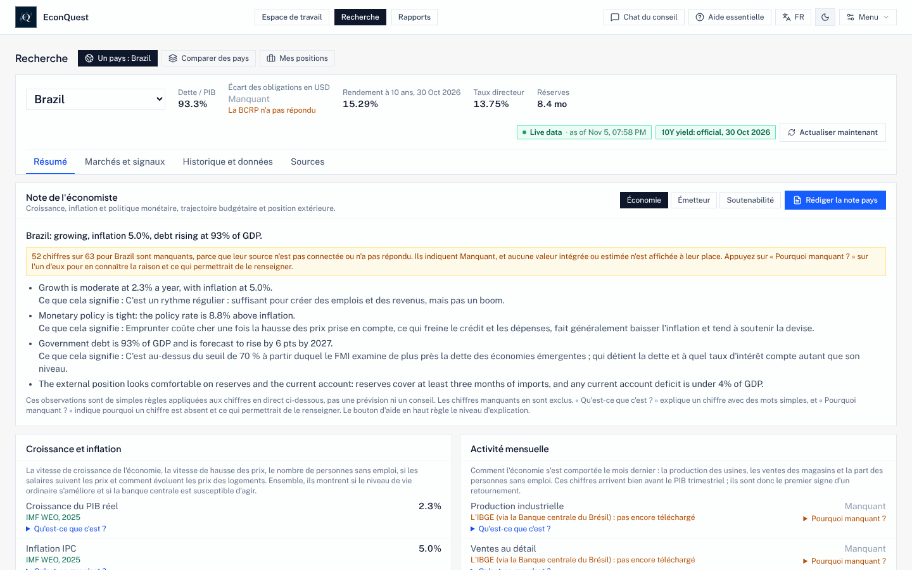

1. Appuyez sur le bouton de **langue** de l'en-tête. Chaque appui passe à la suivante : English, Español,
   Français, Português. Le choix est gardé dans ce navigateur.
2. Appuyez sur le bouton d'**aide** à côté pour passer entre :
   - **Aide essentielle** (par défaut) : comment lire chaque graphique, ce que cela signifie dans la vie
     réelle et *Qu'est-ce que c'est ?* sur les principaux chiffres ;
   - **Aide complète** : *Qu'est-ce que c'est ?* sur chaque chiffre et terme, et pourquoi chaque chiffre
     absent manque ;
   - **Aide désactivée** : chiffres, sources et observations seulement, sans intervalles de prévision.

Les chiffres et les noms de sources et de séries restent tels que la source les écrit. Certaines phrases
que l'application écrit sur un pays sont encore en anglais, comme le montre la capture ; les agents du
conseil travaillent en anglais.

## 11. L'utiliser sur un téléphone

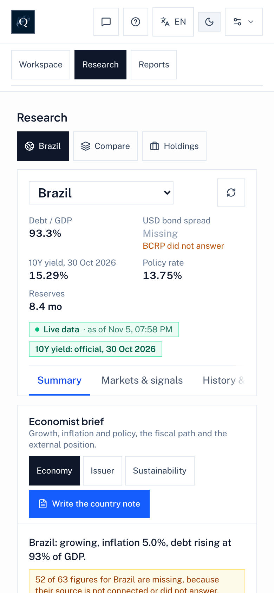

L'application fonctionne à la largeur d'un téléphone dans le navigateur. Les panneaux s'empilent sur une
colonne et l'en-tête garde les boutons des pages, avec des boutons-icônes pour le Chat du conseil, l'aide,
la langue, le clair et sombre, et le Menu. Pour l'ouvrir depuis un téléphone sur le même réseau domestique,
l'ordinateur qui fait tourner EconQuest doit l'autoriser (`HOST="0.0.0.0"` et `ALLOWED_HOSTS` dans `.env` ;
voir [HOME_SERVER.md](./HOME_SERVER.md), et activez d'abord la connexion par compte).

## 12. Essayer les Quêtes

Les Quêtes sont désactivées pour tous tant que la liste de lancement de [QUESTS.md](./QUESTS.md) n'est pas
terminée. Pour les essayer sur votre ordinateur :

1. Ajoutez `QUESTS_ENABLED=on` au fichier `.env` de votre dossier EconQuest et redémarrez l'application.
2. Ouvrez **Menu > Quêtes**. La fenêtre des Quêtes est en anglais pour l'instant. La liste montre la
   question de chaque Quête, son type (Forecast, Debate, Replication ou Signal), si c'est un brouillon et
   quand son résultat est attendu. Filtrez par type ou par date.
3. Ouvrez une Quête pour voir sa règle, les chiffres en direct sur lesquels elle sera réglée et ses
   limites connues.
4. **Log privately** garde votre réponse sur cet ordinateur seulement ; **Practice** répond à des questions
   passées et vous note tout de suite ; **My entries** liste ce que vous avez enregistré et votre score.
5. **Results**, **Scoreboard**, **Stances** et **Health** montrent les Quêtes réglées, les statistiques
   des participants, les questions facultatives de positionnement économique et si le système fonctionne.

Quand les Quêtes seront publiques, **Enter publicly** préparera pour vous une demande de modification vers
le dépôt public. Le README explique [comment fonctionne le jeu](../README.fr.md#quêtes--des-solutions-économiques-à-plusieurs).
