# Walk-through guide

**English** · [Español](./GUIDE.es.md) · [Français](./GUIDE.fr.md) · [Português](./GUIDE.pt.md)

This guide shows how to use EconQuest, task by task, with a screenshot for each step. It assumes the
app is installed and open in your browser (see [INSTALL.md](./INSTALL.md)). For every page and panel
in detail, see the [user manual](./USER_MANUAL.md); for any term you do not know, the
[glossary](./GLOSSARY.md).

About the screenshots: they were taken on 13 November 2026 (four retaken or added on 17 November)
from a local build of the main branch,
replaying feed replies recorded on 5 November 2026 from the sources whose terms allow passing data
on, with no AI model set up. That is why many figures read **Missing** and the council shows no
written summary in them. On your computer, with the feeds reachable and an AI model chosen, more
figures fill in and the council writes its summary.

## Contents

1. [The screen at a glance](#1-the-screen-at-a-glance)
2. [First start: what to set up](#2-first-start-what-to-set-up)
3. [Ask the council a question](#3-ask-the-council-a-question)
4. [Study one country](#4-study-one-country)
5. [Look back in time](#5-look-back-in-time)
6. [Compare countries](#6-compare-countries)
7. [Review a policy and write a report](#7-review-a-policy-and-write-a-report)
8. [Choose an AI model](#8-choose-an-ai-model)
9. [Tools, data checks and the menu](#9-tools-data-checks-and-the-menu)
10. [Change language and help level](#10-change-language-and-help-level)
11. [Use it on a phone](#11-use-it-on-a-phone)
12. [Try Quests](#12-try-quests)

---

## 1. The screen at a glance

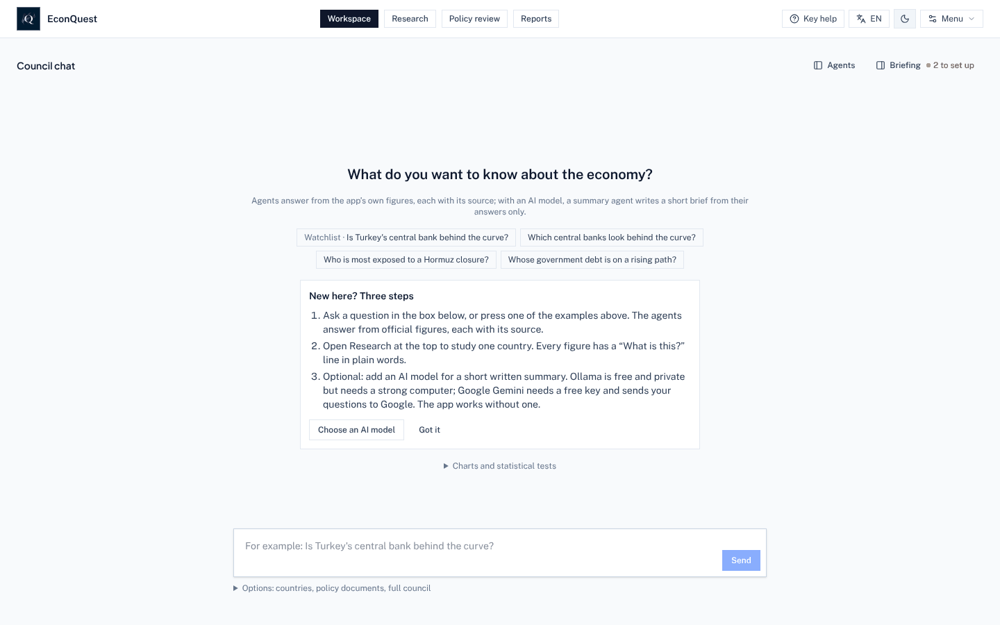

- **Header, centre:** the three pages. **Workspace** (Council chat), **Research** (countries and
  holdings) and **Reports**.
- **Header, right:** **Council chat** (opens the chat beside Research or Reports), the **help level**
  button (here *Key help*), the **language** button (*EN*), the light and dark switch (until you press it, the
  app follows your computer's own setting), and **Menu**.
- **Workspace, top right:** **Agents** shows which agents worked on the last answer; **Briefing**
  opens your inputs, watchlist, what moved and what is coming. "2 to set up" counts the setup steps
  still open.

## 2. First start: what to set up

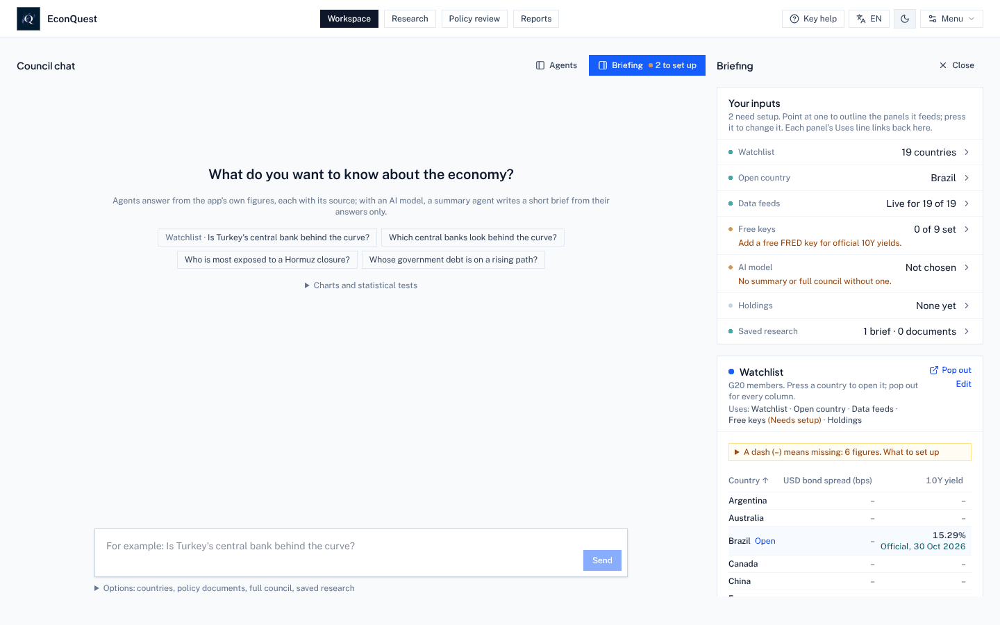

1. On **Workspace**, press **Briefing**.
2. Read **Your inputs**. Each line says what the app is using: the watchlist (19 G20 countries to
   start), the open country, how many data feeds answered, how many free keys are set, the AI model,
   your holdings and saved research. Press a line to change it.
3. Add the free **FRED** key first (Menu > Settings > Free data keys). It fills official 10-year
   government bond yields for several countries.
4. Press **Edit** on the watchlist card to add or remove countries. To follow poorer economies,
   pick the **Lower-income countries** list: the 15 largest by region, from India and Nigeria to
   Ghana and Bolivia. A country not in the app's list can be added with **Add a country** (in **Research > One country**, or in the watchlist editor); from
   the next daily download it is saved like the others, so it gets history, "as of" views and alerts
   (up to 25 added countries; any more are named on **Menu > Offline data** with the reason).
5. Choose an AI model if you want written summaries ([section 8](#8-choose-an-ai-model)). Everything
   else works without one.

A new install shows dashes until the first data download finishes, which can take a few minutes.

## 3. Ask the council a question

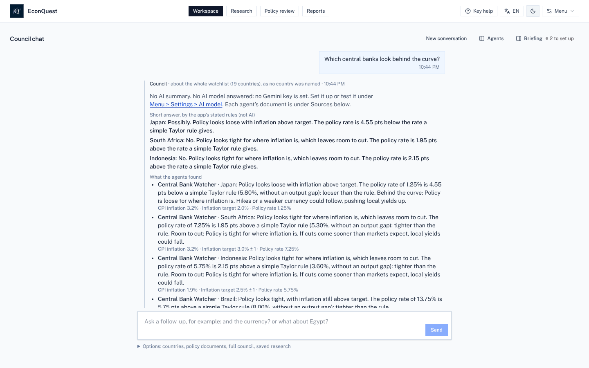

1. On **Workspace**, type a question in plain words in the box at the bottom, for example "Which
   central banks look behind the curve?", or press one of the example questions.
2. Press **Send**. The **Agents** panel on the left shows the work as it happens:
   - **Planner** picks the agents that cover your question (by stated rules if no AI model is set).
   - **Desk agents** answer from the app's figures. Here the Central Bank Watcher covered 6 countries.
   - **Synthesis agent** writes a short brief that may quote only the agents' figures. Without an AI
     model it is skipped and says why, as in the screenshot.
3. Open **Sources & actions** under the answer to see each agent's document, with every figure's
   source and date, and to save it to Reports.
4. Ask a follow-up in the same box, or press one of the suggested follow-ups. If you name no country,
   the question covers your whole watchlist.
5. **Options** under the box lets you pick countries, attach a policy document for the Document agent,
   or **Run the full council**: nine agents on three desks debate one country, and the app asks for
   your approval before the final report.

**Ask what a change would do.** Council chat also answers what-if questions.

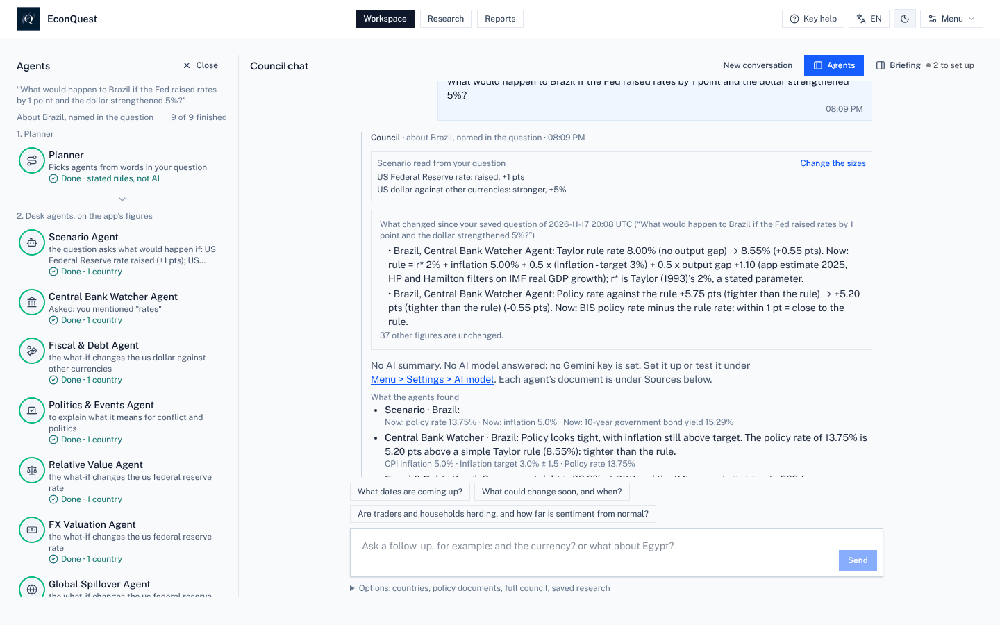

1. Ask the change in your own words, with its size: "What would happen to Brazil if the Fed raised
   rates by 1 point and the dollar strengthened 5%?" You can name a central bank or Fed rate,
   government borrowing costs, the dollar, the currency, oil, food or commodity prices, financial
   stress, supply chain pressure, growth or inflation.
2. **Scenario read from your question** shows each change the app understood, with its size. If you
   gave no size, it asks you for one; it never picks one for you.
3. The **Scenario Agent** sets today's figures beside the figures after the change, for up to four
   countries, and adds what happened in past episodes of the same kind and what published studies
   found (each study with its page and DOI; a study's number is an average over many countries).
   Parts with no figures read Missing with the reason.
4. With an AI model set up, the answer comes in eight parts, from *Where things stand now* to *What
   would change the answer*, each marked with the kind of evidence it rests on: *Data*, *App
   calculation*, *Past*, *Published study* or *Interpretation*.
5. Press **Change the sizes**, change a size or take a change out, and press **Ask again with these
   changes**. The new answer comes as a follow-up, so you can compare the two. A debt path has **Keep
   for the trade-off chart**, which puts it on the chart under Debt sustainability.

If you run a research-tools server of your own and set it up (Menu > Settings > Research tools), a
**Quant desk** also answers questions about backtests, forecasts, volatility, nowcasts, option prices,
drawdowns or Sharpe ratios, with each figure's link, data-through date and the server's label
("Hypothetical, past performance; not a recommendation"). It is off until you set it up
([RESEARCH_TOOLS.md](./RESEARCH_TOOLS.md)).

## 4. Study one country

Open **Research**. The country picker is at the top left; the strip beside it shows debt, bond spread,
10-year yield, policy rate and reserves, and the green labels say how fresh the data is. **Refresh
now** pulls that country's figures again.

### Summary

1. **Summary** opens first. The **Economist brief** gives the main points in plain words, each with
   "What it means" for daily life. *Economy*, *Issuer* and *Sustainability* switch the angle.
2. The yellow box says how many figures are Missing and why. Press **Why missing?** beside any of them
   for the reason and what would fill it.
3. **What is this?** under a figure explains it. **Explain** asks the council what it means for this
   country.
4. The figures come one group at a time: pick a group from the row of buttons, or **Show all**.
   **Sources** and **My holdings** work the same way.
5. **Write the country note** turns the page into a report draft.

### Markets & signals

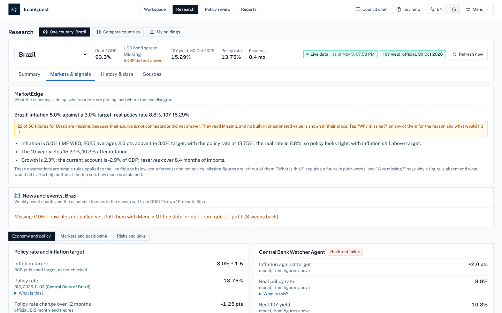

1. Press **Markets & signals**. **MarketEdge** compares what the economy is doing with what markets
   price, and where the two disagree.
2. Each agent and signal carries a badge: *Validated*, *Provisional*, *Not validated*, and so on. A
   badge says how far its test has gone ([METHODOLOGY.md](./METHODOLOGY.md)). Most signals have not
   passed a test yet, and the badge says so.
3. Prediction-market odds (Kalshi, Polymarket), bond spreads and currency figures appear here when
   their sources answer.
4. The page is in three parts: **Economy and policy**, **Markets and positioning**, and **Risks and
   links**.

### History & data

1. Press **History & data**. Pick a figure in **Figures with a history** on the right to chart it.
2. Above each chart: what it measures, whose figure it is, how often it comes out, how to read the
   chart and what it means in real life.
3. Under the chart: **Download this series** (CSV or Excel), **Download every series for the
   country**, **Cite** (plain text, BibTeX or RIS), **Flag** (report a problem) and **Publish chart**
   (PNG or SVG).
4. Below the chart, **Tools for <country>** lists every analysis tool in eight groups: Debt and budget,
   Rates and prices, External and currency, Growth and forecasts, People and development, Risks and
   shocks, Look back, and Learn and convert. Press one and it opens below the chart. To switch, pick
   another from the **Tool** list, or press **All tools** to see the menu again. Figures with no
   history yet fold into one line in the list on the right.

   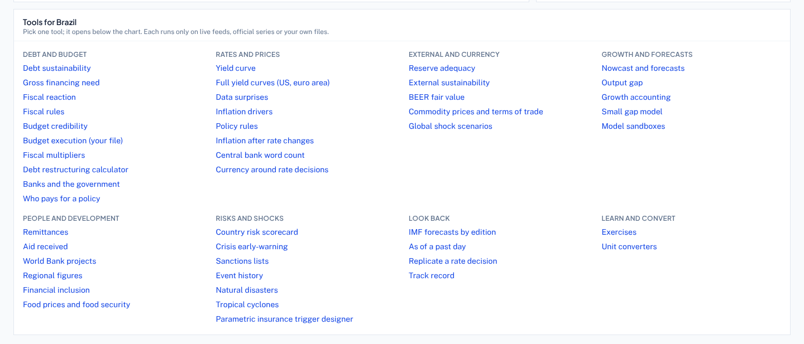

   The tools include nowcasts and forecasts with 50, 70 and 90% bands, the output gap, debt
   sustainability, gross financing need, reserve adequacy, external sustainability, crisis
   early-warning, the yield curve, inflation drivers, growth accounting, policy rules, fiscal
   what-ifs and a small gap model you fill in yourself.
5. Tools for lower-income countries, under People and development and Risks and shocks:
   **Remittances** (beside exports, investment and aid, and
   the cost of sending US$200 against the UN 3% goal), **Financial inclusion** (who has an account,
   by sex and income), **Commodity prices and terms of trade** (what the latest world price moves mean
   for the country, as % of GDP), **Aid received**, **Food prices and food security** and **Natural
   disasters**. Food price inflation and disasters read from files you save yourself in
   `data/local/fao-cpi/` and `data/local/emdat/`; until then those parts read Missing and say where to
   get the file ([INSTALL.md](./INSTALL.md#files-you-save-yourself)). Under Natural disasters,
   **Loss model** splits the yearly damage into how many damaging events a year and how large each
   one is, and simulates 20,000 years to give the average yearly loss and the loss passed 1 year in
   10, 50 and 100, also as % of GDP.
6. **Figures with a history** also hold how the currency and dollar funding work in practice:
   the **exchange rate regime** (how the currency is run in fact, month by month, from the Ilzetzki,
   Reinhart and Rogoff workbook you save in `data/local/irr/`), **central bank assets** (the central
   bank's balance sheet as % of GDP, from the BIS) and **dollar funding stress** (dollar loans and
   bonds owed by the country's non-banks, from the BIS, and the Federal Reserve's dollar swap lines,
   from the New York Fed).
7. The same list holds the **weather**: monthly temperature and rainfall at the capital since 1981
   (NASA POWER) and averaged over the whole country since 1901 (World Bank climate portal), each
   month against its 1991-2020 average. Rice, wheat, maize and soybean world prices go back to 1960,
   so a drought can be set beside a price spike.
8. **Parametric insurance** lets you sketch a cover that pays from a measured number (rainfall,
   temperature or a food price) instead of an assessed loss:
   1. Pick the index, the season, whether it pays when the index is low or high, the trigger where
      payment starts, the exit where the full cover is paid, and the cover amount. The panel opens on
      a design from the record (trigger passed about 1 year in 5, exit about 1 in 20).
   2. **Burn analysis** replays the design over every past season: the years it paid and the average
      yearly payout (the burn cost).
   3. **Fair price** adds a loading you pick (a % of the expected payout, or k standard deviations of
      the yearly payout) and gives the price as % of the cover a year.
   4. **How rare is it?** says how often the trigger and the exit are passed, from the record and from
      a fitted extreme value curve, with a 90% range.
   5. **Basis risk** checks the cover against the other weather series (capital against whole
      country): in how many bad years it paid, and how many it missed.
9. **Tropical cyclones** lists the hurricanes, typhoons and cyclones that passed within 50, 100 or
   200 km of the country since 1980, from NOAA's IBTrACS tracks. Nothing is downloaded until you
   press **Download storm tracks from NOAA**; you can also save an IBTrACS file in
   `data/local/ibtracs/`.
10. Tools for people who run or judge a budget, under **Debt and budget** and **People and development**:
    - **Budget credibility**: how much of the budget first approved each year the government actually
      spent, with the PEFA band of each year (A within 5% of the budget, B within 10%, C within 15%,
      D further) and a grade worked out by the app (not the official PEFA score).
    - **Budget execution (your file)**: press **Download the template**, fill in your approved budget
      and monthly spending by ministry or programme, say which month the fiscal year starts, the unit
      and the source, and load the file. Each line shows its spending against the share of the year
      gone; lines more than 10 points behind or ahead are marked, and months with no figure are
      listed, never filled in. The file stays on your computer.
    - **World Bank projects**: projects under way in the country, largest first, with the amount
      committed, the share of planned time gone and, for IDA credits and grants, the share paid out.
      A project paying out slowly for its age is marked as a reason to look closer.
    - **Regional figures**: output per person in each region, the gap to the national figure and
      whether regions drew closer in ten years; for EU and EFTA countries, GDP per person and
      unemployment by region; and the Human Development Index by region if you save the Global Data
      Lab file in `data/local/gdl/`.
11. Tools for economists and traders, under **Rates and prices** and **Growth and forecasts**:
    - **Full yield curves (US, euro area)**: every maturity of the US Treasury and euro area curves
      each day, a fitted curve, the level, slope and curvature with their moves over a day and a
      month, and carry and roll-down over three months for each maturity.
    - **Data surprises**: each release against what was expected just before it (Brazil's Focus
      survey, the ECB's survey of forecasters, the Kalshi CPI market for the United States, or the
      app's own GDP nowcast), and the **Inflation surprise index**, which sums up recent inflation
      surprises (also a card on Today for Brazil, the euro area and the United States). A
      description, not a signal.
    - **Nowcast and forecasts** adds **Ranges from past misses**: a 70% and 90% range on each tested
      step, from how far the forecast missed for this country in its test. Fewer than 8 past cases
      reads Missing.
12. The **Country risk scorecard** sets governance, armed conflict, unrest, geopolitical risk,
    capital account openness (the Chinn-Ito index, credited to Chinn and Ito 2006) and the economy
    side by side, each with its source and year. It gives no overall score. A test of whether weak
    governance comes before a default was fixed in advance on 13 November 2026; until it is run the
    panel's badge reads Not validated.

13. More tools in History & data: **How shocks spread between economies** (a small global VAR:
    pick where a surprise starts, growth or inflation, and its size; each economy's response over
    five years with a 90% band, and the trade weight behind it), the **Estimated gap model** inside
    the small gap model (shown only when its pre-registered test passed), **Official documents**
    (World Bank reports and BIS central bankers' speeches for the country, each linked to the
    publisher's page), and the **Macro lab** for teaching (aggregate demand and supply, and a debt
    path, with sliders that start at zero). **Download offline report** saves a one-page HTML file
    of the country's figures that opens without the app.

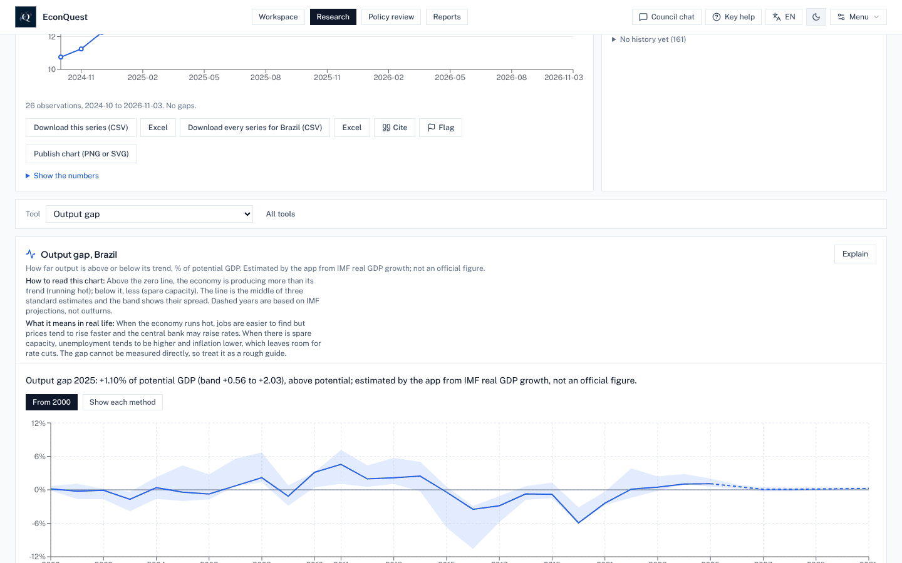

Example: the **output gap** shows how far the economy runs above or below its normal capacity. The
line is the middle of three standard estimates, the band their spread, and dashed years rest on IMF
projections. The sentence above the chart states the latest reading and where it comes from.

### Sources

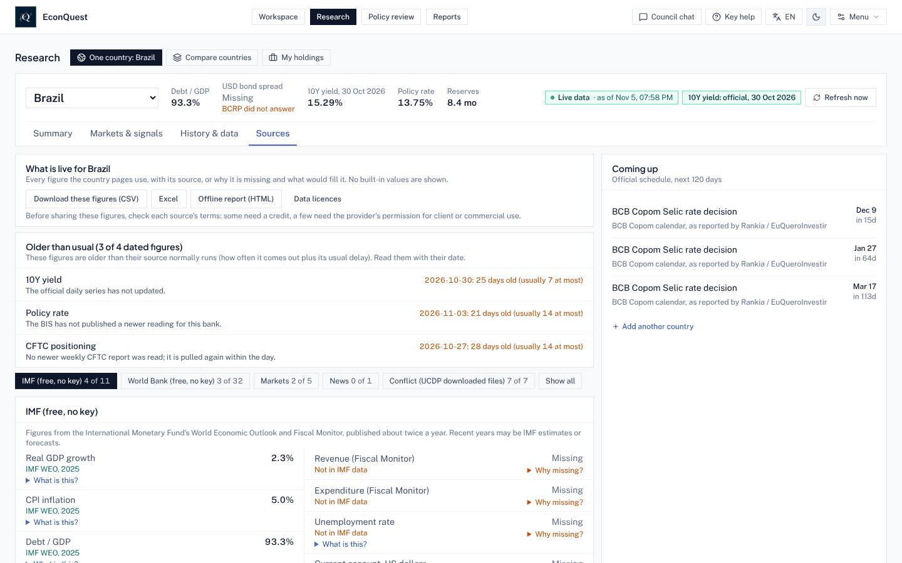

1. Press **Sources**. It lists every figure on the country's pages with its source, or why it is
   missing, and nothing built in.
2. **Older than usual** flags figures whose source is late.
3. **Coming up** lists official dates (central bank decisions, data releases) for the next 120 days.
4. **Download these figures** gives the whole list as CSV or Excel; **Data licences** says what each
   source allows you to share.

## 5. Look back in time

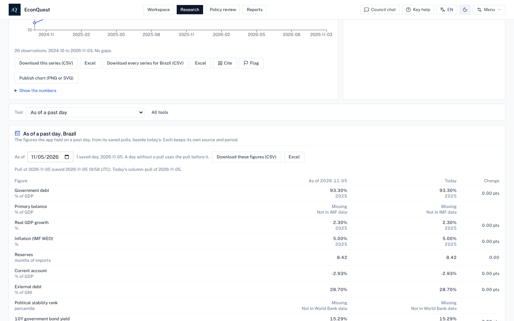

1. In **History & data**, open **As of a past day** from the tools menu (under Look back).
2. Pick a date. The table shows each figure as the app held it that day beside today's figure and the
   change. Every daily pull is archived, so nothing is lost.
3. **IMF forecasts by edition** (another tool under Look back) shows how the IMF's view of the country
   changed from one World Economic Outlook to the next, once past editions are saved (see the panel's
   own note). Under its table, **Range from past IMF misses** puts a 70% and 90% range around the
   latest edition's projections, from how far past editions missed for this country.

## 6. Compare countries

1. In **Research**, press **Compare countries**. Your watchlist appears side by side, with the same
   four tabs as one country.
2. **Story leads** points to records, big moves and revisions in the official figures.
3. **Where data and price disagree** ranks countries where markets and the data point different
   ways, each with the figures behind it.
4. MarketEdge, scenario exposure and the Fed balance sheet are separate parts; **Where data and price
   disagree** shows four countries until you press **Show all**.
5. Press a country's name to open it on its own.

For lower-income countries, some figures come from slower sources and say so on their label. Where no
central bank or ECB daily exchange rate exists (for example the naira, the Kenyan shilling or the
cedi), the history chart shows the IMF's monthly average rate per US dollar. Where the BIS does not
publish a country's policy rate (for example Egypt, Nigeria, Kenya or Pakistan), the watchlist and
country page show the IMF's monthly figure, labelled "IMF, monthly" with its month; it reads Missing
when it is more than four months old. The inflation nowcast and forecast and the policy rate
forecast (History & data) use the same IMF monthly figures for these countries and say they are the
IMF's; a policy rate more than four months old gives no forecast. Inflation targets and central bank decision dates appear only
where the bank's own page states them, so many of these countries show "no date on file".

**My holdings**, the third view, does the same for a list of bonds or positions you load from a CSV
file (Menu > Your data, or the template in the holdings screen).

## 7. Review a policy and write a report

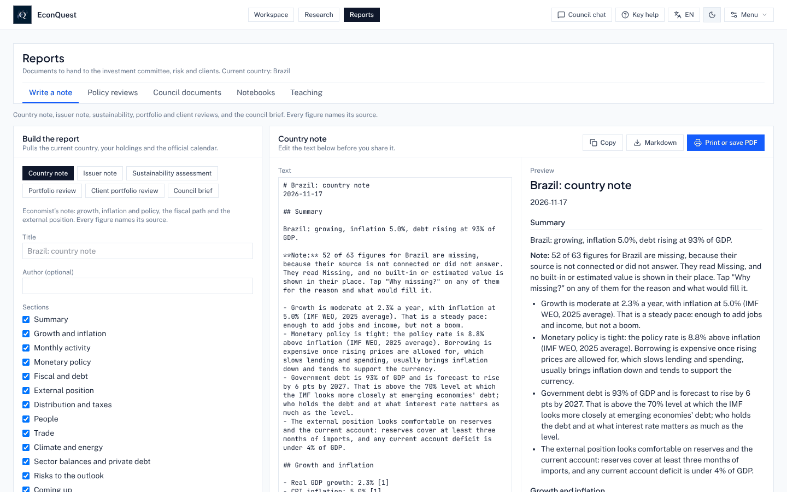

**Reports** has five tabs, each on its own: **Write a note** (the report builder), **Policy reviews**,
**Council documents** (documents you saved from Council chat), **Notebooks** and **Teaching**.

To write a report:

1. In **Write a note**, under **Build the report**, pick a type: Country note, Issuer note, Sustainability assessment,
   Portfolio review, Client portfolio review or Council brief.
2. Tick the sections you want. The draft on the left updates and the preview shows how it will look.
3. Edit the text, then **Copy**, download as **Markdown**, or **Print or save PDF**. Sources and dates
   go with every figure.

To review a policy:

1. Open the **Policy reviews** tab and press **New policy review**.
2. Choose the country and the **As of** date (every later step reads the data as it stood on that day).
3. Describe the problem in a sentence or two, for example "Inflation is well above target while
   growth is slowing and debt is rising".
4. Pick the indicator that should improve, the direction and, if you like, a target and a date. List
   constraints one per line (a currency peg, little fiscal room, an election) and who the review is for.
5. Press **Start review**. The steps follow: Frame, Diagnose, Options (ranked by the referee model),
   Evidence and Precedents (the closest past country-years and what followed), a behavioural check,
   fiscal rules and political feasibility, the Recommendation memo, a **one-page brief** PDF for
   non-economists, and Track outcomes, which checks the review against what happened at 12 and 24
   months. Every step is saved and fingerprinted.

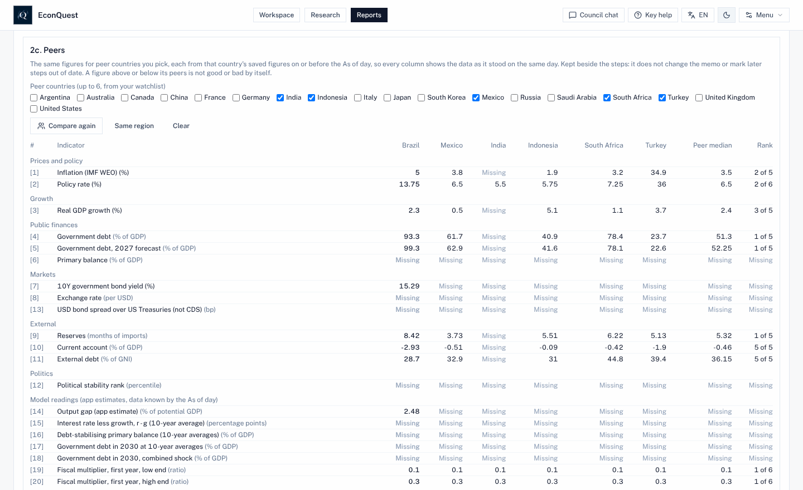

6. After Diagnose, **Peers** sets the diagnosis figures beside up to six countries from your watchlist
   (or press **Same region**, then **Compare**), each as saved on or before the review's As of day, with
   the peers' median and this country's rank.
7. In the memo, give a watched figure a trigger the app can read, such as "above 8", "below 3",
   "target 4", "rises" or "falls". **Policy review watch**, under Watch alerts in the Workspace
   Briefing, then shows each one as Crossed or Not crossed against the latest saved figures; **Open
   review** goes back to the review.
8. On the review date, **Review again** starts a new review with the same frame on today's data. The
   new review opens **What changed since the earlier review**: the frame, the option each memo
   recommended, each figure then and now, and whether the goal indicator moved the right way.
9. To weigh one measure (a tax change, a subsidy reform, a spending programme), tick **Policy council
   question** in the frame and pick **One measure**. Under the review, fill in **Costs and benefits**
   (each year's figures with their source, at official or your own discount rates: the app gives the
   present value and the year it pays back), **Who gains and who loses**, **What follows** (second-order
   effects, each resting on a figure, a source or an assumption) and **What could go differently** (two
   to five cases, with odds if you like). The Options step then ranks alternatives against the measure.
   Pick **What an event means for a market** instead to weigh an event for the currency or government
   bonds: **Copy in the market readings** takes the app's own figures as they stood on the As of day,
   and your cases are the change in value for a holder. The one-page brief ends with these parts, and
   at 12 and 24 months a currency review's cases are checked against what the exchange rate did.

10. In the memo, **For people** gives a plain summary for constituents: what changes, the cost per
    person, who gains and who pays, the regions furthest behind and what three countries in a similar
    position saw next. It is written from fixed sentences filled with the figures, not by AI, and is
    added to the one-page brief.

To write a working paper you can check later:

1. In Council chat, ask for a chart ("chart Brazil's policy rate since 2015"). Under the Chart Agent's
   chart, press **Pin to notebook** and pick a notebook. The app keeps the date the figures run to and
   a fingerprint of the figures (a short code that changes if any figure changes).
2. Open **Reports > Notebooks**. **Working-paper bundle (.zip)** downloads one zip: a draft in
   Markdown with your notes, a folder for each pinned figure with its data and Python, R and Stata
   scripts, a citation file and a list of every file's fingerprint.
3. Later, press **Check it still holds** on a pinned figure. It answers *Same*, *Revised* (with the old
   and new values) or *Source no longer answers*. `npm run notebook:check` checks every pinned figure
   at once.

## 8. Choose an AI model

1. Open **Menu > Settings > AI model** (or press ⌘, on a Mac, Ctrl+, elsewhere).
2. Pick a provider:
   - **Ollama on your computer**: free and private; the Ollama app must be running with the models
     downloaded.
   - **Google Gemini**: needs your own Gemini key, pasted below; questions go to Google.
   - **Ollama, then Gemini**: Ollama first, Gemini when Ollama does not answer.
3. For Ollama, say **where it runs** and press **Find Ollama** to pick from the models you have.
4. Set the **Fast model** (picking agents and desk answers; `qwen2.5:7b` by default) and the
   **Referee model** (summaries, explanations, the debate and policy options; `qwen2.5:32b` by
   default). Use your largest model as referee.
5. Leave **Allow a 14B referee** off unless your computer cannot run the 32B model. With it on, every
   answer a 14B referee judges says "Small referee". An 8B or smaller model is never a good referee.
6. Press **Test the model**. It sends one short question the way Council chat does.

Which model fits which computer, and the settings the app uses, are in the README:
[AI models](../README.md#ai-models-which-to-use-sizes-and-settings).

## 9. Tools, data checks and the menu

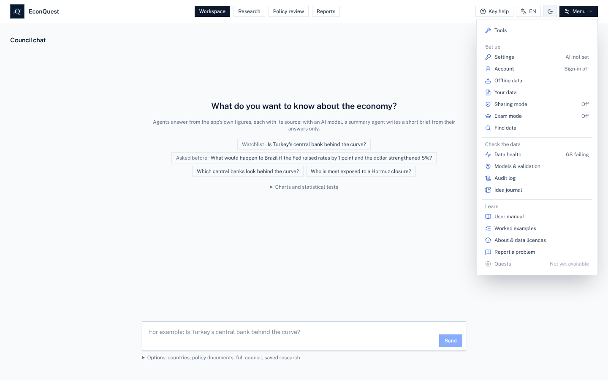

**Menu** holds everything that is not a page. Items worth knowing first:

- **Tools**: every tool grouped by what you want to do (keep up, screen and compare, study one
  country, look back, your portfolio, write and share), and **Data connections**.
- **Offline data**: download all country data for use without internet, and see how much space it
  takes.
- **Settings > Research tools**: the address and token of a research-tools server you run yourself,
  for the Quant desk in Council chat. Off until both are set; **Test connection** lists the tools the
  token can see, and every call goes in the audit log, never the token.
- **Data health**: which sources arrive, which fail, and which figures were revised. Its **Daily
  download** tab follows the daily download as it runs: each part, what failed and why, sources that
  need a key or a file, and what to download by hand.
- **Models & validation**: the model register, test results and **Your tests**.
- **Your data**: load your own series from a CSV file.
- **Find data**: one search across the free catalogues (DBnomics, the IMF, the World Bank and
  Eurostat), each result with its provider and a link to it.
- **Settings > Your subscriptions > Your broker prices**: live prices for contracts you list from
  your own Interactive Brokers account, through the IBKR Client Portal Gateway you run and sign in to
  on your computer. Off by default; shown on screen only and never saved.
- **Exam mode**: turns every AI step off for a class test.
- **Worked examples**: five case studies from a question to a memo.
- **About & data licences**: the version, a short note on privacy ([PRIVACY.md](PRIVACY.md)), and
  whether a newer version is out, with the steps to update.
- **Report a problem**: opens a new GitHub issue with the app version filled in. You read it and
  send it yourself. If a screen fails to draw, its note has **Copy details** and **Report this
  problem** too.
- **Keyboard shortcuts**: press **?** for the list. **/** jumps to the council question box,
  **Cmd+K** (Ctrl+K on Windows) searches the tools, **Cmd+,** opens Settings and **Esc** closes a
  window. / and ? do nothing while you type in a box.
- **Quests**: greyed out, "Not yet available" ([section 12](#12-try-quests)).

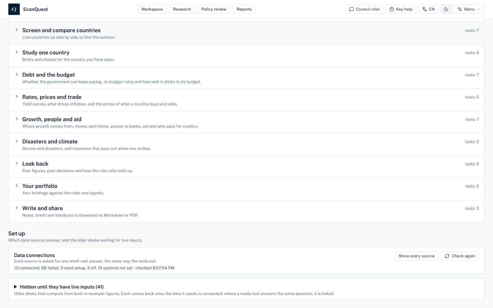

To check which sources answer:

1. Open **Menu > Tools**.
2. Scroll to **Data connections** and press **Show sources**, or **Check again** to ask every source
   now. Each source reads connected (with a figure it returned), needs setup, off, or why it failed.
3. The same check runs in a terminal with `npm run check:data`.

### Let another program use EconQuest

If you use a portfolio tool or another program that should read EconQuest's figures, you can let it
in without sharing your password.

1. Open **Menu > Settings > API tokens**.
2. Give the token a name (for example "Portfolio console") and tick only what it may do: read
   figures and series, read council runs, ask Council chat questions, receive events and set watches,
   send positions, set hidden names, or run scenarios on a portfolio.
3. Press **Make token** and copy the token at once: it is shown only once, and the app keeps only a
   fingerprint of it. Every use is written to the audit log; **Revoke** stops it straight away.
4. Positions the other program sends appear in **Research > My holdings** marked "Sent by" and the
   token's name.
5. A token that may ask Council chat questions gets the same answer you would get in the chat for
   the same question: the same agents, figures and checks. Each question uses your AI model and
   counts against the same limit on AI requests as your own questions. Hidden names never appear in
   its answers, and only figures whose sources allow passing them on are used. Each question is
   written to the audit log with the token's name.

To keep a country or a security out of every screen, reply and event, add it under **Menu > Settings
> Hidden names** (by ISO country code, ticker or your own entity ID). Screens then show only how many
items are hidden, and the app keeps a fingerprint of each name, not the name itself.

On a server shared by several people, an administrator can let them sign in with an existing account
at Google, Microsoft, Okta, Keycloak or another OpenID Connect provider; the sign-in page then shows
**Sign in with** and the provider's name ([SECURITY.md](./SECURITY.md)). What a programmer needs to
connect is in [DATA_API.md](./DATA_API.md) and [DEPLOYMENT.md](./DEPLOYMENT.md).

## 10. Change language and help level

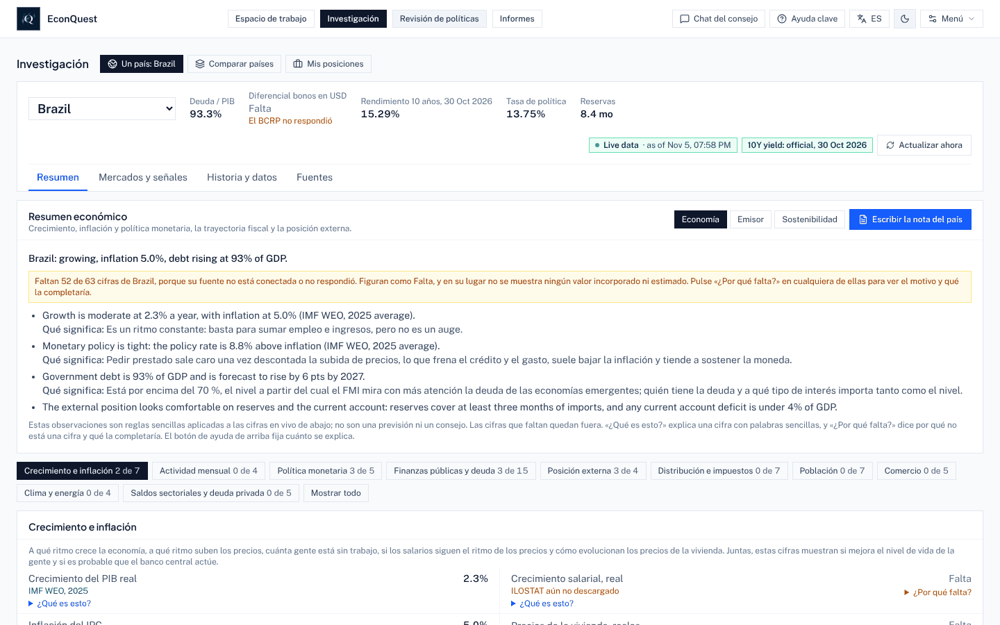

1. Press the **language** button in the header (*EN*). Each press moves to the next language:
   English, Español, Français, Português. The choice is kept in this browser.
2. Press the **help** button beside it to move between:
   - **Key help** (the default): how to read each chart, what it means in real life, and *What is
     this?* on the main figures;
   - **Full help**: *What is this?* on every figure and term, and why each missing figure is missing;
   - **Help off**: figures, sources and observations only, without forecast ranges;
   - **Expert**: figures, sources and forecast ranges, with no plain-language explanations.

Figures, source names and series names stay as the source wrote them. Some lines the app writes about
a country are still in English, as the screenshot shows; Council chat and the council answer in the language
you pick; their agents still read questions best in English.

| French | Portuguese |
| --- | --- |
| 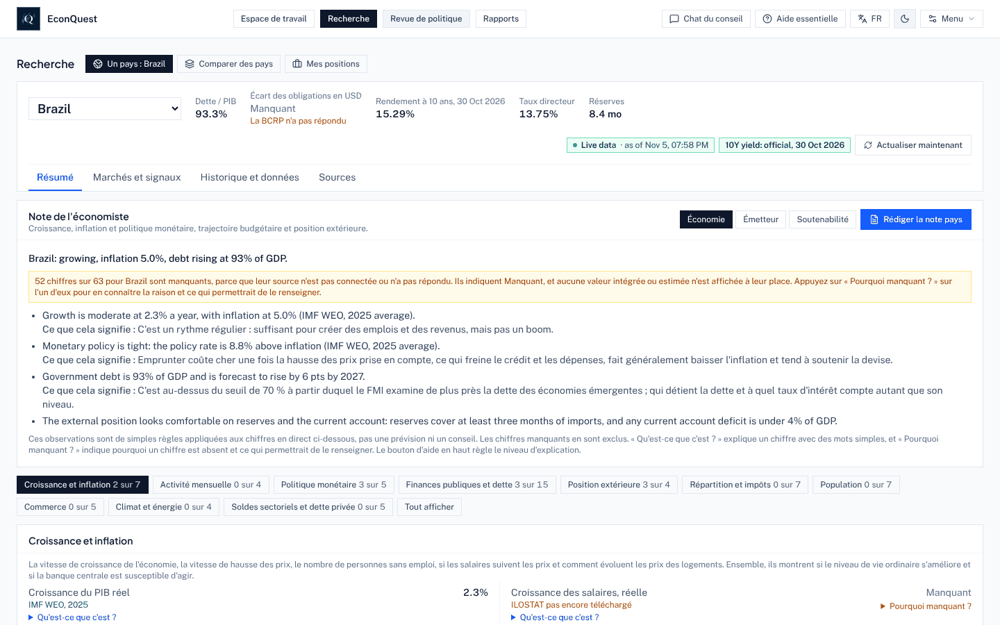 | 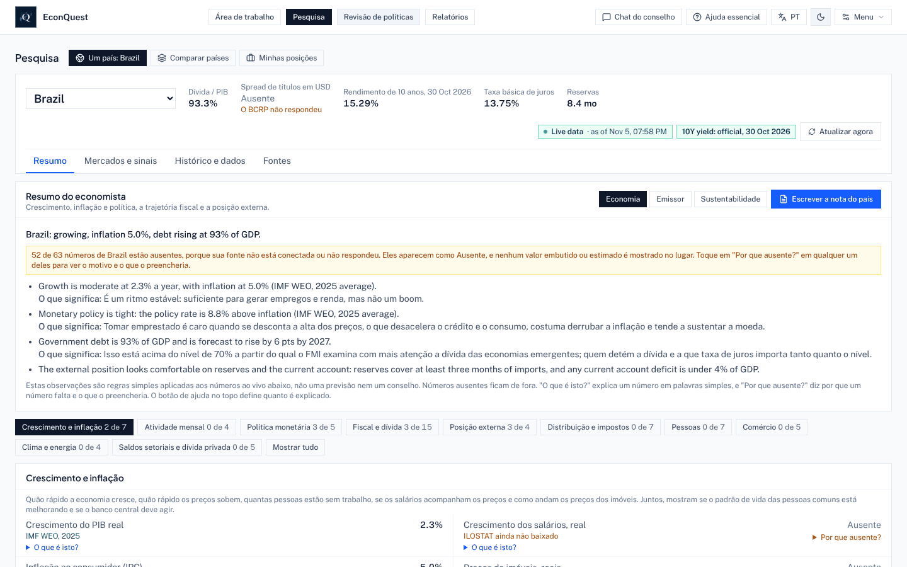 |

## 11. Use it on a phone

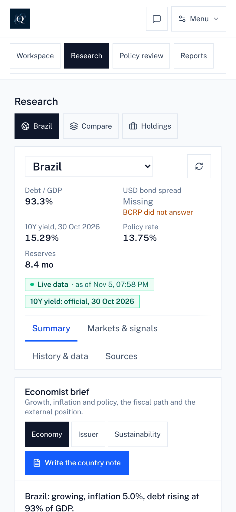

The app works at phone width in the browser. Panels stack into one column, and the header keeps the page
buttons with icon buttons for Council chat, help, language, light and dark, and Menu. To open it from a phone on the same home
network, the computer running EconQuest must allow it (`HOST="0.0.0.0"` and `ALLOWED_HOSTS` in `.env`;
see [HOME_SERVER.md](./HOME_SERVER.md), and turn on sign-in first).

## 12. Try Quests

Quests are switched off for everyone until the launch checklist in [QUESTS.md](./QUESTS.md) is done.
To try them on your own computer:

1. Add `QUESTS_ENABLED=on` to the `.env` file in your EconQuest folder and restart the app.
2. Open **Menu > Quests**. The list shows each Quest's question, its kind (Forecast, Debate,
   Replication or Signal), whether it is a draft, and when its result is due. Filter by kind or due
   date.
3. Open a Quest to see its rule, the live figures it will be settled on and its known limits.
4. **Log privately** keeps your answer on this computer only; **Practice** answers past questions and
   scores you at once; **My entries** lists what you logged and how it scored.
5. **Results**, **Scoreboard**, **Stances** and **Health** show settled Quests, contributor
   statistics, the optional economics stance questions and whether the Quest system is working.

When Quests go public, **Enter publicly** will prepare a pull request to the public repository for
you. The README explains [how the game works](../README.md#quests-crowdsourcing-answers-to-economic-questions).
