# Walk-through guide

**English** · [Español](./GUIDE.es.md) · [Français](./GUIDE.fr.md) · [Português](./GUIDE.pt.md)

This guide shows how to use EconQuest, task by task, with a screenshot for each step. It assumes the
app is installed and open in your browser (see [INSTALL.md](./INSTALL.md)). For every page and panel
in detail, see the [user manual](./USER_MANUAL.md); for any term you do not know, the
[glossary](./GLOSSARY.md).

About the screenshots: they were taken on 13 November 2026 from a local build of the main branch,
replaying feed replies recorded on 5 November 2026 from the sources whose terms allow passing data
on, with no AI model set up. That is why many figures read **Missing** and the council shows no
written summary in them. On your computer, with the feeds reachable and an AI model chosen, more
figures fill in and the council writes its summary.

## Contents

1. [The screen at a glance](#1-the-screen-at-a-glance)
2. [First start: what to set up](#2-first-start-what-to-set-up)
3. [Ask the council a question](#3-ask-the-council-a-question)
4. [Study one country](#4-study-one-country)
5. [Look back in time](#5-look-back-in-time)
6. [Compare countries](#6-compare-countries)
7. [Review a policy and write a report](#7-review-a-policy-and-write-a-report)
8. [Choose an AI model](#8-choose-an-ai-model)
9. [Tools, data checks and the menu](#9-tools-data-checks-and-the-menu)
10. [Change language and help level](#10-change-language-and-help-level)
11. [Use it on a phone](#11-use-it-on-a-phone)
12. [Try Quests](#12-try-quests)

---

## 1. The screen at a glance

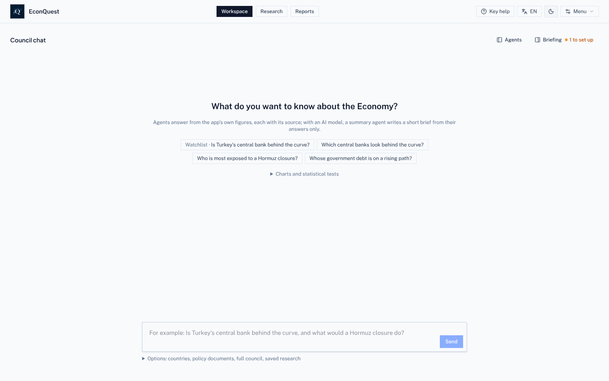

- **Header, centre:** the three pages. **Workspace** (Council chat), **Research** (countries and
  holdings) and **Reports**.
- **Header, right:** **Council chat** (opens the chat beside Research or Reports), the **help level**
  button (here *Key help*), the **language** button (*EN*), the light and dark switch, and **Menu**.
- **Workspace, top right:** **Agents** shows which agents worked on the last answer; **Briefing**
  opens your inputs, watchlist, what moved and what is coming. "2 to set up" counts the setup steps
  still open.

## 2. First start: what to set up

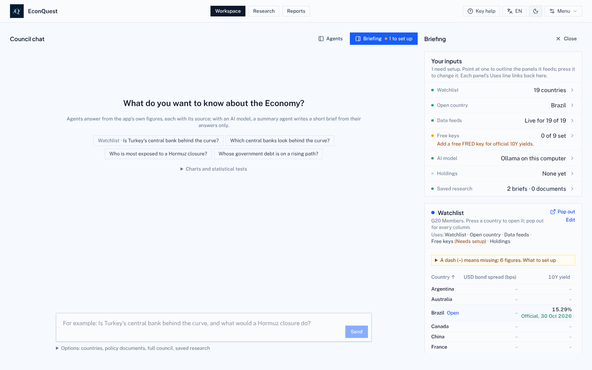

1. On **Workspace**, press **Briefing**.
2. Read **Your inputs**. Each line says what the app is using: the watchlist (19 G20 countries to
   start), the open country, how many data feeds answered, how many free keys are set, the AI model,
   your holdings and saved research. Press a line to change it.
3. Add the free **FRED** key first (Menu > Settings > Free data keys). It fills official 10-year
   government bond yields for several countries.
4. Press **Edit** on the watchlist card to add or remove countries.
5. Choose an AI model if you want written summaries ([section 8](#8-choose-an-ai-model)). Everything
   else works without one.

A new install shows dashes until the first data download finishes, which can take a few minutes.

## 3. Ask the council a question

1. On **Workspace**, type a question in plain words in the box at the bottom, for example "Which
   central banks look behind the curve?", or press one of the example questions.
2. Press **Send**. The **Agents** panel on the left shows the work as it happens:
   - **Planner** picks the agents that cover your question (by stated rules if no AI model is set).
   - **Desk agents** answer from the app's figures. Here the Central Bank Watcher covered 6 countries.
   - **Synthesis agent** writes a short brief that may quote only the agents' figures. Without an AI
     model it is skipped and says why, as in the screenshot.
3. Open **Sources & actions** under the answer to see each agent's document, with every figure's
   source and date, and to save it to Reports.
4. Ask a follow-up in the same box, or press one of the suggested follow-ups. If you name no country,
   the question covers your whole watchlist.
5. **Options** under the box lets you pick countries, attach a policy document for the Document agent,
   or **Run the full council**: nine agents on three desks debate one country, and the app asks for
   your approval before the final report.

## 4. Study one country

Open **Research**. The country picker is at the top left; the strip beside it shows debt, bond spread,
10-year yield, policy rate and reserves, and the green labels say how fresh the data is. **Refresh
now** pulls that country's figures again.

### Summary

1. **Summary** opens first. The **Economist brief** gives the main points in plain words, each with
   "What it means" for daily life. *Economy*, *Issuer* and *Sustainability* switch the angle.
2. The yellow box says how many figures are Missing and why. Press **Why missing?** beside any of them
   for the reason and what would fill it.
3. **What is this?** under a figure explains it. **Explain** asks the council what it means for this
   country.
4. **Write the country note** turns the page into a report draft.

### Markets & signals

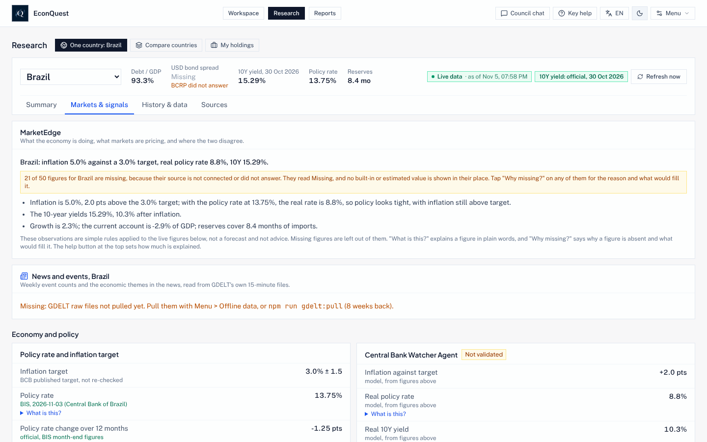

1. Press **Markets & signals**. **MarketEdge** compares what the economy is doing with what markets
   price, and where the two disagree.
2. Each agent and signal carries a badge: *Validated*, *Provisional*, *Not validated*, and so on. A
   badge says how far its test has gone ([METHODOLOGY.md](./METHODOLOGY.md)). Most signals have not
   passed a test yet, and the badge says so.
3. Prediction-market odds (Kalshi, Polymarket), bond spreads and currency figures appear here when
   their sources answer.

### History & data

1. Press **History & data**. Pick a figure in **Figures with a history** on the right to chart it.
2. Above each chart: what it measures, whose figure it is, how often it comes out, how to read the
   chart and what it means in real life.
3. Under the chart: **Download this series** (CSV or Excel), **Download every series for the
   country**, **Cite** (plain text, BibTeX or RIS), **Flag** (report a problem) and **Publish chart**
   (PNG or SVG).
4. Scroll down for the analysis panels: nowcasts and forecasts with 50, 70 and 90% bands, the output
   gap, debt sustainability, gross financing need, reserve adequacy, external sustainability, crisis
   early-warning, the yield curve, inflation drivers, growth accounting, policy rules, fiscal
   what-ifs and a small gap model you fill in yourself.
5. Panels for lower-income countries follow: **Remittances** (beside exports, investment and aid, and
   the cost of sending US$200 against the UN 3% goal), **Financial inclusion** (who has an account,
   by sex and income), **Commodity prices and terms of trade** (what the latest world price moves mean
   for the country, as % of GDP), **Aid received**, **Food prices and food security** and **Natural
   disasters**. Food price inflation and disasters read from files you save yourself in
   `data/local/fao-cpi/` and `data/local/emdat/`; until then those parts read Missing and say where to
   get the file ([INSTALL.md](./INSTALL.md#files-you-save-yourself)).

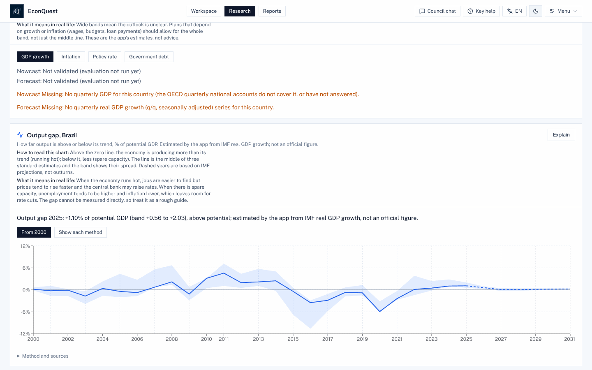

Example: the **output gap** shows how far the economy runs above or below its normal capacity. The
line is the middle of three standard estimates, the band their spread, and dashed years rest on IMF
projections. The sentence above the chart states the latest reading and where it comes from.

### Sources

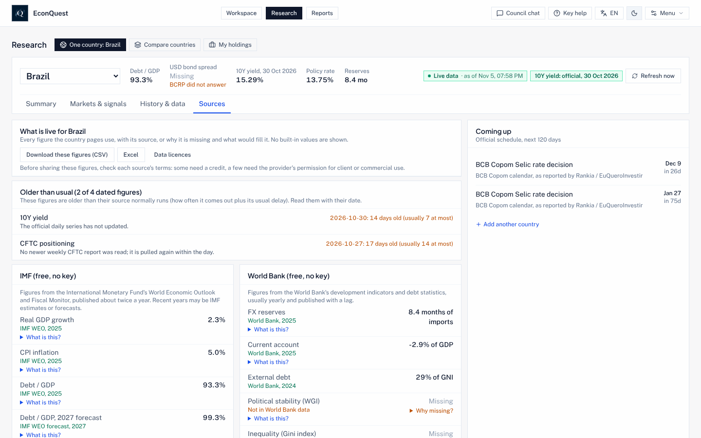

1. Press **Sources**. It lists every figure on the country's pages with its source, or why it is
   missing, and nothing built in.
2. **Older than usual** flags figures whose source is late.
3. **Coming up** lists official dates (central bank decisions, data releases) for the next 120 days.
4. **Download these figures** gives the whole list as CSV or Excel; **Data licences** says what each
   source allows you to share.

## 5. Look back in time

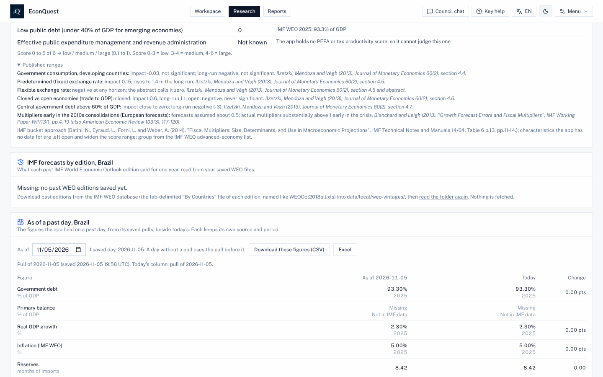

1. In **History & data**, scroll to **As of a past day**.
2. Pick a date. The table shows each figure as the app held it that day beside today's figure and the
   change. Every daily pull is archived, so nothing is lost.
3. **IMF forecasts by edition** (just above) shows how the IMF's view of the country changed from one
   World Economic Outlook to the next, once past editions are saved (see the panel's own note).

## 6. Compare countries

1. In **Research**, press **Compare countries**. Your watchlist appears side by side, with the same
   four tabs as one country.
2. **Story leads** points to records, big moves and revisions in the official figures.
3. **Where data and price disagree** ranks countries where markets and the data point different
   ways, each with the figures behind it.
4. Press a country's name to open it on its own.

**My holdings**, the third view, does the same for a list of bonds or positions you load from a CSV
file (Menu > Your data, or the template in the holdings screen).

## 7. Review a policy and write a report

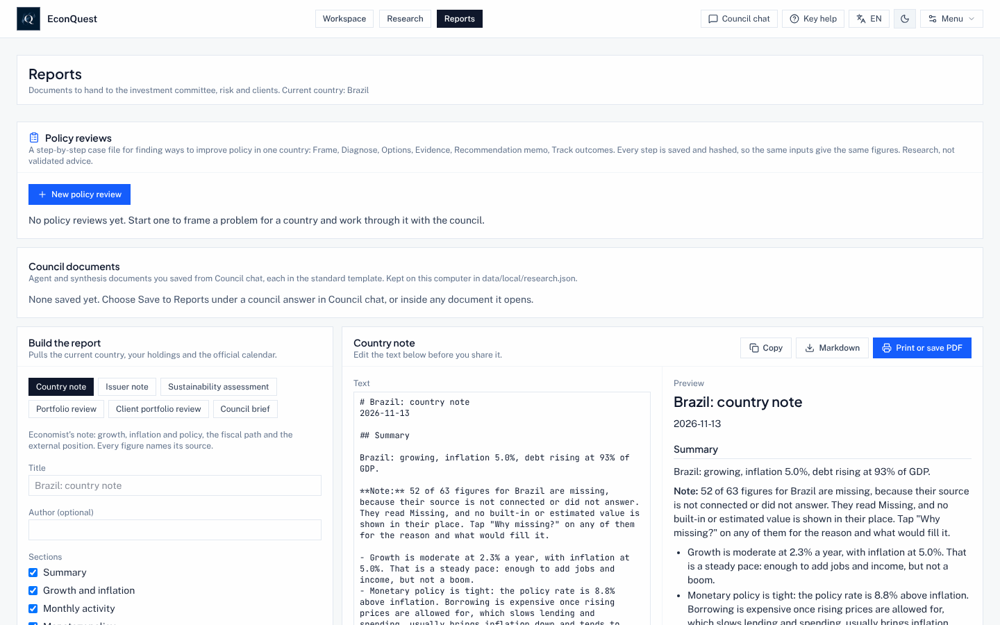

**Reports** holds policy reviews, documents you saved from Council chat, and the report builder.

To write a report:

1. Under **Build the report**, pick a type: Country note, Issuer note, Sustainability assessment,
   Portfolio review, Client portfolio review or Council brief.
2. Tick the sections you want. The draft on the left updates and the preview shows how it will look.
3. Edit the text, then **Copy**, download as **Markdown**, or **Print or save PDF**. Sources and dates
   go with every figure.

To review a policy:

1. Press **New policy review**.
2. Choose the country and the **As of** date (every later step reads the data as it stood on that day).
3. Describe the problem in a sentence or two, for example "Inflation is well above target while
   growth is slowing and debt is rising".
4. Pick the indicator that should improve, the direction and, if you like, a target and a date. List
   constraints one per line (a currency peg, little fiscal room, an election) and who the review is for.
5. Press **Start review**. The steps follow: Frame, Diagnose, Options (ranked by the referee model),
   Evidence and Precedents (the closest past country-years and what followed), a behavioural check,
   fiscal rules and political feasibility, the Recommendation memo, a **one-page brief** PDF for
   non-economists, and Track outcomes, which checks the review against what happened at 12 and 24
   months. Every step is saved and fingerprinted.

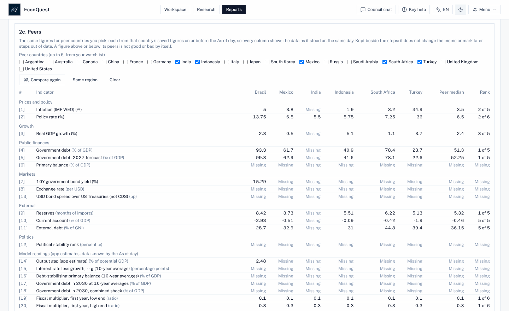

6. After Diagnose, **Peers** sets the diagnosis figures beside up to six countries from your watchlist
   (or press **Same region**, then **Compare**), each as saved on or before the review's As of day, with
   the peers' median and this country's rank.
7. In the memo, give a watched figure a trigger the app can read, such as "above 8", "below 3",
   "target 4", "rises" or "falls". **Policy review watch**, under Watch alerts in the Workspace
   Briefing, then shows each one as Crossed or Not crossed against the latest saved figures; **Open
   review** goes back to the review.
8. On the review date, **Review again** starts a new review with the same frame on today's data. The
   new review opens **What changed since the earlier review**: the frame, the option each memo
   recommended, each figure then and now, and whether the goal indicator moved the right way.

## 8. Choose an AI model

1. Open **Menu > Settings > AI model** (or press ⌘, on a Mac, Ctrl+, elsewhere).
2. Pick a provider:
   - **Ollama on your computer**: free and private; the Ollama app must be running with the models
     downloaded.
   - **Google Gemini**: needs your own Gemini key, pasted below; questions go to Google.
   - **Ollama, then Gemini**: Ollama first, Gemini when Ollama does not answer.
3. For Ollama, say **where it runs** and press **Find Ollama** to pick from the models you have.
4. Set the **Fast model** (picking agents and desk answers; `qwen2.5:7b` by default) and the
   **Referee model** (summaries, explanations, the debate and policy options; `qwen2.5:32b` by
   default). Use your largest model as referee.
5. Leave **Allow a 14B referee** off unless your computer cannot run the 32B model. With it on, every
   answer a 14B referee judges says "Small referee". An 8B or smaller model is never a good referee.
6. Press **Test the model**. It sends one short question the way Council chat does.

Which model fits which computer, and the settings the app uses, are in the README:
[AI models](../README.md#ai-models-which-to-use-sizes-and-settings).

## 9. Tools, data checks and the menu

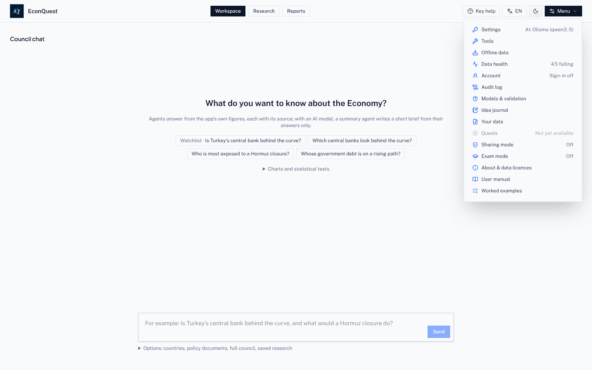

**Menu** holds everything that is not a page. Items worth knowing first:

- **Tools**: every tool grouped by what you want to do (keep up, screen and compare, study one
  country, look back, your portfolio, write and share), and **Data connections**.
- **Offline data**: download all country data for use without internet, and see how much space it
  takes.
- **Data health**: which sources arrive, which fail, and which figures were revised.
- **Models & validation**: the model register, test results and **Your tests**.
- **Your data**: load your own series from a CSV file.
- **Exam mode**: turns every AI step off for a class test.
- **Worked examples**: four case studies from a question to a memo.
- **Quests**: greyed out, "Not yet available" ([section 12](#12-try-quests)).

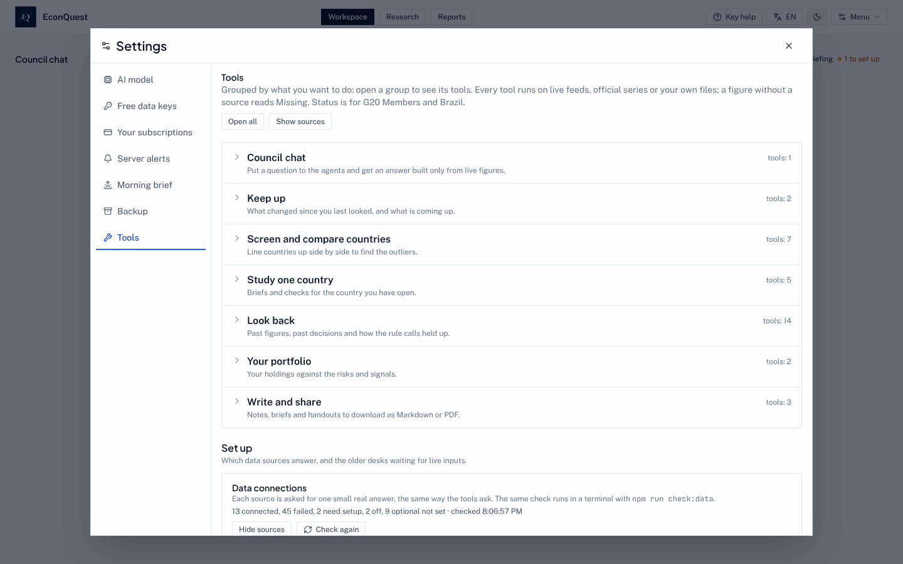

To check which sources answer:

1. Open **Menu > Tools**.
2. Scroll to **Data connections** and press **Show sources**, or **Check again** to ask every source
   now. Each source reads connected (with a figure it returned), needs setup, off, or why it failed.
3. The same check runs in a terminal with `npm run check:data`.

## 10. Change language and help level

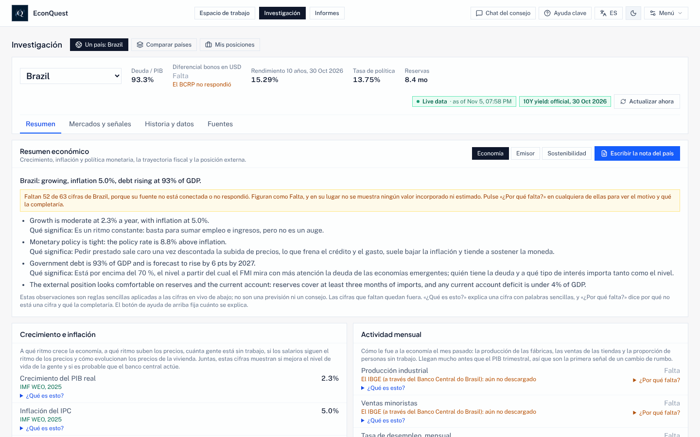

1. Press the **language** button in the header (*EN*). Each press moves to the next language:
   English, Español, Français, Português. The choice is kept in this browser.
2. Press the **help** button beside it to move between:
   - **Key help** (the default): how to read each chart, what it means in real life, and *What is
     this?* on the main figures;
   - **Full help**: *What is this?* on every figure and term, and why each missing figure is missing;
   - **Help off**: figures, sources and observations only, without forecast ranges.

Figures, source names and series names stay as the source wrote them. Some lines the app writes about
a country are still in English, as the screenshot shows; the council agents work in English.

| French | Portuguese |
| --- | --- |
| 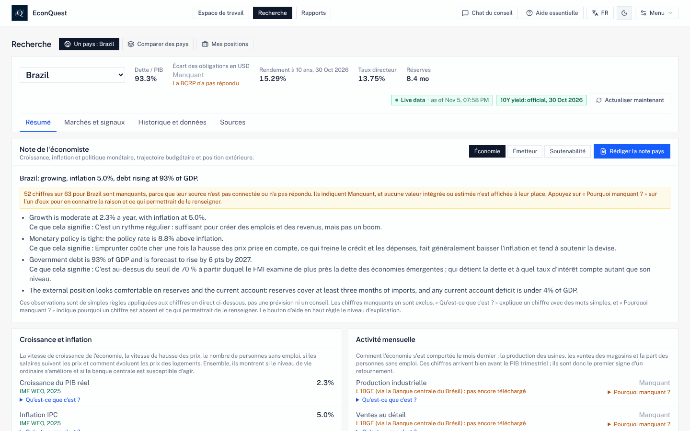 | 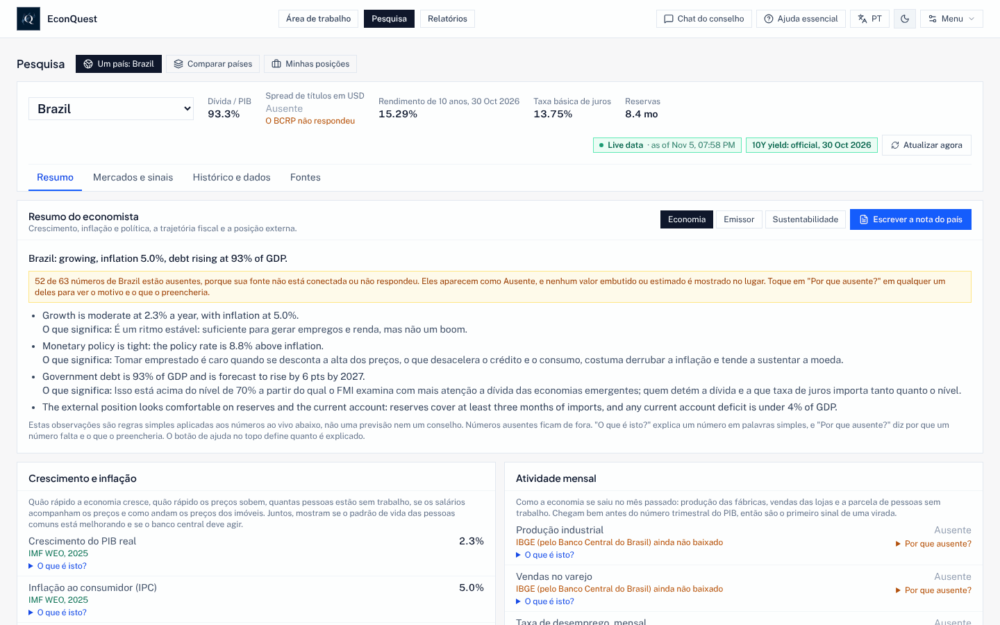 |

## 11. Use it on a phone

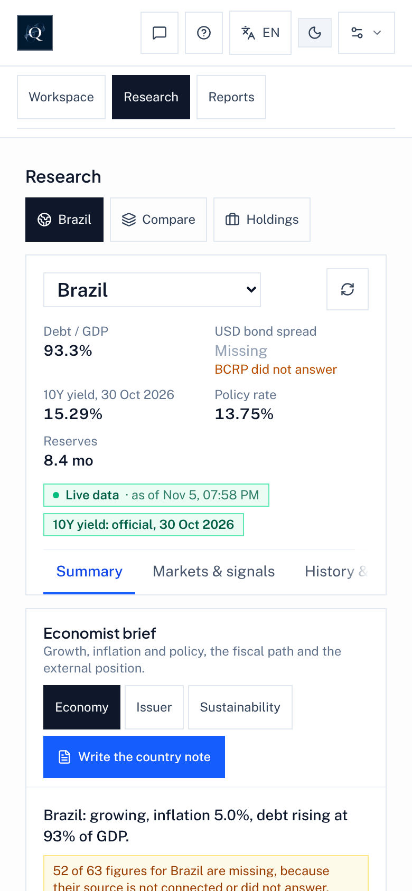

The app works at phone width in the browser. Panels stack into one column, and the header keeps the page
buttons with icon buttons for Council chat, help, language, light and dark, and Menu. To open it from a phone on the same home
network, the computer running EconQuest must allow it (`HOST="0.0.0.0"` and `ALLOWED_HOSTS` in `.env`;
see [HOME_SERVER.md](./HOME_SERVER.md), and turn on sign-in first).

## 12. Try Quests

Quests are switched off for everyone until the launch checklist in [QUESTS.md](./QUESTS.md) is done.
To try them on your own computer:

1. Add `QUESTS_ENABLED=on` to the `.env` file in your EconQuest folder and restart the app.
2. Open **Menu > Quests**. The list shows each Quest's question, its kind (Forecast, Debate,
   Replication or Signal), whether it is a draft, and when its result is due. Filter by kind or due
   date.
3. Open a Quest to see its rule, the live figures it will be settled on and its known limits.
4. **Log privately** keeps your answer on this computer only; **Practice** answers past questions and
   scores you at once; **My entries** lists what you logged and how it scored.
5. **Results**, **Scoreboard**, **Stances** and **Health** show settled Quests, contributor
   statistics, the optional economics stance questions and whether the Quest system is working.

When Quests go public, **Enter publicly** will prepare a pull request to the public repository for
you. The README explains [how the game works](../README.md#quests-crowdsourcing-answers-to-economic-questions).
