# Guia passo a passo

[English](./GUIDE.md) · [Español](./GUIDE.es.md) · [Français](./GUIDE.fr.md) · **Português**

Este guia mostra como usar o EconQuest, tarefa por tarefa, com uma captura de tela para cada passo. Ele
supõe que o app já está instalado e aberto no seu navegador (veja [INSTALL.md](./INSTALL.md), em inglês).
Para cada página e painel em detalhe, veja o [manual do usuário](./USER_MANUAL.md) (em inglês); para
qualquer termo, o glossário dentro do app (Menu > Manual do usuário).

Sobre as capturas: foram feitas em 24 de novembro de 2026 (duas, Quests e Pares, são de 13 de novembro)
a partir de uma compilação local do branch principal, reproduzindo respostas gravadas em 5 de novembro de 2026 das fontes cujos termos permitem
repassar os dados, sem nenhum modelo de IA configurado. Por isso muitos números aparecem como **Ausente** e
o conselho não escreve um resumo nelas. No seu computador, com as fontes acessíveis e um modelo de IA
escolhido, mais números são preenchidos e o conselho escreve seu resumo. As capturas estão em inglês,
exceto a da seção 10; os nomes dos botões aparecem aqui como no app em português.

## Conteúdo

1. [A tela num relance](#1-a-tela-num-relance)
2. [Primeiro início: o que configurar](#2-primeiro-início-o-que-configurar)
3. [Fazer uma pergunta ao conselho](#3-fazer-uma-pergunta-ao-conselho)
4. [Estudar um país](#4-estudar-um-país)
5. [Voltar no tempo](#5-voltar-no-tempo)
6. [Comparar países](#6-comparar-países)
7. [Revisar uma política e escrever um relatório](#7-revisar-uma-política-e-escrever-um-relatório)
8. [Escolher um modelo de IA](#8-escolher-um-modelo-de-ia)
9. [Ferramentas, checagem dos dados e o menu](#9-ferramentas-checagem-dos-dados-e-o-menu)
10. [Trocar o idioma e o nível de ajuda](#10-trocar-o-idioma-e-o-nível-de-ajuda)
11. [Usar no celular](#11-usar-no-celular)
12. [Experimentar as Quests](#12-experimentar-as-quests)

---

## 1. A tela num relance

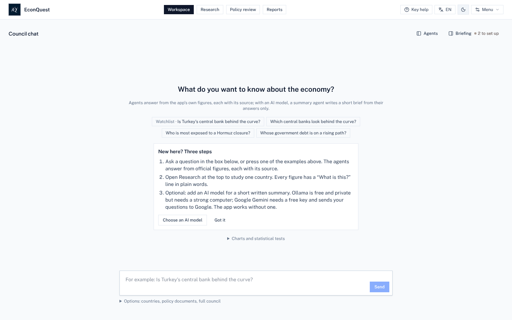

- **Cabeçalho, no centro:** as quatro páginas. **Área de trabalho** (Chat do conselho), **Pesquisa**
  (países e posições), **Revisão de políticas** (dossiês passo a passo) e **Relatórios** (notas, resumos
  e material de ensino).
- **Cabeçalho, à direita:** **Chat do conselho** (abre o chat ao lado de Pesquisa ou Relatórios), o botão
  do **nível de ajuda** (aqui *Ajuda essencial*), o botão de **idioma** (*PT*), a troca entre claro e
  escuro (até você clicar nela, o app segue a configuração do seu computador), e **Menu**.
- **Área de trabalho, no alto à direita:** **Agentes** mostra quais agentes trabalharam na última
  resposta; **Resumo** abre suas entradas, a lista de acompanhamento, o que mudou e o que vem por aí. "1 a
  configurar" conta os passos de configuração que faltam.
- **É novo aqui? Três passos** (só no primeiro início): faça uma pergunta, abra Pesquisa para estudar um
  país e, se quiser, adicione um modelo de IA. **Escolher um modelo de IA** abre as configurações;
  **Entendi** esconde o cartão de vez neste navegador. Enquanto nenhum modelo de IA funcionar, as
  configurações não mostram nenhum escolhido e o Menu diz *IA: não configurada*: o app funciona sem ele.

## 2. Primeiro início: o que configurar

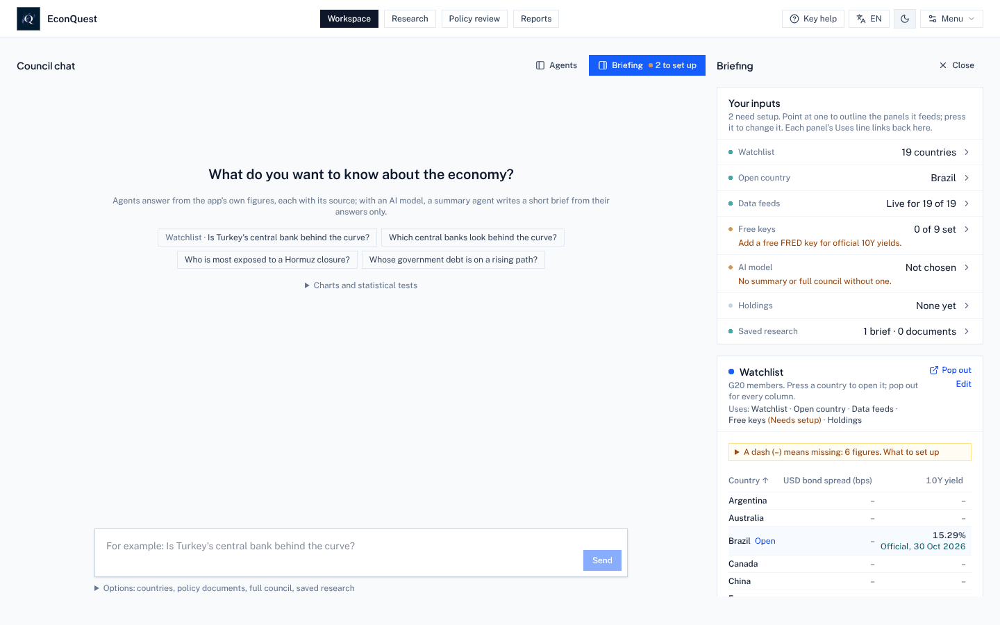

1. Na **Área de trabalho**, clique em **Resumo**.
2. Leia suas entradas. Cada linha diz o que o app está usando: a lista de acompanhamento (19 países do G20
   no início), o país aberto, quantas fontes responderam, quantas chaves gratuitas estão definidas, o
   modelo de IA, suas posições e sua pesquisa salva. Clique numa linha para alterá-la.
3. Adicione primeiro a chave gratuita do **FRED** (Menu > Configurações > Chaves de dados gratuitos). Ela
   preenche os rendimentos oficiais dos títulos públicos de 10 anos de vários países.
4. Clique em **Editar** no cartão da lista de acompanhamento para incluir ou tirar países. Para
   acompanhar economias mais pobres, escolha a lista **Países de baixa renda**: os 15 maiores por
   região, da Índia e da Nigéria a Gana e à Bolívia. Os 59 países da lista de dívida de baixa renda do
   FMI e do Banco Mundial (Malaui, Serra Leoa, Haiti, Ruanda, Nepal, Camboja, os pequenos Estados
   insulares e outros) também estão em todas as listas de países; o download diário salva um deles
   assim que ele entra em uma lista de acompanhamento e, se não, os números são buscados quando você
   o abre. Um país que não está na lista do app pode ser incluído com **Adicionar um país** (em
   **Pesquisa > Um país**, ou no editor da lista), que mostra todos os países com o nome no idioma da
   página; a partir do próximo download diário ele é salvo como os outros, com histórico, visões "em
   uma data" e alertas (até 25 países incluídos; os demais aparecem em **Menu > Dados offline** com o
   motivo).
5. Escolha um modelo de IA se quiser resumos escritos ([seção 8](#8-escolher-um-modelo-de-ia)). Todo o
   resto funciona sem ele.

Uma instalação nova mostra traços até terminar o primeiro download de dados, o que pode levar alguns
minutos.

## 3. Fazer uma pergunta ao conselho

1. Na **Área de trabalho**, digite uma pergunta na caixa de baixo ou clique numa pergunta de exemplo. Por
   enquanto os agentes entendem melhor perguntas em inglês, por exemplo "Which central banks look behind
   the curve?".
2. Clique em **Enviar**. A resposta vem primeiro. Clique em **Agentes** (no alto à direita) para abrir o
   painel que mostra o trabalho:
   - o **Planejador** escolhe os agentes que cobrem a sua pergunta (por regras escritas se não houver
     modelo de IA);
   - os **agentes das mesas** respondem com os números do app. Aqui o agente de Banco Central cobriu 6
     países;
   - o **agente de síntese** escreve um breve resumo que só pode citar os números dos agentes. Sem modelo
     de IA, ele é pulado e diz por quê, como na captura.

   Quando todos os agentes foram chamados pelo mesmo motivo, o painel diz isso uma vez só.
3. **Sem modelo de IA**, uma **Resposta curta, pelas regras declaradas do aplicativo (não IA)** aparece
   no alto. Para uma pergunta sobre um banco central atrás da curva, ela responde *Não*, *Possivelmente*
   ou *Não claramente* para cada país, a partir da postura que o agente de Banco Central atribui à
   política e da distância até uma regra de Taylor simples. As outras perguntas recebem numa linha a
   postura e a trajetória da dívida de cada país. Abaixo, **O que os agentes encontraram** traz as linhas
   de cada agente com seus números.
4. A lista de **Ausente** abaixo da resposta fica curta: repetições saem, números que só estão mais
   antigos que o normal ganham o próprio título (*Mais antigos que o normal: leia com a data*), e o que
   nenhuma fonte lida pelo aplicativo publica para o país vira uma linha só. A contagem mostra só o que
   poderia ser preenchido. Se você já fez a mesma pergunta, **O que mudou** é uma linha quando nada se
   mexeu, e fica recolhido com a contagem quando algo mudou.
5. Abra **Fontes e ações** abaixo da resposta para ver o documento de cada agente, com a fonte e a data de
   cada número, e salvá-lo em Relatórios.
6. Faça uma pergunta de continuação na mesma caixa ou clique numa das sugeridas abaixo da resposta. Se
   você não citar nenhum país, a pergunta cobre toda a sua lista de acompanhamento.
7. **Opções**, abaixo da caixa, permite escolher países, anexar um documento de política para o agente de
   Documentos ou **executar o conselho completo**: nove agentes em três mesas debatem um país, e o app pede
   a sua aprovação antes do relatório final.

**Perguntar o que uma mudança faria.** O Chat do conselho também responde perguntas do tipo "e se...?".

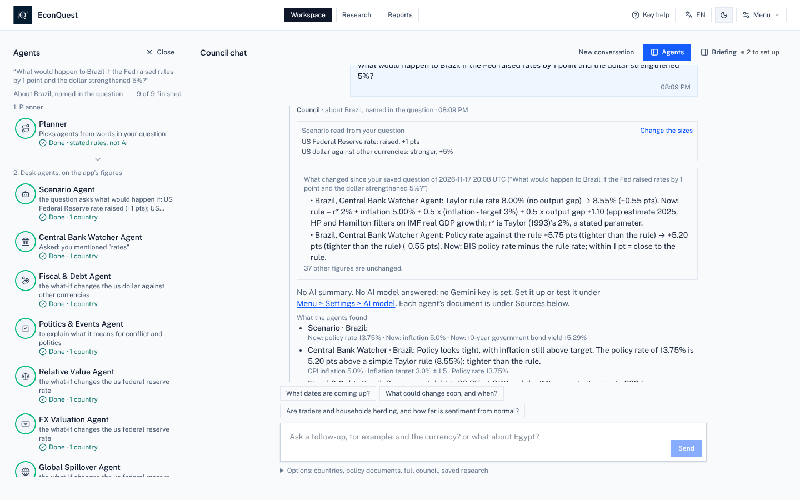

1. Escreva a mudança com suas palavras e com o tamanho: "What would happen to Brazil if the Fed raised
   rates by 1 point and the dollar strengthened 5%?". Você pode citar a taxa de um banco central ou do
   Fed, o custo de endividamento do governo, o dólar, a moeda, os preços do petróleo, dos alimentos ou
   das commodities, o estresse financeiro, a pressão nas cadeias de suprimento, o crescimento ou a
   inflação.
2. **Cenário lido da sua pergunta** mostra cada mudança que o app entendeu, com o tamanho. Se você não
   deu um tamanho, o app pede um; ele nunca escolhe um por você.
3. O **Scenario Agent** (agente de cenários) coloca os números de hoje ao lado dos números depois da
   mudança, para até quatro países, e acrescenta o que aconteceu em episódios passados do mesmo tipo e o
   que estudos publicados encontraram (cada estudo com sua página e seu DOI; o número de um estudo é uma
   média de muitos países). As partes sem números mostram **Ausente** com o motivo. Para Bolívia,
   Croácia, Iraque, Nepal, Paquistão ou Turquia, uma mudança no petróleo, nos alimentos ou na taxa
   básica de juros recebe também números do **modelo do Banco Mundial**, se os modelos de país do
   Banco Mundial estiverem ligados (veja a seção 5).
4. Com um modelo de IA configurado, a resposta vem em oito partes, de *Onde as coisas estão hoje* a *O que
   mudaria a resposta*, cada uma marcada com o tipo de evidência em que se apoia: *Dados*, *Cálculo do
   app*, *Passado*, *Estudo publicado* ou *Interpretação*.
5. Clique em **Mudar os tamanhos**, mude um tamanho ou tire uma mudança, e clique em **Perguntar de novo
   com estas mudanças**. A nova resposta vem como continuação, para você comparar as duas. Uma trajetória
   de dívida tem **Guardar para o gráfico de escolhas**, que a leva ao gráfico de Sustentabilidade da
   dívida.

Se você tem seu próprio servidor de ferramentas de pesquisa e o configura (Menu > Configurações >
Ferramentas de pesquisa), uma **mesa quantitativa** também responde perguntas sobre backtests, previsões,
volatilidade, nowcasts, preços de opções, quedas máximas ou índices de Sharpe, com o link de cada número,
a data dos dados e o rótulo do servidor (resultado hipotético sobre dados passados, não uma
recomendação). Ela fica desligada até você configurá-la ([RESEARCH_TOOLS.md](./RESEARCH_TOOLS.md), em
inglês).

## 4. Estudar um país

Abra **Pesquisa**. O seletor de país fica no alto à esquerda; a faixa ao lado mostra dívida, spread dos
títulos, rendimento de 10 anos, taxa básica e reservas, e as etiquetas verdes dizem quão recentes são os
dados. **Atualizar agora** busca de novo os números daquele país.

### Resumo

1. **Resumo** abre primeiro. O **resumo do economista** traz os pontos principais em linguagem simples,
   cada um com "O que significa" para o dia a dia. *Economia*, *Emissor* e *Sustentabilidade* mudam o
   ângulo.
2. O quadro amarelo diz quantos números estão ausentes e por quê. Clique em **Por que ausente?** ao lado de
   qualquer um para ver o motivo e o que o preencheria.
3. **O que é isto?** abaixo de um número o explica. **Explicar** pergunta ao conselho o que ele significa
   para esse país.
4. Os números aparecem por grupo: escolha um grupo na fileira de botões, ou **Mostrar tudo**. **Fontes**
   e **Minhas posições** funcionam do mesmo jeito.
5. **Escrever a nota do país** transforma a página num rascunho de relatório.

### Mercados e sinais

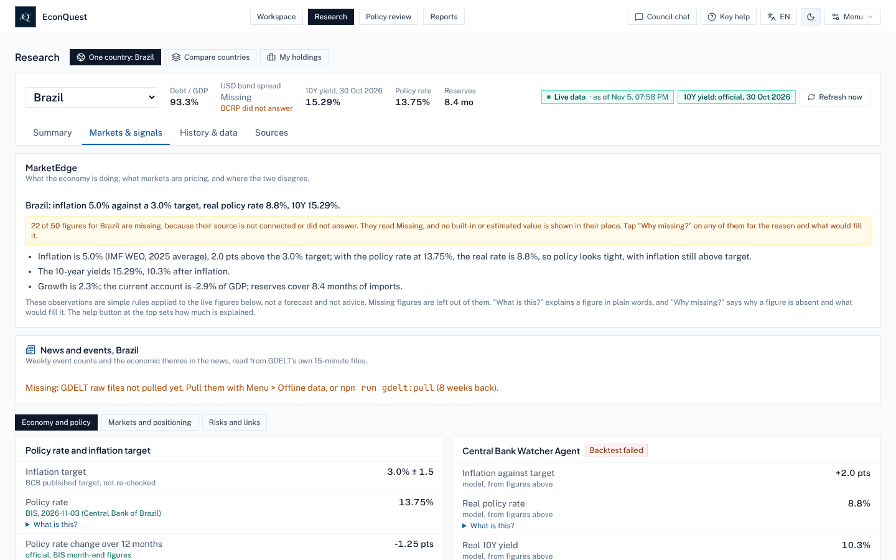

1. Clique em **Mercados e sinais**. O **MarketEdge** compara o que a economia está fazendo com o que os
   mercados precificam, e onde os dois discordam.
2. Cada agente e sinal tem um selo: *Validado*, *Provisório*, *Não validado* e assim por diante. O selo
   diz até onde chegou o teste. A maioria dos sinais ainda não passou num teste, e o selo diz isso.
3. As probabilidades dos mercados de previsão (Kalshi, Polymarket), os spreads dos títulos e o câmbio
   aparecem aqui quando suas fontes respondem.
4. A página tem três partes: **Economia e política**, **Mercados e posicionamento** e **Riscos e
   ligações**.

### Histórico e dados

1. Clique em **Histórico e dados**. Escolha um número em **Números com histórico**, à direita, para ver o
   gráfico.
2. Acima de cada gráfico: o que ele mede, de quem é o número, com que frequência sai, como ler o gráfico e
   o que significa na vida real.
3. Abaixo: **Baixar esta série** (CSV ou Excel), **Baixar todas as séries** do país, **Citar** (texto,
   BibTeX ou RIS), **Sinalizar** (avisar de um problema) e **Publicar gráfico** (PNG ou SVG).
4. Abaixo do gráfico, **Ferramentas para <país>** lista todas as ferramentas de análise em oito grupos:
   Dívida e orçamento, Juros e preços, Setor externo e moeda, Crescimento e previsões, Pessoas e
   desenvolvimento, Riscos e choques, Olhar para trás, e Aprender e converter. Clique numa e ela abre
   abaixo do gráfico. Para trocar, escolha outra na lista **Ferramenta**, ou clique em **Todas as
   ferramentas** para voltar ao menu. Os números que ainda não têm histórico ficam agrupados numa linha
   (**Ainda sem histórico**) na lista da direita.

   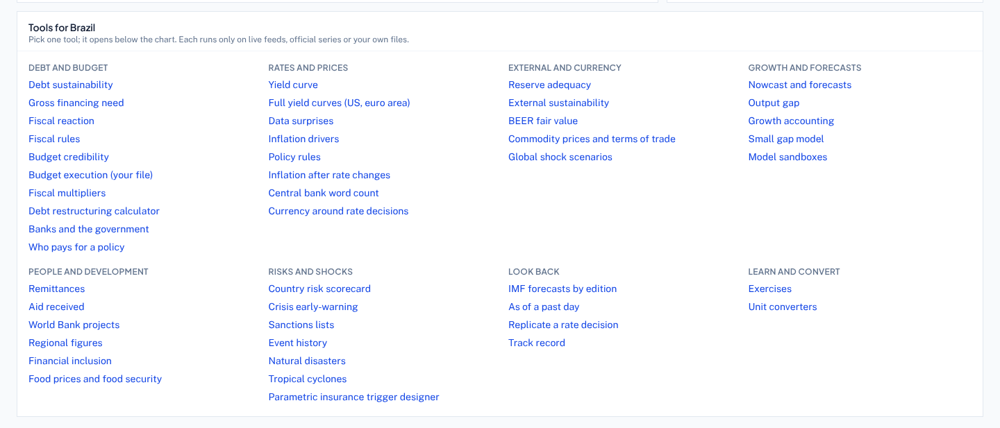

   Entre elas: estimativas do presente e previsões com faixas de 50, 70 e 90%, hiato do produto,
   sustentabilidade da dívida, necessidade bruta de financiamento, adequação das reservas,
   sustentabilidade externa, alerta antecipado de crise, curva de juros, fatores da inflação,
   contabilidade do crescimento, regras de política, "e se" fiscais e um pequeno modelo de hiatos que
   você preenche.
5. Ferramentas para países de renda mais baixa, em Pessoas e desenvolvimento e em Riscos e choques:
   **Remessas** (ao lado de exportações, investimento e
   ajuda, e o custo de enviar US$ 200 frente à meta de 3% da ONU), **Inclusão financeira** (quem tem
   conta, por sexo e renda), **Preços de commodities e termos de troca** (o que os últimos movimentos dos
   preços mundiais significam para o país, em % do PIB), **Ajuda recebida**, **Preços dos alimentos e
   segurança alimentar** e **Desastres naturais**. A inflação de alimentos e os desastres são lidos de
   arquivos que você mesmo salva em `data/local/fao-cpi/` e `data/local/emdat/`; até lá essas partes
   mostram Ausente e dizem onde obter o arquivo ([INSTALL.md](./INSTALL.md#files-you-save-yourself), em
   inglês). Em Desastres naturais, **Modelo de perdas** separa o dano de cada ano em quantos eventos
   danosos ocorrem num ano e o tamanho de cada um, e simula 20.000 anos para dar a perda anual média e
   a perda superada 1 ano em 10, 50 e 100, também em % do PIB.
6. **Números com histórico** também mostra como a moeda e o financiamento em dólares funcionam na
   prática: o **regime cambial** (como a moeda é administrada de fato, mês a mês, pela planilha de
   Ilzetzki, Reinhart e Rogoff que você salva em `data/local/irr/`), os **ativos do banco central** (o
   balanço do banco central em % do PIB, do BIS) e a **pressão no financiamento em dólares**
   (empréstimos e títulos em dólares devidos pelos não bancos do país, do BIS, e as linhas de swap em
   dólares do Federal Reserve, do Fed de Nova York).
7. A mesma lista mostra o **clima**: temperatura e chuva mensais na capital desde 1981 (NASA POWER) e na
   média do país inteiro desde 1901 (portal climático do Banco Mundial), cada mês contra sua média de
   1991-2020. Os preços mundiais de arroz, trigo, milho e soja vão até 1960, para pôr uma seca ao lado
   de uma alta de preços.
8. **Seguro paramétrico** permite esboçar uma cobertura que paga por um número medido (chuva,
   temperatura ou preço de alimentos) e não por uma perda avaliada:
   1. Escolha o índice, a estação, se paga quando o índice está baixo ou alto, o gatilho onde o
      pagamento começa, a saída onde a cobertura inteira é paga e o valor coberto. O painel abre com um
      desenho tirado do histórico (gatilho superado cerca de 1 ano em 5, saída cerca de 1 em 20).
   2. A análise de sinistralidade repete o desenho em cada estação passada: os anos em que pagou e o
      pagamento anual médio (o custo de sinistralidade).
   3. **Preço justo** soma um carregamento que você escolhe (um % do pagamento esperado, ou k
      desvios-padrão do pagamento anual) e dá o preço em % da cobertura por ano.
   4. **Quão raro é?** diz com que frequência o gatilho e a saída são superados, pelo histórico e por
      uma curva de valores extremos ajustada, com uma faixa de 90%.
   5. **Risco de base** compara a cobertura com a outra série de clima (capital contra o país inteiro):
      em quantos anos ruins pagou e quantos deixou passar.
9. **Ciclones tropicais** lista os furacões, tufões e ciclones que passaram a menos de 50, 100 ou
   200 km do país desde 1980, pelas trajetórias IBTrACS da NOAA. Nada é baixado até você clicar em
   **Baixar trajetórias de tempestades da NOAA**; você também pode salvar um arquivo IBTrACS em
   `data/local/ibtracs/`.
10. Ferramentas para quem administra ou avalia um orçamento, em **Dívida e orçamento** e **Pessoas e
    desenvolvimento**:
    - **Credibilidade do orçamento**: quanto do orçamento aprovado no início de cada ano o governo de
      fato gastou, com a faixa PEFA de cada ano (A dentro de 5% do orçamento, B dentro de 10%, C dentro
      de 15%, D além disso) e uma nota calculada pelo app (não a nota oficial do PEFA).
    - **Execução do orçamento (seu arquivo)**: clique em **Baixar o modelo**, preencha seu orçamento
      aprovado e o gasto mensal por ministério ou programa, diga em que mês começa o ano fiscal, a
      unidade e a fonte, e carregue o arquivo. Cada linha mostra o gasto diante da parte do ano já
      decorrida; as linhas mais de 10 pontos atrasadas ou adiantadas são marcadas, e os meses sem número
      são listados, nunca preenchidos. O arquivo fica no seu computador.
    - **Projetos do Banco Mundial**: os projetos em andamento no país, do maior para o menor, com o valor
      comprometido, a parte do prazo previsto já decorrida e, para os créditos e doações da AID, a parte
      desembolsada. Um projeto que desembolsa devagar para a idade que tem é marcado como motivo para
      olhar de perto.
    - **Números regionais**: a produção por pessoa em cada região, a distância para o número nacional e
      se as regiões se aproximaram em dez anos; para os países da UE e da AELC, o PIB por pessoa e o
      desemprego por região; e o Índice de Desenvolvimento Humano por região se você salvar o arquivo do
      Global Data Lab em `data/local/gdl/`.
11. Ferramentas para economistas e operadores de mercado, em **Juros e preços** e **Crescimento e
    previsões**:
    - **Curvas de juros completas (EUA, zona do euro)**: cada prazo das curvas do Tesouro dos EUA e da
      zona do euro todo dia, uma curva ajustada, o nível, a inclinação e a curvatura com seus movimentos
      em um dia e em um mês, e o carry e o roll-down em três meses de cada prazo.
    - **Surpresas nos dados**: cada divulgação diante do que se esperava logo antes (a pesquisa Focus do
      Brasil, a pesquisa de previsores do BCE, o mercado de CPI da Kalshi para os Estados Unidos ou o
      nowcast do PIB do próprio app), e o **Índice de surpresas de inflação**, que resume as surpresas
      recentes de inflação (também um cartão em Hoje para o Brasil, a zona do euro e os Estados Unidos).
      Uma descrição, não um sinal.
    - **Nowcast e previsões** ganha **Faixas a partir de erros passados**: uma faixa de 70% e de 90% em
      cada passo testado, a partir de quanto a previsão errou para este país no teste. Com menos de 8
      casos passados, mostra **Ausente**.
12. O **Painel de risco-país** coloca lado a lado a governança, os conflitos armados, a agitação social,
    o risco geopolítico, a abertura da conta de capital (o índice de Chinn e Ito, citado como Chinn e Ito
    2006) e a economia, cada dado com sua fonte e seu ano. Ele não dá uma nota geral. Em 13 de novembro
    de 2026 foi fixado de antemão um teste para saber se uma governança fraca vem antes de um calote;
    ele passou na primeira execução (23 de novembro de 2026). Do jeito que o teste foi registrado,
    passar não transforma as leituras numa nota, então o quadro continua dizendo Não validado.

13. Mais ferramentas em Histórico e dados: **Como os choques se espalham entre economias** (um
    pequeno VAR global: escolha onde a surpresa começa, crescimento ou inflação, e o tamanho; a
    resposta de cada economia ao longo de cinco anos com uma faixa de 90% e o peso de comércio por
    trás dela), o **Modelo de hiatos estimado** dentro do modelo de hiatos pequeno (só aparece se
    passou no teste registrado de antemão), **Documentos oficiais** (relatórios do Banco Mundial e
    discursos de banqueiros centrais do BIS sobre o país, cada um com link para a página do editor) e
    o **Laboratório macro** para o ensino (demanda e oferta agregadas, e uma trajetória da dívida, com
    controles que começam em zero). **Baixar relatório offline** salva um arquivo HTML de uma página
    com os números do país, que abre sem o app.

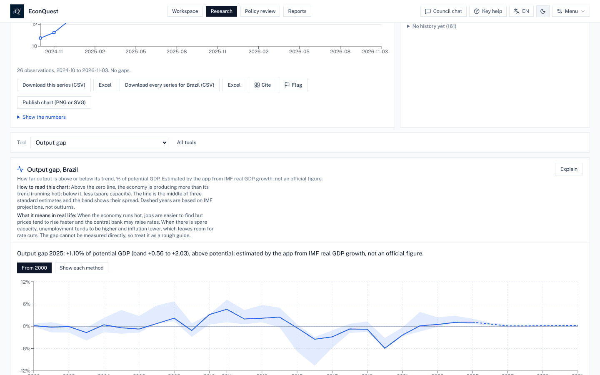

Exemplo: o **hiato do produto** mostra quanto a economia está rodando acima ou abaixo da sua capacidade
normal. A linha é o meio de três estimativas padrão, a faixa é a dispersão delas, e os anos tracejados se
baseiam em projeções do FMI.

### Fontes

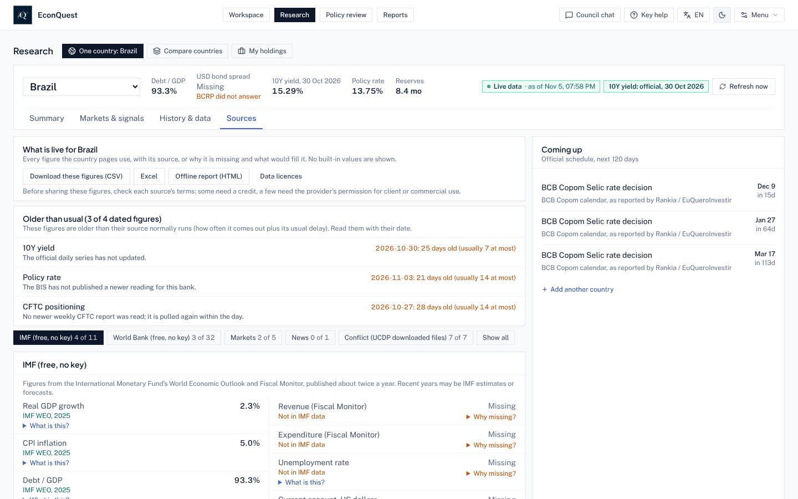

1. Clique em **Fontes**. A aba lista cada número das páginas do país com sua fonte, ou por que está
   ausente, sem nada embutido.
2. **Mais antigos que o normal** aponta os números cuja fonte está atrasada.
3. **Próximos eventos** lista as datas oficiais (decisões de bancos centrais, divulgações de dados) dos
   próximos 120 dias.
4. Você pode baixar a lista inteira em CSV ou Excel; **Licenças dos dados** diz o que cada fonte permite
   compartilhar.

## 5. Voltar no tempo

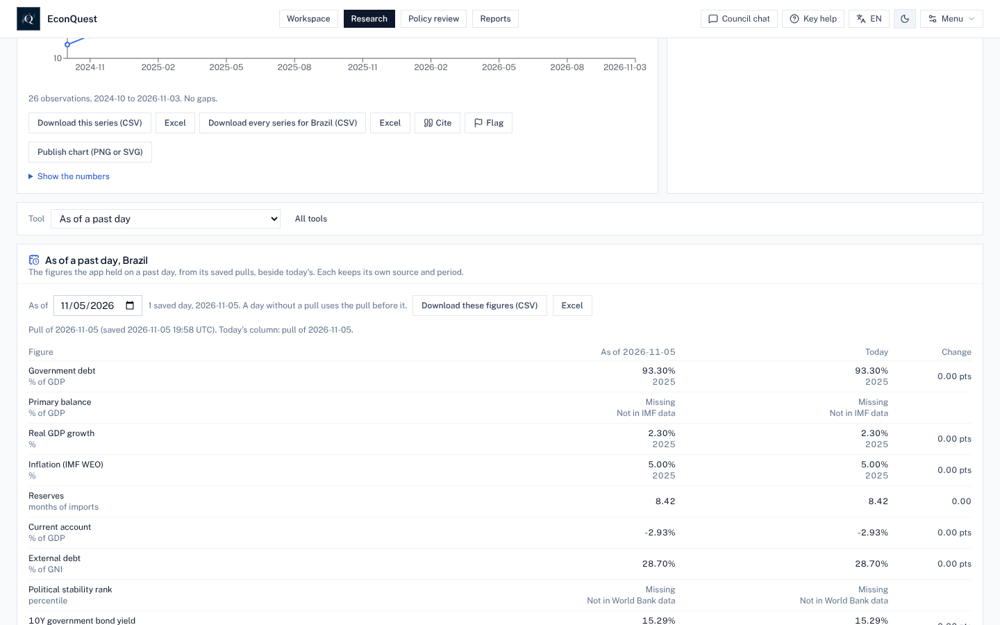

1. Em **Histórico e dados**, abra **Em uma data passada** pelo menu de ferramentas (em Olhar para trás).
2. Escolha uma data. A tabela mostra cada número como o app o tinha naquele dia, ao lado do número de hoje
   e da variação. Cada download diário é arquivado, então nada se perde.
3. **Previsões do FMI por edição** (outra ferramenta de Olhar para trás) mostra como a visão do FMI sobre o
   país mudou de uma edição para outra, quando as edições passadas estão salvas. Abaixo da tabela, **Faixa
   a partir de erros passados do FMI** coloca uma faixa de 70% e de 90% em torno das projeções da última
   edição, a partir de quanto as edições passadas erraram para este país.
   **Previsões oficiais lado a lado** junta as previsões de crescimento e inflação do FMI, do Banco
   Mundial (Global Economic Prospects) e da OCDE (Economic Outlook) para este ano e os dois seguintes,
   com a distância entre elas; para os Estados Unidos, acrescenta a pesquisa de previsores
   profissionais do Federal Reserve da Filadélfia a partir de um arquivo que você salva. São previsões
   oficiais, não um consenso de mercado pago.
4. Para Bolívia, Croácia, Iraque, Nepal, Paquistão e Turquia, **Modelo de país do Banco Mundial** vem
   em seguida na mesma ferramenta, depois que o serviço opcional de modelos é ligado
   ([guia de instalação](./INSTALL.md#add-the-world-bank-country-models-optional), em inglês).
   Mostra os números guardados no modelo público do Banco Mundial para o país: crescimento, inflação,
   saldo do orçamento, dívida, conta corrente e taxa básica de juros. Essas cópias públicas são
   versões didáticas com dados antigos, então leia-as como a trajetória do modelo, não como uma
   previsão. Abaixo, **Teste um choque no modelo**: escolha o preço mundial do petróleo, os preços
   mundiais de alimentos, as compras do governo ou (só Paquistão, Turquia e Iraque) a taxa básica de
   juros, informe um tamanho e clique em **Calcular**. A tabela mostra quanto o choque afasta cada
   número da trajetória do próprio modelo, ano a ano desde o ano em que o choque começa.

## 6. Comparar países

1. Em **Pesquisa**, clique em **Comparar países**. Sua lista de acompanhamento aparece lado a lado, com as
   mesmas quatro abas de um país.
2. **Pautas** aponta recordes, grandes movimentos e revisões nos números oficiais.
3. **Onde dados e preços discordam** ordena os países em que mercados e dados apontam para lados
   diferentes, com os números que sustentam isso.
4. MarketEdge, a exposição a cenários e o balanço do Fed são partes separadas; **Onde dados e preços
   discordam** mostra quatro países até você clicar em **Mostrar tudo**.
5. Clique no nome de um país para abri-lo sozinho.

Nos países de baixa renda, alguns números vêm de fontes mais lentas e dizem isso no rótulo. Onde não
há taxa de câmbio diária de um banco central ou do BCE (por exemplo a naira, o xelim queniano ou o
cedi), o gráfico histórico mostra a taxa média mensal do FMI por dólar americano. Onde o BIS não
publica a taxa básica de um país (por exemplo Egito, Nigéria, Quênia ou Paquistão), a lista de
acompanhamento e a página do país mostram o número mensal do FMI, com o rótulo "FMI, mensal" e o mês;
ele aparece como Missing se tiver mais de quatro meses. O nowcast e a previsão de inflação e a
previsão da taxa básica (Histórico e dados) usam os mesmos números mensais do FMI para esses países,
e informam que são do FMI; uma taxa básica com mais de quatro meses não gera previsão. Metas de inflação e datas de decisão dos
bancos centrais só aparecem onde a página do próprio banco as informa, por isso muitos desses países
não mostram nenhuma data.

**Minhas posições**, a terceira visão, faz o mesmo com uma lista de títulos ou posições que você carrega de
um arquivo CSV.

## 7. Revisar uma política e escrever um relatório

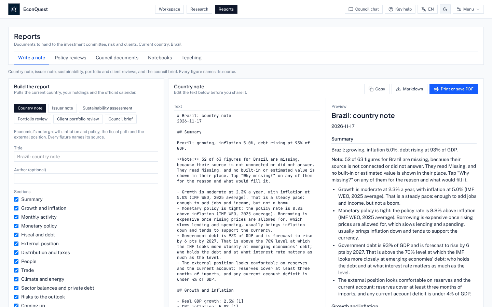

**Relatórios** tem quatro abas, cada uma sozinha: **Escrever uma nota** (o montador de relatórios),
**Documentos do conselho** (os documentos salvos do Chat do conselho), **Cadernos** e **Ensino**. As
revisões de política têm a própria página, **Revisão de políticas**, no cabeçalho.

Para escrever um relatório:

1. Em **Escrever uma nota**, escolha um tipo: Nota do país, Nota do emissor, Avaliação de sustentabilidade, Revisão da carteira,
   Revisão da carteira do cliente ou Resumo do conselho.
2. Marque as seções que quiser. O rascunho se atualiza e a prévia mostra o resultado.
3. Edite o texto e depois **Copiar**, baixe em **Markdown** ou **Imprimir ou salvar PDF**. Cada número leva
   sua fonte e data.

Para revisar uma política:

1. Clique em **Revisão de políticas** no cabeçalho e depois em **Nova revisão de política**. **Iniciar
   uma revisão de política**, abaixo de uma resposta do Chat do conselho, e os links de revisão de
   política em Ferramentas abrem a mesma página.
2. Escolha o país e a data de referência (cada passo seguinte lê os dados como estavam naquele dia).
3. Descreva o problema em uma ou duas frases, por exemplo "A inflação está bem acima da meta enquanto o
   crescimento desacelera e a dívida sobe".
4. Escolha o indicador que deve melhorar, a direção e, se quiser, uma meta e uma data. Liste as
   restrições, uma por linha (câmbio fixo, pouco espaço fiscal, uma eleição), e para quem é a revisão.
5. Clique em **Iniciar revisão**. Os passos seguem: enquadramento, diagnóstico, opções (ordenadas pelo
   modelo árbitro), evidências e precedentes (os anos-país passados mais parecidos e o que veio depois),
   uma checagem comportamental, regras fiscais e viabilidade política, o memorando de recomendação, um
   **resumo de uma página** em PDF para quem não é economista, e o acompanhamento dos resultados, que
   compara a revisão com o que aconteceu em 12 e 24 meses. Cada passo é salvo com sua impressão digital.
   Em precedentes, **O que aconteceu depois** escolhe uma mudança que o país fez (uma grande virada
   orçamentária, uma desvalorização, um novo regime cambial ou regra fiscal, ou uma que você adiciona
   com a fonte) e compara o país com um "gêmeo": uma mistura de outros países que se moveram como ele
   nos dez anos anteriores e não fizeram essa mudança. Diz o quanto se afastaram três anos depois, o
   quão incomum isso é entre países que não fizeram nenhuma mudança, e pode mostrar todos os países que
   fizeram o mesmo tipo de mudança. Um resultado pode ser guardado para o resumo de uma página. Fica
   marcado como não validado até passar no seu teste registrado de antemão.

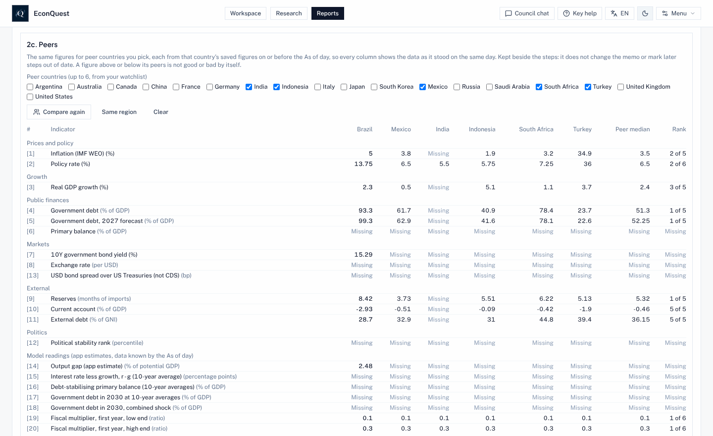

6. Depois do diagnóstico, **Pares** coloca os números do diagnóstico ao lado de até seis países da sua
   lista de acompanhamento (ou clique em **Mesma região**, depois em **Comparar**), cada um como estava
   salvo na data da revisão ou antes, com a mediana dos pares e a posição deste país.
7. No memorando, dê a um número acompanhado um gatilho que o app saiba ler, como "acima de 8", "abaixo
   de 3", "meta 4", "sobe" ou "cai". **Acompanhamento das revisões de políticas**, abaixo dos alertas de
   acompanhamento no Briefing do espaço de trabalho, mostra cada um como cruzado ou não cruzado frente
   aos últimos números salvos; **Abrir revisão** volta para a revisão.
8. Na data da revisão, **Revisar novamente** inicia uma nova revisão com o mesmo enquadramento e os
   dados de hoje. A nova revisão abre **O que mudou desde a revisão anterior**: o enquadramento, a opção
   recomendada por cada memorando, cada número antes e agora, e se o indicador-alvo andou na direção
   certa.
9. Para pesar uma medida (uma mudança de imposto, uma reforma de subsídio, um programa de gastos),
   marque **Pergunta para o conselho de políticas** no enquadramento e escolha **Uma medida**. Abaixo da
   revisão, preencha **Custos e benefícios** (os números de cada ano com sua fonte, a taxas de desconto
   oficiais ou às suas: o aplicativo dá o valor presente e o ano em que a medida se paga), **Quem ganha
   e quem perde**, **O que vem depois** (efeitos de segunda ordem, cada um apoiado em um número, uma
   fonte ou uma suposição) e **O que pode sair diferente** (de dois a cinco casos, com probabilidades se
   você quiser). O passo de opções então ordena alternativas em relação à medida. Escolha em vez disso
   **O que um evento significa para um mercado** para pesar um evento para a moeda ou os títulos do
   governo: **Copiar as leituras de mercado** pega os números do próprio aplicativo como estavam na data
   de referência, e seus casos são a mudança de valor para quem detém o ativo. O resumo de uma página
   termina com essas partes, e em 12 e 24 meses os casos de uma revisão sobre a moeda são comparados com
   o que o câmbio fez.

10. No memorando, **Para as pessoas** dá um resumo simples para a população: o que muda, o custo por
    pessoa, quem ganha e quem paga, as regiões mais atrasadas e o que três países em situação parecida
    viram depois. É escrito com frases fixas preenchidas com os números, não por IA, e entra no resumo de
    uma página.

Para escrever um texto para discussão que você possa conferir depois:

1. No Chat do conselho, peça um gráfico ("chart Brazil's policy rate since 2015"). Abaixo do gráfico do
   agente de gráficos, clique em **Fixar no caderno** e escolha um caderno. O app guarda a data até onde
   vão os números e uma impressão digital dos números (um código curto que muda se qualquer número
   mudar).
2. Abra **Relatórios > Cadernos**. **Pacote de texto para discussão (.zip)** baixa um único zip: um
   rascunho em Markdown com suas notas, uma pasta para cada número fixado com os dados e os scripts de
   Python, R e Stata, um arquivo de citação e a lista da impressão digital de cada arquivo.
3. Depois, clique em **Verificar se ainda vale** num número fixado. A resposta é *Igual*, *Revisado* (com
   os valores antigos e novos) ou *A fonte não responde mais*. `npm run notebook:check` confere todos os
   números fixados de uma vez.

## 8. Escolher um modelo de IA

1. Abra **Menu > Configurações > Modelo de IA** (ou ⌘, no Mac, Ctrl+, nos outros).
2. Escolha um provedor:
   - **Ollama no seu computador**: gratuito e privado; o Ollama precisa estar rodando com os modelos
     baixados;
   - **Google Gemini**: precisa da sua própria chave do Gemini; as perguntas são enviadas ao Google;
   - **Ollama, depois Gemini**: Ollama primeiro, Gemini quando o Ollama não responde.
3. Para o Ollama, diga **onde o Ollama roda** e clique em **Encontrar o Ollama** para escolher entre os
   seus modelos.
4. Defina o **modelo rápido** (escolha dos agentes e respostas das mesas; `qwen2.5:7b` por padrão) e o
   **modelo árbitro** (resumos, explicações, debate e opções de política; `qwen2.5:32b` por padrão). Use
   seu maior modelo como árbitro.
5. Deixe **Permitir um árbitro de 14B** desligado, a não ser que seu computador não aguente o de 32B.
   Ligado, toda resposta julgada por um árbitro de 14B diz "Árbitro pequeno". Um modelo de 8B ou menos
   nunca é um bom árbitro.
6. Clique em **Testar o modelo**. Ele envia uma pergunta curta do jeito que o Chat do conselho faz.

Qual modelo serve para qual computador, e os ajustes que o app usa, estão em Recursos e detalhes:
[Modelos de IA](./FEATURES.pt.md#modelos-de-ia-qual-usar-tamanhos-e-ajustes).

## 9. Ferramentas, checagem dos dados e o menu

O **Menu** reúne tudo o que não é uma página, em três grupos depois de **Ferramentas**: *Configurar*,
*Verificar os dados* e *Aprender*. O que vale conhecer primeiro:

- **Ferramentas**: todas as ferramentas agrupadas pelo que você quer fazer, e **Conexões de dados**.
- **Dados offline**: baixe os dados de todos os países para usar sem internet e veja quanto espaço ocupam.
- **Configurações > Ferramentas de pesquisa**: o endereço e o token de um servidor de ferramentas de
  pesquisa que você roda, para a mesa quantitativa do Chat do conselho. Desligado até os dois estarem
  preenchidos; **Testar a conexão** lista as ferramentas que o token enxerga, e cada chamada vai para o
  registro de auditoria, nunca o token.
- **Saúde dos dados**: quais fontes chegam, quais falham e quais números foram revisados. Enquanto uma
  fonte não responde, alguns números mostram a última resposta boa com as próprias datas em vez de
  Ausente; a aba **Sources** (em inglês) mostra quais fontes estão com números salvos e quando cada uma
  será consultada de novo. A aba **Calendar** (em inglês) tem o cartão **Dias de divulgação** (também
  em Hoje): as divulgações oficiais de IPC e de atividade mensal de ontem até daqui a uma semana, e
  "New today" quando o mês novo chega (num dia de divulgação o app consulta essa fonte de novo mais ou
  menos a cada hora). O download diário dá às etapas que falharam uma segunda tentativa no fim e
  outras tentativas depois de duas horas. A aba
  **Daily download** (em inglês) acompanha o download diário enquanto ele roda: cada parte, o que
  falhou e por quê, as fontes que pedem uma chave ou um arquivo, e o que baixar à mão.
- **Modelos e validação**: o registro de modelos, os resultados dos testes, o **Histórico de acertos**
  (39 testes registrados em 23 de novembro de 2026: 11 aprovados, 25 reprovados e 3 com poucos casos;
  cada um com seu p e se continua de pé quando o número de testes é levado em conta, e uma tabela mês a
  mês das previsões anotadas antes de o número sair e avaliadas depois) e **Seus testes**.
- **Seus dados**: carregue suas próprias séries a partir de um arquivo CSV.
- **Buscar dados**: uma busca nos catálogos gratuitos (DBnomics, o FMI, o Banco Mundial e o
  Eurostat), cada resultado com seu provedor e um link.
- **Configurações > Suas assinaturas > Sua assinatura de dados**: se você já paga Macrobond, Trading
  Economics ou EODHD, ligue-a, digite sua própria chave e mapeie as séries que quiser (o código do
  serviço, o país, o que é). Elas aparecem em Histórico e dados identificadas como "Sua assinatura" e nunca
  saem do seu computador: downloads, backups e cópias compartilhadas mostram "Retido". Desligada por
  padrão.
- **Configurações > Suas assinaturas > Preços da sua corretora**: preços ao vivo dos contratos que
  você listar, da sua própria conta na Interactive Brokers, pelo IBKR Client Portal Gateway que você
  executa e no qual entra no seu computador. Desligado por padrão; só na tela e nunca salvos.
- **Modo prova**: desliga todos os passos de IA para uma prova.
- **Exemplos resolvidos**: cinco casos, de uma pergunta a um memorando.
- **O que isso significa para você**: sua própria taxa de inflação a partir de como você divide seus
  gastos entre os grupos oficiais de preços, contra a taxa geral, e o que uma mudança de juros faz com
  a parcela do seu empréstimo. O que você digita fica apenas no seu navegador.
- **Sobre e licenças de dados**: a versão, uma nota curta sobre privacidade ([PRIVACY.md](PRIVACY.md),
  em inglês) e se há uma versão mais nova, com os passos para atualizar. Quando há, o Menu mostra **Nova
  versão** ao lado de Sobre.
- **Relatar um problema**: abre um novo issue no GitHub com a versão do app já preenchida. Você lê e
  envia. Se uma tela não puder ser desenhada, a nota dela também tem **Copiar os detalhes** e
  **Relatar este problema**. Até a cópia pública ser aberta, os issues vão para
  github.com/smcarus/econquest; para enviar um, você precisa de uma conta gratuita no GitHub.
- **Atalhos de teclado**: aperte **?** para ver a lista. **/** vai para a caixa de pergunta do
  conselho, **Cmd+K** (Ctrl+K no Windows) busca nas ferramentas, **Cmd+,** abre as configurações e
  **Esc** fecha uma janela. / e ? não fazem nada enquanto você digita numa caixa.
- **Quests**: em cinza, "Ainda não disponível" ([seção 12](#12-experimentar-as-quests)).

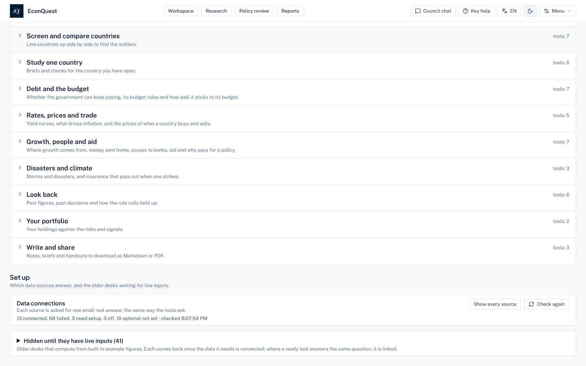

Para ver quais fontes respondem:

1. Abra **Menu > Ferramentas**.
2. Desça até **Conexões de dados** e clique em **Mostrar todas as fontes**, ou em **Verificar novamente** para
   consultar todas as fontes agora. Cada fonte aparece como conectada (com um número que retornou),
   precisando de configuração, desligada, ou com o motivo da falha.
3. A mesma checagem roda num terminal com `npm run check:data`.

### Deixar outro programa usar o EconQuest

Se você usa uma ferramenta de carteira ou outro programa que precisa ler os números do EconQuest, pode
dar acesso a ele sem compartilhar sua senha.

1. Abra **Menu > Configurações > Tokens de API**.
2. Dê um nome ao token (por exemplo "Console de carteira") e marque só o que ele pode fazer: ler
   números e séries, ler as rodadas do conselho, fazer perguntas ao chat do Conselho, receber eventos e
   definir alertas, enviar posições, definir nomes ocultos ou rodar cenários em uma carteira.
3. Clique em **Criar token** e copie na hora: ele aparece só uma vez, e o app guarda apenas uma impressão digital
   dele. Cada uso fica no registro de auditoria; **Revogar** para o token na hora.
4. As posições que o outro programa enviar aparecem em **Pesquisa > Minhas posições**, marcadas
   "Enviada por" e o nome do token.
5. Um token que pode fazer perguntas ao chat do Conselho recebe a mesma resposta que você teria no
   chat para a mesma pergunta: os mesmos agentes, números e verificações. Cada pergunta usa o seu
   modelo de IA e conta no mesmo limite de solicitações de IA que as suas próprias perguntas. Nomes
   ocultos nunca aparecem nas respostas, e só são usados números cujas fontes permitem o
   compartilhamento. Cada pergunta fica no registro de auditoria com o nome do token.

Para que um país ou um título não apareça em nenhuma tela, resposta ou evento, inclua-o em **Menu >
Configurações > Nomes ocultos** (pelo código ISO do país, ticker ou seu próprio identificador). As
telas passam a mostrar só quantos itens estão ocultos, e o app guarda uma impressão digital de cada
nome, não o nome.

Em um servidor compartilhado por várias pessoas, um administrador pode deixar que elas entrem com uma
conta que já têm no Google, Microsoft, Okta, Keycloak ou outro provedor OpenID Connect; a página de
login mostra então **Entrar com** e o nome do provedor ([SECURITY.md](./SECURITY.md), em inglês). O que
um programador precisa para conectar está em [DATA_API.md](./DATA_API.md) e
[DEPLOYMENT.md](./DEPLOYMENT.md) (em inglês).

## 10. Trocar o idioma e o nível de ajuda

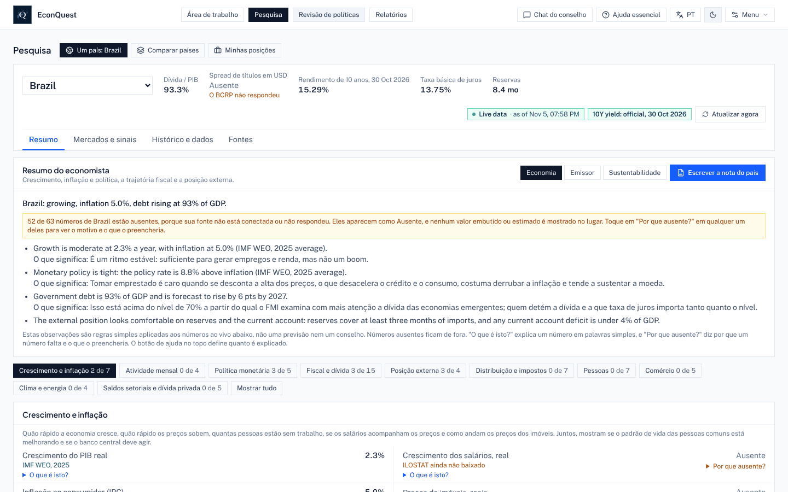

1. Clique no botão de **idioma** do cabeçalho. Cada clique passa para o próximo: English, Español,
   Français, Português. A escolha fica salva neste navegador.
2. Clique no botão de **ajuda** ao lado. Ele abre os quatro níveis, cada um com uma linha sobre o que
   explica; clique num deles para escolher:
   - **Ajuda essencial** (padrão): como ler cada gráfico, o que significa na vida real e *O que é isto?*
     nos números principais;
   - **Ajuda completa**: *O que é isto?* em todo número e termo, e por que cada número ausente está
     ausente;
   - **Ajuda desativada**: só números, fontes e observações, sem faixas de previsão;
   - **Especialista**: números, fontes e faixas de previsão, sem explicações em linguagem simples.

Números e nomes de fontes e séries ficam como a fonte os escreve. Algumas frases que o app escreve sobre um
país ainda estão em inglês, como mostra a captura; o Chat do conselho e o conselho
respondem no idioma que você escolher; os agentes ainda entendem melhor perguntas em inglês.

**Teclado, leitor de tela e reduzir movimento.** Cada página pode ser usada só com o teclado: Tab
passa de um controle para o próximo, e o que está em foco mostra um contorno. Com o ajuste "reduzir
movimento" do computador ligado, os indicadores que giram e as transições param. O que foi
verificado, e o que ainda se sabe que não funciona, está em [ACCESSIBILITY.md](./ACCESSIBILITY.md)
(em inglês).

## 11. Usar no celular

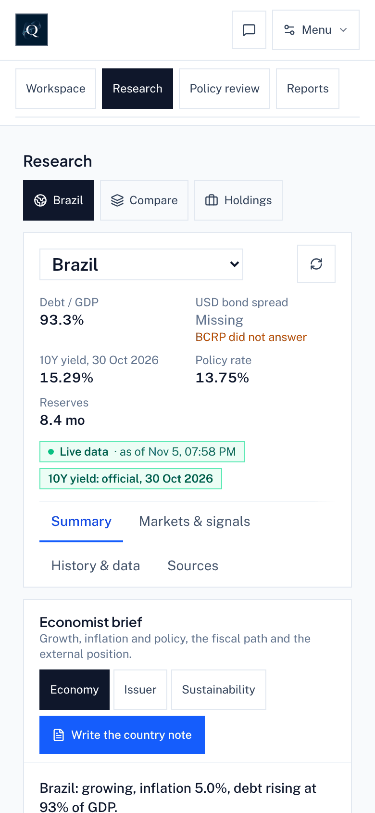

O app funciona na largura de um celular, no navegador. Os painéis se empilham numa coluna e o cabeçalho
mantém os botões das páginas, com botões de ícone para o Chat do conselho, a ajuda, o idioma, claro e
escuro, e o Menu. Para abrir de um celular na mesma rede de casa, o computador que roda o EconQuest
precisa permitir (`HOST="0.0.0.0"` e `ALLOWED_HOSTS` no `.env`; veja [HOME_SERVER.md](./HOME_SERVER.md), e
ligue antes o login por conta).

## 12. Experimentar as Quests

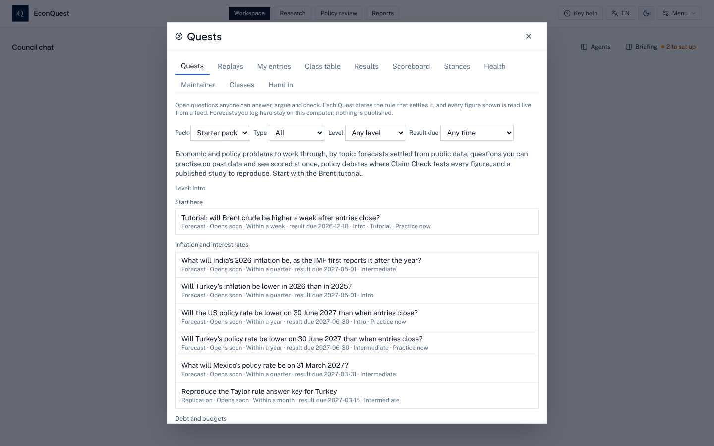

As Quests estão desligadas para todos até que a lista de lançamento em [QUESTS.md](./QUESTS.md) esteja
completa. Para experimentar no seu computador:

1. Abra **Menu > Configurações > Quests e turmas** e escolha *Ativado* para as Quests (sem reiniciar).
   Ou adicione `QUESTS_ENABLED=on` ao arquivo `.env` da sua pasta do EconQuest e reinicie o app.
2. Abra **Menu > Quests**. A janela das Quests está em inglês por enquanto. A lista mostra a pergunta de
   cada Quest, seu tipo (Forecast, Debate, Replication ou Signal), se é rascunho e quando o resultado é
   esperado. Filtre por tipo ou por data.
3. Abra uma Quest para ver sua regra, os números ao vivo com que será resolvida e seus limites conhecidos.
4. **Log privately** guarda sua resposta só neste computador; **Practice** responde a perguntas passadas e
   pontua na hora; **My entries** lista o que você registrou e como pontuou.
5. **Results**, **Scoreboard**, **Stances** e **Health** mostram as Quests resolvidas, as estatísticas dos
   participantes, as perguntas opcionais de posição econômica e se o sistema está funcionando.

Quando as Quests forem públicas, **Enter publicly** vai preparar para você um pull request para o
repositório público. A página Recursos e detalhes explica [como o jogo funciona](./FEATURES.pt.md#quests-soluções-econômicas-construídas-por-muitos).
