# Guia passo a passo

[English](./GUIDE.md) · [Español](./GUIDE.es.md) · [Français](./GUIDE.fr.md) · **Português**

Este guia mostra como usar o EconQuest, tarefa por tarefa, com uma captura de tela para cada passo. Ele
supõe que o app já está instalado e aberto no seu navegador (veja [INSTALL.md](./INSTALL.md), em inglês).
Para cada página e painel em detalhe, veja o [manual do usuário](./USER_MANUAL.md) (em inglês); para
qualquer termo, o glossário dentro do app (Menu > Manual do usuário).

Sobre as capturas: foram feitas em 13 de novembro de 2026 a partir de uma compilação local do branch
principal, reproduzindo respostas gravadas em 5 de novembro de 2026 das fontes cujos termos permitem
repassar os dados, sem nenhum modelo de IA configurado. Por isso muitos números aparecem como **Ausente** e
o conselho não escreve um resumo nelas. No seu computador, com as fontes acessíveis e um modelo de IA
escolhido, mais números são preenchidos e o conselho escreve seu resumo. As capturas estão em inglês,
exceto a da seção 10; os nomes dos botões aparecem aqui como no app em português.

## Conteúdo

1. [A tela num relance](#1-a-tela-num-relance)
2. [Primeiro início: o que configurar](#2-primeiro-início-o-que-configurar)
3. [Fazer uma pergunta ao conselho](#3-fazer-uma-pergunta-ao-conselho)
4. [Estudar um país](#4-estudar-um-país)
5. [Voltar no tempo](#5-voltar-no-tempo)
6. [Comparar países](#6-comparar-países)
7. [Revisar uma política e escrever um relatório](#7-revisar-uma-política-e-escrever-um-relatório)
8. [Escolher um modelo de IA](#8-escolher-um-modelo-de-ia)
9. [Ferramentas, checagem dos dados e o menu](#9-ferramentas-checagem-dos-dados-e-o-menu)
10. [Trocar o idioma e o nível de ajuda](#10-trocar-o-idioma-e-o-nível-de-ajuda)
11. [Usar no celular](#11-usar-no-celular)
12. [Experimentar as Quests](#12-experimentar-as-quests)

---

## 1. A tela num relance

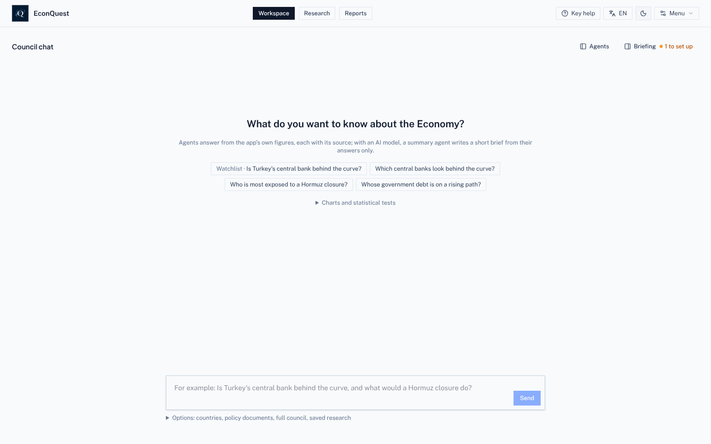

- **Cabeçalho, no centro:** as três páginas. **Área de trabalho** (Chat do conselho), **Pesquisa** (países
  e posições) e **Relatórios**.
- **Cabeçalho, à direita:** **Chat do conselho** (abre o chat ao lado de Pesquisa ou Relatórios), o botão
  do **nível de ajuda** (aqui *Ajuda essencial*), o botão de **idioma** (*PT*), a troca entre claro e
  escuro, e **Menu**.
- **Área de trabalho, no alto à direita:** **Agentes** mostra quais agentes trabalharam na última
  resposta; **Resumo** abre suas entradas, a lista de acompanhamento, o que mudou e o que vem por aí. "1 a
  configurar" conta os passos de configuração que faltam.

## 2. Primeiro início: o que configurar

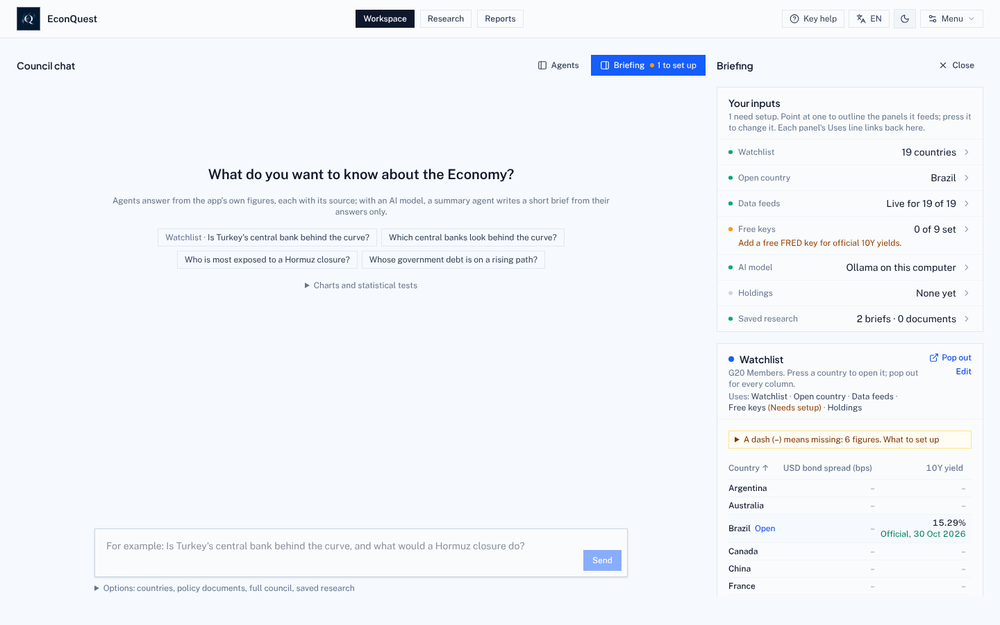

1. Na **Área de trabalho**, clique em **Resumo**.
2. Leia suas entradas. Cada linha diz o que o app está usando: a lista de acompanhamento (19 países do G20
   no início), o país aberto, quantas fontes responderam, quantas chaves gratuitas estão definidas, o
   modelo de IA, suas posições e sua pesquisa salva. Clique numa linha para alterá-la.
3. Adicione primeiro a chave gratuita do **FRED** (Menu > Configurações > Chaves de dados gratuitos). Ela
   preenche os rendimentos oficiais dos títulos públicos de 10 anos de vários países.
4. Clique em **Editar** no cartão da lista de acompanhamento para incluir ou tirar países.
5. Escolha um modelo de IA se quiser resumos escritos ([seção 8](#8-escolher-um-modelo-de-ia)). Todo o
   resto funciona sem ele.

Uma instalação nova mostra traços até terminar o primeiro download de dados, o que pode levar alguns
minutos.

## 3. Fazer uma pergunta ao conselho

1. Na **Área de trabalho**, digite uma pergunta na caixa de baixo ou clique numa pergunta de exemplo. Por
   enquanto os agentes entendem melhor perguntas em inglês, por exemplo "Which central banks look behind
   the curve?".
2. Clique em **Enviar**. O painel **Agentes**, à esquerda, mostra o trabalho:
   - o **Planejador** escolhe os agentes que cobrem a sua pergunta (por regras escritas se não houver
     modelo de IA);
   - os **agentes das mesas** respondem com os números do app. Aqui o agente de Banco Central cobriu 6
     países;
   - o **agente de síntese** escreve um breve resumo que só pode citar os números dos agentes. Sem modelo
     de IA, ele é pulado e diz por quê, como na captura.
3. Abra **Fontes e ações** abaixo da resposta para ver o documento de cada agente, com a fonte e a data de
   cada número, e salvá-lo em Relatórios.
4. Faça uma pergunta de continuação na mesma caixa ou clique numa das sugeridas. Se você não citar nenhum
   país, a pergunta cobre toda a sua lista de acompanhamento.
5. **Opções**, abaixo da caixa, permite escolher países, anexar um documento de política para o agente de
   Documentos ou **executar o conselho completo**: nove agentes em três mesas debatem um país, e o app pede
   a sua aprovação antes do relatório final.

## 4. Estudar um país

Abra **Pesquisa**. O seletor de país fica no alto à esquerda; a faixa ao lado mostra dívida, spread dos
títulos, rendimento de 10 anos, taxa básica e reservas, e as etiquetas verdes dizem quão recentes são os
dados. **Atualizar agora** busca de novo os números daquele país.

### Resumo

1. **Resumo** abre primeiro. O **resumo do economista** traz os pontos principais em linguagem simples,
   cada um com "O que significa" para o dia a dia. *Economia*, *Emissor* e *Sustentabilidade* mudam o
   ângulo.
2. O quadro amarelo diz quantos números estão ausentes e por quê. Clique em **Por que ausente?** ao lado de
   qualquer um para ver o motivo e o que o preencheria.
3. **O que é isto?** abaixo de um número o explica. **Explicar** pergunta ao conselho o que ele significa
   para esse país.
4. **Escrever a nota do país** transforma a página num rascunho de relatório.

### Mercados e sinais

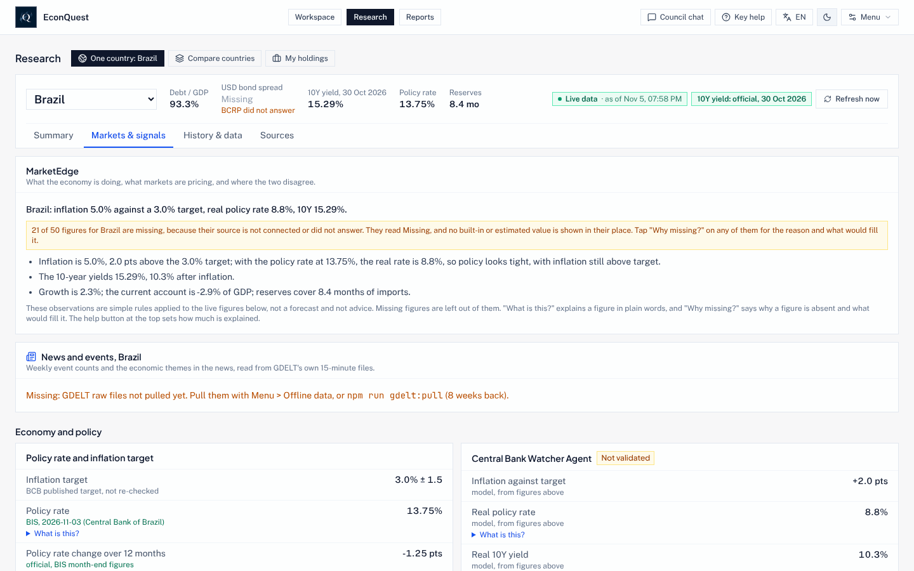

1. Clique em **Mercados e sinais**. O **MarketEdge** compara o que a economia está fazendo com o que os
   mercados precificam, e onde os dois discordam.
2. Cada agente e sinal tem um selo: *Validado*, *Provisório*, *Não validado* e assim por diante. O selo
   diz até onde chegou o teste. A maioria dos sinais ainda não passou num teste, e o selo diz isso.
3. As probabilidades dos mercados de previsão (Kalshi, Polymarket), os spreads dos títulos e o câmbio
   aparecem aqui quando suas fontes respondem.

### Histórico e dados

1. Clique em **Histórico e dados**. Escolha um número em **Números com histórico**, à direita, para ver o
   gráfico.
2. Acima de cada gráfico: o que ele mede, de quem é o número, com que frequência sai, como ler o gráfico e
   o que significa na vida real.
3. Abaixo: **Baixar esta série** (CSV ou Excel), **Baixar todas as séries** do país, **Citar** (texto,
   BibTeX ou RIS), **Sinalizar** (avisar de um problema) e **Publicar gráfico** (PNG ou SVG).
4. Mais abaixo ficam os painéis de análise: estimativas do presente e previsões com faixas de 50, 70 e
   90%, hiato do produto, sustentabilidade da dívida, necessidade bruta de financiamento, adequação das
   reservas, sustentabilidade externa, alerta antecipado de crise, curva de juros, fatores da inflação,
   contabilidade do crescimento, regras de política monetária, "e se" fiscais e um pequeno modelo de hiato
   que você mesmo preenche.
5. Seguem painéis para países de renda mais baixa: **Remessas** (ao lado de exportações, investimento e
   ajuda, e o custo de enviar US$ 200 frente à meta de 3% da ONU), **Inclusão financeira** (quem tem
   conta, por sexo e renda), **Preços de commodities e termos de troca** (o que os últimos movimentos dos
   preços mundiais significam para o país, em % do PIB), **Ajuda recebida**, **Preços dos alimentos e
   segurança alimentar** e **Desastres naturais**. A inflação de alimentos e os desastres são lidos de
   arquivos que você mesmo salva em `data/local/fao-cpi/` e `data/local/emdat/`; até lá essas partes
   mostram Ausente e dizem onde obter o arquivo ([INSTALL.md](./INSTALL.md#files-you-save-yourself), em
   inglês).
6. O **Painel de risco-país** coloca lado a lado a governança, os conflitos armados, a agitação social,
   o risco geopolítico, a abertura da conta de capital (o índice de Chinn e Ito, citado como Chinn e Ito
   2006) e a economia, cada dado com sua fonte e seu ano. Ele não dá uma nota geral. Em 13 de novembro
   de 2026 foi fixado de antemão um teste para saber se uma governança fraca vem antes de um calote;
   enquanto ele não rodar, o selo do painel diz Não validado.

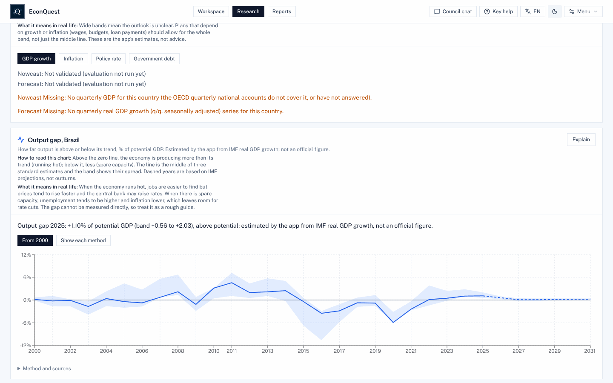

Exemplo: o **hiato do produto** mostra quanto a economia está rodando acima ou abaixo da sua capacidade
normal. A linha é o meio de três estimativas padrão, a faixa é a dispersão delas, e os anos tracejados se
baseiam em projeções do FMI.

### Fontes

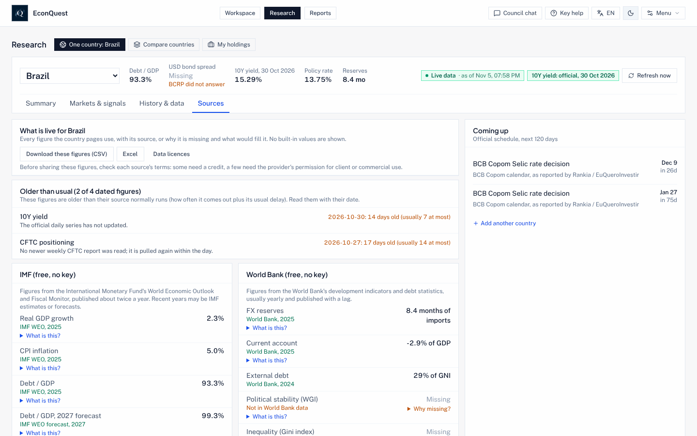

1. Clique em **Fontes**. A aba lista cada número das páginas do país com sua fonte, ou por que está
   ausente, sem nada embutido.
2. **Mais antigos que o normal** aponta os números cuja fonte está atrasada.
3. **Próximos eventos** lista as datas oficiais (decisões de bancos centrais, divulgações de dados) dos
   próximos 120 dias.
4. Você pode baixar a lista inteira em CSV ou Excel; **Licenças dos dados** diz o que cada fonte permite
   compartilhar.

## 5. Voltar no tempo

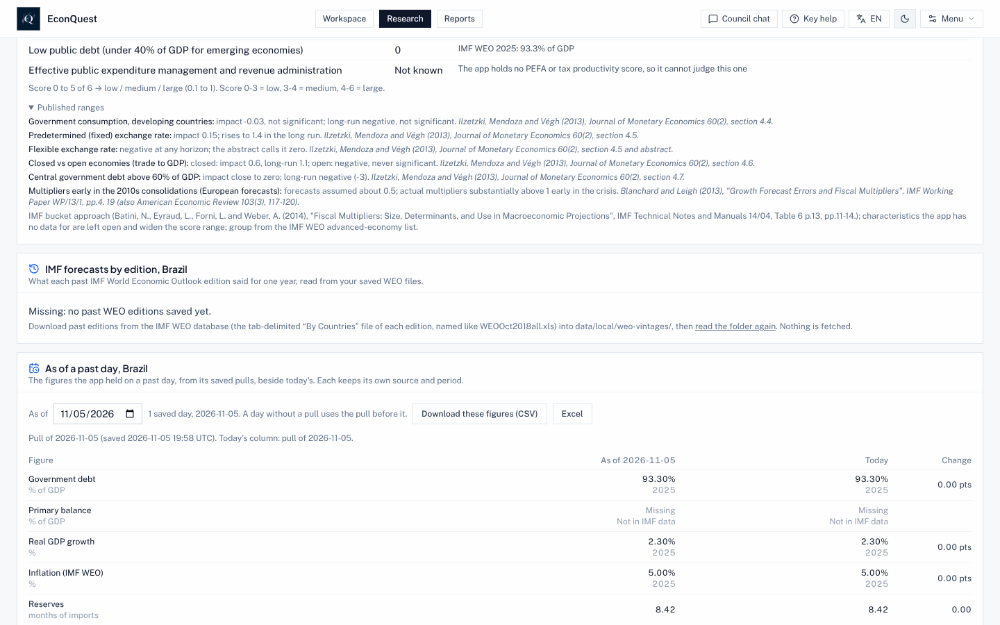

1. Em **Histórico e dados**, desça até **Em um dia passado**.
2. Escolha uma data. A tabela mostra cada número como o app o tinha naquele dia, ao lado do número de hoje
   e da variação. Cada download diário é arquivado, então nada se perde.
3. **Previsões do FMI por edição** (logo acima) mostra como a visão do FMI sobre o país mudou de uma
   edição para outra, depois que as edições passadas forem salvas.

## 6. Comparar países

1. Em **Pesquisa**, clique em **Comparar países**. Sua lista de acompanhamento aparece lado a lado, com as
   mesmas quatro abas de um país.
2. **Pautas** aponta recordes, grandes movimentos e revisões nos números oficiais.
3. **Onde dados e preços discordam** ordena os países em que mercados e dados apontam para lados
   diferentes, com os números que sustentam isso.
4. Clique no nome de um país para abri-lo sozinho.

**Minhas posições**, a terceira visão, faz o mesmo com uma lista de títulos ou posições que você carrega de
um arquivo CSV.

## 7. Revisar uma política e escrever um relatório

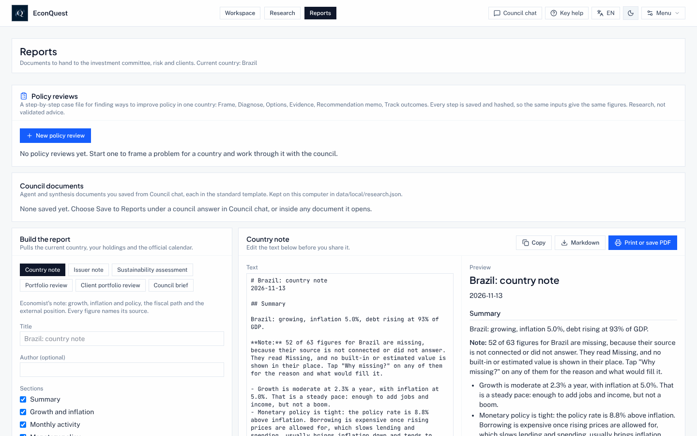

**Relatórios** reúne as revisões de política, os documentos salvos do Chat do conselho e o montador de
relatórios.

Para escrever um relatório:

1. Escolha um tipo: Nota do país, Nota do emissor, Avaliação de sustentabilidade, Revisão da carteira,
   Revisão da carteira do cliente ou Resumo do conselho.
2. Marque as seções que quiser. O rascunho se atualiza e a prévia mostra o resultado.
3. Edite o texto e depois **Copiar**, baixe em **Markdown** ou **Imprimir ou salvar PDF**. Cada número leva
   sua fonte e data.

Para revisar uma política:

1. Clique em **Nova revisão de política**.
2. Escolha o país e a data de referência (cada passo seguinte lê os dados como estavam naquele dia).
3. Descreva o problema em uma ou duas frases, por exemplo "A inflação está bem acima da meta enquanto o
   crescimento desacelera e a dívida sobe".
4. Escolha o indicador que deve melhorar, a direção e, se quiser, uma meta e uma data. Liste as
   restrições, uma por linha (câmbio fixo, pouco espaço fiscal, uma eleição), e para quem é a revisão.
5. Clique em **Iniciar revisão**. Os passos seguem: enquadramento, diagnóstico, opções (ordenadas pelo
   modelo árbitro), evidências e precedentes (os anos-país passados mais parecidos e o que veio depois),
   uma checagem comportamental, regras fiscais e viabilidade política, o memorando de recomendação, um
   **resumo de uma página** em PDF para quem não é economista, e o acompanhamento dos resultados, que
   compara a revisão com o que aconteceu em 12 e 24 meses. Cada passo é salvo com sua impressão digital.

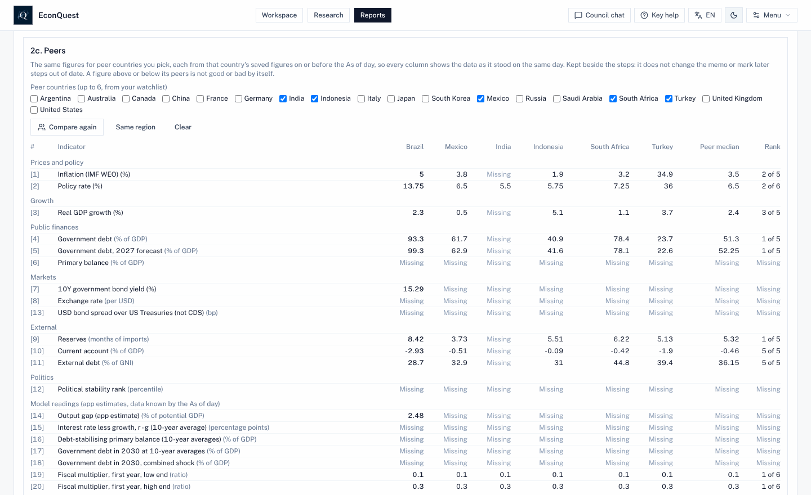

6. Depois do diagnóstico, **Pares** coloca os números do diagnóstico ao lado de até seis países da sua
   lista de acompanhamento (ou clique em **Mesma região**, depois em **Comparar**), cada um como estava
   salvo na data da revisão ou antes, com a mediana dos pares e a posição deste país.
7. No memorando, dê a um número acompanhado um gatilho que o app saiba ler, como "acima de 8", "abaixo
   de 3", "meta 4", "sobe" ou "cai". **Acompanhamento das revisões de políticas**, abaixo dos alertas de
   acompanhamento no Briefing do espaço de trabalho, mostra cada um como cruzado ou não cruzado frente
   aos últimos números salvos; **Abrir revisão** volta para a revisão.
8. Na data da revisão, **Revisar novamente** inicia uma nova revisão com o mesmo enquadramento e os
   dados de hoje. A nova revisão abre **O que mudou desde a revisão anterior**: o enquadramento, a opção
   recomendada por cada memorando, cada número antes e agora, e se o indicador-alvo andou na direção
   certa.

## 8. Escolher um modelo de IA

1. Abra **Menu > Configurações > Modelo de IA** (ou ⌘, no Mac, Ctrl+, nos outros).
2. Escolha um provedor:
   - **Ollama no seu computador**: gratuito e privado; o Ollama precisa estar rodando com os modelos
     baixados;
   - **Google Gemini**: precisa da sua própria chave do Gemini; as perguntas são enviadas ao Google;
   - **Ollama, depois Gemini**: Ollama primeiro, Gemini quando o Ollama não responde.
3. Para o Ollama, diga **onde o Ollama roda** e clique em **Encontrar o Ollama** para escolher entre os
   seus modelos.
4. Defina o **modelo rápido** (escolha dos agentes e respostas das mesas; `qwen2.5:7b` por padrão) e o
   **modelo árbitro** (resumos, explicações, debate e opções de política; `qwen2.5:32b` por padrão). Use
   seu maior modelo como árbitro.
5. Deixe **Permitir um árbitro de 14B** desligado, a não ser que seu computador não aguente o de 32B.
   Ligado, toda resposta julgada por um árbitro de 14B diz "Árbitro pequeno". Um modelo de 8B ou menos
   nunca é um bom árbitro.
6. Clique em **Testar o modelo**. Ele envia uma pergunta curta do jeito que o Chat do conselho faz.

Qual modelo serve para qual computador, e os ajustes que o app usa, estão no README:
[Modelos de IA](../README.pt.md#modelos-de-ia-qual-usar-tamanhos-e-ajustes).

## 9. Ferramentas, checagem dos dados e o menu

O **Menu** reúne tudo o que não é uma página. O que vale conhecer primeiro:

- **Ferramentas**: todas as ferramentas agrupadas pelo que você quer fazer, e **Conexões de dados**.
- **Dados offline**: baixe os dados de todos os países para usar sem internet e veja quanto espaço ocupam.
- **Saúde dos dados**: quais fontes chegam, quais falham e quais números foram revisados.
- **Modelos e validação**: o registro de modelos, os resultados dos testes e **Seus testes**.
- **Seus dados**: carregue suas próprias séries a partir de um arquivo CSV.
- **Modo prova**: desliga todos os passos de IA para uma prova.
- **Exemplos resolvidos**: quatro casos, de uma pergunta a um memorando.
- **Quests**: em cinza, "Ainda não disponível" ([seção 12](#12-experimentar-as-quests)).

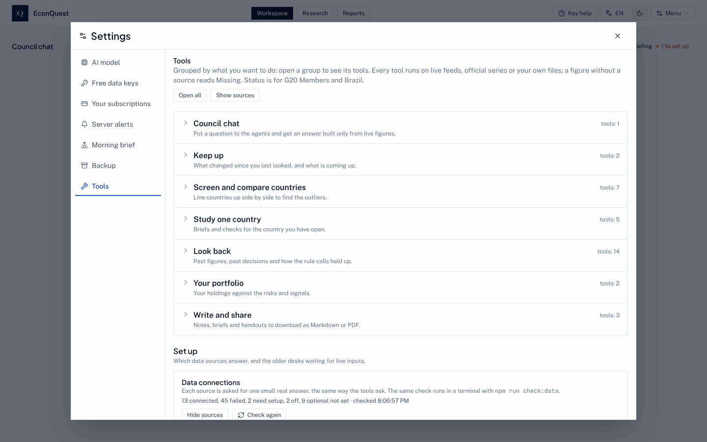

Para ver quais fontes respondem:

1. Abra **Menu > Ferramentas**.
2. Desça até **Conexões de dados** e clique em **Mostrar fontes**, ou em **Verificar novamente** para
   consultar todas as fontes agora. Cada fonte aparece como conectada (com um número que retornou),
   precisando de configuração, desligada, ou com o motivo da falha.
3. A mesma checagem roda num terminal com `npm run check:data`.

### Deixar outro programa usar o EconQuest

Se você usa uma ferramenta de carteira ou outro programa que precisa ler os números do EconQuest, pode
dar acesso a ele sem compartilhar sua senha.

1. Abra **Menu > Configurações > Tokens de API**.
2. Dê um nome ao token (por exemplo "Console de carteira") e marque só o que ele pode fazer: ler
   números e séries, ler as rodadas do conselho, receber eventos e definir alertas, enviar posições,
   definir nomes ocultos ou rodar cenários em uma carteira.
3. Clique em **Criar token** e copie na hora: ele aparece só uma vez, e o app guarda apenas uma impressão digital
   dele. Cada uso fica no registro de auditoria; **Revogar** para o token na hora.
4. As posições que o outro programa enviar aparecem em **Pesquisa > Minhas posições**, marcadas
   "Enviada por" e o nome do token.

Para que um país ou um título não apareça em nenhuma tela, resposta ou evento, inclua-o em **Menu >
Configurações > Nomes ocultos** (pelo código ISO do país, ticker ou seu próprio identificador). As
telas passam a mostrar só quantos itens estão ocultos, e o app guarda uma impressão digital de cada
nome, não o nome.

Em um servidor compartilhado por várias pessoas, um administrador pode deixar que elas entrem com uma
conta que já têm no Google, Microsoft, Okta, Keycloak ou outro provedor OpenID Connect; a página de
login mostra então **Entrar com** e o nome do provedor ([SECURITY.md](./SECURITY.md), em inglês). O que
um programador precisa para conectar está em [DATA_API.md](./DATA_API.md) e
[DEPLOYMENT.md](./DEPLOYMENT.md) (em inglês).

## 10. Trocar o idioma e o nível de ajuda

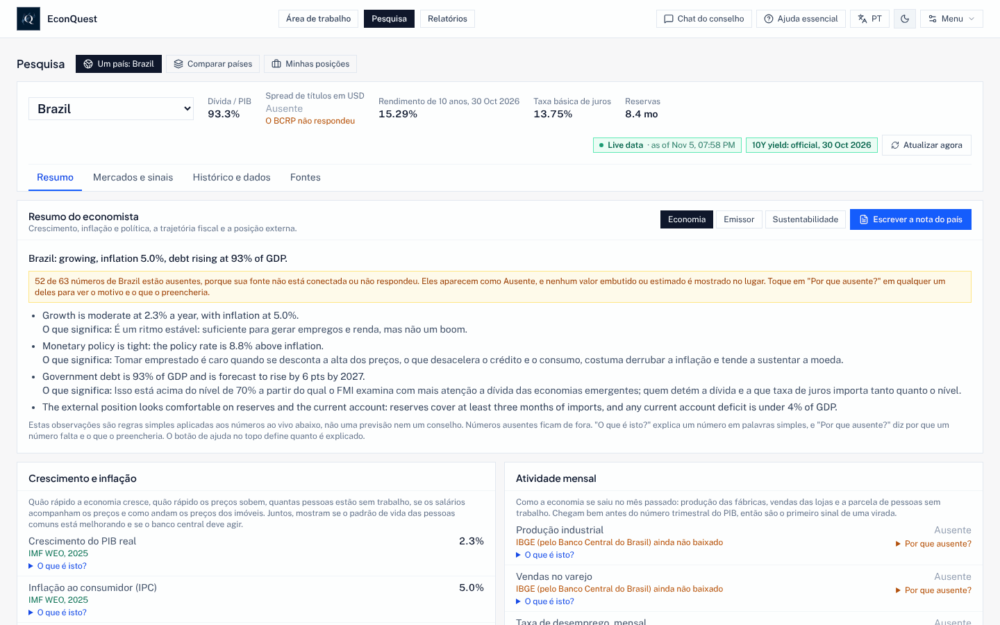

1. Clique no botão de **idioma** do cabeçalho. Cada clique passa para o próximo: English, Español,
   Français, Português. A escolha fica salva neste navegador.
2. Clique no botão de **ajuda** ao lado para alternar entre:
   - **Ajuda essencial** (padrão): como ler cada gráfico, o que significa na vida real e *O que é isto?*
     nos números principais;
   - **Ajuda completa**: *O que é isto?* em todo número e termo, e por que cada número ausente está
     ausente;
   - **Ajuda desativada**: só números, fontes e observações, sem faixas de previsão;
   - **Especialista**: números, fontes e faixas de previsão, sem explicações em linguagem simples.

Números e nomes de fontes e séries ficam como a fonte os escreve. Algumas frases que o app escreve sobre um
país ainda estão em inglês, como mostra a captura; os agentes do conselho trabalham em inglês.

## 11. Usar no celular

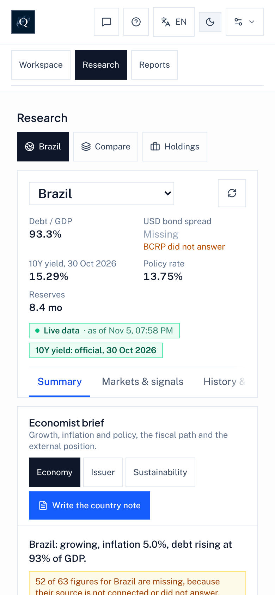

O app funciona na largura de um celular, no navegador. Os painéis se empilham numa coluna e o cabeçalho
mantém os botões das páginas, com botões de ícone para o Chat do conselho, a ajuda, o idioma, claro e
escuro, e o Menu. Para abrir de um celular na mesma rede de casa, o computador que roda o EconQuest
precisa permitir (`HOST="0.0.0.0"` e `ALLOWED_HOSTS` no `.env`; veja [HOME_SERVER.md](./HOME_SERVER.md), e
ligue antes o login por conta).

## 12. Experimentar as Quests

As Quests estão desligadas para todos até que a lista de lançamento em [QUESTS.md](./QUESTS.md) esteja
completa. Para experimentar no seu computador:

1. Adicione `QUESTS_ENABLED=on` ao arquivo `.env` da sua pasta do EconQuest e reinicie o app.
2. Abra **Menu > Quests**. A janela das Quests está em inglês por enquanto. A lista mostra a pergunta de
   cada Quest, seu tipo (Forecast, Debate, Replication ou Signal), se é rascunho e quando o resultado é
   esperado. Filtre por tipo ou por data.
3. Abra uma Quest para ver sua regra, os números ao vivo com que será resolvida e seus limites conhecidos.
4. **Log privately** guarda sua resposta só neste computador; **Practice** responde a perguntas passadas e
   pontua na hora; **My entries** lista o que você registrou e como pontuou.
5. **Results**, **Scoreboard**, **Stances** e **Health** mostram as Quests resolvidas, as estatísticas dos
   participantes, as perguntas opcionais de posição econômica e se o sistema está funcionando.

Quando as Quests forem públicas, **Enter publicly** vai preparar para você um pull request para o
repositório público. O README explica [como o jogo funciona](../README.pt.md#quests-soluções-econômicas-construídas-por-muitos).
